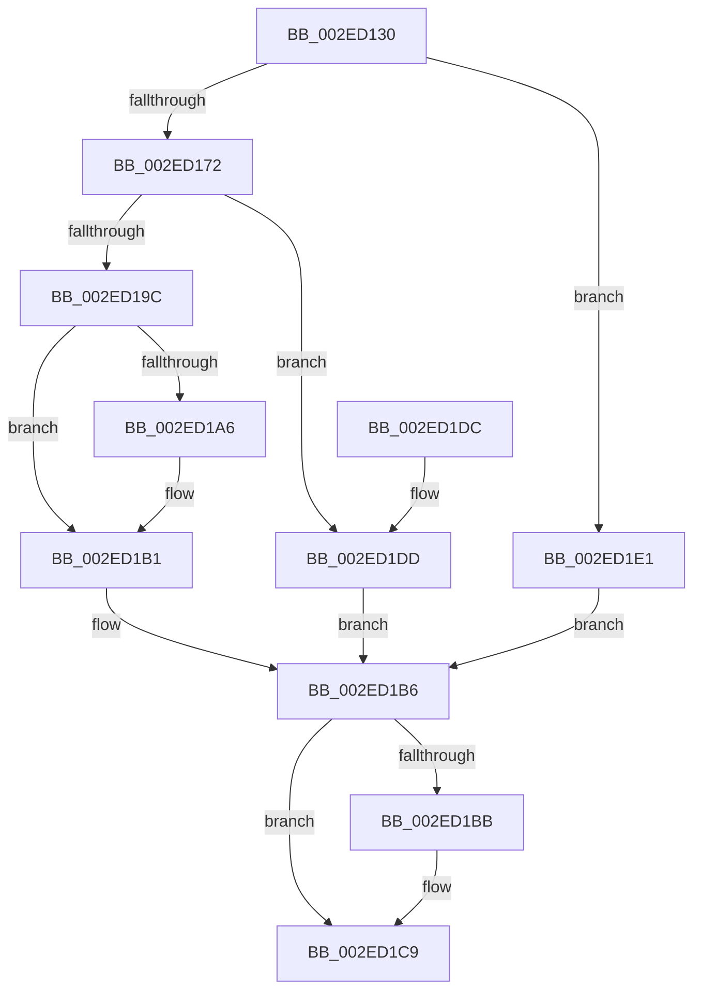

# RtlpHpSegMgrAllocate

- RVA: `0x002ED130`–`0x002ED1EA` (길이 `186` bytes)
- VA: `0x00000001402ED130`
- 실행 섹션: `.text`
- PDB 이름 있음: `예`; PDB Function 태그: `아니요`
- unwind 정보 RVA: `0x0007185C`
- 디코드: `56`개 명령, `186/186` bytes 표시
- 미해석 바이트: `0` (있으면 어셈블리에 `.byte`로 보존)

> 이 문서는 커널 이미지의 기계어와 PDB 기호를 분석해 생성했습니다. 4번과 5번은 함수 원형과 자료형을 바이너리 사용 방식에서 추정한 C 해석이며 원본 소스 복구 결과는 아닙니다.

## 1. Dependencies

- 직접 호출 지점: **4**; 고유 호출 대상: **4**
- 직접 호출자로 확인된 함수: **1**
- RIP 상대 이미지 참조: **0**

### Outgoing calls
- `0x002ED169` → [RtlpHpSegMgrReserve](RtlpHpSegMgrReserve_function_002ED1F0.md) (function, `0x002ED1F0`)
- `0x002ED193` → [RtlpHpSegMgrCommit](../32/RtlpHpSegMgrCommit_function_00326BE4.md) (function, `0x00326BE4`)
- `0x002ED1AC` → [RtlpHpSegMgrVaCtxInsert](RtlpHpSegMgrVaCtxInsert_function_002ED470.md) (function, `0x002ED470`)
- `0x002ED1C4` → [RtlpHpSegMgrRelease](RtlpHpSegMgrRelease_function_002E37FC.md) (function, `0x002E37FC`)

### Direct callers
- [RtlpHpSegSegmentAllocate](../32/RtlpHpSegSegmentAllocate_function_00326A78.md) at `0x00326A9F`

### Static image references
- 디코드된 RIP-relative 메모리 참조가 없습니다.

## 2. Other-region calls and transfers

- 다른 실행 섹션으로 향하는 call: **0**
- 별도 외부 분기/꼬리 이동을 확인하지 못했습니다.

## 3. Assembly (complete function range)

```asm
002ED130  4C 8B DC                        mov r11, rsp
002ED133  49 89 5B 08                     mov qword ptr [r11 + 8], rbx
002ED137  49 89 73 10                     mov qword ptr [r11 + 0x10], rsi
002ED13B  57                              push rdi
002ED13C  48 83 EC 50                     sub rsp, 0x50
002ED140  83 64 24 40 00                  and dword ptr [rsp + 0x40], 0
002ED145  49 8D 43 20                     lea rax, [r11 + 0x20]
002ED149  83 64 24 78 00                  and dword ptr [rsp + 0x78], 0
002ED14E  4D 8D 4B E8                     lea r9, [r11 - 0x18]
002ED152  49 83 63 F0 00                  and qword ptr [r11 - 0x10], 0
002ED157  41 8B F8                        mov edi, r8d
002ED15A  8B DA                           mov ebx, edx
002ED15C  49 89 43 C8                     mov qword ptr [r11 - 0x38], rax
002ED160  8B D7                           mov edx, edi
002ED162  4D 8D 43 F0                     lea r8, [r11 - 0x10]
002ED166  48 8B F1                        mov rsi, rcx
002ED169  E8 82 00 00 00                  call 0x1402ed1f0
002ED16E  85 C0                           test eax, eax
002ED170  78 6F                           js 0x1402ed1e1
002ED172  89 7C 24 30                     mov dword ptr [rsp + 0x30], edi
002ED176  44 8B CB                        mov r9d, ebx
002ED179  C7 44 24 28 00 10 00 40         mov dword ptr [rsp + 0x28], 0x40001000
002ED181  45 33 C0                        xor r8d, r8d
002ED184  89 5C 24 20                     mov dword ptr [rsp + 0x20], ebx
002ED188  48 8B CE                        mov rcx, rsi
002ED18B  48 8B 5C 24 48                  mov rbx, qword ptr [rsp + 0x48]
002ED190  48 8B D3                        mov rdx, rbx
002ED193  E8 4C 9A 03 00                  call 0x140326be4
002ED198  85 C0                           test eax, eax
002ED19A  78 41                           js 0x1402ed1dd
002ED19C  8B 44 24 78                     mov eax, dword ptr [rsp + 0x78]
002ED1A0  39 44 24 40                     cmp dword ptr [rsp + 0x40], eax
002ED1A4  73 0B                           jae 0x1402ed1b1
002ED1A6  48 8B D3                        mov rdx, rbx
002ED1A9  48 8B CE                        mov rcx, rsi
002ED1AC  E8 BF 02 00 00                  call 0x1402ed470
002ED1B1  48 8B FB                        mov rdi, rbx
002ED1B4  33 DB                           xor ebx, ebx
002ED1B6  48 85 DB                        test rbx, rbx
002ED1B9  74 0E                           je 0x1402ed1c9
002ED1BB  45 33 C0                        xor r8d, r8d
002ED1BE  48 8B D3                        mov rdx, rbx
002ED1C1  48 8B CE                        mov rcx, rsi
002ED1C4  E8 33 66 FF FF                  call 0x1402e37fc
002ED1C9  48 8B 5C 24 60                  mov rbx, qword ptr [rsp + 0x60]
002ED1CE  48 8B C7                        mov rax, rdi
002ED1D1  48 8B 74 24 68                  mov rsi, qword ptr [rsp + 0x68]
002ED1D6  48 83 C4 50                     add rsp, 0x50
002ED1DA  5F                              pop rdi
002ED1DB  C3                              ret
002ED1DC  CC                              int3
002ED1DD  33 FF                           xor edi, edi
002ED1DF  EB D5                           jmp 0x1402ed1b6
002ED1E1  48 8B 5C 24 48                  mov rbx, qword ptr [rsp + 0x48]
002ED1E6  33 FF                           xor edi, edi
002ED1E8  EB CC                           jmp 0x1402ed1b6
```

## 4. C-style interpretation (structured pseudocode)

```c
__int64 __fastcall RtlpHpSegMgrAllocate(__int64 a1, int a2, int a3)
{
    __int64 result;
    __int64 v_rbx;
    __int64 v_rdi;
    __int64 v_rsp;
    unsigned __int64 v_stack_m10;
    unsigned int v_stack_m18;
    unsigned int v_stack_m28;
    unsigned int v_stack_m30;
    unsigned int v_stack_m38;
    unsigned __int64 v_stack_p10;
    unsigned int v_stack_p20;
    unsigned __int64 v_stack_p48;
    unsigned __int64 v_stack_p8;

    *(unsigned __int64 *)(v_rsp + 8) = v_rbx;
    *(unsigned __int64 *)(v_rsp + 16) = v_rsi;
    v_rsp = (v_rsp) - (80);
    *(unsigned __int64 *)(v_rsp - 56) = v_rsp + 32;
    result = RtlpHpSegMgrReserve(a1, (unsigned int)((unsigned int)((unsigned int)(a3))), v_rsp - 16, v_rsp - 24);
    if (sign_flag) goto loc_002ED1E1;
    v_stack_m28 = (unsigned int)((unsigned int)(a3));
    v_stack_m30 = 0x40001000ULL;
    a3 = 0;
    v_stack_m38 = (unsigned int)((unsigned int)(a2));
    result = RtlpHpSegMgrCommit(a1, v_stack_m10, a3, (unsigned int)((unsigned int)((unsigned int)(a2))));
    if (sign_flag) goto loc_002ED1DD;
    result = (unsigned int)(v_stack_p20);
    if (v_stack_m18 < ((unsigned int)((unsigned int)(v_stack_p20)))) {
        a2 = v_stack_m10;
        a1 = a1;
        result = RtlpHpSegMgrVaCtxInsert(a1, a2, a3, (unsigned int)((unsigned int)((unsigned int)(a2))));
    }
    v_rbx = 0;
loc_002ED1B6:
    if (0 != 0) {
        a3 = 0;
        a2 = 0;
        a1 = a1;
        result = RtlpHpSegMgrRelease(a1, a2, a3, (unsigned int)((unsigned int)((unsigned int)(a2))));
    }
    v_rsp = (v_rsp) + (80);
    return v_stack_m10;
loc_002ED1DD:
    v_rdi = 0;
    goto loc_002ED1B6;
loc_002ED1E1:
    v_rdi = 0;
    goto loc_002ED1B6;
}
```

## 5. (Beta) C Style

```c
int64_t RtlpHpSegMgrAllocate(int64_t Arg1, int32_t Arg2, int32_t Arg3)
{
    int64_t result;
    int64_t local_rbx;
    int64_t local_rdi;
    int64_t local_rsp;
    uint64_t v_stack_m10;
    uint32_t v_stack_m18;
    uint32_t v_stack_m28;
    uint32_t v_stack_m30;
    uint32_t v_stack_m38;
    uint64_t v_stack_p10;
    uint32_t v_stack_p20;
    uint64_t v_stack_p48;
    uint64_t v_stack_p8;

    *(uint64_t *)(local_rsp + 0x8) = local_rbx;
    *(uint64_t *)(local_rsp + 0x10) = local_rsi;
    local_rsp = (local_rsp) - (80);
    *(uint64_t *)(local_rsp - 0x38) = local_rsp + 32;
    result = RtlpHpSegMgrReserve(Arg1, (uint32_t)((uint32_t)((uint32_t)(Arg3))), local_rsp - 16, local_rsp - 24);
    if (sign_flag) goto loc_002ED1E1;
    v_stack_m28 = (uint32_t)((uint32_t)(Arg3));
    v_stack_m30 = 0x40001000ULL;
    Arg3 = 0;
    v_stack_m38 = (uint32_t)((uint32_t)(Arg2));
    result = RtlpHpSegMgrCommit(Arg1, v_stack_m10, Arg3, (uint32_t)((uint32_t)((uint32_t)(Arg2))));
    if (sign_flag) goto loc_002ED1DD;
    result = (uint32_t)(v_stack_p20);
    if (v_stack_m18 < ((uint32_t)((uint32_t)(v_stack_p20)))) {
        Arg2 = v_stack_m10;
        Arg1 = Arg1;
        result = RtlpHpSegMgrVaCtxInsert(Arg1, Arg2, Arg3, (uint32_t)((uint32_t)((uint32_t)(Arg2))));
    }
    local_rbx = 0;
loc_002ED1B6:
    if (0 != 0) {
        Arg3 = 0;
        Arg2 = 0;
        Arg1 = Arg1;
        result = RtlpHpSegMgrRelease(Arg1, Arg2, Arg3, (uint32_t)((uint32_t)((uint32_t)(Arg2))));
    }
    local_rsp = (local_rsp) + (80);
    return v_stack_m10;
loc_002ED1DD:
    local_rdi = 0;
    goto loc_002ED1B6;
loc_002ED1E1:
    local_rdi = 0;
    goto loc_002ED1B6;
}
```

## 6. Execution-region graph

[열기: 2D/3D 그래프와 함수 탐색 컨트롤 패널](../../../control-panel.html?section=text&rva=0x002ED130&view=graph)

- 2D 그래프는 위에서 아래로 흐르고, 3D 그래프는 빈 공간을 드래그해 회전합니다. Shift+드래그는 이동, 휠은 확대·축소, 함수 노드 선택은 대상 보고서 이동입니다.

### Static fallback


