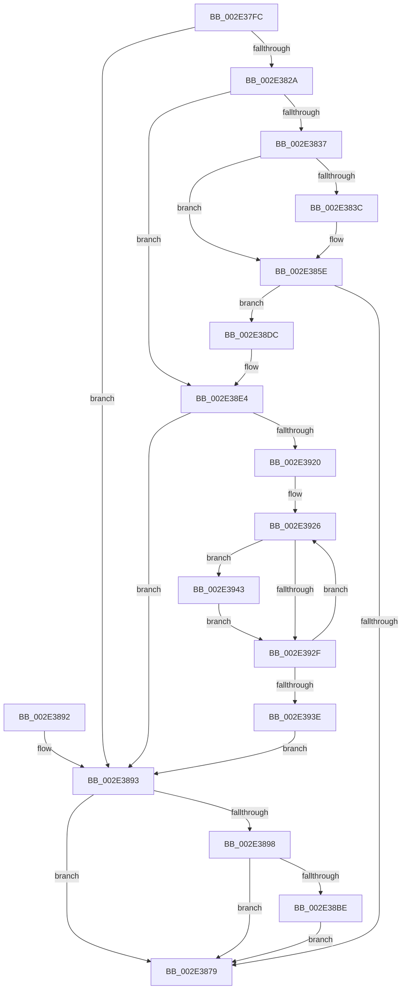

# RtlpHpSegMgrRelease

- RVA: `0x002E37FC`–`0x002E396F` (길이 `371` bytes)
- VA: `0x00000001402E37FC`
- 실행 섹션: `.text`
- PDB 이름 있음: `예`; PDB Function 태그: `아니요`
- unwind 정보 RVA: `0x00070EC4`
- 디코드: `97`개 명령, `371/371` bytes 표시
- 미해석 바이트: `0` (있으면 어셈블리에 `.byte`로 보존)

> 이 문서는 커널 이미지의 기계어와 PDB 기호를 분석해 생성했습니다. 4번과 5번은 함수 원형과 자료형을 바이너리 사용 방식에서 추정한 C 해석이며 원본 소스 복구 결과는 아닙니다.

## 1. Dependencies

- 직접 호출 지점: **5**; 고유 호출 대상: **4**
- 직접 호출자로 확인된 함수: **3**
- RIP 상대 이미지 참조: **1**

### Outgoing calls
- `0x002E3859` → [RtlpHpSegMgrCommit](../32/RtlpHpSegMgrCommit_function_00326BE4.md) (function, `0x00326BE4`)
- `0x002E386C` → [RtlpHpSegMgrVaCtxFree](RtlpHpSegMgrVaCtxFree_function_002ED570.md) (function, `0x002ED570`)
- `0x002E38D5` → [RtlpHpVaMgrCtxFree](RtlpHpVaMgrCtxFree_function_002ED734.md) (function, `0x002ED734`)
- `0x002E3900` → [RtlpHpVaMgrCtxQuery](../32/RtlpHpVaMgrCtxQuery_function_003273C0.md) (function, `0x003273C0`)
- `0x002E3968` → [RtlpHpSegMgrCommit](../32/RtlpHpSegMgrCommit_function_00326BE4.md) (function, `0x00326BE4`)

### Direct callers
- [sub_002E3191](Unknown_function_002E3191.md) at `0x002E3317`
- [RtlpHpSegMgrAllocate](RtlpHpSegMgrAllocate_function_002ED130.md) at `0x002ED1C4`
- [RtlpHpSegSegmentFree](../47/RtlpHpSegSegmentFree_function_00471328.md) at `0x00471398`

### Static image references
- `0x002E38CE` → RVA `0x00E68658` (`.data`; read)

## 2. Other-region calls and transfers

- 다른 실행 섹션으로 향하는 call: **0**
- 별도 외부 분기/꼬리 이동을 확인하지 못했습니다.

## 3. Assembly (complete function range)

```asm
002E37FC  4C 8B DC                        mov r11, rsp
002E37FF  49 89 5B 18                     mov qword ptr [r11 + 0x18], rbx
002E3803  49 89 6B 20                     mov qword ptr [r11 + 0x20], rbp
002E3807  56                              push rsi
002E3808  57                              push rdi
002E3809  41 55                           push r13
002E380B  41 56                           push r14
002E380D  41 57                           push r15
002E380F  48 83 EC 60                     sub rsp, 0x60
002E3813  8B 39                           mov edi, dword ptr [rcx]
002E3815  48 8B DA                        mov rbx, rdx
002E3818  8A 41 0D                        mov al, byte ptr [rcx + 0xd]
002E381B  F7 DF                           neg edi
002E381D  24 07                           and al, 7
002E381F  49 89 7B 08                     mov qword ptr [r11 + 8], rdi
002E3823  4C 8B F1                        mov r14, rcx
002E3826  3C 01                           cmp al, 1
002E3828  72 69                           jb 0x1402e3893
002E382A  48 81 FF 00 00 20 00            cmp rdi, 0x200000
002E3831  0F 83 AD 00 00 00               jae 0x1402e38e4
002E3837  45 85 C0                        test r8d, r8d
002E383A  7E 22                           jle 0x1402e385e
002E383C  83 64 24 30 00                  and dword ptr [rsp + 0x30], 0
002E3841  41 F7 D8                        neg r8d
002E3844  C1 EF 0C                        shr edi, 0xc
002E3847  C7 44 24 28 00 40 00 00         mov dword ptr [rsp + 0x28], 0x4000
002E384F  44 8B CF                        mov r9d, edi
002E3852  45 89 43 98                     mov dword ptr [r11 - 0x68], r8d
002E3856  45 33 C0                        xor r8d, r8d
002E3859  E8 86 33 04 00                  call 0x140326be4
002E385E  4C 8D 84 24 90 00 00 00         lea r8, [rsp + 0x90]
002E3866  48 8B D3                        mov rdx, rbx
002E3869  49 8B CE                        mov rcx, r14
002E386C  E8 FF 9C 00 00                  call 0x1402ed570
002E3871  48 8B D8                        mov rbx, rax
002E3874  48 85 C0                        test rax, rax
002E3877  75 63                           jne 0x1402e38dc
002E3879  4C 8D 5C 24 60                  lea r11, [rsp + 0x60]
002E387E  49 8B 5B 40                     mov rbx, qword ptr [r11 + 0x40]
002E3882  49 8B 6B 48                     mov rbp, qword ptr [r11 + 0x48]
002E3886  49 8B E3                        mov rsp, r11
002E3889  41 5F                           pop r15
002E388B  41 5E                           pop r14
002E388D  41 5D                           pop r13
002E388F  5F                              pop rdi
002E3890  5E                              pop rsi
002E3891  C3                              ret
002E3892  CC                              int3
002E3893  48 85 DB                        test rbx, rbx
002E3896  74 E1                           je 0x1402e3879
002E3898  48 8D 83 FF FF 0F 00            lea rax, [rbx + 0xfffff]
002E389F  48 25 00 00 F0 FF               and rax, 0xfffffffffff00000
002E38A5  48 8D 14 3B                     lea rdx, [rbx + rdi]
002E38A9  48 2B D0                        sub rdx, rax
002E38AC  48 89 84 24 98 00 00 00         mov qword ptr [rsp + 0x98], rax
002E38B4  48 89 94 24 90 00 00 00         mov qword ptr [rsp + 0x90], rdx
002E38BC  74 BB                           je 0x1402e3879
002E38BE  4C 8D 84 24 90 00 00 00         lea r8, [rsp + 0x90]
002E38C6  48 8D 94 24 98 00 00 00         lea rdx, [rsp + 0x98]
002E38CE  48 8D 0D 83 4D B8 00            lea rcx, [rip + 0xb84d83]
002E38D5  E8 5A 9E 00 00                  call 0x1402ed734
002E38DA  EB 9D                           jmp 0x1402e3879
002E38DC  48 8B BC 24 90 00 00 00         mov rdi, qword ptr [rsp + 0x90]
002E38E4  0F 57 C0                        xorps xmm0, xmm0
002E38E7  4C 8D 44 24 40                  lea r8, [rsp + 0x40]
002E38EC  48 8B D3                        mov rdx, rbx
002E38EF  48 8D 0D 62 4D B8 00            lea rcx, [rip + 0xb84d62]
002E38F6  0F 11 44 24 40                  movups xmmword ptr [rsp + 0x40], xmm0
002E38FB  0F 11 44 24 50                  movups xmmword ptr [rsp + 0x50], xmm0
002E3900  E8 BB 3A 04 00                  call 0x1403273c0
002E3905  48 8B 74 24 50                  mov rsi, qword ptr [rsp + 0x50]
002E390A  48 8B C7                        mov rax, rdi
002E390D  48 C1 E8 15                     shr rax, 0x15
002E3911  33 ED                           xor ebp, ebp
002E3913  4C 8D 3C 46                     lea r15, [rsi + rax*2]
002E3917  49 3B F7                        cmp rsi, r15
002E391A  0F 83 73 FF FF FF               jae 0x1402e3893
002E3920  41 BD FF 07 00 00               mov r13d, 0x7ff
002E3926  0F B7 06                        movzx eax, word ptr [rsi]
002E3929  66 41 85 C5                     test r13w, ax
002E392D  75 14                           jne 0x1402e3943
002E392F  48 83 C6 02                     add rsi, 2
002E3933  81 C5 00 02 00 00               add ebp, 0x200
002E3939  49 3B F7                        cmp rsi, r15
002E393C  72 E8                           jb 0x1402e3926
002E393E  E9 50 FF FF FF                  jmp 0x1402e3893
002E3943  83 64 24 30 00                  and dword ptr [rsp + 0x30], 0
002E3948  41 23 C5                        and eax, r13d
002E394B  F7 D8                           neg eax
002E394D  C7 44 24 28 00 40 00 00         mov dword ptr [rsp + 0x28], 0x4000
002E3955  41 B9 00 02 00 00               mov r9d, 0x200
002E395B  89 44 24 20                     mov dword ptr [rsp + 0x20], eax
002E395F  44 8B C5                        mov r8d, ebp
002E3962  48 8B D3                        mov rdx, rbx
002E3965  49 8B CE                        mov rcx, r14
002E3968  E8 77 32 04 00                  call 0x140326be4
002E396D  EB C0                           jmp 0x1402e392f
```

## 4. C-style interpretation (structured pseudocode)

```c
__int64 __fastcall RtlpHpSegMgrRelease(__int64 a1, __int64 a2, int a3)
{
    __int64 result;
    __int64 v_rbp;
    __int64 v_rdi;
    __int64 v_rsi;
    __int64 v_rsp;
    unsigned __int64 v_stack_m10;
    unsigned __int64 v_stack_m20;
    unsigned __int64 v_stack_m28;
    unsigned int v_stack_m30;
    unsigned int v_stack_m38;
    unsigned int v_stack_m40;
    unsigned int v_stack_m58;
    unsigned int v_stack_m60;
    unsigned __int64 v_stack_p30;
    unsigned __int64 v_stack_p38;
    unsigned __int64 v_stack_p8;

    *(unsigned __int64 *)(v_rsp + 24) = v_rbx;
    *(unsigned __int64 *)(v_rsp + 32) = v_rbp;
    v_rsp = (v_rsp) - (96);
    v_rdi = (unsigned int)(-((unsigned int)(*(unsigned int *)(a1))));
    result = (unsigned __int8)((*(unsigned __int8 *)(a1 + 13)) & (7));
    *(unsigned __int64 *)(v_rsp + 8) = v_rdi;
    if (((unsigned __int8)(result)) < 1) goto loc_002E3893;
    if (v_rdi >= 0x200000ULL) goto loc_002E38E4;
    if (!(condition_is_less_or_equal)) {
        a3 = (unsigned int)(-(a3));
        v_rdi = (unsigned int)((v_rdi) >> (12));
        v_stack_m60 = 0x4000ULL;
        a4 = (unsigned int)(v_rdi);
        *(unsigned int *)(v_rsp - 104) = a3;
        a3 = 0;
        result = RtlpHpSegMgrCommit(a1, a2, a3, a4);
    }
    result = RtlpHpSegMgrVaCtxFree(a1, a2, v_stack_p8, a4);
    if (result != 0) goto loc_002E38DC;
loc_002E3879:
    return result;
loc_002E3893:
    if (*(unsigned __int64 *)(v_stack_m28 + 64) == 0) goto loc_002E3879;
    result = (*(unsigned __int64 *)(v_stack_m28 + 64) + 1048575) & (0xFFFFFFFFFFF00000ULL);
    a2 = (*(unsigned __int64 *)(v_stack_m28 + 64) + v_rdi * 1) - (result);
    v_stack_p38 = result;
    v_stack_p30 = a2;
    if (condition_is_equal) goto loc_002E3879;
    result = RtlpHpVaMgrCtxFree(v_rip + 12078467, v_stack_p38, v_stack_p30, a4);
    goto loc_002E3879;
loc_002E38DC:
loc_002E38E4:
    v_stack_m20 = v_xmm0;
    v_stack_m10 = v_xmm0;
    result = RtlpHpVaMgrCtxQuery(v_rip + 12078434, *(unsigned __int64 *)(v_stack_m28 + 64), v_stack_m20, a4);
    result = (v_stack_p30) >> (21);
    v_rbp = 0;
    if (v_stack_m10 >= (v_stack_m10 + result * 2)) goto loc_002E3893;
loc_002E3926:
    if ((((unsigned __int16)((unsigned int)(0x7FFULL))) & ((unsigned __int16)(*(unsigned __int16 *)(v_stack_m10)))) != 0) goto loc_002E3943;
loc_002E392F:
    v_rsi = (v_stack_m10) + (2);
    v_rbp = (unsigned int)((v_rbp) + (512));
    if (v_rsi < (v_stack_m10 + result * 2)) goto loc_002E3926;
    goto loc_002E3893;
loc_002E3943:
    result = (unsigned int)((*(unsigned __int16 *)(v_stack_m10)) & ((unsigned int)((unsigned int)(0x7FFULL))));
    result = (unsigned int)(-(result));
    v_stack_m38 = 0x4000ULL;
    v_stack_m40 = (unsigned int)(result);
    result = RtlpHpSegMgrCommit(a1, *(unsigned __int64 *)(v_stack_m28 + 64), (unsigned int)((unsigned int)(v_rbp)), 512);
    goto loc_002E392F;
}
```

## 5. (Beta) C Style

```c
int64_t RtlpHpSegMgrRelease(void *Arg1, int64_t Arg2, int32_t Arg3)
{
    uint8_t *arg1 = (uint8_t *)Arg1;

    int64_t result;
    int64_t local_rbp;
    int64_t local_rdi;
    int64_t local_rsi;
    int64_t local_rsp;
    uint64_t v_stack_m10;
    uint64_t v_stack_m20;
    uint64_t v_stack_m28;
    uint32_t v_stack_m30;
    uint32_t v_stack_m38;
    uint32_t v_stack_m40;
    uint32_t v_stack_m58;
    uint32_t v_stack_m60;
    uint64_t v_stack_p30;
    uint64_t v_stack_p38;
    uint64_t v_stack_p8;

    *(uint64_t *)(local_rsp + 0x18) = local_rbx;
    *(uint64_t *)(local_rsp + 0x20) = local_rbp;
    local_rsp = (local_rsp) - (96);
    local_rdi = (uint32_t)(-((uint32_t)(*(uint32_t *)(arg1))));
    result = (uint8_t)((*(uint8_t *)(arg1 + 0xD)) & (7));
    *(uint64_t *)(local_rsp + 0x8) = local_rdi;
    if (((uint8_t)(result)) < 1) goto loc_002E3893;
    if (local_rdi >= 0x200000ULL) goto loc_002E38E4;
    if (!(condition_is_less_or_equal)) {
        Arg3 = (uint32_t)(-(Arg3));
        local_rdi = (uint32_t)((local_rdi) >> (12));
        v_stack_m60 = 0x4000ULL;
        a4 = (uint32_t)(local_rdi);
        *(uint32_t *)(local_rsp - 0x68) = Arg3;
        Arg3 = 0;
        result = RtlpHpSegMgrCommit(Arg1, Arg2, Arg3, a4);
    }
    result = RtlpHpSegMgrVaCtxFree(Arg1, Arg2, v_stack_p8, a4);
    if (result != 0) goto loc_002E38DC;
loc_002E3879:
    return result;
loc_002E3893:
    if (*(uint64_t *)(v_stack_m28 + 0x40) == 0) goto loc_002E3879;
    result = (*(uint64_t *)(v_stack_m28 + 0x40) + 1048575) & (0xFFFFFFFFFFF00000ULL);
    Arg2 = (*(uint64_t *)(v_stack_m28 + 0x40) + local_rdi * 1) - (result);
    v_stack_p38 = result;
    v_stack_p30 = Arg2;
    if (condition_is_equal) goto loc_002E3879;
    result = RtlpHpVaMgrCtxFree(v_rip + 12078467, v_stack_p38, v_stack_p30, a4);
    goto loc_002E3879;
loc_002E38DC:
loc_002E38E4:
    v_stack_m20 = v_xmm0;
    v_stack_m10 = v_xmm0;
    result = RtlpHpVaMgrCtxQuery(v_rip + 12078434, *(uint64_t *)(v_stack_m28 + 0x40), v_stack_m20, a4);
    result = (v_stack_p30) >> (21);
    local_rbp = 0;
    if (v_stack_m10 >= (v_stack_m10 + result * 2)) goto loc_002E3893;
loc_002E3926:
    if ((((uint16_t)((uint32_t)(0x7FFULL))) & ((uint16_t)(*(uint16_t *)(v_stack_m10)))) != 0) goto loc_002E3943;
loc_002E392F:
    local_rsi = (v_stack_m10) + (2);
    local_rbp = (uint32_t)((local_rbp) + (512));
    if (local_rsi < (v_stack_m10 + result * 2)) goto loc_002E3926;
    goto loc_002E3893;
loc_002E3943:
    result = (uint32_t)((*(uint16_t *)(v_stack_m10)) & ((uint32_t)((uint32_t)(0x7FFULL))));
    result = (uint32_t)(-(result));
    v_stack_m38 = 0x4000ULL;
    v_stack_m40 = (uint32_t)(result);
    result = RtlpHpSegMgrCommit(Arg1, *(uint64_t *)(v_stack_m28 + 0x40), (uint32_t)((uint32_t)(local_rbp)), 512);
    goto loc_002E392F;
}
```

### 관측된 메모리 오프셋

구조체 형식이 확인되지 않은 접근은 인자 기준의 오프셋으로만 기록했습니다.

| 기준 인자 | 오프셋 표현 | 폭 (bit) | 접근 |
|---|---:|---:|---|
| `Arg1` | `+ 0x0` | `32` | `R` |
| `Arg1` | `+ 0xD` | `8` | `R` |

## 6. Execution-region graph

[열기: 2D/3D 그래프와 함수 탐색 컨트롤 패널](../../../control-panel.html?section=text&rva=0x002E37FC&view=graph)

- 2D 그래프는 위에서 아래로 흐르고, 3D 그래프는 빈 공간을 드래그해 회전합니다. Shift+드래그는 이동, 휠은 확대·축소, 함수 노드 선택은 대상 보고서 이동입니다.

### Static fallback


