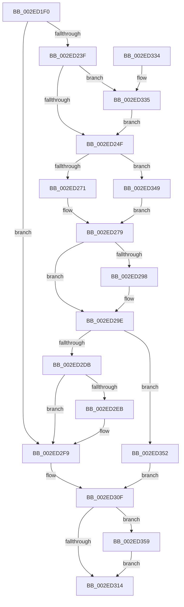

# RtlpHpSegMgrReserve

- RVA: `0x002ED1F0`–`0x002ED37C` (길이 `396` bytes)
- VA: `0x00000001402ED1F0`
- 실행 섹션: `.text`
- PDB 이름 있음: `예`; PDB Function 태그: `아니요`
- unwind 정보 RVA: `0x00071870`
- 디코드: `117`개 명령, `396/396` bytes 표시
- 미해석 바이트: `0` (있으면 어셈블리에 `.byte`로 보존)

> 이 문서는 커널 이미지의 기계어와 PDB 기호를 분석해 생성했습니다. 4번과 5번은 함수 원형과 자료형을 바이너리 사용 방식에서 추정한 C 해석이며 원본 소스 복구 결과는 아닙니다.

## 1. Dependencies

- 직접 호출 지점: **4**; 고유 호출 대상: **4**
- 직접 호출자로 확인된 함수: **1**
- RIP 상대 이미지 참조: **1**

### Outgoing calls
- `0x002ED22A` → [RtlpHpSegMgrVaCtxAlloc](RtlpHpSegMgrVaCtxAlloc_function_002ED384.md) (function, `0x002ED384`)
- `0x002ED2D1` → [RtlpHpVaMgrCtxAlloc](RtlpHpVaMgrCtxAlloc_function_002EDA80.md) (function, `0x002EDA80`)
- `0x002ED2F4` → [RtlpHpSegMgrVaCtxInitialize](RtlpHpSegMgrVaCtxInitialize_function_002ED50C.md) (function, `0x002ED50C`)
- `0x002ED375` → [RtlpHpFreeVA](../2C/RtlpHpFreeVA_function_002C0FD4.md) (function, `0x002C0FD4`)

### Direct callers
- [RtlpHpSegMgrAllocate](RtlpHpSegMgrAllocate_function_002ED130.md) at `0x002ED169`

### Static image references
- `0x002ED2CA` → RVA `0x00E68658` (`.data`; read)

## 2. Other-region calls and transfers

- 다른 실행 섹션으로 향하는 call: **0**
- 별도 외부 분기/꼬리 이동을 확인하지 못했습니다.

## 3. Assembly (complete function range)

```asm
002ED1F0  48 89 5C 24 10                  mov qword ptr [rsp + 0x10], rbx
002ED1F5  48 89 74 24 18                  mov qword ptr [rsp + 0x18], rsi
002ED1FA  48 89 7C 24 20                  mov qword ptr [rsp + 0x20], rdi
002ED1FF  55                              push rbp
002ED200  41 54                           push r12
002ED202  41 55                           push r13
002ED204  41 56                           push r14
002ED206  41 57                           push r15
002ED208  48 8B EC                        mov rbp, rsp
002ED20B  48 83 EC 50                     sub rsp, 0x50
002ED20F  8B 31                           mov esi, dword ptr [rcx]
002ED211  4D 8B E8                        mov r13, r8
002ED214  F7 DE                           neg esi
002ED216  44 8B C2                        mov r8d, edx
002ED219  8B DE                           mov ebx, esi
002ED21B  8B D6                           mov edx, esi
002ED21D  48 89 5D 30                     mov qword ptr [rbp + 0x30], rbx
002ED221  4D 8B E1                        mov r12, r9
002ED224  4C 8B F1                        mov r14, rcx
002ED227  44 8B FE                        mov r15d, esi
002ED22A  E8 55 01 00 00                  call 0x1402ed384
002ED22F  48 89 45 E0                     mov qword ptr [rbp - 0x20], rax
002ED233  48 8B F8                        mov rdi, rax
002ED236  48 85 C0                        test rax, rax
002ED239  0F 85 BA 00 00 00               jne 0x1402ed2f9
002ED23F  41 8A 4E 0D                     mov cl, byte ptr [r14 + 0xd]
002ED243  80 E1 07                        and cl, 7
002ED246  80 F9 01                        cmp cl, 1
002ED249  0F 83 E6 00 00 00               jae 0x1402ed335
002ED24F  41 0F 10 46 28                  movups xmm0, xmmword ptr [r14 + 0x28]
002ED254  0F 29 45 D0                     movaps xmmword ptr [rbp - 0x30], xmm0
002ED258  33 C9                           xor ecx, ecx
002ED25A  66 48 0F 7E C2                  movq rdx, xmm0
002ED25F  48 8B C2                        mov rax, rdx
002ED262  89 4D F4                        mov dword ptr [rbp - 0xc], ecx
002ED265  48 C1 E8 18                     shr rax, 0x18
002ED269  84 C0                           test al, al
002ED26B  0F 84 D8 00 00 00               je 0x1402ed349
002ED271  0F B6 C0                        movzx eax, al
002ED274  FF C8                           dec eax
002ED276  89 45 E8                        mov dword ptr [rbp - 0x18], eax
002ED279  48 8B C2                        mov rax, rdx
002ED27C  48 C1 E8 08                     shr rax, 8
002ED280  0F B6 C0                        movzx eax, al
002ED283  89 45 EC                        mov dword ptr [rbp - 0x14], eax
002ED286  48 8B C2                        mov rax, rdx
002ED289  48 C1 E8 10                     shr rax, 0x10
002ED28D  0F B6 C0                        movzx eax, al
002ED290  89 45 F0                        mov dword ptr [rbp - 0x10], eax
002ED293  F6 C2 08                        test dl, 8
002ED296  74 06                           je 0x1402ed29e
002ED298  83 C9 01                        or ecx, 1
002ED29B  89 4D F4                        mov dword ptr [rbp - 0xc], ecx
002ED29E  48 8B 45 D8                     mov rax, qword ptr [rbp - 0x28]
002ED2A2  4C 8D 4D E8                     lea r9, [rbp - 0x18]
002ED2A6  48 89 45 F8                     mov qword ptr [rbp - 8], rax
002ED2AA  BA FF FF 0F 00                  mov edx, 0xfffff
002ED2AF  48 8D 43 FF                     lea rax, [rbx - 1]
002ED2B3  48 8B CB                        mov rcx, rbx
002ED2B6  48 23 C2                        and rax, rdx
002ED2B9  4C 8B C3                        mov r8, rbx
002ED2BC  48 2B C8                        sub rcx, rax
002ED2BF  48 03 CA                        add rcx, rdx
002ED2C2  48 8D 55 D0                     lea rdx, [rbp - 0x30]
002ED2C6  48 89 4D D0                     mov qword ptr [rbp - 0x30], rcx
002ED2CA  48 8D 0D 87 B3 B7 00            lea rcx, [rip + 0xb7b387]
002ED2D1  E8 AA 07 00 00                  call 0x1402eda80
002ED2D6  48 85 C0                        test rax, rax
002ED2D9  74 77                           je 0x1402ed352
002ED2DB  48 8B 5D D0                     mov rbx, qword ptr [rbp - 0x30]
002ED2DF  48 8B F8                        mov rdi, rax
002ED2E2  48 89 5D 30                     mov qword ptr [rbp + 0x30], rbx
002ED2E6  4C 3B FB                        cmp r15, rbx
002ED2E9  73 0E                           jae 0x1402ed2f9
002ED2EB  44 8B CB                        mov r9d, ebx
002ED2EE  44 8B C6                        mov r8d, esi
002ED2F1  48 8B D0                        mov rdx, rax
002ED2F4  E8 13 02 00 00                  call 0x1402ed50c
002ED2F9  48 8B 45 50                     mov rax, qword ptr [rbp + 0x50]
002ED2FD  49 89 7D 00                     mov qword ptr [r13], rdi
002ED301  33 FF                           xor edi, edi
002ED303  41 89 34 24                     mov dword ptr [r12], esi
002ED307  48 89 7D E0                     mov qword ptr [rbp - 0x20], rdi
002ED30B  89 18                           mov dword ptr [rax], ebx
002ED30D  33 DB                           xor ebx, ebx
002ED30F  48 85 FF                        test rdi, rdi
002ED312  75 45                           jne 0x1402ed359
002ED314  4C 8D 5C 24 50                  lea r11, [rsp + 0x50]
002ED319  8B C3                           mov eax, ebx
002ED31B  49 8B 5B 38                     mov rbx, qword ptr [r11 + 0x38]
002ED31F  49 8B 73 40                     mov rsi, qword ptr [r11 + 0x40]
002ED323  49 8B 7B 48                     mov rdi, qword ptr [r11 + 0x48]
002ED327  49 8B E3                        mov rsp, r11
002ED32A  41 5F                           pop r15
002ED32C  41 5E                           pop r14
002ED32E  41 5D                           pop r13
002ED330  41 5C                           pop r12
002ED332  5D                              pop rbp
002ED333  C3                              ret
002ED334  CC                              int3
002ED335  B8 00 00 20 00                  mov eax, 0x200000
002ED33A  3B F0                           cmp esi, eax
002ED33C  48 0F 42 D8                     cmovb rbx, rax
002ED340  48 89 5D 30                     mov qword ptr [rbp + 0x30], rbx
002ED344  E9 06 FF FF FF                  jmp 0x1402ed24f
002ED349  83 4D E8 FF                     or dword ptr [rbp - 0x18], 0xffffffff
002ED34D  E9 27 FF FF FF                  jmp 0x1402ed279
002ED352  BB 9A 00 00 C0                  mov ebx, 0xc000009a
002ED357  EB B6                           jmp 0x1402ed30f
002ED359  41 0F 10 46 28                  movups xmm0, xmmword ptr [r14 + 0x28]
002ED35E  4C 8D 4D D0                     lea r9, [rbp - 0x30]
002ED362  41 B8 00 80 00 00               mov r8d, 0x8000
002ED368  48 8D 55 30                     lea rdx, [rbp + 0x30]
002ED36C  48 8D 4D E0                     lea rcx, [rbp - 0x20]
002ED370  F3 0F 7F 45 D0                  movdqu xmmword ptr [rbp - 0x30], xmm0
002ED375  E8 5A 3C FD FF                  call 0x1402c0fd4
002ED37A  EB 98                           jmp 0x1402ed314
```

## 4. C-style interpretation (structured pseudocode)

```c
__int64 __fastcall RtlpHpSegMgrReserve(__int64 a1, int a2, __int64 a3, __int64 a4, __int64 a5)
{
    __int64 result;
    __int64 v_rbx;
    __int64 v_rdi;
    __int64 v_rsi;
    __int64 v_rsp;
    unsigned __int64 v_stack_m28;
    unsigned __int64 v_stack_m30;
    unsigned int v_stack_m34;
    unsigned int v_stack_m38;
    unsigned int v_stack_m3C;
    unsigned int v_stack_m40;
    unsigned __int64 v_stack_m48;
    unsigned __int64 v_stack_m50;
    unsigned __int64 v_stack_m58;
    unsigned __int64 v_stack_p10;
    unsigned __int64 v_stack_p18;
    unsigned __int64 v_stack_p20;
    unsigned __int64 v_stack_p8;

    v_stack_p10 = v_rbx;
    v_stack_p18 = v_rsi;
    v_stack_p20 = v_rdi;
    v_rsp = (v_rsp) - (80);
    v_rsi = (unsigned int)(-((unsigned int)(*(unsigned int *)(a1))));
    v_stack_p8 = (unsigned int)((unsigned int)(v_rsi));
    result = RtlpHpSegMgrVaCtxAlloc(a1, (unsigned int)((unsigned int)(v_rsi)), (unsigned int)(a2), a4);
    v_stack_m48 = result;
    if (result != 0) goto loc_002ED2F9;
    a1 = (unsigned __int8)((*(unsigned __int8 *)(a1 + 13)) & (7));
    if (((unsigned __int8)(a1)) >= 1) goto loc_002ED335;
loc_002ED24F:
    v_stack_m58 = v_xmm0;
    a1 = 0;
    v_stack_m34 = 0;
    result = ((unsigned int)((unsigned int)(v_rsi))) >> (24);
    if ((unsigned __int8)(result) == 0) goto loc_002ED349;
    result = (unsigned int)(((unsigned __int8)(result)) - 1);
    v_stack_m40 = (unsigned int)(result);
loc_002ED279:
    result = ((unsigned int)((unsigned int)(v_rsi))) >> (8);
    v_stack_m3C = (unsigned int)((unsigned __int8)(result));
    result = ((unsigned int)((unsigned int)(v_rsi))) >> (16);
    v_stack_m38 = (unsigned int)((unsigned __int8)(result));
    if ((((unsigned __int8)((unsigned int)((unsigned int)(v_rsi)))) & (8)) != 0) {
        a1 = (unsigned int)((a1) | (1));
        v_stack_m34 = (unsigned int)(a1);
    }
    v_stack_m30 = v_stack_m50;
    result = ((unsigned int)((unsigned int)(v_rsi)) - 1) & ((unsigned int)(0xFFFFFULL));
    a1 = ((unsigned int)((unsigned int)(v_rsi))) - (result);
    a1 = (a1) + ((unsigned int)(0xFFFFFULL));
    v_stack_m58 = a1;
    result = RtlpHpVaMgrCtxAlloc(v_rip + 12039047, v_stack_m58, (unsigned int)((unsigned int)(v_rsi)), v_stack_m40);
    if (result == 0) goto loc_002ED352;
    v_stack_p8 = v_stack_m58;
    if (((unsigned int)((unsigned int)(v_rsi))) < v_stack_m58) {
        a4 = (unsigned int)(v_stack_m58);
        a3 = (unsigned int)(v_rsi);
        a2 = result;
        result = RtlpHpSegMgrVaCtxInitialize(v_rip + 12039047, a2, a3, a4);
    }
    *(unsigned __int64 *)(a3) = result;
    v_rdi = 0;
    *(unsigned int *)(a4) = (unsigned int)(v_rsi);
    v_stack_m48 = 0;
    *(unsigned int *)(a5) = (unsigned int)(v_stack_m58);
    v_rbx = 0;
loc_002ED30F:
    if (0 != 0) goto loc_002ED359;
loc_002ED314:
    return 0;
loc_002ED335:
    v_rbx = *(unsigned __int64 *)(v_stack_m28 + 56);
    if (((unsigned int)(*(unsigned __int64 *)(v_stack_m28 + 64))) < ((unsigned int)((unsigned int)(0x200000ULL)))) { v_rbx = (unsigned int)(0x200000ULL); }
    v_stack_p8 = v_rbx;
    goto loc_002ED24F;
loc_002ED349:
    goto loc_002ED279;
loc_002ED352:
    goto loc_002ED30F;
loc_002ED359:
    v_stack_m58 = v_xmm0;
    result = RtlpHpFreeVA(v_stack_m48, v_stack_p8, (unsigned int)(0x8000ULL), v_stack_m58);
    goto loc_002ED314;
}
```

## 5. (Beta) C Style

```c
int64_t RtlpHpSegMgrReserve(void *Arg1, int32_t Arg2, void *Arg3, void *Arg4, void *Arg5)
{
    uint8_t *arg1 = (uint8_t *)Arg1;
    uint8_t *arg3 = (uint8_t *)Arg3;
    uint8_t *arg4 = (uint8_t *)Arg4;
    uint8_t *arg5 = (uint8_t *)Arg5;

    int64_t result;
    int64_t local_rbx;
    int64_t local_rdi;
    int64_t local_rsi;
    int64_t local_rsp;
    uint64_t v_stack_m28;
    uint64_t v_stack_m30;
    uint32_t v_stack_m34;
    uint32_t v_stack_m38;
    uint32_t v_stack_m3C;
    uint32_t v_stack_m40;
    uint64_t v_stack_m48;
    uint64_t v_stack_m50;
    uint64_t v_stack_m58;
    uint64_t v_stack_p10;
    uint64_t v_stack_p18;
    uint64_t v_stack_p20;
    uint64_t v_stack_p8;

    v_stack_p10 = local_rbx;
    v_stack_p18 = local_rsi;
    v_stack_p20 = local_rdi;
    local_rsp = (local_rsp) - (80);
    local_rsi = (uint32_t)(-((uint32_t)(*(uint32_t *)(arg1))));
    v_stack_p8 = (uint32_t)((uint32_t)(local_rsi));
    result = RtlpHpSegMgrVaCtxAlloc(Arg1, (uint32_t)((uint32_t)(local_rsi)), (uint32_t)(Arg2), Arg4);
    v_stack_m48 = result;
    if (result != 0) goto loc_002ED2F9;
    Arg1 = (uint8_t)((*(uint8_t *)(arg1 + 0xD)) & (7));
    if (((uint8_t)(Arg1)) >= 1) goto loc_002ED335;
loc_002ED24F:
    v_stack_m58 = v_xmm0;
    Arg1 = 0;
    v_stack_m34 = 0;
    result = ((uint32_t)((uint32_t)(local_rsi))) >> (24);
    if ((uint8_t)(result) == 0) goto loc_002ED349;
    result = (uint32_t)(((uint8_t)(result)) - 1);
    v_stack_m40 = (uint32_t)(result);
loc_002ED279:
    result = ((uint32_t)((uint32_t)(local_rsi))) >> (8);
    v_stack_m3C = (uint32_t)((uint8_t)(result));
    result = ((uint32_t)((uint32_t)(local_rsi))) >> (16);
    v_stack_m38 = (uint32_t)((uint8_t)(result));
    if ((((uint8_t)((uint32_t)((uint32_t)(local_rsi)))) & (8)) != 0) {
        Arg1 = (uint32_t)((Arg1) | (1));
        v_stack_m34 = (uint32_t)(Arg1);
    }
    v_stack_m30 = v_stack_m50;
    result = ((uint32_t)((uint32_t)(local_rsi)) - 1) & ((uint32_t)(0xFFFFFULL));
    Arg1 = ((uint32_t)((uint32_t)(local_rsi))) - (result);
    Arg1 = (Arg1) + ((uint32_t)(0xFFFFFULL));
    v_stack_m58 = Arg1;
    result = RtlpHpVaMgrCtxAlloc(v_rip + 12039047, v_stack_m58, (uint32_t)((uint32_t)(local_rsi)), v_stack_m40);
    if (result == 0) goto loc_002ED352;
    v_stack_p8 = v_stack_m58;
    if (((uint32_t)((uint32_t)(local_rsi))) < v_stack_m58) {
        Arg4 = (uint32_t)(v_stack_m58);
        Arg3 = (uint32_t)(local_rsi);
        Arg2 = result;
        result = RtlpHpSegMgrVaCtxInitialize(v_rip + 12039047, Arg2, Arg3, Arg4);
    }
    *(uint64_t *)(arg3) = result;
    local_rdi = 0;
    *(uint32_t *)(arg4) = (uint32_t)(local_rsi);
    v_stack_m48 = 0;
    *(uint32_t *)(arg5) = (uint32_t)(v_stack_m58);
    local_rbx = 0;
loc_002ED30F:
    if (0 != 0) goto loc_002ED359;
loc_002ED314:
    return 0;
loc_002ED335:
    local_rbx = *(uint64_t *)(v_stack_m28 + 0x38);
    if (((uint32_t)(*(uint64_t *)(v_stack_m28 + 0x40))) < ((uint32_t)((uint32_t)(0x200000ULL)))) { local_rbx = (uint32_t)(0x200000ULL); }
    v_stack_p8 = local_rbx;
    goto loc_002ED24F;
loc_002ED349:
    goto loc_002ED279;
loc_002ED352:
    goto loc_002ED30F;
loc_002ED359:
    v_stack_m58 = v_xmm0;
    result = RtlpHpFreeVA(v_stack_m48, v_stack_p8, (uint32_t)(0x8000ULL), v_stack_m58);
    goto loc_002ED314;
}
```

### 관측된 메모리 오프셋

구조체 형식이 확인되지 않은 접근은 인자 기준의 오프셋으로만 기록했습니다.

| 기준 인자 | 오프셋 표현 | 폭 (bit) | 접근 |
|---|---:|---:|---|
| `Arg1` | `+ 0x0` | `32` | `R` |
| `Arg1` | `+ 0xD` | `8` | `R` |
| `Arg1` | `+ 0x28` | `128` | `R` |
| `Arg3` | `+ 0x0` | `64` | `W` |
| `Arg4` | `+ 0x0` | `32` | `W` |
| `Arg5` | `+ 0x0` | `32` | `W` |

## 6. Execution-region graph

[열기: 2D/3D 그래프와 함수 탐색 컨트롤 패널](../../../control-panel.html?section=text&rva=0x002ED1F0&view=graph)

- 2D 그래프는 위에서 아래로 흐르고, 3D 그래프는 빈 공간을 드래그해 회전합니다. Shift+드래그는 이동, 휠은 확대·축소, 함수 노드 선택은 대상 보고서 이동입니다.

### Static fallback


