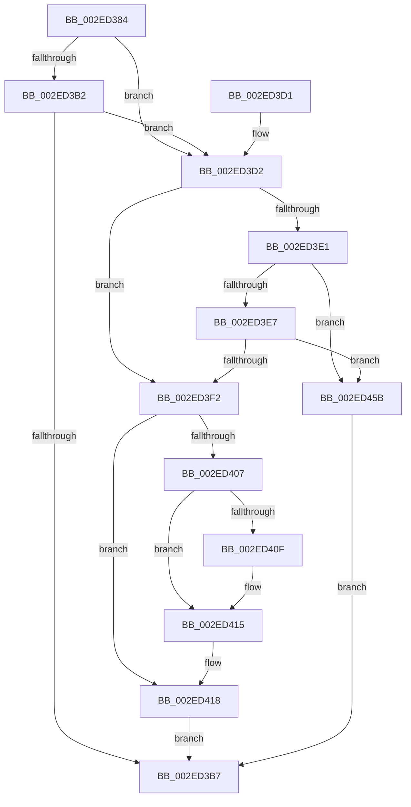

# RtlpHpSegMgrVaCtxAlloc

- RVA: `0x002ED384`–`0x002ED468` (길이 `228` bytes)
- VA: `0x00000001402ED384`
- 실행 섹션: `.text`
- PDB 이름 있음: `예`; PDB Function 태그: `아니요`
- unwind 정보 RVA: `0x00071890`
- 디코드: `72`개 명령, `228/228` bytes 표시
- 미해석 바이트: `0` (있으면 어셈블리에 `.byte`로 보존)

> 이 문서는 커널 이미지의 기계어와 PDB 기호를 분석해 생성했습니다. 4번과 5번은 함수 원형과 자료형을 바이너리 사용 방식에서 추정한 C 해석이며 원본 소스 복구 결과는 아닙니다.

## 1. Dependencies

- 직접 호출 지점: **3**; 고유 호출 대상: **2**
- 직접 호출자로 확인된 함수: **1**
- RIP 상대 이미지 참조: **1**

### Outgoing calls
- `0x002ED3D2` → [RtlpHpSegMgrLock](RtlpHpSegMgrLock_function_002ED710.md) (function, `0x002ED710`)
- `0x002ED41B` → [RtlpHpSegMgrUnlock](RtlpHpSegMgrUnlock_function_002ED6E8.md) (function, `0x002ED6E8`)
- `0x002ED45E` → [RtlpHpSegMgrUnlock](RtlpHpSegMgrUnlock_function_002ED6E8.md) (function, `0x002ED6E8`)

### Direct callers
- [RtlpHpSegMgrReserve](RtlpHpSegMgrReserve_function_002ED1F0.md) at `0x002ED22A`

### Static image references
- `0x002ED42C` → RVA `0x00E68EE0` (`.data`; read)

## 2. Other-region calls and transfers

- 다른 실행 섹션으로 향하는 call: **0**
- 별도 외부 분기/꼬리 이동을 확인하지 못했습니다.

## 3. Assembly (complete function range)

```asm
002ED384  48 89 5C 24 10                  mov qword ptr [rsp + 0x10], rbx
002ED389  48 89 6C 24 18                  mov qword ptr [rsp + 0x18], rbp
002ED38E  56                              push rsi
002ED38F  57                              push rdi
002ED390  41 54                           push r12
002ED392  41 56                           push r14
002ED394  41 57                           push r15
002ED396  48 83 EC 20                     sub rsp, 0x20
002ED39A  4C 8D 71 78                     lea r14, [rcx + 0x78]
002ED39E  33 DB                           xor ebx, ebx
002ED3A0  49 8D 7E 08                     lea rdi, [r14 + 8]
002ED3A4  45 8B F8                        mov r15d, r8d
002ED3A7  44 8B E2                        mov r12d, edx
002ED3AA  48 8B E9                        mov rbp, rcx
002ED3AD  49 39 1E                        cmp qword ptr [r14], rbx
002ED3B0  75 20                           jne 0x1402ed3d2
002ED3B2  48 39 1F                        cmp qword ptr [rdi], rbx
002ED3B5  75 1B                           jne 0x1402ed3d2
002ED3B7  48 8B 6C 24 60                  mov rbp, qword ptr [rsp + 0x60]
002ED3BC  48 8B C3                        mov rax, rbx
002ED3BF  48 8B 5C 24 58                  mov rbx, qword ptr [rsp + 0x58]
002ED3C4  48 83 C4 20                     add rsp, 0x20
002ED3C8  41 5F                           pop r15
002ED3CA  41 5E                           pop r14
002ED3CC  41 5C                           pop r12
002ED3CE  5F                              pop rdi
002ED3CF  5E                              pop rsi
002ED3D0  C3                              ret
002ED3D1  CC                              int3
002ED3D2  E8 39 03 00 00                  call 0x1402ed710
002ED3D7  48 8B 37                        mov rsi, qword ptr [rdi]
002ED3DA  8A D0                           mov dl, al
002ED3DC  48 85 F6                        test rsi, rsi
002ED3DF  75 11                           jne 0x1402ed3f2
002ED3E1  41 F6 C7 02                     test r15b, 2
002ED3E5  75 74                           jne 0x1402ed45b
002ED3E7  49 8B 36                        mov rsi, qword ptr [r14]
002ED3EA  49 8B FE                        mov rdi, r14
002ED3ED  48 85 F6                        test rsi, rsi
002ED3F0  74 69                           je 0x1402ed45b
002ED3F2  0F B7 46 FA                     movzx eax, word ptr [rsi - 6]
002ED3F6  44 0F BC F0                     bsf r14d, eax
002ED3FA  44 0F BB F0                     btc eax, r14d
002ED3FE  66 89 46 FA                     mov word ptr [rsi - 6], ax
002ED402  66 85 C0                        test ax, ax
002ED405  75 11                           jne 0x1402ed418
002ED407  48 8B 07                        mov rax, qword ptr [rdi]
002ED40A  48 85 C0                        test rax, rax
002ED40D  74 06                           je 0x1402ed415
002ED40F  48 8B 00                        mov rax, qword ptr [rax]
002ED412  48 89 07                        mov qword ptr [rdi], rax
002ED415  48 89 1E                        mov qword ptr [rsi], rbx
002ED418  48 8B CD                        mov rcx, rbp
002ED41B  E8 C8 02 00 00                  call 0x1402ed6e8
002ED420  48 8D 5E F0                     lea rbx, [rsi - 0x10]
002ED424  45 0F AF F4                     imul r14d, r12d
002ED428  0F B6 43 01                     movzx eax, byte ptr [rbx + 1]
002ED42C  48 8D 15 AD BA B7 00            lea rdx, [rip + 0xb7baad]
002ED433  48 8D 0C 40                     lea rcx, [rax + rax*2]
002ED437  41 8B C6                        mov eax, r14d
002ED43A  48 03 C9                        add rcx, rcx
002ED43D  48 8B 14 CA                     mov rdx, qword ptr [rdx + rcx*8]
002ED441  48 2B 5A 28                     sub rbx, qword ptr [rdx + 0x28]
002ED445  8B 4A 18                        mov ecx, dword ptr [rdx + 0x18]
002ED448  48 D3 EB                        shr rbx, cl
002ED44B  48 C1 E3 14                     shl rbx, 0x14
002ED44F  48 03 D8                        add rbx, rax
002ED452  48 03 5A 08                     add rbx, qword ptr [rdx + 8]
002ED456  E9 5C FF FF FF                  jmp 0x1402ed3b7
002ED45B  48 8B CD                        mov rcx, rbp
002ED45E  E8 85 02 00 00                  call 0x1402ed6e8
002ED463  E9 4F FF FF FF                  jmp 0x1402ed3b7
```

## 4. C-style interpretation (structured pseudocode)

```c
__int64 __fastcall RtlpHpSegMgrVaCtxAlloc(__int64 a1, int a2, int a3)
{
    __int64 result;
    __int64 v_r14;
    __int64 v_rbx;
    __int64 v_rsp;
    unsigned __int64 v_stack_p10;
    unsigned __int64 v_stack_p18;

    v_stack_p10 = v_rbx;
    v_stack_p18 = v_rbp;
    v_rsp = (v_rsp) - (32);
    v_rbx = 0;
    if ((*(unsigned __int64 *)(a1 + 120)) != 0) goto loc_002ED3D2;
    if ((*(unsigned __int64 *)(a1 + 120 + 8)) != 0) goto loc_002ED3D2;
loc_002ED3B7:
    v_rsp = (v_rsp) + (32);
    return 0;
loc_002ED3D2:
    result = RtlpHpSegMgrLock(a1, a2, a3, a4);
    if (*(unsigned __int64 *)(a1 + 120 + 8) != 0) goto loc_002ED3F2;
    if ((((unsigned __int8)((unsigned int)(a3))) & (2)) != 0) goto loc_002ED45B;
    if (*(unsigned __int64 *)(a1 + 120) == 0) goto loc_002ED45B;
loc_002ED3F2:
    *(unsigned __int16 *)(*(unsigned __int64 *)(a1 + 120) - 6) = (unsigned __int16)(*(unsigned __int16 *)(*(unsigned __int64 *)(a1 + 120) - 6));
    if ((unsigned __int16)(*(unsigned __int16 *)(*(unsigned __int64 *)(a1 + 120) - 6)) != 0) goto loc_002ED418;
    result = *(unsigned __int64 *)(a1 + 120);
    if (*(unsigned __int64 *)(a1 + 120) != 0) {
        result = *(unsigned __int64 *)(*(unsigned __int64 *)(a1 + 120));
        *(unsigned __int64 *)(a1 + 120) = result;
    }
    *(unsigned __int64 *)(*(unsigned __int64 *)(a1 + 120)) = v_stack_p10;
loc_002ED418:
    result = RtlpHpSegMgrUnlock(v_stack_p18, (unsigned __int8)(result), a3, a4);
    v_r14 = (unsigned int)((a1 + 120) * ((unsigned int)((unsigned int)(a2))));
    a1 = (*(unsigned __int8 *)(*(unsigned __int64 *)(a1 + 120) - 16 + 1) + *(unsigned __int8 *)(*(unsigned __int64 *)(a1 + 120) - 16 + 1) * 2) + (*(unsigned __int8 *)(*(unsigned __int64 *)(a1 + 120) - 16 + 1) + *(unsigned __int8 *)(*(unsigned __int64 *)(a1 + 120) - 16 + 1) * 2);
    v_rbx = (*(unsigned __int64 *)(a1 + 120) - 16) - (*(unsigned __int64 *)(*(unsigned __int64 *)(v_rip + 12040877 + a1 * 8) + 40));
    v_rbx = (v_rbx) >> ((unsigned __int8)((unsigned int)(*(unsigned int *)(*(unsigned __int64 *)(v_rip + 12040877 + a1 * 8) + 24))));
    v_rbx = (v_rbx) << (20);
    v_rbx = (v_rbx) + ((unsigned int)((unsigned int)(v_r14)));
    v_rbx = (v_rbx) + (*(unsigned __int64 *)(*(unsigned __int64 *)(v_rip + 12040877 + a1 * 8) + 8));
    goto loc_002ED3B7;
loc_002ED45B:
    result = RtlpHpSegMgrUnlock(v_stack_p18, *(unsigned __int64 *)(v_rip + 12040877 + a1 * 8), a3, a4);
    goto loc_002ED3B7;
}
```

## 5. (Beta) C Style

```c
int64_t RtlpHpSegMgrVaCtxAlloc(void *Arg1, int32_t Arg2, int32_t Arg3)
{
    uint8_t *arg1 = (uint8_t *)Arg1;

    int64_t result;
    int64_t local_r14;
    int64_t local_rbx;
    int64_t local_rsp;
    uint64_t v_stack_p10;
    uint64_t v_stack_p18;

    v_stack_p10 = local_rbx;
    v_stack_p18 = local_rbp;
    local_rsp = (local_rsp) - (32);
    local_rbx = 0;
    if ((*(uint64_t *)(arg1 + 0x78)) != 0) goto loc_002ED3D2;
    if ((*(uint64_t *)(arg1 + 0x78 + 0x8)) != 0) goto loc_002ED3D2;
loc_002ED3B7:
    local_rsp = (local_rsp) + (32);
    return 0;
loc_002ED3D2:
    result = RtlpHpSegMgrLock(Arg1, Arg2, Arg3, a4);
    if (*(uint64_t *)(arg1 + 0x78 + 0x8) != 0) goto loc_002ED3F2;
    if ((((uint8_t)((uint32_t)(Arg3))) & (2)) != 0) goto loc_002ED45B;
    if (*(uint64_t *)(arg1 + 0x78) == 0) goto loc_002ED45B;
loc_002ED3F2:
    *(uint16_t *)(*(uint64_t *)(arg1 + 0x78) - 0x6) = (uint16_t)(*(uint16_t *)(*(uint64_t *)(arg1 + 0x78) - 0x6));
    if ((uint16_t)(*(uint16_t *)(*(uint64_t *)(arg1 + 0x78) - 0x6)) != 0) goto loc_002ED418;
    result = *(uint64_t *)(arg1 + 0x78);
    if (*(uint64_t *)(arg1 + 0x78) != 0) {
        result = *(uint64_t *)(*(uint64_t *)(arg1 + 0x78));
        *(uint64_t *)(arg1 + 0x78) = result;
    }
    *(uint64_t *)(*(uint64_t *)(arg1 + 0x78)) = v_stack_p10;
loc_002ED418:
    result = RtlpHpSegMgrUnlock(v_stack_p18, (uint8_t)(result), Arg3, a4);
    local_r14 = (uint32_t)((Arg1 + 120) * ((uint32_t)((uint32_t)(Arg2))));
    Arg1 = (*(uint8_t *)(*(uint64_t *)(arg1 + 0x78) - 0x10 + 0x1) + *(uint8_t *)(*(uint64_t *)(arg1 + 0x78) - 0x10 + 0x1) * 2) + (*(uint8_t *)(*(uint64_t *)(arg1 + 0x78) - 0x10 + 0x1) + *(uint8_t *)(*(uint64_t *)(arg1 + 0x78) - 0x10 + 0x1) * 2);
    local_rbx = (*(uint64_t *)(arg1 + 0x78) - 16) - (*(uint64_t *)(*(uint64_t *)(v_rip + 0xB7BAAD + arg1 * 8) + 0x28));
    local_rbx = (local_rbx) >> ((uint8_t)((uint32_t)(*(uint32_t *)(*(uint64_t *)(v_rip + 0xB7BAAD + arg1 * 8) + 0x18))));
    local_rbx = (local_rbx) << (20);
    local_rbx = (local_rbx) + ((uint32_t)((uint32_t)(local_r14)));
    local_rbx = (local_rbx) + (*(uint64_t *)(*(uint64_t *)(v_rip + 0xB7BAAD + arg1 * 8) + 0x8));
    goto loc_002ED3B7;
loc_002ED45B:
    result = RtlpHpSegMgrUnlock(v_stack_p18, *(uint64_t *)(v_rip + 0xB7BAAD + arg1 * 8), Arg3, a4);
    goto loc_002ED3B7;
}
```

### 관측된 메모리 오프셋

구조체 형식이 확인되지 않은 접근은 인자 기준의 오프셋으로만 기록했습니다.

| 기준 인자 | 오프셋 표현 | 폭 (bit) | 접근 |
|---|---:|---:|---|
| `Arg1` | `+ 0x0` | `64` | `R` |
| `Arg1` | `+ 0x0` | `64` | `W` |
| `Arg1` | `+ 0x8` | `64` | `R` |
| `Arg1` | `+ 0x78` | `64` | `R` |

## 6. Execution-region graph

[열기: 2D/3D 그래프와 함수 탐색 컨트롤 패널](../../../control-panel.html?section=text&rva=0x002ED384&view=graph)

- 2D 그래프는 위에서 아래로 흐르고, 3D 그래프는 빈 공간을 드래그해 회전합니다. Shift+드래그는 이동, 휠은 확대·축소, 함수 노드 선택은 대상 보고서 이동입니다.

### Static fallback


