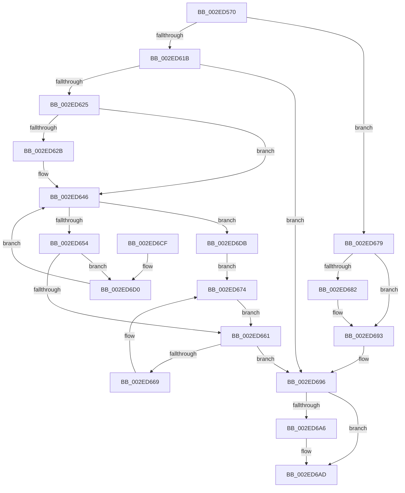

# RtlpHpSegMgrVaCtxFree

- RVA: `0x002ED570`–`0x002ED6DF` (길이 `367` bytes)
- VA: `0x00000001402ED570`
- 실행 섹션: `.text`
- PDB 이름 있음: `예`; PDB Function 태그: `아니요`
- unwind 정보 RVA: `0x000718D0`
- 디코드: `106`개 명령, `367/367` bytes 표시
- 미해석 바이트: `0` (있으면 어셈블리에 `.byte`로 보존)

> 이 문서는 커널 이미지의 기계어와 PDB 기호를 분석해 생성했습니다. 4번과 5번은 함수 원형과 자료형을 바이너리 사용 방식에서 추정한 C 해석이며 원본 소스 복구 결과는 아닙니다.

## 1. Dependencies

- 직접 호출 지점: **3**; 고유 호출 대상: **3**
- 직접 호출자로 확인된 함수: **1**
- RIP 상대 이미지 참조: **1**

### Outgoing calls
- `0x002ED5BF` → [RtlpHpVaMgrCtxQuery](../32/RtlpHpVaMgrCtxQuery_function_003273C0.md) (function, `0x003273C0`)
- `0x002ED5D5` → [RtlpHpSegMgrLock](RtlpHpSegMgrLock_function_002ED710.md) (function, `0x002ED710`)
- `0x002ED69C` → [RtlpHpSegMgrUnlock](RtlpHpSegMgrUnlock_function_002ED6E8.md) (function, `0x002ED6E8`)

### Direct callers
- [RtlpHpSegMgrRelease](RtlpHpSegMgrRelease_function_002E37FC.md) at `0x002E386C`

### Static image references
- `0x002ED5A7` → RVA `0x00E68658` (`.data`; read)

## 2. Other-region calls and transfers

- 다른 실행 섹션으로 향하는 call: **0**
- 별도 외부 분기/꼬리 이동을 확인하지 못했습니다.

## 3. Assembly (complete function range)

```asm
002ED570  48 8B C4                        mov rax, rsp
002ED573  48 89 58 08                     mov qword ptr [rax + 8], rbx
002ED577  48 89 68 10                     mov qword ptr [rax + 0x10], rbp
002ED57B  48 89 70 18                     mov qword ptr [rax + 0x18], rsi
002ED57F  48 89 78 20                     mov qword ptr [rax + 0x20], rdi
002ED583  41 54                           push r12
002ED585  41 56                           push r14
002ED587  41 57                           push r15
002ED589  48 83 EC 40                     sub rsp, 0x40
002ED58D  48 8B EA                        mov rbp, rdx
002ED590  0F 57 C0                        xorps xmm0, xmm0
002ED593  4D 8B F0                        mov r14, r8
002ED596  48 8B FA                        mov rdi, rdx
002ED599  48 8B F1                        mov rsi, rcx
002ED59C  4C 8D 40 C8                     lea r8, [rax - 0x38]
002ED5A0  48 81 E5 00 00 E0 FF            and rbp, 0xffffffffffe00000
002ED5A7  48 8D 0D AA B0 B7 00            lea rcx, [rip + 0xb7b0aa]
002ED5AE  45 33 E4                        xor r12d, r12d
002ED5B1  48 8B D5                        mov rdx, rbp
002ED5B4  41 8B DC                        mov ebx, r12d
002ED5B7  0F 11 40 C8                     movups xmmword ptr [rax - 0x38], xmm0
002ED5BB  0F 11 40 D8                     movups xmmword ptr [rax - 0x28], xmm0
002ED5BF  E8 FC 9D 03 00                  call 0x1403273c0
002ED5C4  48 2B FD                        sub rdi, rbp
002ED5C7  33 D2                           xor edx, edx
002ED5C9  48 8B C7                        mov rax, rdi
002ED5CC  48 8B CE                        mov rcx, rsi
002ED5CF  49 F7 36                        div qword ptr [r14]
002ED5D2  48 8B F8                        mov rdi, rax
002ED5D5  E8 36 01 00 00                  call 0x1402ed710
002ED5DA  4C 8B 54 24 30                  mov r10, qword ptr [rsp + 0x30]
002ED5DF  44 8A F8                        mov r15b, al
002ED5E2  33 D2                           xor edx, edx
002ED5E4  41 0F B7 42 02                  movzx eax, word ptr [r10 + 2]
002ED5E9  0F BB F8                        btc eax, edi
002ED5EC  44 0F B7 D8                     movzx r11d, ax
002ED5F0  41 8D 7C 24 01                  lea edi, [r12 + 1]
002ED5F5  B8 00 00 20 00                  mov eax, 0x200000
002ED5FA  66 45 89 5A 02                  mov word ptr [r10 + 2], r11w
002ED5FF  49 F7 36                        div qword ptr [r14]
002ED602  45 0F B7 0A                     movzx r9d, word ptr [r10]
002ED606  48 8B C8                        mov rcx, rax
002ED609  45 8B C1                        mov r8d, r9d
002ED60C  8B C7                           mov eax, edi
002ED60E  49 C1 E8 0F                     shr r8, 0xf
002ED612  D3 E0                           shl eax, cl
002ED614  2B C7                           sub eax, edi
002ED616  44 3B D8                        cmp r11d, eax
002ED619  75 5E                           jne 0x1402ed679
002ED61B  49 8D 52 08                     lea rdx, [r10 + 8]
002ED61F  48 83 3A FF                     cmp qword ptr [rdx], -1
002ED623  74 71                           je 0x1402ed696
002ED625  66 45 85 C9                     test r9w, r9w
002ED629  78 1B                           js 0x1402ed646
002ED62B  41 0F B7 C1                     movzx eax, r9w
002ED62F  B9 FF 07 00 00                  mov ecx, 0x7ff
002ED634  66 2B C7                        sub ax, di
002ED637  66 41 33 C1                     xor ax, r9w
002ED63B  66 23 C1                        and ax, cx
002ED63E  66 41 33 C1                     xor ax, r9w
002ED642  66 41 89 02                     mov word ptr [r10], ax
002ED646  4A 8B 44 C6 78                  mov rax, qword ptr [rsi + r8*8 + 0x78]
002ED64B  48 85 C0                        test rax, rax
002ED64E  0F 84 87 00 00 00               je 0x1402ed6db
002ED654  48 8B 08                        mov rcx, qword ptr [rax]
002ED657  4A 89 4C C6 78                  mov qword ptr [rsi + r8*8 + 0x78], rcx
002ED65C  48 3B C2                        cmp rax, rdx
002ED65F  75 6F                           jne 0x1402ed6d0
002ED661  48 8B C3                        mov rax, rbx
002ED664  48 85 DB                        test rbx, rbx
002ED667  74 2D                           je 0x1402ed696
002ED669  48 8B 1B                        mov rbx, qword ptr [rbx]
002ED66C  48 89 08                        mov qword ptr [rax], rcx
002ED66F  4A 89 44 C6 78                  mov qword ptr [rsi + r8*8 + 0x78], rax
002ED674  48 8B C8                        mov rcx, rax
002ED677  EB E8                           jmp 0x1402ed661
002ED679  41 8D 43 FF                     lea eax, [r11 - 1]
002ED67D  41 85 C3                        test r11d, eax
002ED680  75 11                           jne 0x1402ed693
002ED682  4A 8B 44 C6 78                  mov rax, qword ptr [rsi + r8*8 + 0x78]
002ED687  49 8D 4A 08                     lea rcx, [r10 + 8]
002ED68B  48 89 01                        mov qword ptr [rcx], rax
002ED68E  4A 89 4C C6 78                  mov qword ptr [rsi + r8*8 + 0x78], rcx
002ED693  49 8B EC                        mov rbp, r12
002ED696  41 8A D7                        mov dl, r15b
002ED699  48 8B CE                        mov rcx, rsi
002ED69C  E8 47 00 00 00                  call 0x1402ed6e8
002ED6A1  48 85 ED                        test rbp, rbp
002ED6A4  74 07                           je 0x1402ed6ad
002ED6A6  49 C7 06 00 00 20 00            mov qword ptr [r14], 0x200000
002ED6AD  48 8B 5C 24 60                  mov rbx, qword ptr [rsp + 0x60]
002ED6B2  48 8B C5                        mov rax, rbp
002ED6B5  48 8B 6C 24 68                  mov rbp, qword ptr [rsp + 0x68]
002ED6BA  48 8B 74 24 70                  mov rsi, qword ptr [rsp + 0x70]
002ED6BF  48 8B 7C 24 78                  mov rdi, qword ptr [rsp + 0x78]
002ED6C4  48 83 C4 40                     add rsp, 0x40
002ED6C8  41 5F                           pop r15
002ED6CA  41 5E                           pop r14
002ED6CC  41 5C                           pop r12
002ED6CE  C3                              ret
002ED6CF  CC                              int3
002ED6D0  48 89 18                        mov qword ptr [rax], rbx
002ED6D3  48 8B D8                        mov rbx, rax
002ED6D6  E9 6B FF FF FF                  jmp 0x1402ed646
002ED6DB  CD 2C                           int 0x2c
002ED6DD  EB 95                           jmp 0x1402ed674
```

## 4. C-style interpretation (structured pseudocode)

```c
__int64 __fastcall RtlpHpSegMgrVaCtxFree(__int64 a1, __int64 a2, __int64 a3)
{
    __int64 result;
    __int64 v_r12;
    __int64 v_rbp;
    __int64 v_rdi;
    __int64 v_rsp;
    unsigned __int64 v_stack_m28;
    unsigned __int64 v_stack_p10;
    unsigned __int64 v_stack_p18;
    unsigned __int64 v_stack_p20;
    unsigned __int64 v_stack_p8;

    *(unsigned __int64 *)(v_rsp + 8) = v_rbx;
    *(unsigned __int64 *)(v_rsp + 16) = v_rbp;
    *(unsigned __int64 *)(v_rsp + 24) = v_rsi;
    *(unsigned __int64 *)(v_rsp + 32) = v_rdi;
    v_rsp = (v_rsp) - (64);
    v_rbp = (a2) & (0xFFFFFFFFFFE00000ULL);
    v_r12 = 0;
    *(unsigned __int64 *)(v_rsp - 56) = v_xmm0;
    *(unsigned __int64 *)(v_rsp - 40) = v_xmm0;
    result = RtlpHpVaMgrCtxQuery(v_rip + 12038314, v_rbp, v_rsp - 56, a4);
    v_rdi = (a2) - (v_rbp);
    a2 = 0;
    result = RtlpHpSegMgrLock(a1, a2, v_rsp - 56, a4);
    a2 = 0;
    *(unsigned __int16 *)(v_stack_m28 + 2) = (unsigned __int16)((unsigned __int16)(*(unsigned __int16 *)(v_stack_m28 + 2)));
    a3 = ((unsigned int)((unsigned int)(*(unsigned __int16 *)(v_stack_m28)))) >> (15);
    result = (unsigned int)(((unsigned int)((unsigned int)(v_r12 + 1))) << ((unsigned __int8)((unsigned int)(0x200000ULL))));
    result = (unsigned int)((result) - ((unsigned int)(v_r12 + 1)));
    if (((unsigned int)((unsigned __int16)(*(unsigned __int16 *)(v_stack_m28 + 2)))) != ((unsigned int)(result))) goto loc_002ED679;
    if ((*(unsigned __int64 *)(v_stack_m28 + 8)) == -1) goto loc_002ED696;
    if (!(sign_flag)) {
        result = (unsigned __int16)(*(unsigned __int16 *)(v_stack_m28));
        a1 = 0x7FFULL;
        result = (unsigned __int16)((result) - ((unsigned __int16)(v_r12 + 1)));
        result = (unsigned __int16)((result) ^ ((unsigned __int16)(*(unsigned __int16 *)(v_stack_m28))));
        result = (unsigned __int16)((result) & ((unsigned __int16)(a1)));
        result = (unsigned __int16)((result) ^ ((unsigned __int16)(*(unsigned __int16 *)(v_stack_m28))));
        *(unsigned __int16 *)(v_stack_m28) = (unsigned __int16)(result);
    }
    if (*(unsigned __int64 *)(a1 + a3 * 8 + 120) == 0) goto loc_002ED6DB;
    *(unsigned __int64 *)(a1 + a3 * 8 + 120) = *(unsigned __int64 *)(*(unsigned __int64 *)(a1 + a3 * 8 + 120));
    if ((*(unsigned __int64 *)(a1 + a3 * 8 + 120)) != (v_stack_m28 + 8)) goto loc_002ED6D0;
loc_002ED661:
    if (0 == 0) goto loc_002ED696;
    *(unsigned __int64 *)(0) = *(unsigned __int64 *)(*(unsigned __int64 *)(a1 + a3 * 8 + 120));
    *(unsigned __int64 *)(a1 + a3 * 8 + 120) = 0;
loc_002ED674:
    goto loc_002ED661;
loc_002ED679:
    result = (unsigned __int16)(*(unsigned __int16 *)(v_stack_m28 + 2)) - 1;
    if ((((unsigned int)((unsigned __int16)(*(unsigned __int16 *)(v_stack_m28 + 2)))) & ((unsigned int)((unsigned __int16)(*(unsigned __int16 *)(v_stack_m28 + 2)) - 1))) == 0) {
        result = *(unsigned __int64 *)(a1 + a3 * 8 + 120);
        a1 = v_stack_m28 + 8;
        *(unsigned __int64 *)(a1) = result;
        *(unsigned __int64 *)(a1 + a3 * 8 + 120) = a1;
    }
loc_002ED696:
    result = RtlpHpSegMgrUnlock(a1, (unsigned __int8)((unsigned __int8)(result)), a3, *(unsigned __int16 *)(v_stack_m28));
    if (0 != 0) {
        *(unsigned __int64 *)(a3) = 0x200000ULL;
    }
    v_rsp = (v_rsp) + (64);
    return 0;
loc_002ED6D0:
    *(unsigned __int64 *)(0) = v_stack_p8;
    goto loc_002ED646;
loc_002ED6DB:
    goto loc_002ED674;
}
```

## 5. (Beta) C Style

```c
int64_t RtlpHpSegMgrVaCtxFree(void *Arg1, int64_t Arg2, void *Arg3)
{
    uint8_t *arg1 = (uint8_t *)Arg1;
    uint8_t *arg3 = (uint8_t *)Arg3;

    int64_t result;
    int64_t local_r12;
    int64_t local_rbp;
    int64_t local_rdi;
    int64_t local_rsp;
    uint64_t v_stack_m28;
    uint64_t v_stack_p10;
    uint64_t v_stack_p18;
    uint64_t v_stack_p20;
    uint64_t v_stack_p8;

    *(uint64_t *)(local_rsp + 0x8) = local_rbx;
    *(uint64_t *)(local_rsp + 0x10) = local_rbp;
    *(uint64_t *)(local_rsp + 0x18) = local_rsi;
    *(uint64_t *)(local_rsp + 0x20) = local_rdi;
    local_rsp = (local_rsp) - (64);
    local_rbp = (Arg2) & (0xFFFFFFFFFFE00000ULL);
    local_r12 = 0;
    *(uint64_t *)(local_rsp - 0x38) = v_xmm0;
    *(uint64_t *)(local_rsp - 0x28) = v_xmm0;
    result = RtlpHpVaMgrCtxQuery(v_rip + 12038314, local_rbp, local_rsp - 56, a4);
    local_rdi = (Arg2) - (local_rbp);
    Arg2 = 0;
    result = RtlpHpSegMgrLock(Arg1, Arg2, local_rsp - 56, a4);
    Arg2 = 0;
    *(uint16_t *)(v_stack_m28 + 0x2) = (uint16_t)((uint16_t)(*(uint16_t *)(v_stack_m28 + 0x2)));
    Arg3 = ((uint32_t)((uint32_t)(*(uint16_t *)(v_stack_m28)))) >> (15);
    result = (uint32_t)(((uint32_t)((uint32_t)(local_r12 + 1))) << ((uint8_t)((uint32_t)(0x200000ULL))));
    result = (uint32_t)((result) - ((uint32_t)(local_r12 + 1)));
    if (((uint32_t)((uint16_t)(*(uint16_t *)(v_stack_m28 + 0x2)))) != ((uint32_t)(result))) goto loc_002ED679;
    if ((*(uint64_t *)(v_stack_m28 + 0x8)) == -1) goto loc_002ED696;
    if (!(sign_flag)) {
        result = (uint16_t)(*(uint16_t *)(v_stack_m28));
        Arg1 = 0x7FFULL;
        result = (uint16_t)((result) - ((uint16_t)(local_r12 + 1)));
        result = (uint16_t)((result) ^ ((uint16_t)(*(uint16_t *)(v_stack_m28))));
        result = (uint16_t)((result) & ((uint16_t)(Arg1)));
        result = (uint16_t)((result) ^ ((uint16_t)(*(uint16_t *)(v_stack_m28))));
        *(uint16_t *)(v_stack_m28) = (uint16_t)(result);
    }
    if (*(uint64_t *)(arg1 + arg3 * 8 + 0x78) == 0) goto loc_002ED6DB;
    *(uint64_t *)(arg1 + arg3 * 8 + 0x78) = *(uint64_t *)(*(uint64_t *)(arg1 + arg3 * 8 + 0x78));
    if ((*(uint64_t *)(arg1 + arg3 * 8 + 0x78)) != (v_stack_m28 + 8)) goto loc_002ED6D0;
loc_002ED661:
    if (0 == 0) goto loc_002ED696;
    *(uint64_t *)(0) = *(uint64_t *)(*(uint64_t *)(arg1 + arg3 * 8 + 0x78));
    *(uint64_t *)(arg1 + arg3 * 8 + 0x78) = 0;
loc_002ED674:
    goto loc_002ED661;
loc_002ED679:
    result = (uint16_t)(*(uint16_t *)(v_stack_m28 + 0x2)) - 1;
    if ((((uint32_t)((uint16_t)(*(uint16_t *)(v_stack_m28 + 0x2)))) & ((uint32_t)((uint16_t)(*(uint16_t *)(v_stack_m28 + 0x2)) - 1))) == 0) {
        result = *(uint64_t *)(arg1 + arg3 * 8 + 0x78);
        Arg1 = v_stack_m28 + 8;
        *(uint64_t *)(arg1) = result;
        *(void **)(arg1 + arg3 * 8 + 0x78) = Arg1;
    }
loc_002ED696:
    result = RtlpHpSegMgrUnlock(Arg1, (uint8_t)((uint8_t)(result)), Arg3, *(uint16_t *)(v_stack_m28));
    if (0 != 0) {
        *(uint64_t *)(arg3) = 0x200000ULL;
    }
    local_rsp = (local_rsp) + (64);
    return 0;
loc_002ED6D0:
    *(uint64_t *)(0) = v_stack_p8;
    goto loc_002ED646;
loc_002ED6DB:
    goto loc_002ED674;
}
```

### 관측된 메모리 오프셋

구조체 형식이 확인되지 않은 접근은 인자 기준의 오프셋으로만 기록했습니다.

| 기준 인자 | 오프셋 표현 | 폭 (bit) | 접근 |
|---|---:|---:|---|
| `Arg1` | `+ 0x78 + r8*8` | `64` | `R` |
| `Arg1` | `+ 0x78 + r8*8` | `64` | `W` |
| `Arg3` | `+ 0x0` | `64` | `R` |
| `Arg3` | `+ 0x0` | `64` | `W` |

## 6. Execution-region graph

[열기: 2D/3D 그래프와 함수 탐색 컨트롤 패널](../../../control-panel.html?section=text&rva=0x002ED570&view=graph)

- 2D 그래프는 위에서 아래로 흐르고, 3D 그래프는 빈 공간을 드래그해 회전합니다. Shift+드래그는 이동, 휠은 확대·축소, 함수 노드 선택은 대상 보고서 이동입니다.

### Static fallback


