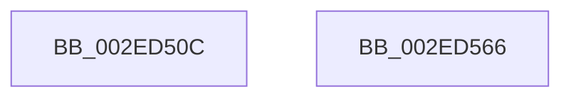

# RtlpHpSegMgrVaCtxInitialize

- RVA: `0x002ED50C`–`0x002ED567` (길이 `91` bytes)
- VA: `0x00000001402ED50C`
- 실행 섹션: `.text`
- PDB 이름 있음: `예`; PDB Function 태그: `아니요`
- unwind 정보 RVA: `0x000718C0`
- 디코드: `27`개 명령, `91/91` bytes 표시
- 미해석 바이트: `0` (있으면 어셈블리에 `.byte`로 보존)

> 이 문서는 커널 이미지의 기계어와 PDB 기호를 분석해 생성했습니다. 4번과 5번은 함수 원형과 자료형을 바이너리 사용 방식에서 추정한 C 해석이며 원본 소스 복구 결과는 아닙니다.

## 1. Dependencies

- 직접 호출 지점: **1**; 고유 호출 대상: **1**
- 직접 호출자로 확인된 함수: **1**
- RIP 상대 이미지 참조: **1**

### Outgoing calls
- `0x002ED534` → [RtlpHpVaMgrCtxQuery](../32/RtlpHpVaMgrCtxQuery_function_003273C0.md) (function, `0x003273C0`)

### Direct callers
- [RtlpHpSegMgrReserve](RtlpHpSegMgrReserve_function_002ED1F0.md) at `0x002ED2F4`

### Static image references
- `0x002ED51B` → RVA `0x00E68658` (`.data`; read)

## 2. Other-region calls and transfers

- 다른 실행 섹션으로 향하는 call: **0**
- 별도 외부 분기/꼬리 이동을 확인하지 못했습니다.

## 3. Assembly (complete function range)

```asm
002ED50C  48 8B C4                        mov rax, rsp
002ED50F  48 89 58 08                     mov qword ptr [rax + 8], rbx
002ED513  57                              push rdi
002ED514  48 83 EC 40                     sub rsp, 0x40
002ED518  0F 57 C0                        xorps xmm0, xmm0
002ED51B  48 8D 0D 36 B1 B7 00            lea rcx, [rip + 0xb7b136]
002ED522  41 8B F8                        mov edi, r8d
002ED525  41 8B D9                        mov ebx, r9d
002ED528  4C 8D 40 D8                     lea r8, [rax - 0x28]
002ED52C  0F 11 40 D8                     movups xmmword ptr [rax - 0x28], xmm0
002ED530  0F 11 40 E8                     movups xmmword ptr [rax - 0x18], xmm0
002ED534  E8 87 9E 03 00                  call 0x1403273c0
002ED539  33 D2                           xor edx, edx
002ED53B  8B C3                           mov eax, ebx
002ED53D  48 8B 5C 24 50                  mov rbx, qword ptr [rsp + 0x50]
002ED542  F7 F7                           div edi
002ED544  BA 01 00 00 00                  mov edx, 1
002ED549  8B C8                           mov ecx, eax
002ED54B  48 8B 44 24 30                  mov rax, qword ptr [rsp + 0x30]
002ED550  66 D3 E2                        shl dx, cl
002ED553  66 83 EA 02                     sub dx, 2
002ED557  66 89 50 02                     mov word ptr [rax + 2], dx
002ED55B  48 83 48 08 FF                  or qword ptr [rax + 8], 0xffffffffffffffff
002ED560  48 83 C4 40                     add rsp, 0x40
002ED564  5F                              pop rdi
002ED565  C3                              ret
002ED566  CC                              int3
```

## 4. C-style interpretation (structured pseudocode)

```c
__int64 __fastcall RtlpHpSegMgrVaCtxInitialize(__int64 a1, int a2, int a3, int a4)
{
    __int64 result;
    __int64 v_rsp;
    unsigned __int64 v_stack_m18;
    unsigned __int64 v_stack_p8;

    *(unsigned __int64 *)(v_rsp + 8) = v_rbx;
    v_rsp = (v_rsp) - (64);
    *(unsigned __int64 *)(v_rsp - 40) = v_xmm0;
    *(unsigned __int64 *)(v_rsp - 24) = v_xmm0;
    result = RtlpHpVaMgrCtxQuery(v_rip + 12038454, a2, v_rsp - 40, a4);
    a2 = 0;
    a2 = (unsigned __int16)((1) << ((unsigned __int8)((unsigned int)((unsigned int)((unsigned int)((unsigned int)((unsigned int)(a4))))))));
    a2 = (unsigned __int16)((a2) - (2));
    *(unsigned __int16 *)(v_stack_m18 + 2) = (unsigned __int16)(a2);
    v_rsp = (v_rsp) + (64);
    return v_stack_m18;
}
```

## 5. (Beta) C Style

```c
int64_t RtlpHpSegMgrVaCtxInitialize(int64_t Arg1, int32_t Arg2, int32_t Arg3, int32_t Arg4)
{
    int64_t result;
    int64_t local_rsp;
    uint64_t v_stack_m18;
    uint64_t v_stack_p8;

    *(uint64_t *)(local_rsp + 0x8) = local_rbx;
    local_rsp = (local_rsp) - (64);
    *(uint64_t *)(local_rsp - 0x28) = v_xmm0;
    *(uint64_t *)(local_rsp - 0x18) = v_xmm0;
    result = RtlpHpVaMgrCtxQuery(v_rip + 12038454, Arg2, local_rsp - 40, Arg4);
    Arg2 = 0;
    Arg2 = (uint16_t)((1) << ((uint8_t)((uint32_t)((uint32_t)((uint32_t)((uint32_t)((uint32_t)(Arg4))))))));
    Arg2 = (uint16_t)((Arg2) - (2));
    *(uint16_t *)(v_stack_m18 + 0x2) = (uint16_t)(Arg2);
    local_rsp = (local_rsp) + (64);
    return v_stack_m18;
}
```

## 6. Execution-region graph

[열기: 2D/3D 그래프와 함수 탐색 컨트롤 패널](../../../control-panel.html?section=text&rva=0x002ED50C&view=graph)

- 2D 그래프는 위에서 아래로 흐르고, 3D 그래프는 빈 공간을 드래그해 회전합니다. Shift+드래그는 이동, 휠은 확대·축소, 함수 노드 선택은 대상 보고서 이동입니다.

### Static fallback


