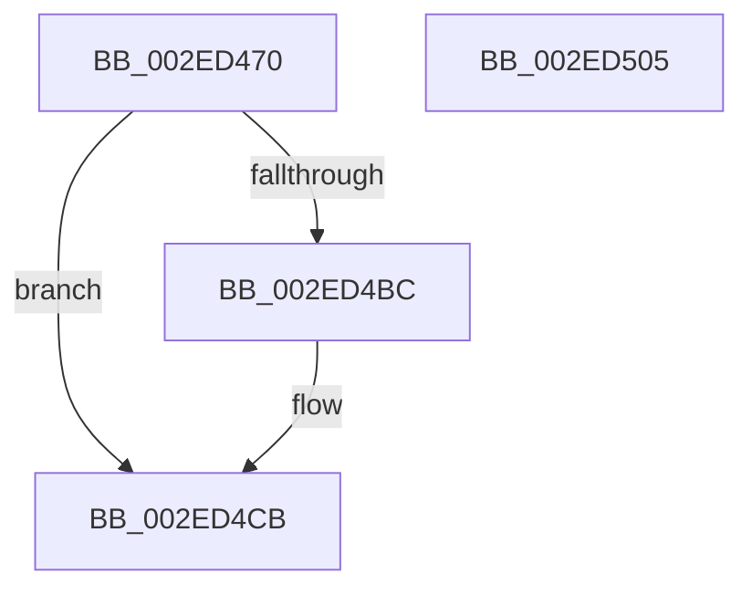

# RtlpHpSegMgrVaCtxInsert

- RVA: `0x002ED470`–`0x002ED506` (길이 `150` bytes)
- VA: `0x00000001402ED470`
- 실행 섹션: `.text`
- PDB 이름 있음: `예`; PDB Function 태그: `아니요`
- unwind 정보 RVA: `0x000718AC`
- 디코드: `41`개 명령, `150/150` bytes 표시
- 미해석 바이트: `0` (있으면 어셈블리에 `.byte`로 보존)

> 이 문서는 커널 이미지의 기계어와 PDB 기호를 분석해 생성했습니다. 4번과 5번은 함수 원형과 자료형을 바이너리 사용 방식에서 추정한 C 해석이며 원본 소스 복구 결과는 아닙니다.

## 1. Dependencies

- 직접 호출 지점: **3**; 고유 호출 대상: **3**
- 직접 호출자로 확인된 함수: **1**
- RIP 상대 이미지 참조: **1**

### Outgoing calls
- `0x002ED499` → [RtlpHpVaMgrCtxQuery](../32/RtlpHpVaMgrCtxQuery_function_003273C0.md) (function, `0x003273C0`)
- `0x002ED4D5` → [RtlpHpSegMgrLock](RtlpHpSegMgrLock_function_002ED710.md) (function, `0x002ED710`)
- `0x002ED4F0` → [RtlpHpSegMgrUnlock](RtlpHpSegMgrUnlock_function_002ED6E8.md) (function, `0x002ED6E8`)

### Direct callers
- [RtlpHpSegMgrAllocate](RtlpHpSegMgrAllocate_function_002ED130.md) at `0x002ED1AC`

### Static image references
- `0x002ED48A` → RVA `0x00E68658` (`.data`; read)

## 2. Other-region calls and transfers

- 다른 실행 섹션으로 향하는 call: **0**
- 별도 외부 분기/꼬리 이동을 확인하지 못했습니다.

## 3. Assembly (complete function range)

```asm
002ED470  48 8B C4                        mov rax, rsp
002ED473  48 89 58 08                     mov qword ptr [rax + 8], rbx
002ED477  48 89 70 10                     mov qword ptr [rax + 0x10], rsi
002ED47B  57                              push rdi
002ED47C  48 83 EC 40                     sub rsp, 0x40
002ED480  0F 57 C0                        xorps xmm0, xmm0
002ED483  4C 8D 40 D8                     lea r8, [rax - 0x28]
002ED487  48 8B F9                        mov rdi, rcx
002ED48A  48 8D 0D C7 B1 B7 00            lea rcx, [rip + 0xb7b1c7]
002ED491  0F 11 40 D8                     movups xmmword ptr [rax - 0x28], xmm0
002ED495  0F 11 40 E8                     movups xmmword ptr [rax - 0x18], xmm0
002ED499  E8 22 9F 03 00                  call 0x1403273c0
002ED49E  48 8B 74 24 30                  mov rsi, qword ptr [rsp + 0x30]
002ED4A3  B9 FF 07 00 00                  mov ecx, 0x7ff
002ED4A8  0F B7 06                        movzx eax, word ptr [rsi]
002ED4AB  8D 50 01                        lea edx, [rax + 1]
002ED4AE  66 33 D0                        xor dx, ax
002ED4B1  66 23 D1                        and dx, cx
002ED4B4  66 33 D0                        xor dx, ax
002ED4B7  66 89 16                        mov word ptr [rsi], dx
002ED4BA  7D 0F                           jge 0x1402ed4cb
002ED4BC  48 0F BF 47 14                  movsx rax, word ptr [rdi + 0x14]
002ED4C1  F0 48 FF 04 38                  lock inc qword ptr [rax + rdi]
002ED4C6  48 8B 74 24 30                  mov rsi, qword ptr [rsp + 0x30]
002ED4CB  0F B7 1E                        movzx ebx, word ptr [rsi]
002ED4CE  48 8B CF                        mov rcx, rdi
002ED4D1  48 C1 EB 0F                     shr rbx, 0xf
002ED4D5  E8 36 02 00 00                  call 0x1402ed710
002ED4DA  48 8B 4C DF 78                  mov rcx, qword ptr [rdi + rbx*8 + 0x78]
002ED4DF  48 8D 56 08                     lea rdx, [rsi + 8]
002ED4E3  48 89 0A                        mov qword ptr [rdx], rcx
002ED4E6  48 8B CF                        mov rcx, rdi
002ED4E9  48 89 54 DF 78                  mov qword ptr [rdi + rbx*8 + 0x78], rdx
002ED4EE  8A D0                           mov dl, al
002ED4F0  E8 F3 01 00 00                  call 0x1402ed6e8
002ED4F5  48 8B 5C 24 50                  mov rbx, qword ptr [rsp + 0x50]
002ED4FA  48 8B 74 24 58                  mov rsi, qword ptr [rsp + 0x58]
002ED4FF  48 83 C4 40                     add rsp, 0x40
002ED503  5F                              pop rdi
002ED504  C3                              ret
002ED505  CC                              int3
```

## 4. C-style interpretation (structured pseudocode)

```c
__int64 __fastcall RtlpHpSegMgrVaCtxInsert(__int64 a1)
{
    __int64 result;
    __int64 v_rbx;
    __int64 v_rsi;
    __int64 v_rsp;
    unsigned __int64 v_stack_m18;
    unsigned __int64 v_stack_p10;
    unsigned __int64 v_stack_p8;

    *(unsigned __int64 *)(v_rsp + 8) = v_rbx;
    *(unsigned __int64 *)(v_rsp + 16) = v_rsi;
    v_rsp = (v_rsp) - (64);
    *(unsigned __int64 *)(v_rsp - 40) = v_xmm0;
    *(unsigned __int64 *)(v_rsp - 24) = v_xmm0;
    result = RtlpHpVaMgrCtxQuery(v_rip + 12038599, a2, v_rsp - 40, a4);
    a2 = (unsigned __int16)((*(unsigned __int16 *)(v_stack_m18) + 1) ^ ((unsigned __int16)(*(unsigned __int16 *)(v_stack_m18))));
    a2 = (unsigned __int16)((a2) & ((unsigned __int16)((unsigned int)(0x7FFULL))));
    a2 = (unsigned __int16)((a2) ^ ((unsigned __int16)(*(unsigned __int16 *)(v_stack_m18))));
    *(unsigned __int16 *)(v_stack_m18) = (unsigned __int16)(a2);
    result = *(unsigned __int16 *)(v_stack_m18);
    v_rsi = v_stack_m18;
    if (!(condition_is_greater_or_equal)) {
        result = (__int16)(*(unsigned __int16 *)(a1 + 20));
        v_rsi = v_stack_m18;
    }
    v_rbx = (*(unsigned __int16 *)(v_rsi)) >> (15);
    result = RtlpHpSegMgrLock(a1, a2, v_rsp - 40, a4);
    *(unsigned __int64 *)(v_rsi + 8) = *(unsigned __int64 *)(a1 + v_rbx * 8 + 120);
    *(unsigned __int64 *)(a1 + v_rbx * 8 + 120) = v_rsi + 8;
    result = RtlpHpSegMgrUnlock(a1, (unsigned __int8)(result), v_rsp - 40, a4);
    v_rsp = (v_rsp) + (64);
    return result;
}
```

## 5. (Beta) C Style

```c
int64_t RtlpHpSegMgrVaCtxInsert(void *Arg1)
{
    uint8_t *arg1 = (uint8_t *)Arg1;

    int64_t result;
    int64_t local_rbx;
    int64_t local_rsi;
    int64_t local_rsp;
    uint64_t v_stack_m18;
    uint64_t v_stack_p10;
    uint64_t v_stack_p8;

    *(uint64_t *)(local_rsp + 0x8) = local_rbx;
    *(uint64_t *)(local_rsp + 0x10) = local_rsi;
    local_rsp = (local_rsp) - (64);
    *(uint64_t *)(local_rsp - 0x28) = v_xmm0;
    *(uint64_t *)(local_rsp - 0x18) = v_xmm0;
    result = RtlpHpVaMgrCtxQuery(v_rip + 12038599, a2, local_rsp - 40, a4);
    a2 = (uint16_t)((*(uint16_t *)(v_stack_m18) + 1) ^ ((uint16_t)(*(uint16_t *)(v_stack_m18))));
    a2 = (uint16_t)((a2) & ((uint16_t)((uint32_t)(0x7FFULL))));
    a2 = (uint16_t)((a2) ^ ((uint16_t)(*(uint16_t *)(v_stack_m18))));
    *(uint16_t *)(v_stack_m18) = (uint16_t)(a2);
    result = *(uint16_t *)(v_stack_m18);
    local_rsi = v_stack_m18;
    if (!(condition_is_greater_or_equal)) {
        result = (int16_t)(*(uint16_t *)(arg1 + 0x14));
        local_rsi = v_stack_m18;
    }
    local_rbx = (*(uint16_t *)(local_rsi)) >> (15);
    result = RtlpHpSegMgrLock(Arg1, a2, local_rsp - 40, a4);
    *(uint64_t *)(local_rsi + 0x8) = *(uint64_t *)(arg1 + local_rbx * 8 + 0x78);
    *(uint64_t *)(arg1 + local_rbx * 8 + 0x78) = local_rsi + 8;
    result = RtlpHpSegMgrUnlock(Arg1, (uint8_t)(result), local_rsp - 40, a4);
    local_rsp = (local_rsp) + (64);
    return result;
}
```

### 관측된 메모리 오프셋

구조체 형식이 확인되지 않은 접근은 인자 기준의 오프셋으로만 기록했습니다.

| 기준 인자 | 오프셋 표현 | 폭 (bit) | 접근 |
|---|---:|---:|---|
| `Arg1` | `+ 0x14` | `16` | `R` |
| `Arg1` | `+ 0x78 + rbx*8` | `64` | `R` |
| `Arg1` | `+ 0x78 + rbx*8` | `64` | `W` |

## 6. Execution-region graph

[열기: 2D/3D 그래프와 함수 탐색 컨트롤 패널](../../../control-panel.html?section=text&rva=0x002ED470&view=graph)

- 2D 그래프는 위에서 아래로 흐르고, 3D 그래프는 빈 공간을 드래그해 회전합니다. Shift+드래그는 이동, 휠은 확대·축소, 함수 노드 선택은 대상 보고서 이동입니다.

### Static fallback


