# RtlpHpSegPageRangeShrink

- RVA: `0x002E2FA0`–`0x002E3191` (길이 `497` bytes)
- VA: `0x00000001402E2FA0`
- 실행 섹션: `.text`
- PDB 이름 있음: `예`; PDB Function 태그: `아니요`
- unwind 정보 RVA: `0x00070DB8`
- 디코드: `142`개 명령, `497/497` bytes 표시
- 미해석 바이트: `0` (있으면 어셈블리에 `.byte`로 보존)

> 이 문서는 커널 이미지의 기계어와 PDB 기호를 분석해 생성했습니다. 4번과 5번은 함수 원형과 자료형을 바이너리 사용 방식에서 추정한 C 해석이며 원본 소스 복구 결과는 아닙니다.

## 1. Dependencies

- 직접 호출 지점: **3**; 고유 호출 대상: **3**
- 직접 호출자로 확인된 함수: **6**
- RIP 상대 이미지 참조: **0**

### Outgoing calls
- `0x002E2FE3` → [RtlpHpSegLockAcquire](RtlpHpSegLockAcquire_function_002E34A0.md) (function, `0x002E34A0`)
- `0x002E3036` → [RtlpHpSegPageRangeCoalesce](../32/RtlpHpSegPageRangeCoalesce_function_00325860.md) (function, `0x00325860`)
- `0x002E3172` → [RtlRbInsertNodeEx](RtlRbInsertNodeEx_function_002E4570.md) (function, `0x002E4570`)

### Direct callers
- [RtlpHpSegAlloc](../32/RtlpHpSegAlloc_function_003265BC.md) at `0x00326773`
- [ExAllocateHeapPool](../35/ExAllocateHeapPool_function_0035BA30.md) at `0x0035C0C8`
- [ExAllocateHeapPool](../35/ExAllocateHeapPool_function_0035BA30.md) at `0x0035D363`
- [sub_0035F6BF](../35/Unknown_function_0035F6BF.md) at `0x0035F8DD`
- [sub_003602E3](../36/Unknown_function_003602E3.md) at `0x00360823`
- [RtlpHpSegFreeInternal](../36/RtlpHpSegFreeInternal_function_0036198C.md) at `0x00361A1F`
- [sub_00B830A9](../../poolcode/B8/Unknown_function_00B830A9.md) at `0x00B835DD`

### Static image references
- 디코드된 RIP-relative 메모리 참조가 없습니다.

## 2. Other-region calls and transfers

- 다른 실행 섹션으로 향하는 call: **0**
- call이 아닌 외부 분기/꼬리 이동: **9**
  - `0x002E2FF5` → [sub_002E3489](Unknown_function_002E3489.md) (`tail-transfer`)
  - `0x002E3064` → [sub_002E3357 + 0xF](Unknown_function_002E3357.md) (`tail-transfer`)
  - `0x002E3072` → [sub_002E3357 + 0x73](Unknown_function_002E3357.md) (`tail-transfer`)
  - `0x002E30E4` → [sub_002E3459](Unknown_function_002E3459.md) (`tail-transfer`)
  - `0x002E30FC` → [sub_002E3357 + 0x58](Unknown_function_002E3357.md) (`tail-transfer`)
  - `0x002E3136` → [sub_002E3416](Unknown_function_002E3416.md) (`tail-transfer`)
  - `0x002E314A` → [sub_002E3357 + 0x3B](Unknown_function_002E3357.md) (`tail-transfer`)
  - `0x002E3157` → [sub_002E3357 + 0x4](Unknown_function_002E3357.md) (`tail-transfer`)
  - `0x002E3160` → [sub_002E3357 + 0x1](Unknown_function_002E3357.md) (`tail-transfer`)

## 3. Assembly (complete function range)

```asm
002E2FA0  48 89 5C 24 10                  mov qword ptr [rsp + 0x10], rbx
002E2FA5  44 89 44 24 18                  mov dword ptr [rsp + 0x18], r8d
002E2FAA  55                              push rbp
002E2FAB  56                              push rsi
002E2FAC  57                              push rdi
002E2FAD  41 54                           push r12
002E2FAF  41 56                           push r14
002E2FB1  48 83 EC 30                     sub rsp, 0x30
002E2FB5  0F B6 72 1F                     movzx esi, byte ptr [rdx + 0x1f]
002E2FB9  48 8B DA                        mov rbx, rdx
002E2FBC  48 8B F9                        mov rdi, rcx
002E2FBF  8D 6E FF                        lea ebp, [rsi - 1]
002E2FC2  83 FD 01                        cmp ebp, 1
002E2FC5  76 19                           jbe 0x1402e2fe0
002E2FC7  48 8D 4A 38                     lea rcx, [rdx + 0x38]
002E2FCB  8D 55 FF                        lea edx, [rbp - 1]
002E2FCE  0F B6 01                        movzx eax, byte ptr [rcx]
002E2FD1  48 8D 49 20                     lea rcx, [rcx + 0x20]
002E2FD5  24 FE                           and al, 0xfe
002E2FD7  88 41 E0                        mov byte ptr [rcx - 0x20], al
002E2FDA  48 83 EA 01                     sub rdx, 1
002E2FDE  75 EE                           jne 0x1402e2fce
002E2FE0  48 8B CF                        mov rcx, rdi
002E2FE3  E8 B8 04 00 00                  call 0x1402e34a0
002E2FE8  8B 53 1C                        mov edx, dword ptr [rbx + 0x1c]
002E2FEB  88 44 24 70                     mov byte ptr [rsp + 0x70], al
002E2FEF  0F B6 43 1F                     movzx eax, byte ptr [rbx + 0x1f]
002E2FF3  3B C6                           cmp eax, esi
002E2FF5  0F 85 8E 04 00 00               jne 0x1402e3489
002E2FFB  0F B6 43 18                     movzx eax, byte ptr [rbx + 0x18]
002E2FFF  8D 4E FF                        lea ecx, [rsi - 1]
002E3002  0C 02                           or al, 2
002E3004  4C 8D 4C 24 70                  lea r9, [rsp + 0x70]
002E3009  88 43 18                        mov byte ptr [rbx + 0x18], al
002E300C  45 33 C0                        xor r8d, r8d
002E300F  8B C5                           mov eax, ebp
002E3011  48 C1 E0 05                     shl rax, 5
002E3015  88 4C 18 1A                     mov byte ptr [rax + rbx + 0x1a], cl
002E3019  48 8B CF                        mov rcx, rdi
002E301C  66 89 53 1C                     mov word ptr [rbx + 0x1c], dx
002E3020  48 8B D3                        mov rdx, rbx
002E3023  40 88 73 1F                     mov byte ptr [rbx + 0x1f], sil
002E3027  C7 03 DD CC DD CC               mov dword ptr [rbx], 0xccddccdd
002E302D  0F B6 43 18                     movzx eax, byte ptr [rbx + 0x18]
002E3031  24 F3                           and al, 0xf3
002E3033  88 43 18                        mov byte ptr [rbx + 0x18], al
002E3036  E8 25 28 04 00                  call 0x140325860
002E303B  44 0F B6 47 0D                  movzx r8d, byte ptr [rdi + 0xd]
002E3040  45 33 E4                        xor r12d, r12d
002E3043  4C 8B F0                        mov r14, rax
002E3046  BE 00 01 00 00                  mov esi, 0x100
002E304B  41 8D 6C 24 02                  lea ebp, [r12 + 2]
002E3050  41 F6 C0 10                     test r8b, 0x10
002E3054  74 14                           je 0x1402e306a
002E3056  0F B6 4F 0A                     movzx ecx, byte ptr [rdi + 0xa]
002E305A  8B D6                           mov edx, esi
002E305C  0F B6 40 1F                     movzx eax, byte ptr [rax + 0x1f]
002E3060  2B D1                           sub edx, ecx
002E3062  3B C2                           cmp eax, edx
002E3064  0F 84 FC 02 00 00               je 0x1402e3366
002E306A  41 80 E0 07                     and r8b, 7
002E306E  41 80 F8 01                     cmp r8b, 1
002E3072  0F 82 52 03 00 00               jb 0x1402e33ca
002E3078  0F B6 4F 08                     movzx ecx, byte ptr [rdi + 8]
002E307C  4D 8B C6                        mov r8, r14
002E307F  4C 8B 0F                        mov r9, qword ptr [rdi]
002E3082  45 8B D4                        mov r10d, r12d
002E3085  45 0F B6 5E 1F                  movzx r11d, byte ptr [r14 + 0x1f]
002E308A  49 8B D1                        mov rdx, r9
002E308D  49 23 D6                        and rdx, r14
002E3090  41 D3 E3                        shl r11d, cl
002E3093  4C 2B C2                        sub r8, rdx
002E3096  49 C1 F8 05                     sar r8, 5
002E309A  49 D3 E0                        shl r8, cl
002E309D  4C 03 C2                        add r8, rdx
002E30A0  41 8D 4B FF                     lea ecx, [r11 - 1]
002E30A4  4D 23 C8                        and r9, r8
002E30A7  45 2B C1                        sub r8d, r9d
002E30AA  41 03 C8                        add ecx, r8d
002E30AD  41 8B C0                        mov eax, r8d
002E30B0  48 C1 E9 15                     shr rcx, 0x15
002E30B4  49 8B 51 18                     mov rdx, qword ptr [r9 + 0x18]
002E30B8  48 C1 E8 15                     shr rax, 0x15
002E30BC  4C 8D 0C 4A                     lea r9, [rdx + rcx*2]
002E30C0  48 8D 0C 42                     lea rcx, [rdx + rax*2]
002E30C4  49 8B D1                        mov rdx, r9
002E30C7  48 2B D1                        sub rdx, rcx
002E30CA  41 8B C4                        mov eax, r12d
002E30CD  48 D1 FA                        sar rdx, 1
002E30D0  FF C2                           inc edx
002E30D2  49 3B C9                        cmp rcx, r9
002E30D5  77 23                           ja 0x1402e30fa
002E30D7  BB FF 07 00 00                  mov ebx, 0x7ff
002E30DC  44 0F B7 01                     movzx r8d, word ptr [rcx]
002E30E0  66 44 85 C3                     test bx, r8w
002E30E4  0F 84 6F 03 00 00               je 0x1402e3459
002E30EA  66 45 85 C0                     test r8w, r8w
002E30EE  79 02                           jns 0x1402e30f2
002E30F0  FF C0                           inc eax
002E30F2  48 03 CD                        add rcx, rbp
002E30F5  49 3B C9                        cmp rcx, r9
002E30F8  76 E2                           jbe 0x1402e30dc
002E30FA  3B C2                           cmp eax, edx
002E30FC  0F 85 AD 02 00 00               jne 0x1402e33af
002E3102  8B C2                           mov eax, edx
002E3104  41 8B CB                        mov ecx, r11d
002E3107  48 81 C1 FF FF 1F 00            add rcx, 0x1fffff
002E310E  48 C1 E9 15                     shr rcx, 0x15
002E3112  48 3B C1                        cmp rax, rcx
002E3115  0F 97 C2                        seta dl
002E3118  B8 1E 00 00 00                  mov eax, 0x1e
002E311D  4C 8D 57 60                     lea r10, [rdi + 0x60]
002E3121  49 8B CE                        mov rcx, r14
002E3124  88 14 08                        mov byte ptr [rax + rcx], dl
002E3127  4D 8B 42 08                     mov r8, qword ptr [r10 + 8]
002E312B  41 8B 46 1C                     mov eax, dword ptr [r14 + 0x1c]
002E312F  49 8B 12                        mov rdx, qword ptr [r10]
002E3132  41 F6 C0 01                     test r8b, 1
002E3136  0F 85 DA 02 00 00               jne 0x1402e3416
002E313C  41 83 E0 01                     and r8d, 1
002E3140  32 C9                           xor cl, cl
002E3142  48 85 D2                        test rdx, rdx
002E3145  74 21                           je 0x1402e3168
002E3147  3B 42 1C                        cmp eax, dword ptr [rdx + 0x1c]
002E314A  0F 82 42 02 00 00               jb 0x1402e3392
002E3150  48 8B 4A 08                     mov rcx, qword ptr [rdx + 8]
002E3154  45 85 C0                        test r8d, r8d
002E3157  0F 84 FE 01 00 00               je 0x1402e335b
002E315D  48 85 C9                        test rcx, rcx
002E3160  0F 85 F2 01 00 00               jne 0x1402e3358
002E3166  B1 01                           mov cl, 1
002E3168  44 0F B6 C1                     movzx r8d, cl
002E316C  4D 8B CE                        mov r9, r14
002E316F  49 8B CA                        mov rcx, r10
002E3172  E8 F9 13 00 00                  call 0x1402e4570
002E3177  41 8B 46 1C                     mov eax, dword ptr [r14 + 0x1c]
002E317B  F7 D0                           not eax
002E317D  0F B7 C8                        movzx ecx, ax
002E3180  48 0F BF 47 16                  movsx rax, word ptr [rdi + 0x16]
002E3185  F0 48 01 4C 38 10               lock add qword ptr [rax + rdi + 0x10], rcx
002E318B  49 8B DC                        mov rbx, r12
002E318E  8B 47 28                        mov eax, dword ptr [rdi + 0x28]
```

## 4. C-style interpretation (structured pseudocode)

```c
__int64 __fastcall RtlpHpSegPageRangeShrink(__int64 a1, __int64 a2, int a3)
{
    __int64 result;
    __int64 v_r11;
    __int64 v_r12;
    __int64 v_rsp;
    unsigned __int64 v_stack_p10;
    unsigned int v_stack_p18;

    v_stack_p10 = v_rbx;
    v_stack_p18 = a3;
    v_rsp = (v_rsp) - (48);
    if (((unsigned int)(*(unsigned __int8 *)(a2 + 31) - 1)) <= 1) goto loc_002E2FE0;
loc_002E2FCE:
    result = (unsigned __int8)((*(unsigned __int8 *)(a2 + 56)) & (254));
    *(unsigned __int8 *)(a2 + 56 + 32 - 32) = (unsigned __int8)(result);
    a2 = (*(unsigned __int8 *)(a2 + 31) - 1 - 1) - (1);
    if (condition_is_not_equal) goto loc_002E2FCE;
loc_002E2FE0:
    result = RtlpHpSegLockAcquire(a1, a2, a3, a4);
    v_stack_p18 = (unsigned __int8)(result);
    result = (unsigned __int8)((*(unsigned __int8 *)(a2 + 24)) | (2));
    *(unsigned __int8 *)(a2 + 24) = (unsigned __int8)(result);
    a3 = 0;
    result = ((unsigned int)((unsigned int)(*(unsigned __int8 *)(a2 + 31) - 1))) << (5);
    *(unsigned __int8 *)(result + a2 * 1 + 26) = (unsigned __int8)(*(unsigned __int8 *)(a2 + 31) - 1);
    *(unsigned __int16 *)(a2 + 28) = (unsigned __int16)((unsigned int)(*(unsigned int *)(a2 + 28)));
    *(unsigned __int8 *)(a2 + 31) = (unsigned __int8)(*(unsigned __int8 *)(a2 + 31));
    *(unsigned int *)(a2) = 0xCCDDCCDDULL;
    result = (unsigned __int8)((*(unsigned __int8 *)(a2 + 24)) & (243));
    *(unsigned __int8 *)(a2 + 24) = (unsigned __int8)(result);
    result = RtlpHpSegPageRangeCoalesce(a1, a2, a3, v_stack_p18);
    v_r12 = 0;
    if ((((unsigned __int8)(*(unsigned __int8 *)(a1 + 13))) & (16)) == 0) goto loc_002E306A;
    a2 = (unsigned int)((256) - ((unsigned int)(*(unsigned __int8 *)(a1 + 10))));
loc_002E306A:
    a3 = (unsigned __int8)((*(unsigned __int8 *)(a1 + 13)) & (7));
    a2 = (*(unsigned __int64 *)(a1)) & (result);
    v_r11 = (unsigned int)((*(unsigned __int8 *)(result + 31)) << ((unsigned __int8)(*(unsigned __int8 *)(a1 + 8))));
    a3 = (result) - (a2);
    a3 = (a3) >> (5);
    a3 = (a3) << ((unsigned __int8)(*(unsigned __int8 *)(a1 + 8)));
    a3 = (a3) + (a2);
    a4 = (*(unsigned __int64 *)(a1)) & (a3);
    a3 = (unsigned int)((a3) - ((unsigned int)(a4)));
    a1 = (unsigned int)((v_r11 - 1) + (a3));
    a1 = (a1) >> (21);
    result = ((unsigned int)(a3)) >> (21);
    a2 = (*(unsigned __int64 *)(a4 + 24) + a1 * 2) - (*(unsigned __int64 *)(a4 + 24) + result * 2);
    a2 = (a2) >> (1);
    a2 = (unsigned int)((a2) + 1);
    if ((*(unsigned __int64 *)(a4 + 24) + result * 2) > (*(unsigned __int64 *)(a4 + 24) + a1 * 2)) goto loc_002E30FA;
loc_002E30DC:
    result = 0;
    if (sign_flag) {
        result = (unsigned int)((0) + 1);
    }
    a1 = (*(unsigned __int64 *)(a4 + 24) + result * 2) + (v_r12 + 2);
    if (a1 <= (*(unsigned __int64 *)(a4 + 24) + a1 * 2)) goto loc_002E30DC;
loc_002E30FA:
    a1 = ((unsigned int)((unsigned int)(v_r11))) + (0x1FFFFFULL);
    a1 = (a1) >> (21);
    a2 = (((unsigned int)((unsigned int)(a2))) > a1) ? 1 : 0;
    *(unsigned __int8 *)(30 + result * 1) = (unsigned __int8)(a2);
    a3 = (unsigned int)((*(unsigned __int64 *)(a1 + 96 + 8)) & (1));
    a1 = 0;
    if (*(unsigned __int64 *)(a1 + 96) == 0) goto loc_002E3168;
loc_002E3168:
    result = RtlRbInsertNodeEx(a1 + 96, *(unsigned __int64 *)(a1 + 96), 1, result);
    result = (unsigned int)(~((unsigned int)(*(unsigned int *)(result + 28))));
    return (unsigned int)(*(unsigned int *)(a1 + 40));
}
```

## 5. (Beta) C Style

```c
int64_t RtlpHpSegPageRangeShrink(void *Arg1, void *Arg2, int32_t Arg3)
{
    uint8_t *arg1 = (uint8_t *)Arg1;
    uint8_t *arg2 = (uint8_t *)Arg2;

    int64_t result;
    int64_t local_r11;
    int64_t local_r12;
    int64_t local_rsp;
    uint64_t v_stack_p10;
    uint32_t v_stack_p18;

    v_stack_p10 = local_rbx;
    v_stack_p18 = Arg3;
    local_rsp = (local_rsp) - (48);
    if (((uint32_t)(*(uint8_t *)(arg2 + 0x1F) - 1)) <= 1) goto loc_002E2FE0;
loc_002E2FCE:
    result = (uint8_t)((*(uint8_t *)(arg2 + 0x38)) & (254));
    *(uint8_t *)(arg2 + 0x38 + 0x20 - 0x20) = (uint8_t)(result);
    Arg2 = (*(uint8_t *)(arg2 + 0x1F) - 1 - 1) - (1);
    if (condition_is_not_equal) goto loc_002E2FCE;
loc_002E2FE0:
    result = RtlpHpSegLockAcquire(Arg1, Arg2, Arg3, a4);
    v_stack_p18 = (uint8_t)(result);
    result = (uint8_t)((*(uint8_t *)(arg2 + 0x18)) | (2));
    *(uint8_t *)(arg2 + 0x18) = (uint8_t)(result);
    Arg3 = 0;
    result = ((uint32_t)((uint32_t)(*(uint8_t *)(arg2 + 0x1F) - 1))) << (5);
    *(uint8_t *)(result + arg2 * 1 + 0x1A) = (uint8_t)(*(uint8_t *)(arg2 + 0x1F) - 1);
    *(uint16_t *)(arg2 + 0x1C) = (uint16_t)((uint32_t)(*(uint32_t *)(arg2 + 0x1C)));
    *(uint8_t *)(arg2 + 0x1F) = (uint8_t)(*(uint8_t *)(arg2 + 0x1F));
    *(uint32_t *)(arg2) = 0xCCDDCCDDULL;
    result = (uint8_t)((*(uint8_t *)(arg2 + 0x18)) & (243));
    *(uint8_t *)(arg2 + 0x18) = (uint8_t)(result);
    result = RtlpHpSegPageRangeCoalesce(Arg1, Arg2, Arg3, v_stack_p18);
    local_r12 = 0;
    if ((((uint8_t)(*(uint8_t *)(arg1 + 0xD))) & (16)) == 0) goto loc_002E306A;
    Arg2 = (uint32_t)((256) - ((uint32_t)(*(uint8_t *)(arg1 + 0xA))));
loc_002E306A:
    Arg3 = (uint8_t)((*(uint8_t *)(arg1 + 0xD)) & (7));
    Arg2 = (*(uint64_t *)(arg1)) & (result);
    local_r11 = (uint32_t)((*(uint8_t *)(result + 0x1F)) << ((uint8_t)(*(uint8_t *)(arg1 + 0x8))));
    Arg3 = (result) - (Arg2);
    Arg3 = (Arg3) >> (5);
    Arg3 = (Arg3) << ((uint8_t)(*(uint8_t *)(arg1 + 0x8)));
    Arg3 = (Arg3) + (Arg2);
    a4 = (*(uint64_t *)(arg1)) & (Arg3);
    Arg3 = (uint32_t)((Arg3) - ((uint32_t)(a4)));
    Arg1 = (uint32_t)((local_r11 - 1) + (Arg3));
    Arg1 = (Arg1) >> (21);
    result = ((uint32_t)(Arg3)) >> (21);
    Arg2 = (*(uint64_t *)(a4 + 0x18) + Arg1 * 2) - (*(uint64_t *)(a4 + 0x18) + result * 2);
    Arg2 = (Arg2) >> (1);
    Arg2 = (uint32_t)((Arg2) + 1);
    if ((*(uint64_t *)(a4 + 0x18) + result * 2) > (*(uint64_t *)(a4 + 0x18) + Arg1 * 2)) goto loc_002E30FA;
loc_002E30DC:
    result = 0;
    if (sign_flag) {
        result = (uint32_t)((0) + 1);
    }
    Arg1 = (*(uint64_t *)(a4 + 0x18) + result * 2) + (local_r12 + 2);
    if (Arg1 <= (*(uint64_t *)(a4 + 0x18) + Arg1 * 2)) goto loc_002E30DC;
loc_002E30FA:
    Arg1 = ((uint32_t)((uint32_t)(local_r11))) + (0x1FFFFFULL);
    Arg1 = (Arg1) >> (21);
    Arg2 = (((uint32_t)((uint32_t)(Arg2))) > Arg1) ? 1 : 0;
    *(uint8_t *)(30 + result * 1) = (uint8_t)(Arg2);
    Arg3 = (uint32_t)((*(uint64_t *)(arg1 + 0x60 + 0x8)) & (1));
    Arg1 = 0;
    if (*(uint64_t *)(arg1 + 0x60) == 0) goto loc_002E3168;
loc_002E3168:
    result = RtlRbInsertNodeEx(Arg1 + 96, *(uint64_t *)(arg1 + 0x60), 1, result);
    result = (uint32_t)(~((uint32_t)(*(uint32_t *)(result + 0x1C))));
    return (uint32_t)(*(uint32_t *)(arg1 + 0x28));
}
```

### 관측된 메모리 오프셋

구조체 형식이 확인되지 않은 접근은 인자 기준의 오프셋으로만 기록했습니다.

| 기준 인자 | 오프셋 표현 | 폭 (bit) | 접근 |
|---|---:|---:|---|
| `Arg1` | `+ 0x0` | `64` | `R` |
| `Arg1` | `+ 0x8` | `8` | `R` |
| `Arg1` | `+ 0x8` | `64` | `R` |
| `Arg1` | `+ 0xA` | `8` | `R` |
| `Arg1` | `+ 0xD` | `8` | `R` |
| `Arg1` | `+ 0x16` | `16` | `R` |
| `Arg1` | `+ 0x28` | `32` | `R` |
| `Arg1` | `+ 0x60` | `64` | `R` |
| `Arg2` | `- 0x20` | `8` | `W` |
| `Arg2` | `+ 0x0` | `8` | `R` |
| `Arg2` | `+ 0x0` | `32` | `W` |
| `Arg2` | `+ 0x18` | `8` | `R` |
| `Arg2` | `+ 0x18` | `8` | `W` |
| `Arg2` | `+ 0x1C` | `16` | `W` |
| `Arg2` | `+ 0x1C` | `32` | `R` |
| `Arg2` | `+ 0x1F` | `8` | `R` |
| `Arg2` | `+ 0x1F` | `8` | `W` |
| `Arg2` | `+ 0x20` | `64` | `R` |
| `Arg2` | `+ 0x38` | `64` | `R` |

## 6. Execution-region graph

[열기: 2D/3D 그래프와 함수 탐색 컨트롤 패널](../../../control-panel.html?section=text&rva=0x002E2FA0&view=graph)

- 2D 그래프는 위에서 아래로 흐르고, 3D 그래프는 빈 공간을 드래그해 회전합니다. Shift+드래그는 이동, 휠은 확대·축소, 함수 노드 선택은 대상 보고서 이동입니다.

### Static fallback

```mermaid
flowchart TD
  bb_002E2FA0[BB_002E2FA0]
  bb_002E2FC7[BB_002E2FC7]
  bb_002E2FCE[BB_002E2FCE]
  bb_002E2FE0[BB_002E2FE0]
  bb_002E2FFB[BB_002E2FFB]
  bb_002E3056[BB_002E3056]
  bb_002E306A[BB_002E306A]
  bb_002E3078[BB_002E3078]
  bb_002E30D7[BB_002E30D7]
  bb_002E30DC[BB_002E30DC]
  bb_002E30EA[BB_002E30EA]
  bb_002E30F0[BB_002E30F0]
  bb_002E30F2[BB_002E30F2]
  bb_002E30FA[BB_002E30FA]
  bb_002E3102[BB_002E3102]
  bb_002E313C[BB_002E313C]
  bb_002E3147[BB_002E3147]
  bb_002E3150[BB_002E3150]
  bb_002E315D[BB_002E315D]
  bb_002E3166[BB_002E3166]
  bb_002E3168[BB_002E3168]
  bb_002E2FA0 -->|branch| bb_002E2FE0
  bb_002E2FA0 -->|fallthrough| bb_002E2FC7
  bb_002E2FC7 -->|flow| bb_002E2FCE
  bb_002E2FCE -->|branch| bb_002E2FCE
  bb_002E2FCE -->|fallthrough| bb_002E2FE0
  bb_002E2FE0 -->|fallthrough| bb_002E2FFB
  bb_002E2FFB -->|branch| bb_002E306A
  bb_002E2FFB -->|fallthrough| bb_002E3056
  bb_002E3056 -->|fallthrough| bb_002E306A
  bb_002E306A -->|fallthrough| bb_002E3078
  bb_002E3078 -->|branch| bb_002E30FA
  bb_002E3078 -->|fallthrough| bb_002E30D7
  bb_002E30D7 -->|flow| bb_002E30DC
  bb_002E30DC -->|fallthrough| bb_002E30EA
  bb_002E30EA -->|branch| bb_002E30F2
  bb_002E30EA -->|fallthrough| bb_002E30F0
  bb_002E30F0 -->|flow| bb_002E30F2
  bb_002E30F2 -->|branch| bb_002E30DC
  bb_002E30F2 -->|fallthrough| bb_002E30FA
  bb_002E30FA -->|fallthrough| bb_002E3102
  bb_002E3102 -->|fallthrough| bb_002E313C
  bb_002E313C -->|branch| bb_002E3168
  bb_002E313C -->|fallthrough| bb_002E3147
  bb_002E3147 -->|fallthrough| bb_002E3150
  bb_002E3150 -->|fallthrough| bb_002E315D
  bb_002E315D -->|fallthrough| bb_002E3166
  bb_002E3166 -->|flow| bb_002E3168
```


