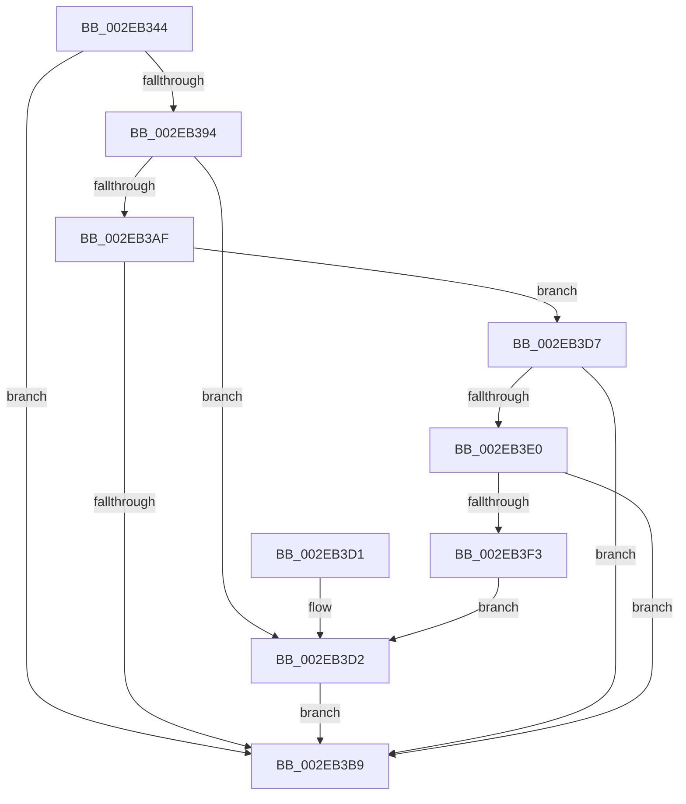

# RtlpHpSegSubAllocate

- RVA: `0x002EB344`–`0x002EB3F5` (길이 `177` bytes)
- VA: `0x00000001402EB344`
- 실행 섹션: `.text`
- PDB 이름 있음: `예`; PDB Function 태그: `아니요`
- unwind 정보 RVA: `0x00071640`
- 디코드: `53`개 명령, `177/177` bytes 표시
- 미해석 바이트: `0` (있으면 어셈블리에 `.byte`로 보존)

> 이 문서는 커널 이미지의 기계어와 PDB 기호를 분석해 생성했습니다. 4번과 5번은 함수 원형과 자료형을 바이너리 사용 방식에서 추정한 C 해석이며 원본 소스 복구 결과는 아닙니다.

## 1. Dependencies

- 직접 호출 지점: **2**; 고유 호출 대상: **2**
- 직접 호출자로 확인된 함수: **2**
- RIP 상대 이미지 참조: **2**

### Outgoing calls
- `0x002EB37C` → [RtlpHpSegAlloc](../32/RtlpHpSegAlloc_function_003265BC.md) (function, `0x003265BC`)
- `0x002EB3E9` → [RtlpHpSegPageRangeComputeLargePageCost](../41/RtlpHpSegPageRangeComputeLargePageCost_function_0041D6C0.md) (function, `0x0041D6C0`)

### Direct callers
- [RtlpHpSegVsAllocate](RtlpHpSegVsAllocate_function_002EB320.md) at `0x002EB332`
- [RtlpHpSegLfhAllocate](RtlpHpSegLfhAllocate_function_002EB690.md) at `0x002EB6A2`

### Static image references
- `0x002EB398` → RVA `0x0001A920` (`.rdata`; read)
- `0x002EB3AF` → RVA `0x00F059A0` (`.data`; read)

## 2. Other-region calls and transfers

- 다른 실행 섹션으로 향하는 call: **0**
- 별도 외부 분기/꼬리 이동을 확인하지 못했습니다.

## 3. Assembly (complete function range)

```asm
002EB344  48 89 5C 24 08                  mov qword ptr [rsp + 8], rbx
002EB349  48 89 6C 24 10                  mov qword ptr [rsp + 0x10], rbp
002EB34E  48 89 74 24 18                  mov qword ptr [rsp + 0x18], rsi
002EB353  57                              push rdi
002EB354  48 83 EC 30                     sub rsp, 0x30
002EB358  8B EA                           mov ebp, edx
002EB35A  41 8B C0                        mov eax, r8d
002EB35D  83 C8 04                        or eax, 4
002EB360  8B D2                           mov edx, edx
002EB362  49 8B D9                        mov rbx, r9
002EB365  81 FD 00 00 01 00               cmp ebp, 0x10000
002EB36B  48 8B F9                        mov rdi, rcx
002EB36E  41 0F 42 C0                     cmovb eax, r8d
002EB372  45 33 C9                        xor r9d, r9d
002EB375  44 8B C5                        mov r8d, ebp
002EB378  89 44 24 20                     mov dword ptr [rsp + 0x20], eax
002EB37C  E8 3B B2 03 00                  call 0x1403265bc
002EB381  83 23 00                        and dword ptr [rbx], 0
002EB384  48 8B F0                        mov rsi, rax
002EB387  48 8B 4C 24 60                  mov rcx, qword ptr [rsp + 0x60]
002EB38C  83 21 00                        and dword ptr [rcx], 0
002EB38F  48 85 C0                        test rax, rax
002EB392  74 25                           je 0x1402eb3b9
002EB394  48 8B 4F 28                     mov rcx, qword ptr [rdi + 0x28]
002EB398  48 8D 05 81 F5 D2 FF            lea rax, [rip - 0x2d0a7f]
002EB39F  48 C1 E9 08                     shr rcx, 8
002EB3A3  0F B6 C9                        movzx ecx, cl
002EB3A6  81 3C 88 00 00 10 00            cmp dword ptr [rax + rcx*4], 0x100000
002EB3AD  77 23                           ja 0x1402eb3d2
002EB3AF  8B 05 EB A5 C1 00               mov eax, dword ptr [rip + 0xc1a5eb]
002EB3B5  A8 10                           test al, 0x10
002EB3B7  75 1E                           jne 0x1402eb3d7
002EB3B9  48 8B 5C 24 40                  mov rbx, qword ptr [rsp + 0x40]
002EB3BE  48 8B C6                        mov rax, rsi
002EB3C1  48 8B 74 24 50                  mov rsi, qword ptr [rsp + 0x50]
002EB3C6  48 8B 6C 24 48                  mov rbp, qword ptr [rsp + 0x48]
002EB3CB  48 83 C4 30                     add rsp, 0x30
002EB3CF  5F                              pop rdi
002EB3D0  C3                              ret
002EB3D1  CC                              int3
002EB3D2  83 0B 01                        or dword ptr [rbx], 1
002EB3D5  EB E2                           jmp 0x1402eb3b9
002EB3D7  8A 47 0D                        mov al, byte ptr [rdi + 0xd]
002EB3DA  24 07                           and al, 7
002EB3DC  3C 01                           cmp al, 1
002EB3DE  72 D9                           jb 0x1402eb3b9
002EB3E0  44 8B C5                        mov r8d, ebp
002EB3E3  48 8B D6                        mov rdx, rsi
002EB3E6  48 8B CF                        mov rcx, rdi
002EB3E9  E8 D2 22 13 00                  call 0x14041d6c0
002EB3EE  83 F8 01                        cmp eax, 1
002EB3F1  7F C6                           jg 0x1402eb3b9
002EB3F3  EB DD                           jmp 0x1402eb3d2
```

## 4. C-style interpretation (structured pseudocode)

```c
__int64 __fastcall RtlpHpSegSubAllocate(__int64 a1, int a2, int a3, __int64 a4, __int64 a5)
{
    __int64 result;
    __int64 v_rsp;
    unsigned int v_stack_m18;
    unsigned __int64 v_stack_p10;
    unsigned __int64 v_stack_p18;
    unsigned __int64 v_stack_p8;

    v_stack_p8 = v_rbx;
    v_stack_p10 = v_rbp;
    v_stack_p18 = v_rsi;
    v_rsp = (v_rsp) - (48);
    result = (unsigned int)(((unsigned int)(a3)) | (4));
    if (((unsigned int)((unsigned int)(a2))) < 0x10000ULL) { result = a3; }
    a4 = 0;
    v_stack_m18 = (unsigned int)(result);
    result = RtlpHpSegAlloc(a1, (unsigned int)(a2), (unsigned int)((unsigned int)((unsigned int)(a2))), a4);
    if (result == 0) goto loc_002EB3B9;
    a1 = (*(unsigned __int64 *)(a1 + 40)) >> (8);
    if ((*(unsigned int *)(v_rip - 2951807 + (unsigned __int8)(a1) * 4)) > 0x100000ULL) goto loc_002EB3D2;
    if ((((unsigned __int8)((unsigned int)(*(unsigned int *)(v_rip + 12690923)))) & (16)) != 0) goto loc_002EB3D7;
loc_002EB3B9:
    v_rsp = (v_rsp) + (48);
    return result;
loc_002EB3D2:
    goto loc_002EB3B9;
loc_002EB3D7:
    result = (unsigned __int8)((*(unsigned __int8 *)(a1 + 13)) & (7));
    if (((unsigned __int8)(result)) < 1) goto loc_002EB3B9;
    result = RtlpHpSegPageRangeComputeLargePageCost(a1, v_stack_p18, (unsigned int)((unsigned int)(v_stack_p10)), a4);
    if (((unsigned int)(result)) > 1) goto loc_002EB3B9;
    goto loc_002EB3D2;
}
```

## 5. (Beta) C Style

```c
int64_t RtlpHpSegSubAllocate(void *Arg1, int32_t Arg2, int32_t Arg3, void *Arg4, void *Arg5)
{
    uint8_t *arg1 = (uint8_t *)Arg1;
    uint8_t *arg4 = (uint8_t *)Arg4;
    uint8_t *arg5 = (uint8_t *)Arg5;

    int64_t result;
    int64_t local_rsp;
    uint32_t v_stack_m18;
    uint64_t v_stack_p10;
    uint64_t v_stack_p18;
    uint64_t v_stack_p8;

    v_stack_p8 = local_rbx;
    v_stack_p10 = local_rbp;
    v_stack_p18 = local_rsi;
    local_rsp = (local_rsp) - (48);
    result = (uint32_t)(((uint32_t)(Arg3)) | (4));
    if (((uint32_t)((uint32_t)(Arg2))) < 0x10000ULL) { result = Arg3; }
    Arg4 = 0;
    v_stack_m18 = (uint32_t)(result);
    result = RtlpHpSegAlloc(Arg1, (uint32_t)(Arg2), (uint32_t)((uint32_t)((uint32_t)(Arg2))), Arg4);
    if (result == 0) goto loc_002EB3B9;
    Arg1 = (*(uint64_t *)(arg1 + 0x28)) >> (8);
    if ((*(uint32_t *)(v_rip - 0x2D0A7F + (uint8_t)(arg1) * 4)) > 0x100000ULL) goto loc_002EB3D2;
    if ((((uint8_t)((uint32_t)(*(uint32_t *)(v_rip + 0xC1A5EB)))) & (16)) != 0) goto loc_002EB3D7;
loc_002EB3B9:
    local_rsp = (local_rsp) + (48);
    return result;
loc_002EB3D2:
    goto loc_002EB3B9;
loc_002EB3D7:
    result = (uint8_t)((*(uint8_t *)(arg1 + 0xD)) & (7));
    if (((uint8_t)(result)) < 1) goto loc_002EB3B9;
    result = RtlpHpSegPageRangeComputeLargePageCost(Arg1, v_stack_p18, (uint32_t)((uint32_t)(v_stack_p10)), Arg4);
    if (((uint32_t)(result)) > 1) goto loc_002EB3B9;
    goto loc_002EB3D2;
}
```

### 관측된 메모리 오프셋

구조체 형식이 확인되지 않은 접근은 인자 기준의 오프셋으로만 기록했습니다.

| 기준 인자 | 오프셋 표현 | 폭 (bit) | 접근 |
|---|---:|---:|---|
| `Arg1` | `+ 0xD` | `8` | `R` |
| `Arg1` | `+ 0x28` | `64` | `R` |
| `Arg4` | `+ 0x0` | `32` | `R/W` |
| `Arg5` | `+ 0x0` | `32` | `R/W` |

## 6. Execution-region graph

[열기: 2D/3D 그래프와 함수 탐색 컨트롤 패널](../../../control-panel.html?section=text&rva=0x002EB344&view=graph)

- 2D 그래프는 위에서 아래로 흐르고, 3D 그래프는 빈 공간을 드래그해 회전합니다. Shift+드래그는 이동, 휠은 확대·축소, 함수 노드 선택은 대상 보고서 이동입니다.

### Static fallback


