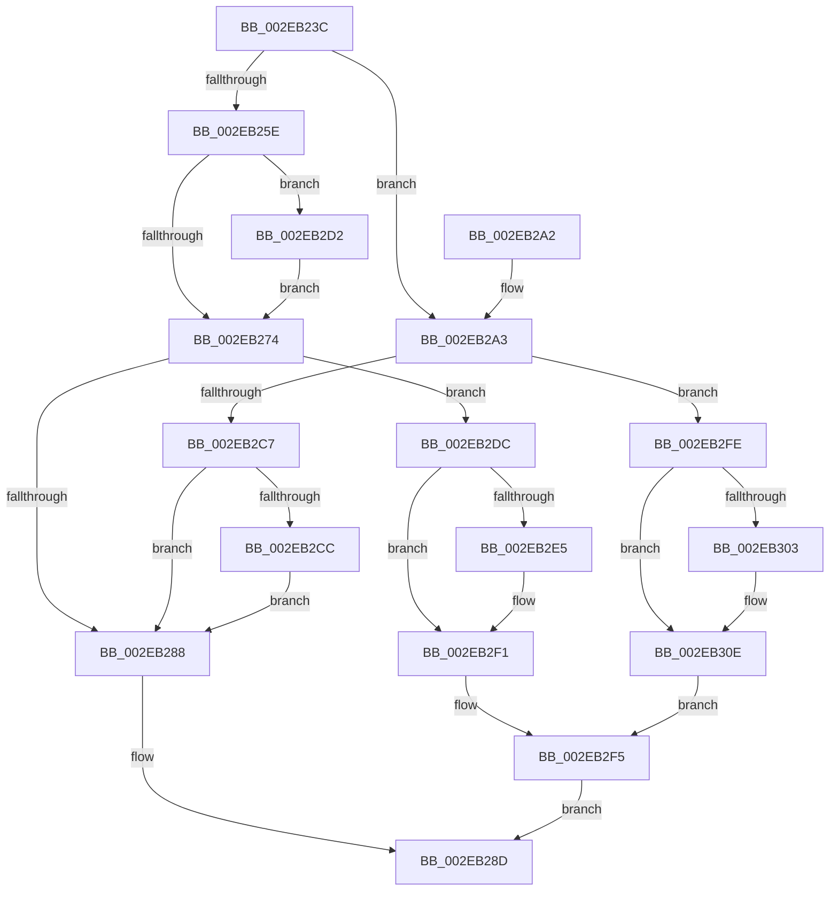

# RtlpHpTryAcquireQueuedLockExclusive

- RVA: `0x002EB23C`–`0x002EB315` (길이 `217` bytes)
- VA: `0x00000001402EB23C`
- 실행 섹션: `.text`
- PDB 이름 있음: `예`; PDB Function 태그: `아니요`
- unwind 정보 RVA: `0x00071628`
- 디코드: `60`개 명령, `217/217` bytes 표시
- 미해석 바이트: `0` (있으면 어셈블리에 `.byte`로 보존)

> 이 문서는 커널 이미지의 기계어와 PDB 기호를 분석해 생성했습니다. 4번과 5번은 함수 원형과 자료형을 바이너리 사용 방식에서 추정한 C 해석이며 원본 소스 복구 결과는 아닙니다.

## 1. Dependencies

- 직접 호출 지점: **6**; 고유 호출 대상: **6**
- 직접 호출자로 확인된 함수: **1**
- RIP 상대 이미지 참조: **1**

### Outgoing calls
- `0x002EB27F` → [ExTryAcquireSpinLockExclusiveAtDpcLevel](../2B/ExTryAcquireSpinLockExclusiveAtDpcLevel_function_002BB800.md) (function, `0x002BB800`)
- `0x002EB2BA` → [KeAbPreAcquire](../21/KeAbPreAcquire_function_00210230.md) (function, `0x00210230`)
- `0x002EB2D5` → [KiRaiseIrqlProcessIrqlFlags](../4F/KiRaiseIrqlProcessIrqlFlags_function_004F56FC.md) (function, `0x004F56FC`)
- `0x002EB2EC` → [KiLowerIrqlProcessIrqlFlags](../4F/KiLowerIrqlProcessIrqlFlags_function_004F5698.md) (function, `0x004F5698`)
- `0x002EB309` → [KeAbPostReleaseEx](../26/KeAbPostReleaseEx_function_00262210.md) (function, `0x00262210`)
- `0x002EB30E` → [KeLeaveGuardedRegion](KeLeaveGuardedRegion_function_002E2C40.md) (function, `0x002E2C40`)

### Direct callers
- [RtlpHpVsContextAllocate](RtlpHpVsContextAllocate_function_002EA944.md) at `0x002EA9EA`

### Static image references
- `0x002EB26B` → RVA `0x00FC6D20` (`ALMOSTRO`; read)

## 2. Other-region calls and transfers

- 다른 실행 섹션으로 향하는 call: **0**
- 별도 외부 분기/꼬리 이동을 확인하지 못했습니다.

## 3. Assembly (complete function range)

```asm
002EB23C  48 89 5C 24 08                  mov qword ptr [rsp + 8], rbx
002EB241  48 89 6C 24 10                  mov qword ptr [rsp + 0x10], rbp
002EB246  48 89 74 24 18                  mov qword ptr [rsp + 0x18], rsi
002EB24B  57                              push rdi
002EB24C  48 83 EC 20                     sub rsp, 0x20
002EB250  49 89 48 08                     mov qword ptr [r8 + 8], rcx
002EB254  49 8B F0                        mov rsi, r8
002EB257  48 8B D9                        mov rbx, rcx
002EB25A  85 D2                           test edx, edx
002EB25C  74 45                           je 0x1402eb2a3
002EB25E  44 0F 20 C7                     mov rdi, cr8
002EB262  BA 02 00 00 00                  mov edx, 2
002EB267  44 0F 22 C2                     mov cr8, rdx
002EB26B  83 3D AE BA CD 00 00            cmp dword ptr [rip + 0xcdbaae], 0
002EB272  75 5E                           jne 0x1402eb2d2
002EB274  40 0F B6 EF                     movzx ebp, dil
002EB278  48 8B CB                        mov rcx, rbx
002EB27B  48 89 6E 10                     mov qword ptr [rsi + 0x10], rbp
002EB27F  E8 7C 05 FD FF                  call 0x1402bb800
002EB284  85 C0                           test eax, eax
002EB286  74 54                           je 0x1402eb2dc
002EB288  B8 01 00 00 00                  mov eax, 1
002EB28D  48 8B 5C 24 30                  mov rbx, qword ptr [rsp + 0x30]
002EB292  48 8B 6C 24 38                  mov rbp, qword ptr [rsp + 0x38]
002EB297  48 8B 74 24 40                  mov rsi, qword ptr [rsp + 0x40]
002EB29C  48 83 C4 20                     add rsp, 0x20
002EB2A0  5F                              pop rdi
002EB2A1  C3                              ret
002EB2A2  CC                              int3
002EB2A3  65 48 8B 04 25 88 01 00 00      mov rax, qword ptr gs:[0x188]
002EB2AC  33 D2                           xor edx, edx
002EB2AE  66 FF 88 E6 01 00 00            dec word ptr [rax + 0x1e6]
002EB2B5  44 8D 42 01                     lea r8d, [rdx + 1]
002EB2B9  90                              nop
002EB2BA  E8 71 4F F2 FF                  call 0x140210230
002EB2BF  F0 48 0F BA 2B 00               lock bts qword ptr [rbx], 0
002EB2C5  72 37                           jb 0x1402eb2fe
002EB2C7  48 85 C0                        test rax, rax
002EB2CA  74 BC                           je 0x1402eb288
002EB2CC  C6 40 0A 01                     mov byte ptr [rax + 0xa], 1
002EB2D0  EB B6                           jmp 0x1402eb288
002EB2D2  40 8A CF                        mov cl, dil
002EB2D5  E8 22 A4 20 00                  call 0x1404f56fc
002EB2DA  EB 98                           jmp 0x1402eb274
002EB2DC  83 3D 3D BA CD 00 00            cmp dword ptr [rip + 0xcdba3d], 0
002EB2E3  74 0C                           je 0x1402eb2f1
002EB2E5  44 0F 20 C1                     mov rcx, cr8
002EB2E9  40 8A D7                        mov dl, dil
002EB2EC  E8 A7 A3 20 00                  call 0x1404f5698
002EB2F1  44 0F 22 C5                     mov cr8, rbp
002EB2F5  48 83 66 08 00                  and qword ptr [rsi + 8], 0
002EB2FA  33 C0                           xor eax, eax
002EB2FC  EB 8F                           jmp 0x1402eb28d
002EB2FE  48 85 C0                        test rax, rax
002EB301  74 0B                           je 0x1402eb30e
002EB303  48 8B D0                        mov rdx, rax
002EB306  48 8B CB                        mov rcx, rbx
002EB309  E8 02 6F F7 FF                  call 0x140262210
002EB30E  E8 2D 79 FF FF                  call 0x1402e2c40
002EB313  EB E0                           jmp 0x1402eb2f5
```

## 4. C-style interpretation (structured pseudocode)

```c
__int64 __fastcall RtlpHpTryAcquireQueuedLockExclusive(__int64 a1, int a2, __int64 a3)
{
    __int64 result;
    __int64 v_rsp;
    unsigned __int64 v_stack_p10;
    unsigned __int64 v_stack_p18;
    unsigned __int64 v_stack_p8;

    v_stack_p8 = v_rbx;
    v_stack_p10 = v_rbp;
    v_stack_p18 = v_rsi;
    v_rsp = (v_rsp) - (32);
    *(unsigned __int64 *)(a3 + 8) = a1;
    if (a2 == 0) goto loc_002EB2A3;
    if ((*(unsigned int *)(v_rip + 13482670)) != 0) goto loc_002EB2D2;
loc_002EB274:
    *(unsigned __int64 *)(a3 + 16) = (unsigned __int8)(v_cr8);
    result = ExTryAcquireSpinLockExclusiveAtDpcLevel(a1, 2, a3, a4);
    if ((unsigned int)(result) == 0) goto loc_002EB2DC;
loc_002EB288:
loc_002EB28D:
    v_rsp = (v_rsp) + (32);
    return 1;
loc_002EB2A3:
    a2 = 0;
    result = KeAbPreAcquire(a1, a2, a2 + 1, a4);
    if (condition_is_below) goto loc_002EB2FE;
    if (result == 0) goto loc_002EB288;
    *(unsigned __int8 *)(result + 10) = 1;
    goto loc_002EB288;
loc_002EB2D2:
    result = KiRaiseIrqlProcessIrqlFlags((unsigned __int8)(v_cr8), a2, a2 + 1, a4);
    goto loc_002EB274;
loc_002EB2DC:
    if ((*(unsigned int *)(v_rip + 13482557)) != 0) {
        a1 = 2;
        a2 = (unsigned __int8)(v_cr8);
        result = KiLowerIrqlProcessIrqlFlags(a1, a2, a2 + 1, a4);
    }
loc_002EB2F5:
    result = 0;
    goto loc_002EB28D;
loc_002EB2FE:
    if (0 != 0) {
        a2 = 0;
        a1 = v_stack_p8;
        result = KeAbPostReleaseEx(a1, a2, a2 + 1, a4);
    }
    result = KeLeaveGuardedRegion(a1, a2, a2 + 1, a4);
    goto loc_002EB2F5;
}
```

## 5. (Beta) C Style

```c
int64_t RtlpHpTryAcquireQueuedLockExclusive(void *Arg1, int32_t Arg2, void *Arg3)
{
    uint8_t *arg1 = (uint8_t *)Arg1;
    uint8_t *arg3 = (uint8_t *)Arg3;

    int64_t result;
    int64_t local_rsp;
    uint64_t v_stack_p10;
    uint64_t v_stack_p18;
    uint64_t v_stack_p8;

    v_stack_p8 = local_rbx;
    v_stack_p10 = local_rbp;
    v_stack_p18 = local_rsi;
    local_rsp = (local_rsp) - (32);
    *(void **)(arg3 + 0x8) = Arg1;
    if (Arg2 == 0) goto loc_002EB2A3;
    if ((*(uint32_t *)(v_rip + 0xCDBAAE)) != 0) goto loc_002EB2D2;
loc_002EB274:
    *(uint64_t *)(arg3 + 0x10) = (uint8_t)(v_cr8);
    result = ExTryAcquireSpinLockExclusiveAtDpcLevel(Arg1, 2, Arg3, a4);
    if ((uint32_t)(result) == 0) goto loc_002EB2DC;
loc_002EB288:
loc_002EB28D:
    local_rsp = (local_rsp) + (32);
    return 1;
loc_002EB2A3:
    Arg2 = 0;
    result = KeAbPreAcquire(Arg1, Arg2, Arg2 + 1, a4);
    if (condition_is_below) goto loc_002EB2FE;
    if (result == 0) goto loc_002EB288;
    *(uint8_t *)(result + 0xA) = 1;
    goto loc_002EB288;
loc_002EB2D2:
    result = KiRaiseIrqlProcessIrqlFlags((uint8_t)(v_cr8), Arg2, Arg2 + 1, a4);
    goto loc_002EB274;
loc_002EB2DC:
    if ((*(uint32_t *)(v_rip + 0xCDBA3D)) != 0) {
        Arg1 = 2;
        Arg2 = (uint8_t)(v_cr8);
        result = KiLowerIrqlProcessIrqlFlags(Arg1, Arg2, Arg2 + 1, a4);
    }
loc_002EB2F5:
    result = 0;
    goto loc_002EB28D;
loc_002EB2FE:
    if (0 != 0) {
        Arg2 = 0;
        Arg1 = v_stack_p8;
        result = KeAbPostReleaseEx(Arg1, Arg2, Arg2 + 1, a4);
    }
    result = KeLeaveGuardedRegion(Arg1, Arg2, Arg2 + 1, a4);
    goto loc_002EB2F5;
}
```

### 관측된 메모리 오프셋

구조체 형식이 확인되지 않은 접근은 인자 기준의 오프셋으로만 기록했습니다.

| 기준 인자 | 오프셋 표현 | 폭 (bit) | 접근 |
|---|---:|---:|---|
| `Arg1` | `+ 0x0` | `64` | `R/W` |
| `Arg3` | `+ 0x8` | `64` | `R/W` |
| `Arg3` | `+ 0x8` | `64` | `W` |
| `Arg3` | `+ 0x10` | `64` | `W` |

## 6. Execution-region graph

[열기: 2D/3D 그래프와 함수 탐색 컨트롤 패널](../../../control-panel.html?section=text&rva=0x002EB23C&view=graph)

- 2D 그래프는 위에서 아래로 흐르고, 3D 그래프는 빈 공간을 드래그해 회전합니다. Shift+드래그는 이동, 휠은 확대·축소, 함수 노드 선택은 대상 보고서 이동입니다.

### Static fallback


