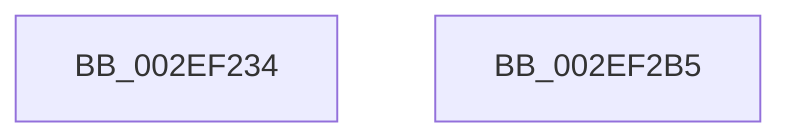

# RtlpHpVaMgrAllocAligned

- RVA: `0x002EF234`–`0x002EF2B6` (길이 `130` bytes)
- VA: `0x00000001402EF234`
- 실행 섹션: `.text`
- PDB 이름 있음: `예`; PDB Function 태그: `아니요`
- unwind 정보 RVA: `0x00071A74`
- 디코드: `29`개 명령, `130/130` bytes 표시
- 미해석 바이트: `0` (있으면 어셈블리에 `.byte`로 보존)

> 이 문서는 커널 이미지의 기계어와 PDB 기호를 분석해 생성했습니다. 4번과 5번은 함수 원형과 자료형을 바이너리 사용 방식에서 추정한 C 해석이며 원본 소스 복구 결과는 아닙니다.

## 1. Dependencies

- 직접 호출 지점: **1**; 고유 호출 대상: **1**
- 직접 호출자로 확인된 함수: **2**
- RIP 상대 이미지 참조: **1**

### Outgoing calls
- `0x002EF2A5` → [RtlpHpEnvAllocVA](../32/RtlpHpEnvAllocVA_function_00328F50.md) (function, `0x00328F50`)

### Direct callers
- [RtlpHpVaMgrAlloc](RtlpHpVaMgrAlloc_function_002EDB1C.md) at `0x002EDCA6`
- [RtlpHpVaMgrRegionAllocate](RtlpHpVaMgrRegionAllocate_function_002EF1B0.md) at `0x002EF1CC`

### Static image references
- `0x002EF23F` → RVA `0x00000000` (`image boundary/outside`; read)

## 2. Other-region calls and transfers

- 다른 실행 섹션으로 향하는 call: **0**
- 별도 외부 분기/꼬리 이동을 확인하지 못했습니다.

## 3. Assembly (complete function range)

```asm
002EF234  40 53                           push rbx
002EF236  48 83 EC 50                     sub rsp, 0x50
002EF23A  44 0F B6 59 2E                  movzx r11d, byte ptr [rcx + 0x2e]
002EF23F  48 8D 1D BA 0D D1 FF            lea rbx, [rip - 0x2ef246]
002EF246  48 83 64 24 60 00               and qword ptr [rsp + 0x60], 0
002EF24C  4C 8B C9                        mov r9, rcx
002EF24F  45 8B D3                        mov r10d, r11d
002EF252  B8 00 30 00 00                  mov eax, 0x3000
002EF257  41 D1 EA                        shr r10d, 1
002EF25A  B9 00 20 00 00                  mov ecx, 0x2000
002EF25F  41 83 E2 07                     and r10d, 7
002EF263  42 81 BC 93 20 A9 01 00 00 00 10 00  cmp dword ptr [rbx + r10*4 + 0x1a920], 0x100000
002EF26F  0F 47 C8                        cmova ecx, eax
002EF272  41 0F B6 41 2D                  movzx eax, byte ptr [r9 + 0x2d]
002EF277  42 0B 8C 93 88 EE 01 00         or ecx, dword ptr [rbx + r10*4 + 0x1ee88]
002EF27F  44 8B C9                        mov r9d, ecx
002EF282  89 44 24 40                     mov dword ptr [rsp + 0x40], eax
002EF286  41 0F BA E9 12                  bts r9d, 0x12
002EF28B  44 89 54 24 30                  mov dword ptr [rsp + 0x30], r10d
002EF290  41 F6 C3 10                     test r11b, 0x10
002EF294  C7 44 24 20 04 00 00 00         mov dword ptr [rsp + 0x20], 4
002EF29C  44 0F 44 C9                     cmove r9d, ecx
002EF2A0  48 8D 4C 24 60                  lea rcx, [rsp + 0x60]
002EF2A5  E8 A6 9C 03 00                  call 0x140328f50
002EF2AA  48 8B 44 24 60                  mov rax, qword ptr [rsp + 0x60]
002EF2AF  48 83 C4 50                     add rsp, 0x50
002EF2B3  5B                              pop rbx
002EF2B4  C3                              ret
002EF2B5  CC                              int3
```

## 4. C-style interpretation (structured pseudocode)

```c
__int64 __fastcall RtlpHpVaMgrAllocAligned(__int64 a1)
{
    __int64 result;
    __int64 v_r10;
    __int64 v_rsp;
    unsigned int v_stack_m18;
    unsigned int v_stack_m28;
    unsigned int v_stack_m38;
    unsigned __int64 v_stack_p8;

    v_rsp = (v_rsp) - (80);
    v_r10 = (unsigned int)(((unsigned int)((unsigned int)(*(unsigned __int8 *)(a1 + 46)))) >> (1));
    v_r10 = (unsigned int)((v_r10) & (7));
    a1 = (unsigned int)(0x2000ULL);
    if ((*(unsigned int *)(v_rip - 3076678 + v_r10 * 4 + 108832)) > 0x100000ULL) { a1 = (unsigned int)((unsigned int)(0x3000ULL)); }
    a1 = (unsigned int)((a1) | (*(unsigned int *)(v_rip - 3076678 + v_r10 * 4 + 126600)));
    v_stack_m18 = (unsigned int)(*(unsigned __int8 *)(a1 + 45));
    v_stack_m28 = (unsigned int)(v_r10);
    v_stack_m38 = 4;
    a4 = (unsigned int)((unsigned int)(a1));
    if ((((unsigned __int8)(*(unsigned __int8 *)(a1 + 46))) & (16)) == 0) { a4 = (unsigned int)(a1); }
    result = RtlpHpEnvAllocVA(v_stack_p8, a2, a3, a4);
    v_rsp = (v_rsp) + (80);
    return v_stack_p8;
}
```

## 5. (Beta) C Style

```c
int64_t RtlpHpVaMgrAllocAligned(void *Arg1)
{
    uint8_t *arg1 = (uint8_t *)Arg1;

    int64_t result;
    int64_t local_r10;
    int64_t local_rsp;
    uint32_t v_stack_m18;
    uint32_t v_stack_m28;
    uint32_t v_stack_m38;
    uint64_t v_stack_p8;

    local_rsp = (local_rsp) - (80);
    local_r10 = (uint32_t)(((uint32_t)((uint32_t)(*(uint8_t *)(arg1 + 0x2E)))) >> (1));
    local_r10 = (uint32_t)((local_r10) & (7));
    Arg1 = (uint32_t)(0x2000ULL);
    if ((*(uint32_t *)(v_rip - 0x2EF246 + local_r10 * 4 + 0x1A920)) > 0x100000ULL) { Arg1 = (uint32_t)((uint32_t)(0x3000ULL)); }
    Arg1 = (uint32_t)((Arg1) | (*(uint32_t *)(v_rip - 0x2EF246 + local_r10 * 4 + 0x1EE88)));
    v_stack_m18 = (uint32_t)(*(uint8_t *)(arg1 + 0x2D));
    v_stack_m28 = (uint32_t)(local_r10);
    v_stack_m38 = 4;
    a4 = (uint32_t)((uint32_t)(Arg1));
    if ((((uint8_t)(*(uint8_t *)(arg1 + 0x2E))) & (16)) == 0) { a4 = (uint32_t)(Arg1); }
    result = RtlpHpEnvAllocVA(v_stack_p8, a2, a3, a4);
    local_rsp = (local_rsp) + (80);
    return v_stack_p8;
}
```

### 관측된 메모리 오프셋

구조체 형식이 확인되지 않은 접근은 인자 기준의 오프셋으로만 기록했습니다.

| 기준 인자 | 오프셋 표현 | 폭 (bit) | 접근 |
|---|---:|---:|---|
| `Arg1` | `+ 0x2D` | `8` | `R` |
| `Arg1` | `+ 0x2E` | `8` | `R` |

## 6. Execution-region graph

[열기: 2D/3D 그래프와 함수 탐색 컨트롤 패널](../../../control-panel.html?section=text&rva=0x002EF234&view=graph)

- 2D 그래프는 위에서 아래로 흐르고, 3D 그래프는 빈 공간을 드래그해 회전합니다. Shift+드래그는 이동, 휠은 확대·축소, 함수 노드 선택은 대상 보고서 이동입니다.

### Static fallback


