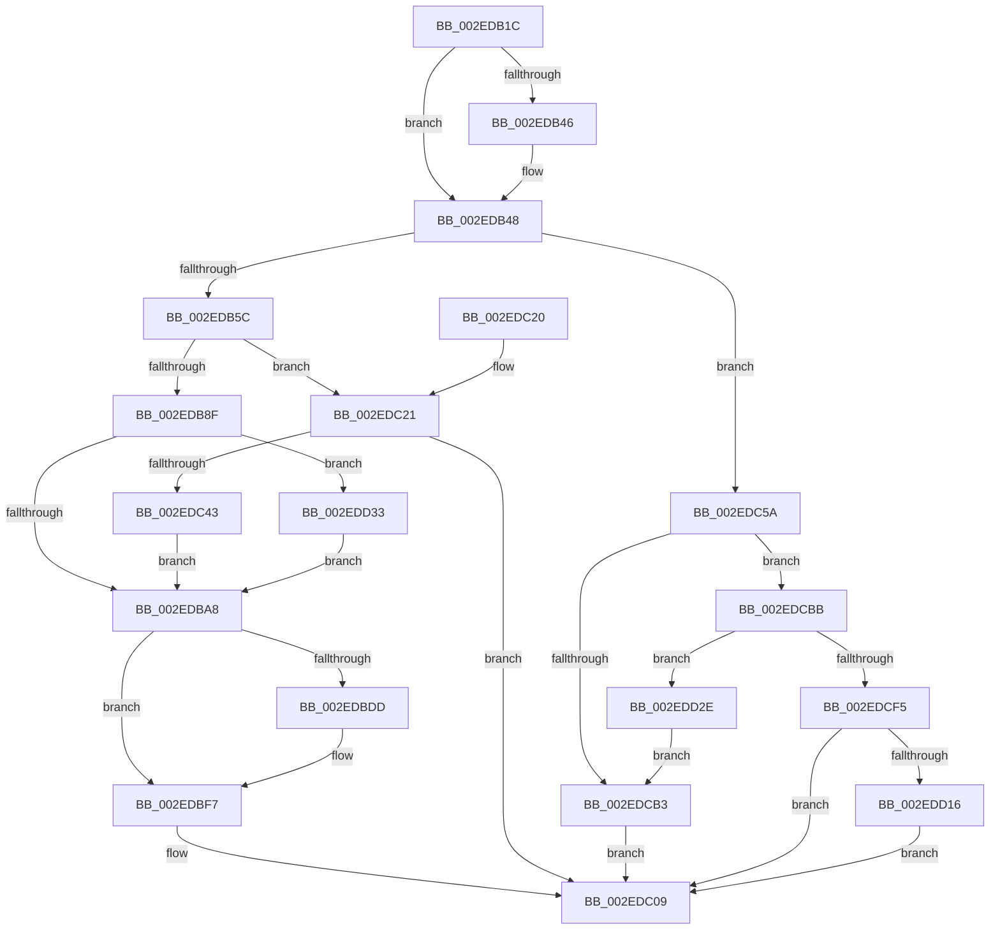

# RtlpHpVaMgrAlloc

- RVA: `0x002EDB1C`–`0x002EDD70` (길이 `596` bytes)
- VA: `0x00000001402EDB1C`
- 실행 섹션: `.text`
- PDB 이름 있음: `예`; PDB Function 태그: `아니요`
- unwind 정보 RVA: `0x0007193C`
- 디코드: `171`개 명령, `596/596` bytes 표시
- 미해석 바이트: `0` (있으면 어셈블리에 `.byte`로 보존)

> 이 문서는 커널 이미지의 기계어와 PDB 기호를 분석해 생성했습니다. 4번과 5번은 함수 원형과 자료형을 바이너리 사용 방식에서 추정한 C 해석이며 원본 소스 복구 결과는 아닙니다.

## 1. Dependencies

- 직접 호출 지점: **14**; 고유 호출 대상: **10**
- 직접 호출자로 확인된 함수: **1**
- RIP 상대 이미지 참조: **1**

### Outgoing calls
- `0x002EDB63` → [RtlpHpAcquireLockExclusive](../32/RtlpHpAcquireLockExclusive_function_003246B0.md) (function, `0x003246B0`)
- `0x002EDB7E` → [RtlpHpVaMgrRangeFind](RtlpHpVaMgrRangeFind_function_002EDD78.md) (function, `0x002EDD78`)
- `0x002EDB96` → [RtlRbRemoveNode](RtlRbRemoveNode_function_002E4C10.md) (function, `0x002E4C10`)
- `0x002EDBE7` → [RtlpHpVaMgrRangeSplit](RtlpHpVaMgrRangeSplit_function_002EDED0.md) (function, `0x002EDED0`)
- `0x002EDBF2` → [RtlpHpVaMgrFree](RtlpHpVaMgrFree_function_002EDF44.md) (function, `0x002EDF44`)
- `0x002EDC04` → [RtlpHpReleaseLockExclusive](../32/RtlpHpReleaseLockExclusive_function_00324230.md) (function, `0x00324230`)
- `0x002EDC2E` → [RtlpHpReleaseLockExclusive](../32/RtlpHpReleaseLockExclusive_function_00324230.md) (function, `0x00324230`)
- `0x002EDC36` → [RtlpHpVaMgrRegionAllocate](RtlpHpVaMgrRegionAllocate_function_002EF1B0.md) (function, `0x002EF1B0`)
- `0x002EDC4D` → [RtlpHpAcquireLockExclusive](../32/RtlpHpAcquireLockExclusive_function_003246B0.md) (function, `0x003246B0`)
- `0x002EDCA6` → [RtlpHpVaMgrAllocAligned](RtlpHpVaMgrAllocAligned_function_002EF234.md) (function, `0x002EF234`)
- `0x002EDCEB` → [RtlpHpVaMgrRangeCreate](RtlpHpVaMgrRangeCreate_function_002EF2BC.md) (function, `0x002EF2BC`)
- `0x002EDD24` → [MmFreePoolMemory](../2C/MmFreePoolMemory_function_002C1578.md) (function, `0x002C1578`)
- `0x002EDD58` → [RtlpHpVaMgrRangeSplit](RtlpHpVaMgrRangeSplit_function_002EDED0.md) (function, `0x002EDED0`)
- `0x002EDD63` → [RtlpHpVaMgrFree](RtlpHpVaMgrFree_function_002EDF44.md) (function, `0x002EDF44`)

### Direct callers
- [RtlpHpVaMgrCtxAlloc](RtlpHpVaMgrCtxAlloc_function_002EDA80.md) at `0x002EDAC4`

### Static image references
- `0x002EDC65` → RVA `0x0001A920` (`.rdata`; read)

## 2. Other-region calls and transfers

- 다른 실행 섹션으로 향하는 call: **0**
- 별도 외부 분기/꼬리 이동을 확인하지 못했습니다.

## 3. Assembly (complete function range)

```asm
002EDB1C  48 89 5C 24 18                  mov qword ptr [rsp + 0x18], rbx
002EDB21  55                              push rbp
002EDB22  56                              push rsi
002EDB23  57                              push rdi
002EDB24  41 56                           push r14
002EDB26  41 57                           push r15
002EDB28  48 8B EC                        mov rbp, rsp
002EDB2B  48 83 EC 40                     sub rsp, 0x40
002EDB2F  4C 8B 32                        mov r14, qword ptr [rdx]
002EDB32  33 FF                           xor edi, edi
002EDB34  48 89 7D 30                     mov qword ptr [rbp + 0x30], rdi
002EDB38  49 8B F0                        mov rsi, r8
002EDB3B  4C 8B FA                        mov r15, rdx
002EDB3E  48 8B D9                        mov rbx, rcx
002EDB41  4D 85 F6                        test r14, r14
002EDB44  75 02                           jne 0x1402edb48
002EDB46  CD 2C                           int 0x2c
002EDB48  0F B7 41 28                     movzx eax, word ptr [rcx + 0x28]
002EDB4C  0F B6 51 2E                     movzx edx, byte ptr [rcx + 0x2e]
002EDB50  C1 E0 14                        shl eax, 0x14
002EDB53  4C 3B F0                        cmp r14, rax
002EDB56  0F 87 FE 00 00 00               ja 0x1402edc5a
002EDB5C  83 E2 01                        and edx, 1
002EDB5F  49 C1 EE 14                     shr r14, 0x14
002EDB63  E8 48 6B 03 00                  call 0x1403246b0
002EDB68  48 C1 EE 14                     shr rsi, 0x14
002EDB6C  4C 8D 4D 30                     lea r9, [rbp + 0x30]
002EDB70  44 0F B7 C6                     movzx r8d, si
002EDB74  41 0F B7 D6                     movzx edx, r14w
002EDB78  48 8B CB                        mov rcx, rbx
002EDB7B  44 8A F8                        mov r15b, al
002EDB7E  E8 F5 01 00 00                  call 0x1402edd78
002EDB83  48 8B F0                        mov rsi, rax
002EDB86  48 85 C0                        test rax, rax
002EDB89  0F 84 92 00 00 00               je 0x1402edc21
002EDB8F  48 8D 4B 08                     lea rcx, [rbx + 8]
002EDB93  48 8B D0                        mov rdx, rax
002EDB96  E8 75 70 FF FF                  call 0x1402e4c10
002EDB9B  48 8B 7D 30                     mov rdi, qword ptr [rbp + 0x30]
002EDB9F  48 3B FE                        cmp rdi, rsi
002EDBA2  0F 85 8B 01 00 00               jne 0x1402edd33
002EDBA8  48 8B 43 18                     mov rax, qword ptr [rbx + 0x18]
002EDBAC  48 8B FE                        mov rdi, rsi
002EDBAF  0F 57 C0                        xorps xmm0, xmm0
002EDBB2  48 2B 78 28                     sub rdi, qword ptr [rax + 0x28]
002EDBB6  8B 48 18                        mov ecx, dword ptr [rax + 0x18]
002EDBB9  48 D3 EF                        shr rdi, cl
002EDBBC  48 C1 E7 14                     shl rdi, 0x14
002EDBC0  48 03 78 08                     add rdi, qword ptr [rax + 8]
002EDBC4  33 C0                           xor eax, eax
002EDBC6  0F 11 06                        movups xmmword ptr [rsi], xmm0
002EDBC9  48 89 46 10                     mov qword ptr [rsi + 0x10], rax
002EDBCD  C6 06 01                        mov byte ptr [rsi], 1
002EDBD0  8A 43 2C                        mov al, byte ptr [rbx + 0x2c]
002EDBD3  88 46 01                        mov byte ptr [rsi + 1], al
002EDBD6  66 44 39 76 18                  cmp word ptr [rsi + 0x18], r14w
002EDBDB  76 1A                           jbe 0x1402edbf7
002EDBDD  45 0F B7 C6                     movzx r8d, r14w
002EDBE1  48 8B D6                        mov rdx, rsi
002EDBE4  48 8B CB                        mov rcx, rbx
002EDBE7  E8 E4 02 00 00                  call 0x1402eded0
002EDBEC  48 8B D0                        mov rdx, rax
002EDBEF  48 8B CB                        mov rcx, rbx
002EDBF2  E8 4D 03 00 00                  call 0x1402edf44
002EDBF7  0F B6 53 2E                     movzx edx, byte ptr [rbx + 0x2e]
002EDBFB  45 8A C7                        mov r8b, r15b
002EDBFE  83 E2 01                        and edx, 1
002EDC01  48 8B CB                        mov rcx, rbx
002EDC04  E8 27 66 03 00                  call 0x140324230
002EDC09  48 8B 9C 24 80 00 00 00         mov rbx, qword ptr [rsp + 0x80]
002EDC11  48 8B C7                        mov rax, rdi
002EDC14  48 83 C4 40                     add rsp, 0x40
002EDC18  41 5F                           pop r15
002EDC1A  41 5E                           pop r14
002EDC1C  5F                              pop rdi
002EDC1D  5E                              pop rsi
002EDC1E  5D                              pop rbp
002EDC1F  C3                              ret
002EDC20  CC                              int3
002EDC21  0F B6 53 2E                     movzx edx, byte ptr [rbx + 0x2e]
002EDC25  45 8A C7                        mov r8b, r15b
002EDC28  83 E2 01                        and edx, 1
002EDC2B  48 8B CB                        mov rcx, rbx
002EDC2E  E8 FD 65 03 00                  call 0x140324230
002EDC33  48 8B CB                        mov rcx, rbx
002EDC36  E8 75 15 00 00                  call 0x1402ef1b0
002EDC3B  48 8B F0                        mov rsi, rax
002EDC3E  48 85 C0                        test rax, rax
002EDC41  74 C6                           je 0x1402edc09
002EDC43  0F B6 53 2E                     movzx edx, byte ptr [rbx + 0x2e]
002EDC47  48 8B CB                        mov rcx, rbx
002EDC4A  83 E2 01                        and edx, 1
002EDC4D  E8 5E 6A 03 00                  call 0x1403246b0
002EDC52  44 8A F8                        mov r15b, al
002EDC55  E9 4E FF FF FF                  jmp 0x1402edba8
002EDC5A  48 8B C2                        mov rax, rdx
002EDC5D  B9 00 00 20 00                  mov ecx, 0x200000
002EDC62  48 3B F1                        cmp rsi, rcx
002EDC65  48 8D 15 B4 CC D2 FF            lea rdx, [rip - 0x2d334c]
002EDC6C  48 0F 47 CE                     cmova rcx, rsi
002EDC70  48 D1 E8                        shr rax, 1
002EDC73  83 E0 07                        and eax, 7
002EDC76  44 8B 04 82                     mov r8d, dword ptr [rdx + rax*4]
002EDC7A  48 8D 55 30                     lea rdx, [rbp + 0x30]
002EDC7E  49 3B C8                        cmp rcx, r8
002EDC81  4C 0F 47 C1                     cmova r8, rcx
002EDC85  49 8D 4E FF                     lea rcx, [r14 - 1]
002EDC89  49 03 C8                        add rcx, r8
002EDC8C  49 8D 40 FF                     lea rax, [r8 - 1]
002EDC90  48 23 C8                        and rcx, rax
002EDC93  49 8B C0                        mov rax, r8
002EDC96  48 2B C1                        sub rax, rcx
002EDC99  48 8B CB                        mov rcx, rbx
002EDC9C  48 FF C8                        dec rax
002EDC9F  49 03 C6                        add rax, r14
002EDCA2  48 89 45 30                     mov qword ptr [rbp + 0x30], rax
002EDCA6  E8 89 15 00 00                  call 0x1402ef234
002EDCAB  48 8B F0                        mov rsi, rax
002EDCAE  48 85 C0                        test rax, rax
002EDCB1  75 08                           jne 0x1402edcbb
002EDCB3  48 8B FE                        mov rdi, rsi
002EDCB6  E9 4E FF FF FF                  jmp 0x1402edc09
002EDCBB  4C 8B 75 30                     mov r14, qword ptr [rbp + 0x30]
002EDCBF  4C 8D 45 E0                     lea r8, [rbp - 0x20]
002EDCC3  33 C0                           xor eax, eax
002EDCC5  0F 57 C0                        xorps xmm0, xmm0
002EDCC8  48 89 45 F0                     mov qword ptr [rbp - 0x10], rax
002EDCCC  48 8B D6                        mov rdx, rsi
002EDCCF  8A 43 2C                        mov al, byte ptr [rbx + 0x2c]
002EDCD2  48 8B CB                        mov rcx, rbx
002EDCD5  0F 11 45 E0                     movups xmmword ptr [rbp - 0x20], xmm0
002EDCD9  88 45 E1                        mov byte ptr [rbp - 0x1f], al
002EDCDC  49 8B C6                        mov rax, r14
002EDCDF  48 C1 E8 14                     shr rax, 0x14
002EDCE3  48 89 45 F8                     mov qword ptr [rbp - 8], rax
002EDCE7  C6 45 E0 05                     mov byte ptr [rbp - 0x20], 5
002EDCEB  E8 CC 15 00 00                  call 0x1402ef2bc
002EDCF0  48 85 C0                        test rax, rax
002EDCF3  75 39                           jne 0x1402edd2e
002EDCF5  48 8D 86 FF FF 1F 00            lea rax, [rsi + 0x1fffff]
002EDCFC  48 25 00 00 E0 FF               and rax, 0xffffffffffe00000
002EDD02  48 2B F0                        sub rsi, rax
002EDD05  48 89 45 38                     mov qword ptr [rbp + 0x38], rax
002EDD09  4C 03 F6                        add r14, rsi
002EDD0C  4C 89 75 30                     mov qword ptr [rbp + 0x30], r14
002EDD10  0F 84 F3 FE FF FF               je 0x1402edc09
002EDD16  41 B8 00 80 00 00               mov r8d, 0x8000
002EDD1C  48 8D 55 30                     lea rdx, [rbp + 0x30]
002EDD20  48 8D 4D 38                     lea rcx, [rbp + 0x38]
002EDD24  E8 4F 38 FD FF                  call 0x1402c1578
002EDD29  E9 DB FE FF FF                  jmp 0x1402edc09
002EDD2E  4D 89 37                        mov qword ptr [r15], r14
002EDD31  EB 80                           jmp 0x1402edcb3
002EDD33  33 C0                           xor eax, eax
002EDD35  0F 57 C0                        xorps xmm0, xmm0
002EDD38  0F 11 06                        movups xmmword ptr [rsi], xmm0
002EDD3B  48 89 46 10                     mov qword ptr [rsi + 0x10], rax
002EDD3F  4C 8B C7                        mov r8, rdi
002EDD42  C6 06 01                        mov byte ptr [rsi], 1
002EDD45  4C 2B C6                        sub r8, rsi
002EDD48  8A 43 2C                        mov al, byte ptr [rbx + 0x2c]
002EDD4B  48 8B D6                        mov rdx, rsi
002EDD4E  49 C1 F8 05                     sar r8, 5
002EDD52  48 8B CB                        mov rcx, rbx
002EDD55  88 46 01                        mov byte ptr [rsi + 1], al
002EDD58  E8 73 01 00 00                  call 0x1402eded0
002EDD5D  48 8B D6                        mov rdx, rsi
002EDD60  48 8B CB                        mov rcx, rbx
002EDD63  E8 DC 01 00 00                  call 0x1402edf44
002EDD68  48 8B F7                        mov rsi, rdi
002EDD6B  E9 38 FE FF FF                  jmp 0x1402edba8
```

## 4. C-style interpretation (structured pseudocode)

```c
__int64 __fastcall RtlpHpVaMgrAlloc(__int64 a1, __int64 a2, __int64 a3)
{
    __int64 result;
    __int64 v_r14;
    __int64 v_rdi;
    __int64 v_rsi;
    __int64 v_rsp;
    unsigned __int64 v_stack_m30;
    unsigned __int64 v_stack_m38;
    unsigned __int8 v_stack_m47;
    unsigned __int64 v_stack_m48;
    unsigned __int64 v_stack_p10;
    unsigned __int64 v_stack_p18;
    unsigned __int64 v_stack_p8;

    v_stack_p18 = v_rbx;
    v_rsp = (v_rsp) - (64);
    v_rdi = 0;
    v_stack_p8 = 0;
    if (*(unsigned __int64 *)(a2) == 0) {
    }
    result = (unsigned int)((*(unsigned __int16 *)(a1 + 40)) << (20));
    if ((*(unsigned __int64 *)(a2)) > result) goto loc_002EDC5A;
    a2 = (unsigned int)((*(unsigned __int8 *)(a1 + 46)) & (1));
    v_r14 = (*(unsigned __int64 *)(a2)) >> (20);
    result = RtlpHpAcquireLockExclusive(a1, a2, a3, a4);
    v_rsi = (a3) >> (20);
    result = RtlpHpVaMgrRangeFind(a1, (unsigned __int16)(v_r14), (unsigned __int16)(v_rsi), v_stack_p8);
    if (result == 0) goto loc_002EDC21;
    result = RtlRbRemoveNode(a1 + 8, result, (unsigned __int16)(v_rsi), v_stack_p8);
    if (v_stack_p8 != result) goto loc_002EDD33;
loc_002EDBA8:
    v_rdi = (result) - (*(unsigned __int64 *)(*(unsigned __int64 *)(a1 + 24) + 40));
    v_rdi = (v_rdi) >> ((unsigned __int8)((unsigned int)(*(unsigned int *)(*(unsigned __int64 *)(a1 + 24) + 24))));
    v_rdi = (v_rdi) << (20);
    v_rdi = (v_rdi) + (*(unsigned __int64 *)(*(unsigned __int64 *)(a1 + 24) + 8));
    result = 0;
    *(unsigned __int64 *)(result) = v_xmm0;
    *(unsigned __int64 *)(result + 16) = 0;
    *(unsigned __int8 *)(result) = 1;
    *(unsigned __int8 *)(result + 1) = (unsigned __int8)(*(unsigned __int8 *)(a1 + 44));
    result = *(unsigned __int8 *)(a1 + 44);
    if ((*(unsigned __int16 *)(result + 24)) >= = ((unsigned __int16)(v_r14))) {
        a3 = (unsigned __int16)(v_r14);
        a2 = 0;
        a1 = a1;
        result = RtlpHpVaMgrRangeSplit(a1, a2, a3, v_stack_p8);
        a2 = result;
        a1 = a1;
        result = RtlpHpVaMgrFree(a1, a2, a3, v_stack_p8);
    }
    a2 = (unsigned int)((*(unsigned __int8 *)(a1 + 46)) & (1));
    result = RtlpHpReleaseLockExclusive(a1, a2, (unsigned __int8)((unsigned __int8)(result)), v_stack_p8);
loc_002EDC09:
    v_rsp = (v_rsp) + (64);
    return v_rdi;
loc_002EDC21:
    a2 = (unsigned int)((*(unsigned __int8 *)(v_stack_p18 + 46)) & (1));
    result = RtlpHpReleaseLockExclusive(v_stack_p18, a2, (unsigned __int8)((unsigned __int8)(result)), v_stack_p8);
    result = RtlpHpVaMgrRegionAllocate(v_stack_p18, a2, (unsigned __int8)((unsigned __int8)(result)), v_stack_p8);
    if (result == 0) goto loc_002EDC09;
    a2 = (unsigned int)((*(unsigned __int8 *)(v_stack_p18 + 46)) & (1));
    result = RtlpHpAcquireLockExclusive(v_stack_p18, a2, (unsigned __int8)((unsigned __int8)(result)), v_stack_p8);
    goto loc_002EDBA8;
loc_002EDC5A:
    a1 = (unsigned int)(0x200000ULL);
    if (result > ((unsigned int)(0x200000ULL))) { a1 = result; }
    result = (a2) >> (1);
    result = (unsigned int)((result) & (7));
    a3 = (unsigned int)(*(unsigned int *)(v_rip - 2962252 + result * 4));
    if (a1 > ((unsigned int)(*(unsigned int *)(v_rip - 2962252 + result * 4)))) { a3 = a1; }
    a1 = (v_r14 - 1) + (a3);
    a1 = (a1) & (a3 - 1);
    result = (a3) - (a1);
    result = (result) - 1;
    result = (result) + (v_r14);
    v_stack_p8 = result;
    result = RtlpHpVaMgrAllocAligned(v_stack_p18, v_stack_p8, a3, v_stack_p8);
    if (result != 0) goto loc_002EDCBB;
loc_002EDCB3:
    goto loc_002EDC09;
loc_002EDCBB:
    result = 0;
    v_stack_m38 = 0;
    v_stack_m48 = v_xmm0;
    v_stack_m47 = (unsigned __int8)(*(unsigned __int8 *)(v_stack_p18 + 44));
    result = (v_stack_p8) >> (20);
    v_stack_m30 = result;
    v_stack_m48 = 5;
    result = RtlpHpVaMgrRangeCreate(v_stack_p18, 0, v_stack_m48, v_stack_p8);
    if (result != 0) goto loc_002EDD2E;
    result = (result + 2097151) & (0xFFFFFFFFFFE00000ULL);
    v_rsi = (result) - (result);
    v_stack_p10 = result;
    v_r14 = (v_stack_p8) + (v_rsi);
    v_stack_p8 = v_r14;
    if (condition_is_equal) goto loc_002EDC09;
    result = MmFreePoolMemory(v_stack_p10, v_stack_p8, (unsigned int)(0x8000ULL), v_stack_p8);
    goto loc_002EDC09;
loc_002EDD2E:
    *(unsigned __int64 *)((unsigned __int8)(result)) = v_r14;
    goto loc_002EDCB3;
loc_002EDD33:
    result = 0;
    *(unsigned __int64 *)(v_rsi) = v_xmm0;
    *(unsigned __int64 *)(v_rsi + 16) = 0;
    *(unsigned __int8 *)(v_rsi) = 1;
    a3 = (0) - (v_rsi);
    a3 = (a3) >> (5);
    *(unsigned __int8 *)(v_rsi + 1) = (unsigned __int8)(*(unsigned __int8 *)(v_stack_p18 + 44));
    result = RtlpHpVaMgrRangeSplit(v_stack_p18, v_rsi, a3, v_stack_p8);
    result = RtlpHpVaMgrFree(v_stack_p18, v_rsi, a3, v_stack_p8);
    goto loc_002EDBA8;
}
```

## 5. (Beta) C Style

```c
int64_t RtlpHpVaMgrAlloc(void *Arg1, void *Arg2, int64_t Arg3)
{
    uint8_t *arg1 = (uint8_t *)Arg1;
    uint8_t *arg2 = (uint8_t *)Arg2;

    int64_t result;
    int64_t local_r14;
    int64_t local_rdi;
    int64_t local_rsi;
    int64_t local_rsp;
    uint64_t v_stack_m30;
    uint64_t v_stack_m38;
    uint8_t v_stack_m47;
    uint64_t v_stack_m48;
    uint64_t v_stack_p10;
    uint64_t v_stack_p18;
    uint64_t v_stack_p8;

    v_stack_p18 = local_rbx;
    local_rsp = (local_rsp) - (64);
    local_rdi = 0;
    v_stack_p8 = 0;
    if (*(uint64_t *)(arg2) == 0) {
    }
    result = (uint32_t)((*(uint16_t *)(arg1 + 0x28)) << (20));
    if ((*(uint64_t *)(arg2)) > result) goto loc_002EDC5A;
    Arg2 = (uint32_t)((*(uint8_t *)(arg1 + 0x2E)) & (1));
    local_r14 = (*(uint64_t *)(arg2)) >> (20);
    result = RtlpHpAcquireLockExclusive(Arg1, Arg2, Arg3, a4);
    local_rsi = (Arg3) >> (20);
    result = RtlpHpVaMgrRangeFind(Arg1, (uint16_t)(local_r14), (uint16_t)(local_rsi), v_stack_p8);
    if (result == 0) goto loc_002EDC21;
    result = RtlRbRemoveNode(Arg1 + 8, result, (uint16_t)(local_rsi), v_stack_p8);
    if (v_stack_p8 != result) goto loc_002EDD33;
loc_002EDBA8:
    local_rdi = (result) - (*(uint64_t *)(*(uint64_t *)(arg1 + 0x18) + 0x28));
    local_rdi = (local_rdi) >> ((uint8_t)((uint32_t)(*(uint32_t *)(*(uint64_t *)(arg1 + 0x18) + 0x18))));
    local_rdi = (local_rdi) << (20);
    local_rdi = (local_rdi) + (*(uint64_t *)(*(uint64_t *)(arg1 + 0x18) + 0x8));
    result = 0;
    *(uint64_t *)(result) = v_xmm0;
    *(uint64_t *)(result + 0x10) = 0;
    *(uint8_t *)(result) = 1;
    *(uint8_t *)(result + 0x1) = (uint8_t)(*(uint8_t *)(arg1 + 0x2C));
    result = *(uint8_t *)(arg1 + 0x2C);
    if ((*(uint16_t *)(result + 0x18)) >= = ((uint16_t)(local_r14))) {
        Arg3 = (uint16_t)(local_r14);
        Arg2 = 0;
        Arg1 = Arg1;
        result = RtlpHpVaMgrRangeSplit(Arg1, Arg2, Arg3, v_stack_p8);
        Arg2 = result;
        Arg1 = Arg1;
        result = RtlpHpVaMgrFree(Arg1, Arg2, Arg3, v_stack_p8);
    }
    Arg2 = (uint32_t)((*(uint8_t *)(arg1 + 0x2E)) & (1));
    result = RtlpHpReleaseLockExclusive(Arg1, Arg2, (uint8_t)((uint8_t)(result)), v_stack_p8);
loc_002EDC09:
    local_rsp = (local_rsp) + (64);
    return local_rdi;
loc_002EDC21:
    Arg2 = (uint32_t)((*(uint8_t *)(v_stack_p18 + 0x2E)) & (1));
    result = RtlpHpReleaseLockExclusive(v_stack_p18, Arg2, (uint8_t)((uint8_t)(result)), v_stack_p8);
    result = RtlpHpVaMgrRegionAllocate(v_stack_p18, Arg2, (uint8_t)((uint8_t)(result)), v_stack_p8);
    if (result == 0) goto loc_002EDC09;
    Arg2 = (uint32_t)((*(uint8_t *)(v_stack_p18 + 0x2E)) & (1));
    result = RtlpHpAcquireLockExclusive(v_stack_p18, Arg2, (uint8_t)((uint8_t)(result)), v_stack_p8);
    goto loc_002EDBA8;
loc_002EDC5A:
    Arg1 = (uint32_t)(0x200000ULL);
    if (result > ((uint32_t)(0x200000ULL))) { Arg1 = result; }
    result = (Arg2) >> (1);
    result = (uint32_t)((result) & (7));
    Arg3 = (uint32_t)(*(uint32_t *)(v_rip - 0x2D334C + result * 4));
    if (Arg1 > ((uint32_t)(*(uint32_t *)(v_rip - 0x2D334C + result * 4)))) { Arg3 = Arg1; }
    Arg1 = (local_r14 - 1) + (Arg3);
    Arg1 = (Arg1) & (Arg3 - 1);
    result = (Arg3) - (Arg1);
    result = (result) - 1;
    result = (result) + (local_r14);
    v_stack_p8 = result;
    result = RtlpHpVaMgrAllocAligned(v_stack_p18, v_stack_p8, Arg3, v_stack_p8);
    if (result != 0) goto loc_002EDCBB;
loc_002EDCB3:
    goto loc_002EDC09;
loc_002EDCBB:
    result = 0;
    v_stack_m38 = 0;
    v_stack_m48 = v_xmm0;
    v_stack_m47 = (uint8_t)(*(uint8_t *)(v_stack_p18 + 0x2C));
    result = (v_stack_p8) >> (20);
    v_stack_m30 = result;
    v_stack_m48 = 5;
    result = RtlpHpVaMgrRangeCreate(v_stack_p18, 0, v_stack_m48, v_stack_p8);
    if (result != 0) goto loc_002EDD2E;
    result = (result + 2097151) & (0xFFFFFFFFFFE00000ULL);
    local_rsi = (result) - (result);
    v_stack_p10 = result;
    local_r14 = (v_stack_p8) + (local_rsi);
    v_stack_p8 = local_r14;
    if (condition_is_equal) goto loc_002EDC09;
    result = MmFreePoolMemory(v_stack_p10, v_stack_p8, (uint32_t)(0x8000ULL), v_stack_p8);
    goto loc_002EDC09;
loc_002EDD2E:
    *(uint64_t *)((uint8_t)(result)) = local_r14;
    goto loc_002EDCB3;
loc_002EDD33:
    result = 0;
    *(uint64_t *)(local_rsi) = v_xmm0;
    *(uint64_t *)(local_rsi + 0x10) = 0;
    *(uint8_t *)(local_rsi) = 1;
    Arg3 = (0) - (local_rsi);
    Arg3 = (Arg3) >> (5);
    *(uint8_t *)(local_rsi + 0x1) = (uint8_t)(*(uint8_t *)(v_stack_p18 + 0x2C));
    result = RtlpHpVaMgrRangeSplit(v_stack_p18, local_rsi, Arg3, v_stack_p8);
    result = RtlpHpVaMgrFree(v_stack_p18, local_rsi, Arg3, v_stack_p8);
    goto loc_002EDBA8;
}
```

### 관측된 메모리 오프셋

구조체 형식이 확인되지 않은 접근은 인자 기준의 오프셋으로만 기록했습니다.

| 기준 인자 | 오프셋 표현 | 폭 (bit) | 접근 |
|---|---:|---:|---|
| `Arg1` | `+ 0x8` | `64` | `R` |
| `Arg1` | `+ 0x18` | `64` | `R` |
| `Arg1` | `+ 0x28` | `16` | `R` |
| `Arg1` | `+ 0x2C` | `8` | `R` |
| `Arg1` | `+ 0x2E` | `8` | `R` |
| `Arg2` | `+ 0x0` | `64` | `R` |
| `Arg2` | `+ 0x0` | `64` | `W` |

## 6. Execution-region graph

[열기: 2D/3D 그래프와 함수 탐색 컨트롤 패널](../../../control-panel.html?section=text&rva=0x002EDB1C&view=graph)

- 2D 그래프는 위에서 아래로 흐르고, 3D 그래프는 빈 공간을 드래그해 회전합니다. Shift+드래그는 이동, 휠은 확대·축소, 함수 노드 선택은 대상 보고서 이동입니다.

### Static fallback


