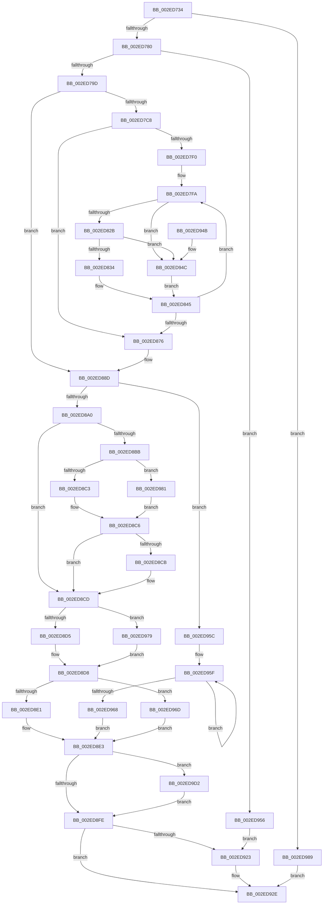

# RtlpHpVaMgrCtxFree

- RVA: `0x002ED734`–`0x002ED9EC` (길이 `696` bytes)
- VA: `0x00000001402ED734`
- 실행 섹션: `.text`
- PDB 이름 있음: `예`; PDB Function 태그: `아니요`
- unwind 정보 RVA: `0x000718F0`
- 디코드: `194`개 명령, `696/696` bytes 표시
- 미해석 바이트: `0` (있으면 어셈블리에 `.byte`로 보존)

> 이 문서는 커널 이미지의 기계어와 PDB 기호를 분석해 생성했습니다. 4번과 5번은 함수 원형과 자료형을 바이너리 사용 방식에서 추정한 C 해석이며 원본 소스 복구 결과는 아닙니다.

## 1. Dependencies

- 직접 호출 지점: **10**; 고유 호출 대상: **9**
- 직접 호출자로 확인된 함수: **4**
- RIP 상대 이미지 참조: **1**

### Outgoing calls
- `0x002ED76F` → [RtlSparseArrayElementAllocated](../32/RtlSparseArrayElementAllocated_function_00327364.md) (function, `0x00327364`)
- `0x002ED7E2` → [RtlSparseArrayElementAllocated](../32/RtlSparseArrayElementAllocated_function_00327364.md) (function, `0x00327364`)
- `0x002ED882` → [MmFreePoolMemory](../2C/MmFreePoolMemory_function_002C1578.md) (function, `0x002C1578`)
- `0x002ED8ED` → [RtlpHpAcquireLockExclusive](../32/RtlpHpAcquireLockExclusive_function_003246B0.md) (function, `0x003246B0`)
- `0x002ED904` → [RtlpHpVaMgrFree](RtlpHpVaMgrFree_function_002EDF44.md) (function, `0x002EDF44`)
- `0x002ED919` → [RtlpHpReleaseLockExclusive](../32/RtlpHpReleaseLockExclusive_function_00324230.md) (function, `0x00324230`)
- `0x002ED929` → [RtlpHpVaMgrRangeFree](RtlpHpVaMgrRangeFree_function_002ED9F4.md) (function, `0x002ED9F4`)
- `0x002ED9A9` → [RtlSparseArrayElementFindCapped](../60/RtlSparseArrayElementFindCapped_function_00605484.md) (function, `0x00605484`)
- `0x002ED9BD` → [RtlpHpEnvFreeVA](../2C/RtlpHpEnvFreeVA_function_002C1534.md) (function, `0x002C1534`)
- `0x002ED9E2` → [RtlpHpVaMgrRangeSplit](RtlpHpVaMgrRangeSplit_function_002EDED0.md) (function, `0x002EDED0`)

### Direct callers
- [RtlpHpFreeVA](../2C/RtlpHpFreeVA_function_002C0FD4.md) at `0x002C1033`
- [RtlpHpSegMgrRelease](RtlpHpSegMgrRelease_function_002E37FC.md) at `0x002E38D5`
- [RtlpHpLargeFree](RtlpHpLargeFree_function_002EC89C.md) at `0x002EC9D7`
- [RtlpHpSegMgrCommit](../32/RtlpHpSegMgrCommit_function_00326BE4.md) at `0x00326F0C`

### Static image references
- `0x002ED7AB` → RVA `0x0001A920` (`.rdata`; read)

## 2. Other-region calls and transfers

- 다른 실행 섹션으로 향하는 call: **0**
- 별도 외부 분기/꼬리 이동을 확인하지 못했습니다.

## 3. Assembly (complete function range)

```asm
002ED734  48 89 5C 24 08                  mov qword ptr [rsp + 8], rbx
002ED739  48 89 6C 24 10                  mov qword ptr [rsp + 0x10], rbp
002ED73E  48 89 74 24 18                  mov qword ptr [rsp + 0x18], rsi
002ED743  57                              push rdi
002ED744  41 54                           push r12
002ED746  41 55                           push r13
002ED748  41 56                           push r14
002ED74A  41 57                           push r15
002ED74C  48 83 EC 30                     sub rsp, 0x30
002ED750  49 8B 38                        mov rdi, qword ptr [r8]
002ED753  4C 8B E2                        mov r12, rdx
002ED756  48 8B 12                        mov rdx, qword ptr [rdx]
002ED759  48 8B E9                        mov rbp, rcx
002ED75C  48 2B 51 08                     sub rdx, qword ptr [rcx + 8]
002ED760  4D 8B F8                        mov r15, r8
002ED763  48 C1 EA 14                     shr rdx, 0x14
002ED767  48 83 C1 10                     add rcx, 0x10
002ED76B  48 C1 EF 14                     shr rdi, 0x14
002ED76F  E8 F0 9B 03 00                  call 0x140327364
002ED774  48 8B D8                        mov rbx, rax
002ED777  48 85 C0                        test rax, rax
002ED77A  0F 84 09 02 00 00               je 0x1402ed989
002ED780  0F B6 40 01                     movzx eax, byte ptr [rax + 1]
002ED784  48 83 C0 2D                     add rax, 0x2d
002ED788  48 8D 34 40                     lea rsi, [rax + rax*2]
002ED78C  8A 03                           mov al, byte ptr [rbx]
002ED78E  48 C1 E6 04                     shl rsi, 4
002ED792  48 03 F5                        add rsi, rbp
002ED795  A8 04                           test al, 4
002ED797  0F 85 B9 01 00 00               jne 0x1402ed956
002ED79D  48 8D 6E 2E                     lea rbp, [rsi + 0x2e]
002ED7A1  41 B8 00 00 10 00               mov r8d, 0x100000
002ED7A7  0F B6 45 00                     movzx eax, byte ptr [rbp]
002ED7AB  48 8D 0D 6E D1 D2 FF            lea rcx, [rip - 0x2d2e92]
002ED7B2  48 D1 E8                        shr rax, 1
002ED7B5  41 BD 01 00 00 00               mov r13d, 1
002ED7BB  83 E0 07                        and eax, 7
002ED7BE  44 39 04 81                     cmp dword ptr [rcx + rax*4], r8d
002ED7C2  0F 87 C5 00 00 00               ja 0x1402ed88d
002ED7C8  48 8B 4E 18                     mov rcx, qword ptr [rsi + 0x18]
002ED7CC  4D 8B 34 24                     mov r14, qword ptr [r12]
002ED7D0  4D 8B 2F                        mov r13, qword ptr [r15]
002ED7D3  49 8B D6                        mov rdx, r14
002ED7D6  48 2B 51 08                     sub rdx, qword ptr [rcx + 8]
002ED7DA  48 83 C1 10                     add rcx, 0x10
002ED7DE  48 C1 EA 14                     shr rdx, 0x14
002ED7E2  E8 7D 9B 03 00                  call 0x140327364
002ED7E7  4D 85 ED                        test r13, r13
002ED7EA  0F 84 86 00 00 00               je 0x1402ed876
002ED7F0  4C 8D 48 02                     lea r9, [rax + 2]
002ED7F4  41 BA 01 00 00 00               mov r10d, 1
002ED7FA  48 8B 46 18                     mov rax, qword ptr [rsi + 0x18]
002ED7FE  4D 8B C1                        mov r8, r9
002ED801  4C 2B 40 28                     sub r8, qword ptr [rax + 0x28]
002ED805  8B 48 18                        mov ecx, dword ptr [rax + 0x18]
002ED808  49 83 E8 02                     sub r8, 2
002ED80C  49 D3 E8                        shr r8, cl
002ED80F  49 C1 E0 14                     shl r8, 0x14
002ED813  4C 03 40 08                     add r8, qword ptr [rax + 8]
002ED817  4B 8D 04 2E                     lea rax, [r14 + r13]
002ED81B  49 8D 90 00 00 10 00            lea rdx, [r8 + 0x100000]
002ED822  49 3B C0                        cmp rax, r8
002ED825  0F 86 21 01 00 00               jbe 0x1402ed94c
002ED82B  49 3B D6                        cmp rdx, r14
002ED82E  0F 86 18 01 00 00               jbe 0x1402ed94c
002ED834  4D 3B F0                        cmp r14, r8
002ED837  4D 0F 47 C6                     cmova r8, r14
002ED83B  48 3B C2                        cmp rax, rdx
002ED83E  48 0F 42 D0                     cmovb rdx, rax
002ED842  49 2B D0                        sub rdx, r8
002ED845  49 C1 E8 10                     shr r8, 0x10
002ED849  48 8B CA                        mov rcx, rdx
002ED84C  48 C1 E9 10                     shr rcx, 0x10
002ED850  41 8B C2                        mov eax, r10d
002ED853  66 D3 E0                        shl ax, cl
002ED856  4C 03 F2                        add r14, rdx
002ED859  66 41 2B C2                     sub ax, r10w
002ED85D  41 8A C8                        mov cl, r8b
002ED860  80 E1 0F                        and cl, 0xf
002ED863  66 D3 E0                        shl ax, cl
002ED866  66 F7 D0                        not ax
002ED869  66 41 21 01                     and word ptr [r9], ax
002ED86D  49 83 C1 20                     add r9, 0x20
002ED871  4C 2B EA                        sub r13, rdx
002ED874  75 84                           jne 0x1402ed7fa
002ED876  41 B8 00 40 00 00               mov r8d, 0x4000
002ED87C  49 8B D7                        mov rdx, r15
002ED87F  49 8B CC                        mov rcx, r12
002ED882  E8 F1 3C FD FF                  call 0x1402c1578
002ED887  41 BD 01 00 00 00               mov r13d, 1
002ED88D  8A 0B                           mov cl, byte ptr [rbx]
002ED88F  48 8B D5                        mov rdx, rbp
002ED892  4C 8B FB                        mov r15, rbx
002ED895  8A 12                           mov dl, byte ptr [rdx]
002ED897  F6 C1 02                        test cl, 2
002ED89A  0F 85 BC 00 00 00               jne 0x1402ed95c
002ED8A0  8A C1                           mov al, cl
002ED8A2  C0 EA 05                        shr dl, 5
002ED8A5  C0 E9 02                        shr cl, 2
002ED8A8  F6 D1                           not cl
002ED8AA  C0 E8 02                        shr al, 2
002ED8AD  22 CA                           and cl, dl
002ED8AF  41 22 C5                        and al, r13b
002ED8B2  41 84 CD                        test r13b, cl
002ED8B5  48 8D 4B 18                     lea rcx, [rbx + 0x18]
002ED8B9  75 12                           jne 0x1402ed8cd
002ED8BB  84 C0                           test al, al
002ED8BD  0F 85 BE 00 00 00               jne 0x1402ed981
002ED8C3  0F B7 11                        movzx edx, word ptr [rcx]
002ED8C6  48 3B FA                        cmp rdi, rdx
002ED8C9  74 02                           je 0x1402ed8cd
002ED8CB  CD 2C                           int 0x2c
002ED8CD  84 C0                           test al, al
002ED8CF  0F 85 A4 00 00 00               jne 0x1402ed979
002ED8D5  0F B7 01                        movzx eax, word ptr [rcx]
002ED8D8  48 3B F8                        cmp rdi, rax
002ED8DB  0F 82 8C 00 00 00               jb 0x1402ed96d
002ED8E1  33 FF                           xor edi, edi
002ED8E3  0F B6 55 00                     movzx edx, byte ptr [rbp]
002ED8E7  48 8B CE                        mov rcx, rsi
002ED8EA  41 23 D5                        and edx, r13d
002ED8ED  E8 BE 6D 03 00                  call 0x1403246b0
002ED8F2  44 8A F0                        mov r14b, al
002ED8F5  48 85 FF                        test rdi, rdi
002ED8F8  0F 85 D4 00 00 00               jne 0x1402ed9d2
002ED8FE  49 8B D7                        mov rdx, r15
002ED901  48 8B CE                        mov rcx, rsi
002ED904  E8 3B 06 00 00                  call 0x1402edf44
002ED909  0F B6 55 00                     movzx edx, byte ptr [rbp]
002ED90D  45 8A C6                        mov r8b, r14b
002ED910  41 23 D5                        and edx, r13d
002ED913  48 8B CE                        mov rcx, rsi
002ED916  48 8B D8                        mov rbx, rax
002ED919  E8 12 69 03 00                  call 0x140324230
002ED91E  48 85 DB                        test rbx, rbx
002ED921  74 0B                           je 0x1402ed92e
002ED923  48 8B D3                        mov rdx, rbx
002ED926  48 8B CE                        mov rcx, rsi
002ED929  E8 C6 00 00 00                  call 0x1402ed9f4
002ED92E  48 8B 5C 24 60                  mov rbx, qword ptr [rsp + 0x60]
002ED933  48 8B 6C 24 68                  mov rbp, qword ptr [rsp + 0x68]
002ED938  48 8B 74 24 70                  mov rsi, qword ptr [rsp + 0x70]
002ED93D  48 83 C4 30                     add rsp, 0x30
002ED941  41 5F                           pop r15
002ED943  41 5E                           pop r14
002ED945  41 5D                           pop r13
002ED947  41 5C                           pop r12
002ED949  5F                              pop rdi
002ED94A  C3                              ret
002ED94B  CC                              int3
002ED94C  45 33 C0                        xor r8d, r8d
002ED94F  33 D2                           xor edx, edx
002ED951  E9 EF FE FF FF                  jmp 0x1402ed845
002ED956  24 FE                           and al, 0xfe
002ED958  88 03                           mov byte ptr [rbx], al
002ED95A  EB C7                           jmp 0x1402ed923
002ED95C  48 8B FB                        mov rdi, rbx
002ED95F  48 83 EB 20                     sub rbx, 0x20
002ED963  F6 03 02                        test byte ptr [rbx], 2
002ED966  75 F7                           jne 0x1402ed95f
002ED968  E9 76 FF FF FF                  jmp 0x1402ed8e3
002ED96D  48 C1 E7 05                     shl rdi, 5
002ED971  48 03 FB                        add rdi, rbx
002ED974  E9 6A FF FF FF                  jmp 0x1402ed8e3
002ED979  48 8B 01                        mov rax, qword ptr [rcx]
002ED97C  E9 57 FF FF FF                  jmp 0x1402ed8d8
002ED981  48 8B 11                        mov rdx, qword ptr [rcx]
002ED984  E9 3D FF FF FF                  jmp 0x1402ed8c6
002ED989  49 8B 04 24                     mov rax, qword ptr [r12]
002ED98D  48 8D 4D 10                     lea rcx, [rbp + 0x10]
002ED991  48 2B 45 08                     sub rax, qword ptr [rbp + 8]
002ED995  41 B8 00 00 10 00               mov r8d, 0x100000
002ED99B  48 99                           cqo
002ED99D  49 F7 F8                        idiv r8
002ED9A0  4C 8B C0                        mov r8, rax
002ED9A3  48 8B D0                        mov rdx, rax
002ED9A6  49 F7 D0                        not r8
002ED9A9  E8 D6 7A 31 00                  call 0x140605484
002ED9AE  41 B8 00 80 00 00               mov r8d, 0x8000
002ED9B4  49 8B D7                        mov rdx, r15
002ED9B7  49 8B CC                        mov rcx, r12
002ED9BA  48 8B D8                        mov rbx, rax
002ED9BD  E8 72 3B FD FF                  call 0x1402c1534
002ED9C2  49 8B 0F                        mov rcx, qword ptr [r15]
002ED9C5  48 C1 E9 14                     shr rcx, 0x14
002ED9C9  48 29 4B 18                     sub qword ptr [rbx + 0x18], rcx
002ED9CD  E9 5C FF FF FF                  jmp 0x1402ed92e
002ED9D2  48 2B FB                        sub rdi, rbx
002ED9D5  48 8B D3                        mov rdx, rbx
002ED9D8  48 C1 FF 05                     sar rdi, 5
002ED9DC  48 8B CE                        mov rcx, rsi
002ED9DF  4C 8B C7                        mov r8, rdi
002ED9E2  E8 E9 04 00 00                  call 0x1402eded0
002ED9E7  E9 12 FF FF FF                  jmp 0x1402ed8fe
```

## 4. C-style interpretation (structured pseudocode)

```c
__int64 __fastcall RtlpHpVaMgrCtxFree(__int64 a1, __int64 a2, __int64 a3)
{
    __int64 result;
    __int64 v_r13;
    __int64 v_r14;
    __int64 v_rbx;
    __int64 v_rdi;
    __int64 v_rsi;
    __int64 v_rsp;
    unsigned __int64 v_stack_p10;
    unsigned __int64 v_stack_p18;
    unsigned __int64 v_stack_p8;

    v_stack_p8 = v_rbx;
    v_stack_p10 = v_rbp;
    v_stack_p18 = v_rsi;
    v_rsp = (v_rsp) - (48);
    a2 = (*(unsigned __int64 *)(a2)) - (*(unsigned __int64 *)(a1 + 8));
    a2 = (a2) >> (20);
    a1 = (a1) + (16);
    v_rdi = (*(unsigned __int64 *)(a3)) >> (20);
    result = RtlSparseArrayElementAllocated(a1, a2, a3, a4);
    if (result == 0) goto loc_002ED989;
    result = (*(unsigned __int8 *)(result + 1)) + (45);
    v_rsi = (result + result * 2) << (4);
    v_rsi = (v_rsi) + (a1);
    if ((((unsigned __int8)(*(unsigned __int8 *)(result))) & (4)) != 0) goto loc_002ED956;
    result = (*(unsigned __int8 *)(v_rsi + 46)) >> (1);
    result = (unsigned int)((result) & (7));
    if ((*(unsigned int *)(v_rip - 2961042 + result * 4)) > ((unsigned int)((unsigned int)(0x100000ULL)))) goto loc_002ED88D;
    a2 = (*(unsigned __int64 *)(a2)) - (*(unsigned __int64 *)(*(unsigned __int64 *)(v_rsi + 24) + 8));
    a1 = (*(unsigned __int64 *)(v_rsi + 24)) + (16);
    a2 = (a2) >> (20);
    result = RtlSparseArrayElementAllocated(a1, a2, (unsigned int)(0x100000ULL), a4);
    if (*(unsigned __int64 *)(a3) == 0) goto loc_002ED876;
loc_002ED7FA:
    a3 = (result + 2) - (*(unsigned __int64 *)(*(unsigned __int64 *)(v_rsi + 24) + 40));
    a3 = (a3) - (2);
    a3 = (a3) >> ((unsigned __int8)((unsigned int)(*(unsigned int *)(*(unsigned __int64 *)(v_rsi + 24) + 24))));
    a3 = (a3) << (20);
    a3 = (a3) + (*(unsigned __int64 *)(*(unsigned __int64 *)(v_rsi + 24) + 8));
    if ((*(unsigned __int64 *)(a2) + *(unsigned __int64 *)(a3) * 1) <= a3) goto loc_002ED94C;
    if ((a3 + 1048576) <= (*(unsigned __int64 *)(a2))) goto loc_002ED94C;
    if ((*(unsigned __int64 *)(a2)) > a3) { a3 = *(unsigned __int64 *)(a2); }
    a2 = a3 + 1048576;
    if ((*(unsigned __int64 *)(a2) + *(unsigned __int64 *)(a3) * 1) < (a3 + 1048576)) { a2 = *(unsigned __int64 *)(a2) + *(unsigned __int64 *)(a3) * 1; }
    a2 = (a2) - (a3);
loc_002ED845:
    a3 = (a3) >> (16);
    a1 = (a2) >> (16);
    result = (unsigned __int16)((1) << ((unsigned __int8)(a1)));
    v_r14 = (*(unsigned __int64 *)(a2)) + (a2);
    result = (unsigned __int16)((result) - (1));
    a1 = (unsigned __int8)(((unsigned __int8)(a3)) & (15));
    result = (unsigned __int16)((result) << ((unsigned __int8)(a1)));
    result = (unsigned __int16)(~(result));
    a4 = (result + 2) + (32);
    v_r13 = (*(unsigned __int64 *)(a3)) - (a2);
    if (condition_is_not_equal) goto loc_002ED7FA;
loc_002ED876:
    result = MmFreePoolMemory(a2, a3, (unsigned int)(0x4000ULL), a4);
loc_002ED88D:
    if ((((unsigned __int8)(*(unsigned __int8 *)(result))) & (2)) != 0) goto loc_002ED95C;
    a2 = (unsigned __int8)((*(unsigned __int8 *)(v_rsi + 46)) >> (5));
    a1 = (unsigned __int8)((*(unsigned __int8 *)(result)) >> (2));
    a1 = (unsigned __int8)(~(a1));
    result = (unsigned __int8)(((unsigned __int8)(*(unsigned __int8 *)(result))) >> (2));
    a1 = (unsigned __int8)((a1) & ((unsigned __int8)(a2)));
    result = (unsigned __int8)((result) & (1));
    if (((1) & ((unsigned __int8)(a1))) != 0) goto loc_002ED8CD;
    if ((unsigned __int8)(result) != 0) goto loc_002ED981;
loc_002ED8C6:
    if (v_rdi != (*(unsigned __int16 *)(result + 24))) {
    }
    if ((unsigned __int8)(result) != 0) goto loc_002ED979;
loc_002ED8D8:
    if (v_rdi < (*(unsigned __int16 *)(result + 24))) goto loc_002ED96D;
    v_rdi = 0;
loc_002ED8E3:
    a2 = (unsigned int)((*(unsigned __int8 *)(v_rsi + 46)) & (1));
    result = RtlpHpAcquireLockExclusive(v_rsi, a2, (unsigned int)(0x4000ULL), a4);
    if (0 != 0) goto loc_002ED9D2;
loc_002ED8FE:
    result = RtlpHpVaMgrFree(v_rsi, result, (unsigned int)(0x4000ULL), a4);
    a2 = (unsigned int)((*(unsigned __int8 *)(v_rsi + 46)) & (1));
    result = RtlpHpReleaseLockExclusive(v_rsi, a2, (unsigned __int8)((unsigned __int8)(result)), a4);
    if (result != 0) {
        a2 = result;
        a1 = v_rsi;
        result = RtlpHpVaMgrRangeFree(a1, a2, (unsigned __int8)((unsigned __int8)(result)), a4);
    }
    v_rsp = (v_rsp) + (48);
    return result;
loc_002ED94C:
    a3 = 0;
    a2 = 0;
    goto loc_002ED845;
loc_002ED956:
    result = (unsigned __int8)((result) & (254));
    *(unsigned __int8 *)(v_stack_p8) = (unsigned __int8)(result);
    goto loc_002ED923;
loc_002ED95C:
loc_002ED95F:
    v_rbx = (v_stack_p8) - (32);
    if (((*(unsigned __int8 *)(v_rbx)) & (2)) != 0) goto loc_002ED95F;
    goto loc_002ED8E3;
loc_002ED96D:
    v_rdi = (v_stack_p8) << (5);
    v_rdi = (v_rdi) + (v_rbx);
    goto loc_002ED8E3;
loc_002ED979:
    goto loc_002ED8D8;
loc_002ED981:
    goto loc_002ED8C6;
loc_002ED989:
    result = (*(unsigned __int64 *)(a2)) - (*(unsigned __int64 *)(v_stack_p10 + 8));
    a3 = ~(result);
    result = RtlSparseArrayElementFindCapped(v_stack_p10 + 16, result, a3, a4);
    result = RtlpHpEnvFreeVA(0, result, (unsigned int)(0x8000ULL), a4);
    a1 = (*(unsigned __int64 *)(result)) >> (20);
    goto loc_002ED92E;
loc_002ED9D2:
    v_rdi = (v_rdi) - (result);
    v_rdi = (v_rdi) >> (5);
    result = RtlpHpVaMgrRangeSplit(v_stack_p18, result, v_rdi, a4);
    goto loc_002ED8FE;
}
```

## 5. (Beta) C Style

```c
int64_t RtlpHpVaMgrCtxFree(void *Arg1, void *Arg2, void *Arg3)
{
    uint8_t *arg1 = (uint8_t *)Arg1;
    uint8_t *arg2 = (uint8_t *)Arg2;
    uint8_t *arg3 = (uint8_t *)Arg3;

    int64_t result;
    int64_t local_r13;
    int64_t local_r14;
    int64_t local_rbx;
    int64_t local_rdi;
    int64_t local_rsi;
    int64_t local_rsp;
    uint64_t v_stack_p10;
    uint64_t v_stack_p18;
    uint64_t v_stack_p8;

    v_stack_p8 = local_rbx;
    v_stack_p10 = local_rbp;
    v_stack_p18 = local_rsi;
    local_rsp = (local_rsp) - (48);
    Arg2 = (*(uint64_t *)(arg2)) - (*(uint64_t *)(arg1 + 0x8));
    Arg2 = (Arg2) >> (20);
    Arg1 = (Arg1) + (16);
    local_rdi = (*(uint64_t *)(arg3)) >> (20);
    result = RtlSparseArrayElementAllocated(Arg1, Arg2, Arg3, a4);
    if (result == 0) goto loc_002ED989;
    result = (*(uint8_t *)(result + 0x1)) + (45);
    local_rsi = (result + result * 2) << (4);
    local_rsi = (local_rsi) + (Arg1);
    if ((((uint8_t)(*(uint8_t *)(result))) & (4)) != 0) goto loc_002ED956;
    result = (*(uint8_t *)(local_rsi + 0x2E)) >> (1);
    result = (uint32_t)((result) & (7));
    if ((*(uint32_t *)(v_rip - 0x2D2E92 + result * 4)) > ((uint32_t)((uint32_t)(0x100000ULL)))) goto loc_002ED88D;
    Arg2 = (*(uint64_t *)(arg2)) - (*(uint64_t *)(*(uint64_t *)(local_rsi + 0x18) + 0x8));
    Arg1 = (*(uint64_t *)(local_rsi + 0x18)) + (16);
    Arg2 = (Arg2) >> (20);
    result = RtlSparseArrayElementAllocated(Arg1, Arg2, (uint32_t)(0x100000ULL), a4);
    if (*(uint64_t *)(arg3) == 0) goto loc_002ED876;
loc_002ED7FA:
    Arg3 = (result + 2) - (*(uint64_t *)(*(uint64_t *)(local_rsi + 0x18) + 0x28));
    Arg3 = (Arg3) - (2);
    Arg3 = (Arg3) >> ((uint8_t)((uint32_t)(*(uint32_t *)(*(uint64_t *)(local_rsi + 0x18) + 0x18))));
    Arg3 = (Arg3) << (20);
    Arg3 = (Arg3) + (*(uint64_t *)(*(uint64_t *)(local_rsi + 0x18) + 0x8));
    if ((*(uint64_t *)(arg2) + *(uint64_t *)(arg3) * 1) <= Arg3) goto loc_002ED94C;
    if ((Arg3 + 1048576) <= (*(uint64_t *)(arg2))) goto loc_002ED94C;
    if ((*(uint64_t *)(arg2)) > Arg3) { Arg3 = *(uint64_t *)(arg2); }
    Arg2 = Arg3 + 1048576;
    if ((*(uint64_t *)(arg2) + *(uint64_t *)(arg3) * 1) < (Arg3 + 1048576)) { Arg2 = *(uint64_t *)(arg2) + *(uint64_t *)(arg3) * 1; }
    Arg2 = (Arg2) - (Arg3);
loc_002ED845:
    Arg3 = (Arg3) >> (16);
    Arg1 = (Arg2) >> (16);
    result = (uint16_t)((1) << ((uint8_t)(Arg1)));
    local_r14 = (*(uint64_t *)(arg2)) + (Arg2);
    result = (uint16_t)((result) - (1));
    Arg1 = (uint8_t)(((uint8_t)(Arg3)) & (15));
    result = (uint16_t)((result) << ((uint8_t)(Arg1)));
    result = (uint16_t)(~(result));
    a4 = (result + 2) + (32);
    local_r13 = (*(uint64_t *)(arg3)) - (Arg2);
    if (condition_is_not_equal) goto loc_002ED7FA;
loc_002ED876:
    result = MmFreePoolMemory(Arg2, Arg3, (uint32_t)(0x4000ULL), a4);
loc_002ED88D:
    if ((((uint8_t)(*(uint8_t *)(result))) & (2)) != 0) goto loc_002ED95C;
    Arg2 = (uint8_t)((*(uint8_t *)(local_rsi + 0x2E)) >> (5));
    Arg1 = (uint8_t)((*(uint8_t *)(result)) >> (2));
    Arg1 = (uint8_t)(~(Arg1));
    result = (uint8_t)(((uint8_t)(*(uint8_t *)(result))) >> (2));
    Arg1 = (uint8_t)((Arg1) & ((uint8_t)(Arg2)));
    result = (uint8_t)((result) & (1));
    if (((1) & ((uint8_t)(Arg1))) != 0) goto loc_002ED8CD;
    if ((uint8_t)(result) != 0) goto loc_002ED981;
loc_002ED8C6:
    if (local_rdi != (*(uint16_t *)(result + 0x18))) {
    }
    if ((uint8_t)(result) != 0) goto loc_002ED979;
loc_002ED8D8:
    if (local_rdi < (*(uint16_t *)(result + 0x18))) goto loc_002ED96D;
    local_rdi = 0;
loc_002ED8E3:
    Arg2 = (uint32_t)((*(uint8_t *)(local_rsi + 0x2E)) & (1));
    result = RtlpHpAcquireLockExclusive(local_rsi, Arg2, (uint32_t)(0x4000ULL), a4);
    if (0 != 0) goto loc_002ED9D2;
loc_002ED8FE:
    result = RtlpHpVaMgrFree(local_rsi, result, (uint32_t)(0x4000ULL), a4);
    Arg2 = (uint32_t)((*(uint8_t *)(local_rsi + 0x2E)) & (1));
    result = RtlpHpReleaseLockExclusive(local_rsi, Arg2, (uint8_t)((uint8_t)(result)), a4);
    if (result != 0) {
        Arg2 = result;
        Arg1 = local_rsi;
        result = RtlpHpVaMgrRangeFree(Arg1, Arg2, (uint8_t)((uint8_t)(result)), a4);
    }
    local_rsp = (local_rsp) + (48);
    return result;
loc_002ED94C:
    Arg3 = 0;
    Arg2 = 0;
    goto loc_002ED845;
loc_002ED956:
    result = (uint8_t)((result) & (254));
    *(uint8_t *)(v_stack_p8) = (uint8_t)(result);
    goto loc_002ED923;
loc_002ED95C:
loc_002ED95F:
    local_rbx = (v_stack_p8) - (32);
    if (((*(uint8_t *)(local_rbx)) & (2)) != 0) goto loc_002ED95F;
    goto loc_002ED8E3;
loc_002ED96D:
    local_rdi = (v_stack_p8) << (5);
    local_rdi = (local_rdi) + (local_rbx);
    goto loc_002ED8E3;
loc_002ED979:
    goto loc_002ED8D8;
loc_002ED981:
    goto loc_002ED8C6;
loc_002ED989:
    result = (*(uint64_t *)(arg2)) - (*(uint64_t *)(v_stack_p10 + 0x8));
    Arg3 = ~(result);
    result = RtlSparseArrayElementFindCapped(v_stack_p10 + 16, result, Arg3, a4);
    result = RtlpHpEnvFreeVA(0, result, (uint32_t)(0x8000ULL), a4);
    Arg1 = (*(uint64_t *)(result)) >> (20);
    goto loc_002ED92E;
loc_002ED9D2:
    local_rdi = (local_rdi) - (result);
    local_rdi = (local_rdi) >> (5);
    result = RtlpHpVaMgrRangeSplit(v_stack_p18, result, local_rdi, a4);
    goto loc_002ED8FE;
}
```

### 관측된 메모리 오프셋

구조체 형식이 확인되지 않은 접근은 인자 기준의 오프셋으로만 기록했습니다.

| 기준 인자 | 오프셋 표현 | 폭 (bit) | 접근 |
|---|---:|---:|---|
| `Arg1` | `+ 0x8` | `64` | `R` |
| `Arg1` | `+ 0x10` | `64` | `R` |
| `Arg2` | `+ 0x0` | `64` | `R` |
| `Arg3` | `+ 0x0` | `64` | `R` |

## 6. Execution-region graph

[열기: 2D/3D 그래프와 함수 탐색 컨트롤 패널](../../../control-panel.html?section=text&rva=0x002ED734&view=graph)

- 2D 그래프는 위에서 아래로 흐르고, 3D 그래프는 빈 공간을 드래그해 회전합니다. Shift+드래그는 이동, 휠은 확대·축소, 함수 노드 선택은 대상 보고서 이동입니다.

### Static fallback


