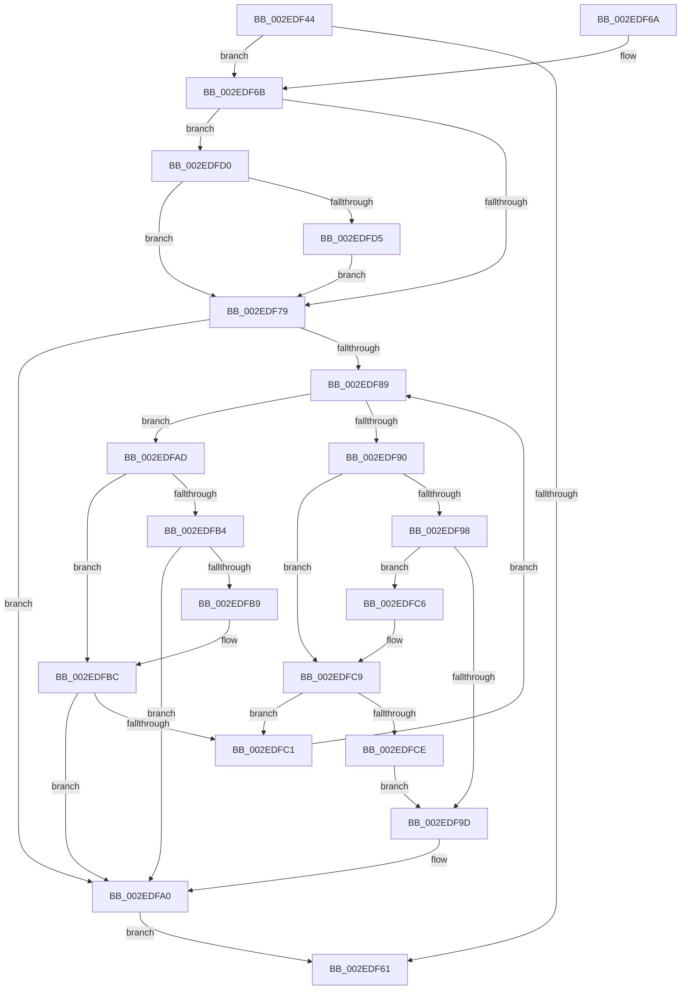

# RtlpHpVaMgrFree

- RVA: `0x002EDF44`–`0x002EDFDA` (길이 `150` bytes)
- VA: `0x00000001402EDF44`
- 실행 섹션: `.text`
- PDB 이름 있음: `예`; PDB Function 태그: `아니요`
- unwind 정보 RVA: `0x00069354`
- 디코드: `52`개 명령, `150/150` bytes 표시
- 미해석 바이트: `0` (있으면 어셈블리에 `.byte`로 보존)

> 이 문서는 커널 이미지의 기계어와 PDB 기호를 분석해 생성했습니다. 4번과 5번은 함수 원형과 자료형을 바이너리 사용 방식에서 추정한 C 해석이며 원본 소스 복구 결과는 아닙니다.

## 1. Dependencies

- 직접 호출 지점: **2**; 고유 호출 대상: **2**
- 직접 호출자로 확인된 함수: **2**
- RIP 상대 이미지 참조: **0**

### Outgoing calls
- `0x002EDF4D` → [RtlpHpVaMgrRangeCoalesce](RtlpHpVaMgrRangeCoalesce_function_002EDFE0.md) (function, `0x002EDFE0`)
- `0x002EDFA3` → [RtlRbInsertNodeEx](RtlRbInsertNodeEx_function_002E4570.md) (function, `0x002E4570`)

### Direct callers
- [RtlpHpVaMgrCtxFree](RtlpHpVaMgrCtxFree_function_002ED734.md) at `0x002ED904`
- [RtlpHpVaMgrAlloc](RtlpHpVaMgrAlloc_function_002EDB1C.md) at `0x002EDBF2`
- [RtlpHpVaMgrAlloc](RtlpHpVaMgrAlloc_function_002EDB1C.md) at `0x002EDD63`

### Static image references
- 디코드된 RIP-relative 메모리 참조가 없습니다.

## 2. Other-region calls and transfers

- 다른 실행 섹션으로 향하는 call: **0**
- 별도 외부 분기/꼬리 이동을 확인하지 못했습니다.

## 3. Assembly (complete function range)

```asm
002EDF44  40 53                           push rbx
002EDF46  48 83 EC 20                     sub rsp, 0x20
002EDF4A  48 8B D9                        mov rbx, rcx
002EDF4D  E8 8E 00 00 00                  call 0x1402edfe0
002EDF52  4C 8B C8                        mov r9, rax
002EDF55  44 0F B7 58 18                  movzx r11d, word ptr [rax + 0x18]
002EDF5A  66 44 3B 5B 28                  cmp r11w, word ptr [rbx + 0x28]
002EDF5F  75 0A                           jne 0x1402edf6b
002EDF61  49 8B C1                        mov rax, r9
002EDF64  48 83 C4 20                     add rsp, 0x20
002EDF68  5B                              pop rbx
002EDF69  C3                              ret
002EDF6A  CC                              int3
002EDF6B  4C 8D 53 08                     lea r10, [rbx + 8]
002EDF6F  41 F6 42 08 01                  test byte ptr [r10 + 8], 1
002EDF74  49 8B 12                        mov rdx, qword ptr [r10]
002EDF77  75 57                           jne 0x1402edfd0
002EDF79  41 0F B6 4A 08                  movzx ecx, byte ptr [r10 + 8]
002EDF7E  45 32 C0                        xor r8b, r8b
002EDF81  83 E1 01                        and ecx, 1
002EDF84  48 85 D2                        test rdx, rdx
002EDF87  74 17                           je 0x1402edfa0
002EDF89  66 44 3B 5A 18                  cmp r11w, word ptr [rdx + 0x18]
002EDF8E  72 1D                           jb 0x1402edfad
002EDF90  48 8B 42 08                     mov rax, qword ptr [rdx + 8]
002EDF94  85 C9                           test ecx, ecx
002EDF96  74 31                           je 0x1402edfc9
002EDF98  48 85 C0                        test rax, rax
002EDF9B  75 29                           jne 0x1402edfc6
002EDF9D  41 B0 01                        mov r8b, 1
002EDFA0  49 8B CA                        mov rcx, r10
002EDFA3  E8 C8 65 FF FF                  call 0x1402e4570
002EDFA8  45 33 C9                        xor r9d, r9d
002EDFAB  EB B4                           jmp 0x1402edf61
002EDFAD  48 8B 02                        mov rax, qword ptr [rdx]
002EDFB0  85 C9                           test ecx, ecx
002EDFB2  74 08                           je 0x1402edfbc
002EDFB4  48 85 C0                        test rax, rax
002EDFB7  74 E7                           je 0x1402edfa0
002EDFB9  48 33 C2                        xor rax, rdx
002EDFBC  48 85 C0                        test rax, rax
002EDFBF  74 DF                           je 0x1402edfa0
002EDFC1  48 8B D0                        mov rdx, rax
002EDFC4  EB C3                           jmp 0x1402edf89
002EDFC6  48 33 C2                        xor rax, rdx
002EDFC9  48 85 C0                        test rax, rax
002EDFCC  75 F3                           jne 0x1402edfc1
002EDFCE  EB CD                           jmp 0x1402edf9d
002EDFD0  48 85 D2                        test rdx, rdx
002EDFD3  74 A4                           je 0x1402edf79
002EDFD5  49 33 D2                        xor rdx, r10
002EDFD8  EB 9F                           jmp 0x1402edf79
```

## 4. C-style interpretation (structured pseudocode)

```c
__int64 __fastcall RtlpHpVaMgrFree(__int64 a1, __int64 a2, unsigned __int8 a3)
{
    __int64 result;
    __int64 v_rsp;

    v_rsp = (v_rsp) - (32);
    result = RtlpHpVaMgrRangeCoalesce(a1, a2, a3, a4);
    if (((unsigned __int16)(*(unsigned __int16 *)(result + 24))) != (*(unsigned __int16 *)(a1 + 40))) goto loc_002EDF6B;
loc_002EDF61:
    v_rsp = (v_rsp) + (32);
    return result;
loc_002EDF6B:
    if (((*(unsigned __int8 *)(a1 + 8 + 8)) & (1)) != 0) goto loc_002EDFD0;
loc_002EDF79:
    a3 = 0;
    a1 = (unsigned int)((*(unsigned __int8 *)(a1 + 8 + 8)) & (1));
    if (*(unsigned __int64 *)(a1 + 8) == 0) goto loc_002EDFA0;
loc_002EDF89:
    if (((unsigned __int16)(*(unsigned __int16 *)(result + 24))) < (*(unsigned __int16 *)(*(unsigned __int64 *)(a1 + 8) + 24))) goto loc_002EDFAD;
    if ((unsigned int)(a1) == 0) goto loc_002EDFC9;
    if (*(unsigned __int64 *)(*(unsigned __int64 *)(a1 + 8) + 8) != 0) goto loc_002EDFC6;
loc_002EDF9D:
loc_002EDFA0:
    result = RtlRbInsertNodeEx(a1 + 8, *(unsigned __int64 *)(a1 + 8), 1, result);
    a4 = 0;
    goto loc_002EDF61;
loc_002EDFAD:
    if ((unsigned int)(a1 + 8) == 0) goto loc_002EDFBC;
    if (*(unsigned __int64 *)(*(unsigned __int64 *)(a1 + 8)) == 0) goto loc_002EDFA0;
    result = (*(unsigned __int64 *)(*(unsigned __int64 *)(a1 + 8))) ^ (*(unsigned __int64 *)(a1 + 8));
loc_002EDFBC:
    if (result == 0) goto loc_002EDFA0;
loc_002EDFC1:
    goto loc_002EDF89;
loc_002EDFC6:
    result = (result) ^ (result);
loc_002EDFC9:
    if (result != 0) goto loc_002EDFC1;
    goto loc_002EDF9D;
loc_002EDFD0:
    if (result == 0) goto loc_002EDF79;
    a2 = (result) ^ (a1 + 8);
    goto loc_002EDF79;
}
```

## 5. (Beta) C Style

```c
int64_t RtlpHpVaMgrFree(void *Arg1, int64_t Arg2, uint8_t Arg3)
{
    uint8_t *arg1 = (uint8_t *)Arg1;

    int64_t result;
    int64_t local_rsp;

    local_rsp = (local_rsp) - (32);
    result = RtlpHpVaMgrRangeCoalesce(Arg1, Arg2, Arg3, a4);
    if (((uint16_t)(*(uint16_t *)(result + 0x18))) != (*(uint16_t *)(arg1 + 0x28))) goto loc_002EDF6B;
loc_002EDF61:
    local_rsp = (local_rsp) + (32);
    return result;
loc_002EDF6B:
    if (((*(uint8_t *)(arg1 + 0x8 + 0x8)) & (1)) != 0) goto loc_002EDFD0;
loc_002EDF79:
    Arg3 = 0;
    Arg1 = (uint32_t)((*(uint8_t *)(arg1 + 0x8 + 0x8)) & (1));
    if (*(uint64_t *)(arg1 + 0x8) == 0) goto loc_002EDFA0;
loc_002EDF89:
    if (((uint16_t)(*(uint16_t *)(result + 0x18))) < (*(uint16_t *)(*(uint64_t *)(arg1 + 0x8) + 0x18))) goto loc_002EDFAD;
    if ((uint32_t)(Arg1) == 0) goto loc_002EDFC9;
    if (*(uint64_t *)(*(uint64_t *)(arg1 + 0x8) + 0x8) != 0) goto loc_002EDFC6;
loc_002EDF9D:
loc_002EDFA0:
    result = RtlRbInsertNodeEx(Arg1 + 8, *(uint64_t *)(arg1 + 0x8), 1, result);
    a4 = 0;
    goto loc_002EDF61;
loc_002EDFAD:
    if ((uint32_t)(Arg1 + 8) == 0) goto loc_002EDFBC;
    if (*(uint64_t *)(*(uint64_t *)(arg1 + 0x8)) == 0) goto loc_002EDFA0;
    result = (*(uint64_t *)(*(uint64_t *)(arg1 + 0x8))) ^ (*(uint64_t *)(arg1 + 0x8));
loc_002EDFBC:
    if (result == 0) goto loc_002EDFA0;
loc_002EDFC1:
    goto loc_002EDF89;
loc_002EDFC6:
    result = (result) ^ (result);
loc_002EDFC9:
    if (result != 0) goto loc_002EDFC1;
    goto loc_002EDF9D;
loc_002EDFD0:
    if (result == 0) goto loc_002EDF79;
    Arg2 = (result) ^ (Arg1 + 8);
    goto loc_002EDF79;
}
```

### 관측된 메모리 오프셋

구조체 형식이 확인되지 않은 접근은 인자 기준의 오프셋으로만 기록했습니다.

| 기준 인자 | 오프셋 표현 | 폭 (bit) | 접근 |
|---|---:|---:|---|
| `Arg1` | `+ 0x0` | `64` | `R` |
| `Arg1` | `+ 0x8` | `8` | `R` |
| `Arg1` | `+ 0x8` | `64` | `R` |
| `Arg1` | `+ 0x28` | `16` | `R` |

## 6. Execution-region graph

[열기: 2D/3D 그래프와 함수 탐색 컨트롤 패널](../../../control-panel.html?section=text&rva=0x002EDF44&view=graph)

- 2D 그래프는 위에서 아래로 흐르고, 3D 그래프는 빈 공간을 드래그해 회전합니다. Shift+드래그는 이동, 휠은 확대·축소, 함수 노드 선택은 대상 보고서 이동입니다.

### Static fallback


