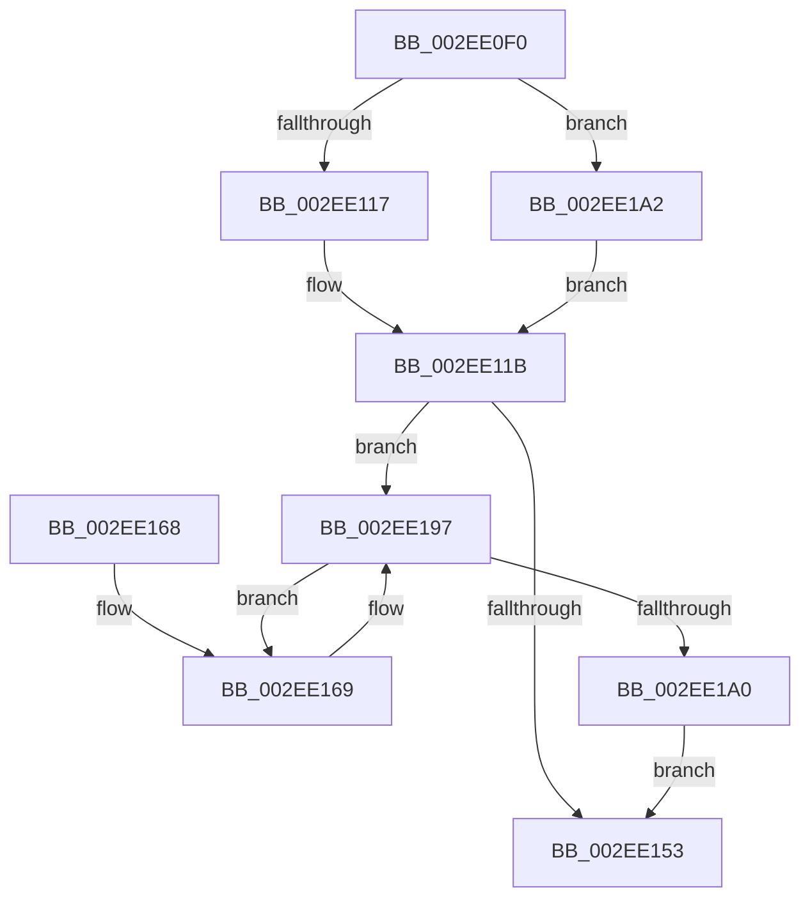

# RtlpHpVaMgrRangeCleanup

- RVA: `0x002EE0F0`–`0x002EE1AB` (길이 `187` bytes)
- VA: `0x00000001402EE0F0`
- 실행 섹션: `.text`
- PDB 이름 있음: `예`; PDB Function 태그: `아니요`
- unwind 정보 RVA: `0x0007198C`
- 디코드: `51`개 명령, `187/187` bytes 표시
- 미해석 바이트: `0` (있으면 어셈블리에 `.byte`로 보존)

> 이 문서는 커널 이미지의 기계어와 PDB 기호를 분석해 생성했습니다. 4번과 5번은 함수 원형과 자료형을 바이너리 사용 방식에서 추정한 C 해석이며 원본 소스 복구 결과는 아닙니다.

## 1. Dependencies

- 직접 호출 지점: **2**; 고유 호출 대상: **1**
- 직접 호출자로 확인된 함수: **1**
- RIP 상대 이미지 참조: **0**

### Outgoing calls
- `0x002EE148` → [RtlCSparseBitmapBitsClear](RtlCSparseBitmapBitsClear_function_002E34C4.md) (function, `0x002E34C4`)
- `0x002EE192` → [RtlCSparseBitmapBitsClear](RtlCSparseBitmapBitsClear_function_002E34C4.md) (function, `0x002E34C4`)

### Direct callers
- [RtlpHpVaMgrRangeFree](RtlpHpVaMgrRangeFree_function_002ED9F4.md) at `0x002EDA26`

### Static image references
- 디코드된 RIP-relative 메모리 참조가 없습니다.

## 2. Other-region calls and transfers

- 다른 실행 섹션으로 향하는 call: **0**
- 별도 외부 분기/꼬리 이동을 확인하지 못했습니다.

## 3. Assembly (complete function range)

```asm
002EE0F0  48 89 5C 24 08                  mov qword ptr [rsp + 8], rbx
002EE0F5  48 89 6C 24 10                  mov qword ptr [rsp + 0x10], rbp
002EE0FA  48 89 74 24 18                  mov qword ptr [rsp + 0x18], rsi
002EE0FF  57                              push rdi
002EE100  48 83 EC 20                     sub rsp, 0x20
002EE104  0F B6 32                        movzx esi, byte ptr [rdx]
002EE107  48 8B DA                        mov rbx, rdx
002EE10A  48 8B E9                        mov rbp, rcx
002EE10D  40 F6 C6 04                     test sil, 4
002EE111  0F 85 8B 00 00 00               jne 0x1402ee1a2
002EE117  0F B7 7A 18                     movzx edi, word ptr [rdx + 0x18]
002EE11B  48 8B 41 18                     mov rax, qword ptr [rcx + 0x18]
002EE11F  41 B8 01 00 00 00               mov r8d, 1
002EE125  48 C1 E7 05                     shl rdi, 5
002EE129  48 03 FB                        add rdi, rbx
002EE12C  8B 48 18                        mov ecx, dword ptr [rax + 0x18]
002EE12F  48 2B 50 28                     sub rdx, qword ptr [rax + 0x28]
002EE133  48 D3 EA                        shr rdx, cl
002EE136  48 D3 E2                        shl rdx, cl
002EE139  49 D3 E0                        shl r8, cl
002EE13C  48 8D 48 20                     lea rcx, [rax + 0x20]
002EE140  48 C1 E2 03                     shl rdx, 3
002EE144  49 C1 E0 03                     shl r8, 3
002EE148  E8 77 53 FF FF                  call 0x1402e34c4
002EE14D  40 F6 C6 04                     test sil, 4
002EE151  74 44                           je 0x1402ee197
002EE153  48 8B 5C 24 30                  mov rbx, qword ptr [rsp + 0x30]
002EE158  48 8B 6C 24 38                  mov rbp, qword ptr [rsp + 0x38]
002EE15D  48 8B 74 24 40                  mov rsi, qword ptr [rsp + 0x40]
002EE162  48 83 C4 20                     add rsp, 0x20
002EE166  5F                              pop rdi
002EE167  C3                              ret
002EE168  CC                              int3
002EE169  48 8B 45 18                     mov rax, qword ptr [rbp + 0x18]
002EE16D  48 8B D3                        mov rdx, rbx
002EE170  41 B8 01 00 00 00               mov r8d, 1
002EE176  8B 48 18                        mov ecx, dword ptr [rax + 0x18]
002EE179  48 2B 50 28                     sub rdx, qword ptr [rax + 0x28]
002EE17D  48 D3 EA                        shr rdx, cl
002EE180  48 D3 E2                        shl rdx, cl
002EE183  49 D3 E0                        shl r8, cl
002EE186  48 8D 48 20                     lea rcx, [rax + 0x20]
002EE18A  48 C1 E2 03                     shl rdx, 3
002EE18E  49 C1 E0 03                     shl r8, 3
002EE192  E8 2D 53 FF FF                  call 0x1402e34c4
002EE197  48 83 C3 20                     add rbx, 0x20
002EE19B  48 3B DF                        cmp rbx, rdi
002EE19E  72 C9                           jb 0x1402ee169
002EE1A0  EB B1                           jmp 0x1402ee153
002EE1A2  48 8B 7A 18                     mov rdi, qword ptr [rdx + 0x18]
002EE1A6  E9 70 FF FF FF                  jmp 0x1402ee11b
```

## 4. C-style interpretation (structured pseudocode)

```c
__int64 __fastcall RtlpHpVaMgrRangeCleanup(__int64 a1, __int64 a2)
{
    __int64 result;
    __int64 v_rbx;
    __int64 v_rdi;
    __int64 v_rsp;
    unsigned __int64 v_stack_p10;
    unsigned __int64 v_stack_p18;
    unsigned __int64 v_stack_p8;

    v_stack_p8 = v_rbx;
    v_stack_p10 = v_rbp;
    v_stack_p18 = v_rsi;
    v_rsp = (v_rsp) - (32);
    if ((((unsigned __int8)(*(unsigned __int8 *)(a2))) & (4)) != 0) goto loc_002EE1A2;
loc_002EE11B:
    v_rdi = (*(unsigned __int16 *)(a2 + 24)) << (5);
    v_rdi = (v_rdi) + (a2);
    a2 = (a2) - (*(unsigned __int64 *)(*(unsigned __int64 *)(a1 + 24) + 40));
    a2 = (a2) >> ((unsigned __int8)((unsigned int)(*(unsigned int *)(*(unsigned __int64 *)(a1 + 24) + 24))));
    a2 = (a2) << ((unsigned __int8)((unsigned int)(*(unsigned int *)(*(unsigned __int64 *)(a1 + 24) + 24))));
    a3 = (1) << ((unsigned __int8)((unsigned int)(*(unsigned int *)(*(unsigned __int64 *)(a1 + 24) + 24))));
    a2 = (a2) << (3);
    a3 = (a3) << (3);
    result = RtlCSparseBitmapBitsClear(*(unsigned __int64 *)(a1 + 24) + 32, a2, a3, a4);
    if ((((unsigned __int8)(*(unsigned __int8 *)(a2))) & (4)) == 0) goto loc_002EE197;
loc_002EE153:
    v_rsp = (v_rsp) + (32);
    return result;
loc_002EE169:
    a2 = (v_stack_p8) - (*(unsigned __int64 *)(*(unsigned __int64 *)(v_stack_p10 + 24) + 40));
    a2 = (a2) >> ((unsigned __int8)((unsigned int)(*(unsigned int *)(*(unsigned __int64 *)(v_stack_p10 + 24) + 24))));
    a2 = (a2) << ((unsigned __int8)((unsigned int)(*(unsigned int *)(*(unsigned __int64 *)(v_stack_p10 + 24) + 24))));
    a3 = (1) << ((unsigned __int8)((unsigned int)(*(unsigned int *)(*(unsigned __int64 *)(v_stack_p10 + 24) + 24))));
    a2 = (a2) << (3);
    a3 = (a3) << (3);
    result = RtlCSparseBitmapBitsClear(*(unsigned __int64 *)(v_stack_p10 + 24) + 32, a2, a3, a4);
loc_002EE197:
    v_rbx = (v_stack_p8) + (32);
    if (v_rbx < v_rdi) goto loc_002EE169;
    goto loc_002EE153;
loc_002EE1A2:
    goto loc_002EE11B;
}
```

## 5. (Beta) C Style

```c
int64_t RtlpHpVaMgrRangeCleanup(void *Arg1, void *Arg2)
{
    uint8_t *arg1 = (uint8_t *)Arg1;
    uint8_t *arg2 = (uint8_t *)Arg2;

    int64_t result;
    int64_t local_rbx;
    int64_t local_rdi;
    int64_t local_rsp;
    uint64_t v_stack_p10;
    uint64_t v_stack_p18;
    uint64_t v_stack_p8;

    v_stack_p8 = local_rbx;
    v_stack_p10 = local_rbp;
    v_stack_p18 = local_rsi;
    local_rsp = (local_rsp) - (32);
    if ((((uint8_t)(*(uint8_t *)(arg2))) & (4)) != 0) goto loc_002EE1A2;
loc_002EE11B:
    local_rdi = (*(uint16_t *)(arg2 + 0x18)) << (5);
    local_rdi = (local_rdi) + (Arg2);
    Arg2 = (Arg2) - (*(uint64_t *)(*(uint64_t *)(arg1 + 0x18) + 0x28));
    Arg2 = (Arg2) >> ((uint8_t)((uint32_t)(*(uint32_t *)(*(uint64_t *)(arg1 + 0x18) + 0x18))));
    Arg2 = (Arg2) << ((uint8_t)((uint32_t)(*(uint32_t *)(*(uint64_t *)(arg1 + 0x18) + 0x18))));
    a3 = (1) << ((uint8_t)((uint32_t)(*(uint32_t *)(*(uint64_t *)(arg1 + 0x18) + 0x18))));
    Arg2 = (Arg2) << (3);
    a3 = (a3) << (3);
    result = RtlCSparseBitmapBitsClear(*(uint64_t *)(arg1 + 0x18) + 32, Arg2, a3, a4);
    if ((((uint8_t)(*(uint8_t *)(arg2))) & (4)) == 0) goto loc_002EE197;
loc_002EE153:
    local_rsp = (local_rsp) + (32);
    return result;
loc_002EE169:
    Arg2 = (v_stack_p8) - (*(uint64_t *)(*(uint64_t *)(v_stack_p10 + 0x18) + 0x28));
    Arg2 = (Arg2) >> ((uint8_t)((uint32_t)(*(uint32_t *)(*(uint64_t *)(v_stack_p10 + 0x18) + 0x18))));
    Arg2 = (Arg2) << ((uint8_t)((uint32_t)(*(uint32_t *)(*(uint64_t *)(v_stack_p10 + 0x18) + 0x18))));
    a3 = (1) << ((uint8_t)((uint32_t)(*(uint32_t *)(*(uint64_t *)(v_stack_p10 + 0x18) + 0x18))));
    Arg2 = (Arg2) << (3);
    a3 = (a3) << (3);
    result = RtlCSparseBitmapBitsClear(*(uint64_t *)(v_stack_p10 + 0x18) + 32, Arg2, a3, a4);
loc_002EE197:
    local_rbx = (v_stack_p8) + (32);
    if (local_rbx < local_rdi) goto loc_002EE169;
    goto loc_002EE153;
loc_002EE1A2:
    goto loc_002EE11B;
}
```

### 관측된 메모리 오프셋

구조체 형식이 확인되지 않은 접근은 인자 기준의 오프셋으로만 기록했습니다.

| 기준 인자 | 오프셋 표현 | 폭 (bit) | 접근 |
|---|---:|---:|---|
| `Arg1` | `+ 0x18` | `64` | `R` |
| `Arg2` | `+ 0x0` | `8` | `R` |
| `Arg2` | `+ 0x18` | `16` | `R` |
| `Arg2` | `+ 0x18` | `64` | `R` |

## 6. Execution-region graph

[열기: 2D/3D 그래프와 함수 탐색 컨트롤 패널](../../../control-panel.html?section=text&rva=0x002EE0F0&view=graph)

- 2D 그래프는 위에서 아래로 흐르고, 3D 그래프는 빈 공간을 드래그해 회전합니다. Shift+드래그는 이동, 휠은 확대·축소, 함수 노드 선택은 대상 보고서 이동입니다.

### Static fallback


