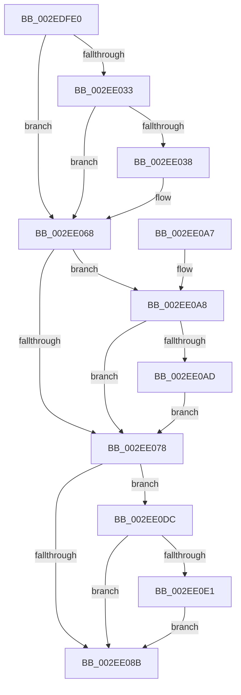

# RtlpHpVaMgrRangeCoalesce

- RVA: `0x002EDFE0`–`0x002EE0E7` (길이 `263` bytes)
- VA: `0x00000001402EDFE0`
- 실행 섹션: `.text`
- PDB 이름 있음: `예`; PDB Function 태그: `아니요`
- unwind 정보 RVA: `0x00071970`
- 디코드: `81`개 명령, `263/263` bytes 표시
- 미해석 바이트: `0` (있으면 어셈블리에 `.byte`로 보존)

> 이 문서는 커널 이미지의 기계어와 PDB 기호를 분석해 생성했습니다. 4번과 5번은 함수 원형과 자료형을 바이너리 사용 방식에서 추정한 C 해석이며 원본 소스 복구 결과는 아닙니다.

## 1. Dependencies

- 직접 호출 지점: **2**; 고유 호출 대상: **1**
- 직접 호출자로 확인된 함수: **1**
- RIP 상대 이미지 참조: **0**

### Outgoing calls
- `0x002EE03F` → [RtlRbRemoveNode](RtlRbRemoveNode_function_002E4C10.md) (function, `0x002E4C10`)
- `0x002EE0B4` → [RtlRbRemoveNode](RtlRbRemoveNode_function_002E4C10.md) (function, `0x002E4C10`)

### Direct callers
- [RtlpHpVaMgrFree](RtlpHpVaMgrFree_function_002EDF44.md) at `0x002EDF4D`

### Static image references
- 디코드된 RIP-relative 메모리 참조가 없습니다.

## 2. Other-region calls and transfers

- 다른 실행 섹션으로 향하는 call: **0**
- 별도 외부 분기/꼬리 이동을 확인하지 못했습니다.

## 3. Assembly (complete function range)

```asm
002EDFE0  48 89 5C 24 08                  mov qword ptr [rsp + 8], rbx
002EDFE5  48 89 6C 24 10                  mov qword ptr [rsp + 0x10], rbp
002EDFEA  48 89 74 24 18                  mov qword ptr [rsp + 0x18], rsi
002EDFEF  57                              push rdi
002EDFF0  41 56                           push r14
002EDFF2  41 57                           push r15
002EDFF4  48 83 EC 20                     sub rsp, 0x20
002EDFF8  0F B7 41 28                     movzx eax, word ptr [rcx + 0x28]
002EDFFC  48 8B FA                        mov rdi, rdx
002EDFFF  80 22 FE                        and byte ptr [rdx], 0xfe
002EE002  48 8B DA                        mov rbx, rdx
002EE005  44 0F B7 72 18                  movzx r14d, word ptr [rdx + 0x18]
002EE00A  48 8B E9                        mov rbp, rcx
002EE00D  48 C1 E0 05                     shl rax, 5
002EE011  41 BF EF CD AB 89               mov r15d, 0x89abcdef
002EE017  48 8B F0                        mov rsi, rax
002EE01A  48 F7 DE                        neg rsi
002EE01D  48 23 F2                        and rsi, rdx
002EE020  48 03 F0                        add rsi, rax
002EE023  0F B7 42 1A                     movzx eax, word ptr [rdx + 0x1a]
002EE027  48 C1 E0 05                     shl rax, 5
002EE02B  48 2B F8                        sub rdi, rax
002EE02E  48 3B FA                        cmp rdi, rdx
002EE031  73 35                           jae 0x1402ee068
002EE033  F6 07 01                        test byte ptr [rdi], 1
002EE036  75 30                           jne 0x1402ee068
002EE038  48 83 C1 08                     add rcx, 8
002EE03C  48 8B D7                        mov rdx, rdi
002EE03F  E8 CC 6B FF FF                  call 0x1402e4c10
002EE044  0F B7 43 18                     movzx eax, word ptr [rbx + 0x18]
002EE048  0F 57 C0                        xorps xmm0, xmm0
002EE04B  66 01 47 18                     add word ptr [rdi + 0x18], ax
002EE04F  0F 11 03                        movups xmmword ptr [rbx], xmm0
002EE052  33 C0                           xor eax, eax
002EE054  48 89 43 10                     mov qword ptr [rbx + 0x10], rax
002EE058  C6 03 02                        mov byte ptr [rbx], 2
002EE05B  8A 45 2C                        mov al, byte ptr [rbp + 0x2c]
002EE05E  88 43 01                        mov byte ptr [rbx + 1], al
002EE061  4C 89 7B 18                     mov qword ptr [rbx + 0x18], r15
002EE065  48 8B DF                        mov rbx, rdi
002EE068  0F B7 7B 18                     movzx edi, word ptr [rbx + 0x18]
002EE06C  48 C1 E7 05                     shl rdi, 5
002EE070  48 03 FB                        add rdi, rbx
002EE073  48 3B FE                        cmp rdi, rsi
002EE076  72 30                           jb 0x1402ee0a8
002EE078  0F B7 4B 18                     movzx ecx, word ptr [rbx + 0x18]
002EE07C  8B C1                           mov eax, ecx
002EE07E  48 C1 E0 05                     shl rax, 5
002EE082  48 03 C3                        add rax, rbx
002EE085  66 41 3B CE                     cmp cx, r14w
002EE089  77 51                           ja 0x1402ee0dc
002EE08B  48 8B 6C 24 48                  mov rbp, qword ptr [rsp + 0x48]
002EE090  48 8B C3                        mov rax, rbx
002EE093  48 8B 5C 24 40                  mov rbx, qword ptr [rsp + 0x40]
002EE098  48 8B 74 24 50                  mov rsi, qword ptr [rsp + 0x50]
002EE09D  48 83 C4 20                     add rsp, 0x20
002EE0A1  41 5F                           pop r15
002EE0A3  41 5E                           pop r14
002EE0A5  5F                              pop rdi
002EE0A6  C3                              ret
002EE0A7  CC                              int3
002EE0A8  F6 07 01                        test byte ptr [rdi], 1
002EE0AB  75 CB                           jne 0x1402ee078
002EE0AD  48 8D 4D 08                     lea rcx, [rbp + 8]
002EE0B1  48 8B D7                        mov rdx, rdi
002EE0B4  E8 57 6B FF FF                  call 0x1402e4c10
002EE0B9  0F B7 47 18                     movzx eax, word ptr [rdi + 0x18]
002EE0BD  0F 57 C0                        xorps xmm0, xmm0
002EE0C0  66 01 43 18                     add word ptr [rbx + 0x18], ax
002EE0C4  0F 11 07                        movups xmmword ptr [rdi], xmm0
002EE0C7  33 C0                           xor eax, eax
002EE0C9  48 89 47 10                     mov qword ptr [rdi + 0x10], rax
002EE0CD  C6 07 02                        mov byte ptr [rdi], 2
002EE0D0  8A 45 2C                        mov al, byte ptr [rbp + 0x2c]
002EE0D3  88 47 01                        mov byte ptr [rdi + 1], al
002EE0D6  4C 89 7F 18                     mov qword ptr [rdi + 0x18], r15
002EE0DA  EB 9C                           jmp 0x1402ee078
002EE0DC  48 3B C6                        cmp rax, rsi
002EE0DF  73 AA                           jae 0x1402ee08b
002EE0E1  66 89 48 1A                     mov word ptr [rax + 0x1a], cx
002EE0E5  EB A4                           jmp 0x1402ee08b
```

## 4. C-style interpretation (structured pseudocode)

```c
__int64 __fastcall RtlpHpVaMgrRangeCoalesce(__int64 a1, __int64 a2)
{
    __int64 result;
    __int64 v_rbx;
    __int64 v_rdi;
    __int64 v_rsi;
    __int64 v_rsp;
    unsigned __int64 v_stack_p10;
    unsigned __int64 v_stack_p18;
    unsigned __int64 v_stack_p8;

    v_stack_p8 = v_rbx;
    v_stack_p10 = v_rbp;
    v_stack_p18 = v_rsi;
    v_rsp = (v_rsp) - (32);
    result = (*(unsigned __int16 *)(a1 + 40)) << (5);
    v_rsi = -(result);
    v_rsi = (v_rsi) & (a2);
    v_rsi = (v_rsi) + (result);
    result = (*(unsigned __int16 *)(a2 + 26)) << (5);
    v_rdi = (a2) - (result);
    if (v_rdi >= a2) goto loc_002EE068;
    v_rbx = a2;
    if (((*(unsigned __int8 *)(v_rdi)) & (1)) == 0) {
        a1 = (a1) + (8);
        a2 = v_rdi;
        result = RtlRbRemoveNode(a1, a2, a3, a4);
        result = *(unsigned __int16 *)(a2 + 24);
        *(unsigned __int64 *)(a2) = v_xmm0;
        result = 0;
        *(unsigned __int64 *)(a2 + 16) = 0;
        *(unsigned __int8 *)(a2) = 2;
        result = *(unsigned __int8 *)(a1 + 44);
        *(unsigned __int8 *)(a2 + 1) = (unsigned __int8)(result);
        *(unsigned __int64 *)(a2 + 24) = (unsigned int)(0x89ABCDEFULL);
        v_rbx = v_rdi;
    }
    v_rdi = (*(unsigned __int16 *)(v_rbx + 24)) << (5);
    v_rdi = (v_rdi) + (v_rbx);
    if (v_rdi < v_rsi) goto loc_002EE0A8;
loc_002EE078:
    result = ((unsigned int)((unsigned int)(*(unsigned __int16 *)(v_rbx + 24)))) << (5);
    result = (result) + (v_rbx);
    if (((unsigned __int16)(*(unsigned __int16 *)(v_rbx + 24))) > ((unsigned __int16)(*(unsigned __int16 *)(a2 + 24)))) goto loc_002EE0DC;
loc_002EE08B:
    v_rsp = (v_rsp) + (32);
    return v_rbx;
loc_002EE0A8:
    if (((*(unsigned __int8 *)(v_rdi)) & (1)) != 0) goto loc_002EE078;
    result = RtlRbRemoveNode(v_stack_p10 + 8, v_rdi, a3, a4);
    *(unsigned __int64 *)(v_rdi) = v_xmm0;
    result = 0;
    *(unsigned __int64 *)(v_rdi + 16) = 0;
    *(unsigned __int8 *)(v_rdi) = 2;
    *(unsigned __int8 *)(v_rdi + 1) = (unsigned __int8)(*(unsigned __int8 *)(v_stack_p10 + 44));
    *(unsigned __int64 *)(v_rdi + 24) = (unsigned int)(0x89ABCDEFULL);
    goto loc_002EE078;
loc_002EE0DC:
    if ((*(unsigned __int8 *)(v_stack_p10 + 44)) >= v_stack_p18) goto loc_002EE08B;
    *(unsigned __int16 *)(*(unsigned __int8 *)(v_stack_p10 + 44) + 26) = (unsigned __int16)(v_stack_p10 + 8);
    goto loc_002EE08B;
}
```

## 5. (Beta) C Style

```c
int64_t RtlpHpVaMgrRangeCoalesce(void *Arg1, void *Arg2)
{
    uint8_t *arg1 = (uint8_t *)Arg1;
    uint8_t *arg2 = (uint8_t *)Arg2;

    int64_t result;
    int64_t local_rbx;
    int64_t local_rdi;
    int64_t local_rsi;
    int64_t local_rsp;
    uint64_t v_stack_p10;
    uint64_t v_stack_p18;
    uint64_t v_stack_p8;

    v_stack_p8 = local_rbx;
    v_stack_p10 = local_rbp;
    v_stack_p18 = local_rsi;
    local_rsp = (local_rsp) - (32);
    result = (*(uint16_t *)(arg1 + 0x28)) << (5);
    local_rsi = -(result);
    local_rsi = (local_rsi) & (Arg2);
    local_rsi = (local_rsi) + (result);
    result = (*(uint16_t *)(arg2 + 0x1A)) << (5);
    local_rdi = (Arg2) - (result);
    if (local_rdi >= Arg2) goto loc_002EE068;
    local_rbx = Arg2;
    if (((*(uint8_t *)(local_rdi)) & (1)) == 0) {
        Arg1 = (Arg1) + (8);
        Arg2 = local_rdi;
        result = RtlRbRemoveNode(Arg1, Arg2, a3, a4);
        result = *(uint16_t *)(arg2 + 0x18);
        *(uint64_t *)(arg2) = v_xmm0;
        result = 0;
        *(uint64_t *)(arg2 + 0x10) = 0;
        *(uint8_t *)(arg2) = 2;
        result = *(uint8_t *)(arg1 + 0x2C);
        *(uint8_t *)(arg2 + 0x1) = (uint8_t)(result);
        *(uint64_t *)(arg2 + 0x18) = (uint32_t)(0x89ABCDEFULL);
        local_rbx = local_rdi;
    }
    local_rdi = (*(uint16_t *)(local_rbx + 0x18)) << (5);
    local_rdi = (local_rdi) + (local_rbx);
    if (local_rdi < local_rsi) goto loc_002EE0A8;
loc_002EE078:
    result = ((uint32_t)((uint32_t)(*(uint16_t *)(local_rbx + 0x18)))) << (5);
    result = (result) + (local_rbx);
    if (((uint16_t)(*(uint16_t *)(local_rbx + 0x18))) > ((uint16_t)(*(uint16_t *)(arg2 + 0x18)))) goto loc_002EE0DC;
loc_002EE08B:
    local_rsp = (local_rsp) + (32);
    return local_rbx;
loc_002EE0A8:
    if (((*(uint8_t *)(local_rdi)) & (1)) != 0) goto loc_002EE078;
    result = RtlRbRemoveNode(v_stack_p10 + 8, local_rdi, a3, a4);
    *(uint64_t *)(local_rdi) = v_xmm0;
    result = 0;
    *(uint64_t *)(local_rdi + 0x10) = 0;
    *(uint8_t *)(local_rdi) = 2;
    *(uint8_t *)(local_rdi + 0x1) = (uint8_t)(*(uint8_t *)(v_stack_p10 + 0x2C));
    *(uint64_t *)(local_rdi + 0x18) = (uint32_t)(0x89ABCDEFULL);
    goto loc_002EE078;
loc_002EE0DC:
    if ((*(uint8_t *)(v_stack_p10 + 0x2C)) >= v_stack_p18) goto loc_002EE08B;
    *(uint16_t *)(*(uint8_t *)(v_stack_p10 + 0x2C) + 0x1A) = (uint16_t)(v_stack_p10 + 8);
    goto loc_002EE08B;
}
```

### 관측된 메모리 오프셋

구조체 형식이 확인되지 않은 접근은 인자 기준의 오프셋으로만 기록했습니다.

| 기준 인자 | 오프셋 표현 | 폭 (bit) | 접근 |
|---|---:|---:|---|
| `Arg1` | `+ 0x8` | `64` | `R` |
| `Arg1` | `+ 0x28` | `16` | `R` |
| `Arg1` | `+ 0x2C` | `8` | `R` |
| `Arg2` | `+ 0x0` | `8` | `R/W` |
| `Arg2` | `+ 0x0` | `8` | `W` |
| `Arg2` | `+ 0x0` | `128` | `R` |
| `Arg2` | `+ 0x1` | `8` | `W` |
| `Arg2` | `+ 0x10` | `64` | `W` |
| `Arg2` | `+ 0x18` | `16` | `R` |
| `Arg2` | `+ 0x18` | `64` | `W` |
| `Arg2` | `+ 0x1A` | `16` | `R` |

## 6. Execution-region graph

[열기: 2D/3D 그래프와 함수 탐색 컨트롤 패널](../../../control-panel.html?section=text&rva=0x002EDFE0&view=graph)

- 2D 그래프는 위에서 아래로 흐르고, 3D 그래프는 빈 공간을 드래그해 회전합니다. Shift+드래그는 이동, 휠은 확대·축소, 함수 노드 선택은 대상 보고서 이동입니다.

### Static fallback


