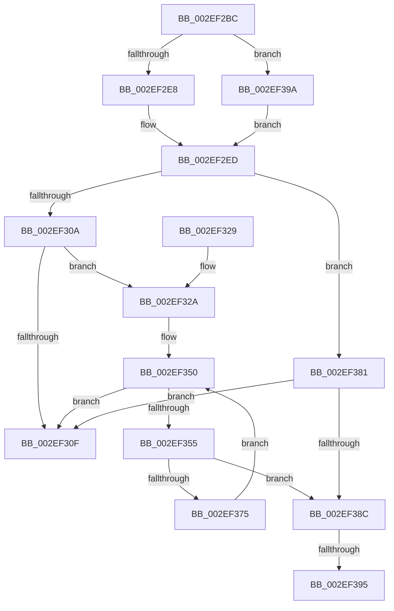

# RtlpHpVaMgrRangeCreate

- RVA: `0x002EF2BC`–`0x002EF3A3` (길이 `231` bytes)
- VA: `0x00000001402EF2BC`
- 실행 섹션: `.text`
- PDB 이름 있음: `예`; PDB Function 태그: `예`
- unwind 정보 RVA: `0x00071A80`
- 디코드: `68`개 명령, `231/231` bytes 표시
- 미해석 바이트: `0` (있으면 어셈블리에 `.byte`로 보존)

> 이 문서는 커널 이미지의 기계어와 PDB 기호를 분석해 생성했습니다. 4번과 5번은 함수 원형과 자료형을 바이너리 사용 방식에서 추정한 C 해석이며 원본 소스 복구 결과는 아닙니다.

## 1. Dependencies

- 직접 호출 지점: **2**; 고유 호출 대상: **1**
- 직접 호출자로 확인된 함수: **2**
- RIP 상대 이미지 참조: **0**

### Outgoing calls
- `0x002EF2FD` → [RtlSparseArrayElementAllocate](../2F/RtlSparseArrayElementAllocate_function_002F09C8.md) (function, `0x002F09C8`)
- `0x002EF36B` → [RtlSparseArrayElementAllocate](../2F/RtlSparseArrayElementAllocate_function_002F09C8.md) (function, `0x002F09C8`)

### Direct callers
- [RtlpHpVaMgrAlloc](RtlpHpVaMgrAlloc_function_002EDB1C.md) at `0x002EDCEB`
- [RtlpHpVaMgrRegionAllocate](RtlpHpVaMgrRegionAllocate_function_002EF1B0.md) at `0x002EF1FC`

### Static image references
- 디코드된 RIP-relative 메모리 참조가 없습니다.

## 2. Other-region calls and transfers

- 다른 실행 섹션으로 향하는 call: **0**
- call이 아닌 외부 분기/꼬리 이동: **2**
  - `0x002EF38F` → [sub_006DED14](../6D/Unknown_function_006DED14.md) (`tail-transfer`)
  - `0x002EF395` → [sub_006DED14 + 0x38](../6D/Unknown_function_006DED14.md) (`tail-transfer`)

## 3. Assembly (complete function range)

```asm
002EF2BC  48 89 5C 24 10                  mov qword ptr [rsp + 0x10], rbx
002EF2C1  48 89 6C 24 18                  mov qword ptr [rsp + 0x18], rbp
002EF2C6  56                              push rsi
002EF2C7  57                              push rdi
002EF2C8  41 54                           push r12
002EF2CA  41 56                           push r14
002EF2CC  41 57                           push r15
002EF2CE  48 83 EC 20                     sub rsp, 0x20
002EF2D2  45 33 E4                        xor r12d, r12d
002EF2D5  49 8B D8                        mov rbx, r8
002EF2D8  41 F6 00 04                     test byte ptr [r8], 4
002EF2DC  48 8B EA                        mov rbp, rdx
002EF2DF  4C 8B F9                        mov r15, rcx
002EF2E2  0F 85 B2 00 00 00               jne 0x1402ef39a
002EF2E8  45 0F B7 70 18                  movzx r14d, word ptr [r8 + 0x18]
002EF2ED  48 8B 49 18                     mov rcx, qword ptr [rcx + 0x18]
002EF2F1  48 2B 51 08                     sub rdx, qword ptr [rcx + 8]
002EF2F5  48 83 C1 10                     add rcx, 0x10
002EF2F9  48 C1 EA 14                     shr rdx, 0x14
002EF2FD  E8 C6 16 00 00                  call 0x1402f09c8
002EF302  48 8B F0                        mov rsi, rax
002EF305  48 85 C0                        test rax, rax
002EF308  74 77                           je 0x1402ef381
002EF30A  F6 00 04                        test byte ptr [rax], 4
002EF30D  74 1B                           je 0x1402ef32a
002EF30F  48 8B 5C 24 58                  mov rbx, qword ptr [rsp + 0x58]
002EF314  48 8B C6                        mov rax, rsi
002EF317  48 8B 6C 24 60                  mov rbp, qword ptr [rsp + 0x60]
002EF31C  48 83 C4 20                     add rsp, 0x20
002EF320  41 5F                           pop r15
002EF322  41 5E                           pop r14
002EF324  41 5C                           pop r12
002EF326  5F                              pop rdi
002EF327  5E                              pop rsi
002EF328  C3                              ret
002EF329  CC                              int3
002EF32A  48 81 C5 00 00 10 00            add rbp, 0x100000
002EF331  0F 57 C0                        xorps xmm0, xmm0
002EF334  80 0B 02                        or byte ptr [rbx], 2
002EF337  BF 01 00 00 00                  mov edi, 1
002EF33C  41 8A 47 2C                     mov al, byte ptr [r15 + 0x2c]
002EF340  88 43 01                        mov byte ptr [rbx + 1], al
002EF343  B8 EF CD AB 89                  mov eax, 0x89abcdef
002EF348  0F 11 43 08                     movups xmmword ptr [rbx + 8], xmm0
002EF34C  48 89 43 18                     mov qword ptr [rbx + 0x18], rax
002EF350  49 3B FE                        cmp rdi, r14
002EF353  73 BA                           jae 0x1402ef30f
002EF355  49 8B 4F 18                     mov rcx, qword ptr [r15 + 0x18]
002EF359  48 8B D5                        mov rdx, rbp
002EF35C  4C 8B C3                        mov r8, rbx
002EF35F  48 2B 51 08                     sub rdx, qword ptr [rcx + 8]
002EF363  48 83 C1 10                     add rcx, 0x10
002EF367  48 C1 EA 14                     shr rdx, 0x14
002EF36B  E8 58 16 00 00                  call 0x1402f09c8
002EF370  48 85 C0                        test rax, rax
002EF373  74 17                           je 0x1402ef38c
002EF375  48 FF C7                        inc rdi
002EF378  48 81 C5 00 00 10 00            add rbp, 0x100000
002EF37F  EB CF                           jmp 0x1402ef350
002EF381  49 8B FC                        mov rdi, r12
002EF384  49 8B F4                        mov rsi, r12
002EF387  4D 3B E6                        cmp r12, r14
002EF38A  73 83                           jae 0x1402ef30f
002EF38C  48 85 FF                        test rdi, rdi
002EF38F  0F 85 7F F9 3E 00               jne 0x1406ded14
002EF395  E9 B2 F9 3E 00                  jmp 0x1406ded4c
002EF39A  4D 8B 70 18                     mov r14, qword ptr [r8 + 0x18]
002EF39E  E9 4A FF FF FF                  jmp 0x1402ef2ed
```

## 4. C-style interpretation (structured pseudocode)

```c
__int64 __fastcall RtlpHpVaMgrRangeCreate(__int64 a1, __int64 a2, __int64 a3)
{
    __int64 result;
    __int64 v_r12;
    __int64 v_rbp;
    __int64 v_rdi;
    __int64 v_rsp;
    unsigned __int64 v_stack_p10;
    unsigned __int64 v_stack_p18;

    v_stack_p10 = v_rbx;
    v_stack_p18 = v_rbp;
    v_rsp = (v_rsp) - (32);
    v_r12 = 0;
    if (((*(unsigned __int8 *)(a3)) & (4)) != 0) goto loc_002EF39A;
loc_002EF2ED:
    a2 = (a2) - (*(unsigned __int64 *)(*(unsigned __int64 *)(a1 + 24) + 8));
    a1 = (*(unsigned __int64 *)(a1 + 24)) + (16);
    a2 = (a2) >> (20);
    result = RtlSparseArrayElementAllocate(a1, a2, a3, a4);
    if (result == 0) goto loc_002EF381;
    if (((*(unsigned __int8 *)(result)) & (4)) == 0) goto loc_002EF32A;
loc_002EF30F:
    v_rsp = (v_rsp) + (32);
    return result;
loc_002EF32A:
    v_rbp = (v_stack_p18) + (0x100000ULL);
    *(unsigned __int8 *)(v_stack_p10 + 1) = (unsigned __int8)(*(unsigned __int8 *)(a1 + 44));
    *(unsigned __int64 *)(v_stack_p10 + 8) = v_xmm0;
    *(unsigned __int64 *)(v_stack_p10 + 24) = (unsigned int)(0x89ABCDEFULL);
loc_002EF350:
    if (1 >= (*(unsigned __int16 *)(a3 + 24))) goto loc_002EF30F;
    a2 = (v_rbp) - (*(unsigned __int64 *)(*(unsigned __int64 *)(a1 + 24) + 8));
    a1 = (*(unsigned __int64 *)(a1 + 24)) + (16);
    a2 = (a2) >> (20);
    result = RtlSparseArrayElementAllocate(a1, a2, v_stack_p10, a4);
    if (result == 0) goto loc_002EF38C;
    v_rdi = (1) + 1;
    v_rbp = (v_rbp) + (0x100000ULL);
    goto loc_002EF350;
loc_002EF381:
    if (0 >= (*(unsigned __int16 *)(a3 + 24))) goto loc_002EF30F;
loc_002EF38C:
loc_002EF39A:
    goto loc_002EF2ED;
}
```

## 5. (Beta) C Style

```c
int64_t RtlpHpVaMgrRangeCreate(void *Arg1, int64_t Arg2, void *Arg3)
{
    uint8_t *arg1 = (uint8_t *)Arg1;
    uint8_t *arg3 = (uint8_t *)Arg3;

    int64_t result;
    int64_t local_r12;
    int64_t local_rbp;
    int64_t local_rdi;
    int64_t local_rsp;
    uint64_t v_stack_p10;
    uint64_t v_stack_p18;

    v_stack_p10 = local_rbx;
    v_stack_p18 = local_rbp;
    local_rsp = (local_rsp) - (32);
    local_r12 = 0;
    if (((*(uint8_t *)(arg3)) & (4)) != 0) goto loc_002EF39A;
loc_002EF2ED:
    Arg2 = (Arg2) - (*(uint64_t *)(*(uint64_t *)(arg1 + 0x18) + 0x8));
    Arg1 = (*(uint64_t *)(arg1 + 0x18)) + (16);
    Arg2 = (Arg2) >> (20);
    result = RtlSparseArrayElementAllocate(Arg1, Arg2, Arg3, a4);
    if (result == 0) goto loc_002EF381;
    if (((*(uint8_t *)(result)) & (4)) == 0) goto loc_002EF32A;
loc_002EF30F:
    local_rsp = (local_rsp) + (32);
    return result;
loc_002EF32A:
    local_rbp = (v_stack_p18) + (0x100000ULL);
    *(uint8_t *)(v_stack_p10 + 0x1) = (uint8_t)(*(uint8_t *)(arg1 + 0x2C));
    *(uint64_t *)(v_stack_p10 + 0x8) = v_xmm0;
    *(uint64_t *)(v_stack_p10 + 0x18) = (uint32_t)(0x89ABCDEFULL);
loc_002EF350:
    if (1 >= (*(uint16_t *)(arg3 + 0x18))) goto loc_002EF30F;
    Arg2 = (local_rbp) - (*(uint64_t *)(*(uint64_t *)(arg1 + 0x18) + 0x8));
    Arg1 = (*(uint64_t *)(arg1 + 0x18)) + (16);
    Arg2 = (Arg2) >> (20);
    result = RtlSparseArrayElementAllocate(Arg1, Arg2, v_stack_p10, a4);
    if (result == 0) goto loc_002EF38C;
    local_rdi = (1) + 1;
    local_rbp = (local_rbp) + (0x100000ULL);
    goto loc_002EF350;
loc_002EF381:
    if (0 >= (*(uint16_t *)(arg3 + 0x18))) goto loc_002EF30F;
loc_002EF38C:
loc_002EF39A:
    goto loc_002EF2ED;
}
```

### 관측된 메모리 오프셋

구조체 형식이 확인되지 않은 접근은 인자 기준의 오프셋으로만 기록했습니다.

| 기준 인자 | 오프셋 표현 | 폭 (bit) | 접근 |
|---|---:|---:|---|
| `Arg1` | `+ 0x18` | `64` | `R` |
| `Arg1` | `+ 0x2C` | `8` | `R` |
| `Arg3` | `+ 0x0` | `8` | `R` |
| `Arg3` | `+ 0x0` | `8` | `R/W` |
| `Arg3` | `+ 0x1` | `8` | `W` |
| `Arg3` | `+ 0x8` | `128` | `R` |
| `Arg3` | `+ 0x18` | `16` | `R` |
| `Arg3` | `+ 0x18` | `64` | `R` |
| `Arg3` | `+ 0x18` | `64` | `W` |

## 6. Execution-region graph

[열기: 2D/3D 그래프와 함수 탐색 컨트롤 패널](../../../control-panel.html?section=text&rva=0x002EF2BC&view=graph)

- 2D 그래프는 위에서 아래로 흐르고, 3D 그래프는 빈 공간을 드래그해 회전합니다. Shift+드래그는 이동, 휠은 확대·축소, 함수 노드 선택은 대상 보고서 이동입니다.

### Static fallback


