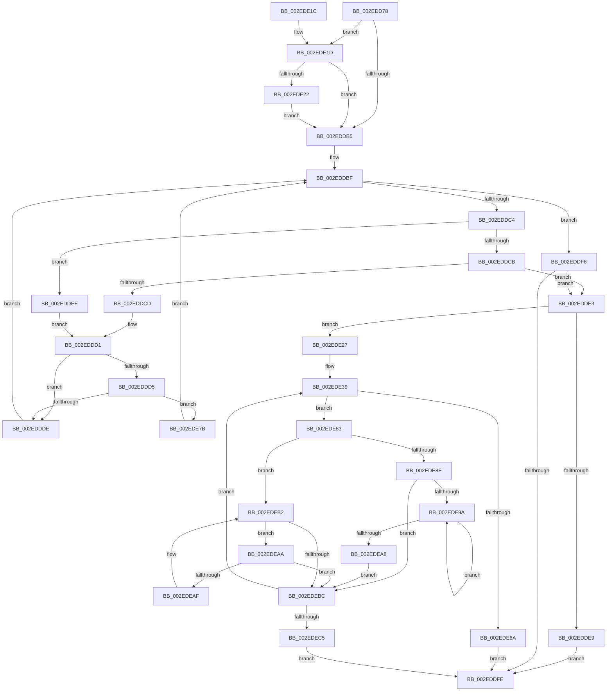

# RtlpHpVaMgrRangeFind

- RVA: `0x002EDD78`–`0x002EDECA` (길이 `338` bytes)
- VA: `0x00000001402EDD78`
- 실행 섹션: `.text`
- PDB 이름 있음: `예`; PDB Function 태그: `아니요`
- unwind 정보 RVA: `0x00071954`
- 디코드: `106`개 명령, `338/338` bytes 표시
- 미해석 바이트: `0` (있으면 어셈블리에 `.byte`로 보존)

> 이 문서는 커널 이미지의 기계어와 PDB 기호를 분석해 생성했습니다. 4번과 5번은 함수 원형과 자료형을 바이너리 사용 방식에서 추정한 C 해석이며 원본 소스 복구 결과는 아닙니다.

## 1. Dependencies

- 직접 호출 지점: **1**; 고유 호출 대상: **1**
- 직접 호출자로 확인된 함수: **1**
- RIP 상대 이미지 참조: **0**

### Outgoing calls
- `0x002EDE71` → [RtlSparseArrayElementAllocated](../32/RtlSparseArrayElementAllocated_function_00327364.md) (function, `0x00327364`)

### Direct callers
- [RtlpHpVaMgrAlloc](RtlpHpVaMgrAlloc_function_002EDB1C.md) at `0x002EDB7E`

### Static image references
- 디코드된 RIP-relative 메모리 참조가 없습니다.

## 2. Other-region calls and transfers

- 다른 실행 섹션으로 향하는 call: **0**
- 별도 외부 분기/꼬리 이동을 확인하지 못했습니다.

## 3. Assembly (complete function range)

```asm
002EDD78  48 8B C4                        mov rax, rsp
002EDD7B  48 89 58 08                     mov qword ptr [rax + 8], rbx
002EDD7F  48 89 68 10                     mov qword ptr [rax + 0x10], rbp
002EDD83  48 89 70 18                     mov qword ptr [rax + 0x18], rsi
002EDD87  48 89 78 20                     mov qword ptr [rax + 0x20], rdi
002EDD8B  41 56                           push r14
002EDD8D  48 83 EC 20                     sub rsp, 0x20
002EDD91  4C 8D 51 08                     lea r10, [rcx + 8]
002EDD95  44 0F B7 DA                     movzx r11d, dx
002EDD99  49 8B 1A                        mov rbx, qword ptr [r10]
002EDD9C  49 8B F1                        mov rsi, r9
002EDD9F  41 B9 01 00 00 00               mov r9d, 1
002EDDA5  41 0F B7 F8                     movzx edi, r8w
002EDDA9  4C 8B C1                        mov r8, rcx
002EDDAC  45 8B F3                        mov r14d, r11d
002EDDAF  45 84 4A 08                     test byte ptr [r10 + 8], r9b
002EDDB3  75 68                           jne 0x1402ede1d
002EDDB5  41 0F B6 4A 08                  movzx ecx, byte ptr [r10 + 8]
002EDDBA  41 23 C9                        and ecx, r9d
002EDDBD  33 D2                           xor edx, edx
002EDDBF  48 85 DB                        test rbx, rbx
002EDDC2  74 32                           je 0x1402eddf6
002EDDC4  66 44 3B 5B 18                  cmp r11w, word ptr [rbx + 0x18]
002EDDC9  72 23                           jb 0x1402eddee
002EDDCB  76 16                           jbe 0x1402edde3
002EDDCD  48 8B 43 08                     mov rax, qword ptr [rbx + 8]
002EDDD1  85 C9                           test ecx, ecx
002EDDD3  74 09                           je 0x1402eddde
002EDDD5  48 85 C0                        test rax, rax
002EDDD8  0F 85 9D 00 00 00               jne 0x1402ede7b
002EDDDE  48 8B D8                        mov rbx, rax
002EDDE1  EB DC                           jmp 0x1402eddbf
002EDDE3  66 41 3B F9                     cmp di, r9w
002EDDE7  77 3E                           ja 0x1402ede27
002EDDE9  48 89 1E                        mov qword ptr [rsi], rbx
002EDDEC  EB 10                           jmp 0x1402eddfe
002EDDEE  48 8B 03                        mov rax, qword ptr [rbx]
002EDDF1  48 8B D3                        mov rdx, rbx
002EDDF4  EB DB                           jmp 0x1402eddd1
002EDDF6  48 8B DA                        mov rbx, rdx
002EDDF9  48 85 D2                        test rdx, rdx
002EDDFC  75 E5                           jne 0x1402edde3
002EDDFE  48 8B 6C 24 38                  mov rbp, qword ptr [rsp + 0x38]
002EDE03  48 8B C3                        mov rax, rbx
002EDE06  48 8B 5C 24 30                  mov rbx, qword ptr [rsp + 0x30]
002EDE0B  48 8B 74 24 40                  mov rsi, qword ptr [rsp + 0x40]
002EDE10  48 8B 7C 24 48                  mov rdi, qword ptr [rsp + 0x48]
002EDE15  48 83 C4 20                     add rsp, 0x20
002EDE19  41 5E                           pop r14
002EDE1B  C3                              ret
002EDE1C  CC                              int3
002EDE1D  48 85 DB                        test rbx, rbx
002EDE20  74 93                           je 0x1402eddb5
002EDE22  49 33 DA                        xor rbx, r10
002EDE25  EB 8E                           jmp 0x1402eddb5
002EDE27  4D 8B 40 18                     mov r8, qword ptr [r8 + 0x18]
002EDE2B  4C 8B D7                        mov r10, rdi
002EDE2E  48 FF CF                        dec rdi
002EDE31  4D 8B 58 28                     mov r11, qword ptr [r8 + 0x28]
002EDE35  41 8B 68 18                     mov ebp, dword ptr [r8 + 0x18]
002EDE39  8B CD                           mov ecx, ebp
002EDE3B  48 8B D3                        mov rdx, rbx
002EDE3E  49 2B D3                        sub rdx, r11
002EDE41  4D 8B CA                        mov r9, r10
002EDE44  48 D3 EA                        shr rdx, cl
002EDE47  49 8D 4A FF                     lea rcx, [r10 - 1]
002EDE4B  48 03 CA                        add rcx, rdx
002EDE4E  48 23 CF                        and rcx, rdi
002EDE51  4C 2B C9                        sub r9, rcx
002EDE54  0F B7 4B 18                     movzx ecx, word ptr [rbx + 0x18]
002EDE58  49 FF C9                        dec r9
002EDE5B  48 03 CA                        add rcx, rdx
002EDE5E  4C 03 CA                        add r9, rdx
002EDE61  4B 8D 04 0E                     lea rax, [r14 + r9]
002EDE65  48 3B C1                        cmp rax, rcx
002EDE68  77 19                           ja 0x1402ede83
002EDE6A  49 8B D1                        mov rdx, r9
002EDE6D  49 8D 48 10                     lea rcx, [r8 + 0x10]
002EDE71  E8 EE 94 03 00                  call 0x140327364
002EDE76  48 89 06                        mov qword ptr [rsi], rax
002EDE79  EB 83                           jmp 0x1402eddfe
002EDE7B  48 33 D8                        xor rbx, rax
002EDE7E  E9 3C FF FF FF                  jmp 0x1402eddbf
002EDE83  48 8B 43 08                     mov rax, qword ptr [rbx + 8]
002EDE87  48 8B CB                        mov rcx, rbx
002EDE8A  48 85 C0                        test rax, rax
002EDE8D  74 23                           je 0x1402edeb2
002EDE8F  48 8B 08                        mov rcx, qword ptr [rax]
002EDE92  48 8B D8                        mov rbx, rax
002EDE95  48 85 C9                        test rcx, rcx
002EDE98  74 22                           je 0x1402edebc
002EDE9A  48 8B 01                        mov rax, qword ptr [rcx]
002EDE9D  48 8B D9                        mov rbx, rcx
002EDEA0  48 8B C8                        mov rcx, rax
002EDEA3  48 85 C0                        test rax, rax
002EDEA6  75 F2                           jne 0x1402ede9a
002EDEA8  EB 12                           jmp 0x1402edebc
002EDEAA  48 39 0B                        cmp qword ptr [rbx], rcx
002EDEAD  74 0D                           je 0x1402edebc
002EDEAF  48 8B CB                        mov rcx, rbx
002EDEB2  48 8B 5B 10                     mov rbx, qword ptr [rbx + 0x10]
002EDEB6  48 83 E3 FC                     and rbx, 0xfffffffffffffffc
002EDEBA  75 EE                           jne 0x1402edeaa
002EDEBC  48 85 DB                        test rbx, rbx
002EDEBF  0F 85 74 FF FF FF               jne 0x1402ede39
002EDEC5  E9 34 FF FF FF                  jmp 0x1402eddfe
```

## 4. C-style interpretation (structured pseudocode)

```c
__int64 __fastcall RtlpHpVaMgrRangeFind(__int64 a1, int a2, unsigned __int16 a3, __int64 a4)
{
    __int64 result;
    __int64 v_rbx;
    __int64 v_rdi;
    __int64 v_rsp;
    unsigned __int64 v_stack_p10;
    unsigned __int64 v_stack_p18;
    unsigned __int64 v_stack_p20;
    unsigned __int64 v_stack_p8;

    *(unsigned __int64 *)(v_rsp + 8) = v_rbx;
    *(unsigned __int64 *)(v_rsp + 16) = v_rbp;
    *(unsigned __int64 *)(v_rsp + 24) = v_rsi;
    *(unsigned __int64 *)(v_rsp + 32) = v_rdi;
    v_rsp = (v_rsp) - (32);
    if (((*(unsigned __int8 *)(a1 + 8 + 8)) & (1)) != 0) goto loc_002EDE1D;
loc_002EDDB5:
    a1 = (unsigned int)((*(unsigned __int8 *)(a1 + 8 + 8)) & (1));
    a2 = 0;
loc_002EDDBF:
    if (*(unsigned __int64 *)(a1 + 8) == 0) goto loc_002EDDF6;
    if (((unsigned __int16)((unsigned __int16)(a2))) < (*(unsigned __int16 *)(*(unsigned __int64 *)(a1 + 8) + 24))) goto loc_002EDDEE;
    if (((unsigned __int16)((unsigned __int16)(a2))) <= (*(unsigned __int16 *)(*(unsigned __int64 *)(a1 + 8) + 24))) goto loc_002EDDE3;
loc_002EDDD1:
    if ((unsigned int)(a1) == 0) goto loc_002EDDDE;
    if (*(unsigned __int64 *)(*(unsigned __int64 *)(a1 + 8) + 8) != 0) goto loc_002EDE7B;
loc_002EDDDE:
    goto loc_002EDDBF;
loc_002EDDE3:
    if (a3 > 1) goto loc_002EDE27;
    *(unsigned __int64 *)(a4) = *(unsigned __int64 *)(*(unsigned __int64 *)(a1 + 8) + 8);
    goto loc_002EDDFE;
loc_002EDDEE:
    goto loc_002EDDD1;
loc_002EDDF6:
    if (*(unsigned __int64 *)(*(unsigned __int64 *)(a1 + 8) + 8) != 0) goto loc_002EDDE3;
loc_002EDDFE:
    v_rsp = (v_rsp) + (32);
    return *(unsigned __int64 *)(*(unsigned __int64 *)(a1 + 8) + 8);
loc_002EDE1D:
    if (v_stack_p8 == 0) goto loc_002EDDB5;
    v_rbx = (v_stack_p8) ^ (a1 + 8);
    goto loc_002EDDB5;
loc_002EDE27:
    v_rdi = (v_stack_p20) - 1;
loc_002EDE39:
    a2 = (v_rbx) - (*(unsigned __int64 *)(*(unsigned __int64 *)(a1 + 24) + 40));
    a2 = (a2) >> ((unsigned __int8)((unsigned int)((unsigned int)((unsigned int)(*(unsigned int *)(*(unsigned __int64 *)(a1 + 24) + 24))))));
    a1 = (v_stack_p20 - 1) + (a2);
    a1 = (a1) & (v_rdi);
    a4 = (v_stack_p20) - (a1);
    a4 = (a4) - 1;
    a1 = (*(unsigned __int16 *)(v_rbx + 24)) + (a2);
    a4 = (a4) + (a2);
    if (((unsigned int)((unsigned int)((unsigned __int16)(a2))) + a4 * 1) > a1) goto loc_002EDE83;
    result = RtlSparseArrayElementAllocated(*(unsigned __int64 *)(a1 + 24) + 16, a4, *(unsigned __int64 *)(a1 + 24), a4);
    *(unsigned __int64 *)(v_stack_p18) = result;
    goto loc_002EDDFE;
loc_002EDE7B:
    v_rbx = (v_rbx) ^ (result);
    goto loc_002EDDBF;
loc_002EDE83:
    if (*(unsigned __int64 *)(v_rbx + 8) == 0) goto loc_002EDEB2;
    if (*(unsigned __int64 *)(*(unsigned __int64 *)(v_rbx + 8)) == 0) goto loc_002EDEBC;
loc_002EDE9A:
    if (*(unsigned __int64 *)(*(unsigned __int64 *)(*(unsigned __int64 *)(v_rbx + 8))) != 0) goto loc_002EDE9A;
    goto loc_002EDEBC;
loc_002EDEAA:
    if ((*(unsigned __int64 *)(*(unsigned __int64 *)(*(unsigned __int64 *)(v_rbx + 8)))) == (*(unsigned __int64 *)(*(unsigned __int64 *)(*(unsigned __int64 *)(v_rbx + 8))))) goto loc_002EDEBC;
loc_002EDEB2:
    v_rbx = (*(unsigned __int64 *)(*(unsigned __int64 *)(*(unsigned __int64 *)(v_rbx + 8)) + 16)) & (-4);
    if (condition_is_not_equal) goto loc_002EDEAA;
loc_002EDEBC:
    if (v_rbx != 0) goto loc_002EDE39;
    goto loc_002EDDFE;
}
```

## 5. (Beta) C Style

```c
int64_t RtlpHpVaMgrRangeFind(void *Arg1, void *Arg2, uint16_t Arg3, void *Arg4)
{
    uint8_t *arg1 = (uint8_t *)Arg1;
    uint8_t *arg2 = (uint8_t *)Arg2;
    uint8_t *arg4 = (uint8_t *)Arg4;

    int64_t result;
    int64_t local_rbx;
    int64_t local_rdi;
    int64_t local_rsp;
    uint64_t v_stack_p10;
    uint64_t v_stack_p18;
    uint64_t v_stack_p20;
    uint64_t v_stack_p8;

    *(uint64_t *)(local_rsp + 0x8) = local_rbx;
    *(uint64_t *)(local_rsp + 0x10) = local_rbp;
    *(uint64_t *)(local_rsp + 0x18) = local_rsi;
    *(uint64_t *)(local_rsp + 0x20) = local_rdi;
    local_rsp = (local_rsp) - (32);
    if (((*(uint8_t *)(arg1 + 0x8 + 0x8)) & (1)) != 0) goto loc_002EDE1D;
loc_002EDDB5:
    Arg1 = (uint32_t)((*(uint8_t *)(arg1 + 0x8 + 0x8)) & (1));
    Arg2 = 0;
loc_002EDDBF:
    if (*(uint64_t *)(arg1 + 0x8) == 0) goto loc_002EDDF6;
    if (((uint16_t)((uint16_t)(Arg2))) < (*(uint16_t *)(*(uint64_t *)(arg1 + 0x8) + 0x18))) goto loc_002EDDEE;
    if (((uint16_t)((uint16_t)(Arg2))) <= (*(uint16_t *)(*(uint64_t *)(arg1 + 0x8) + 0x18))) goto loc_002EDDE3;
loc_002EDDD1:
    if ((uint32_t)(Arg1) == 0) goto loc_002EDDDE;
    if (*(uint64_t *)(*(uint64_t *)(arg1 + 0x8) + 0x8) != 0) goto loc_002EDE7B;
loc_002EDDDE:
    goto loc_002EDDBF;
loc_002EDDE3:
    if (Arg3 > 1) goto loc_002EDE27;
    *(uint64_t *)(arg4) = *(uint64_t *)(*(uint64_t *)(arg1 + 0x8) + 0x8);
    goto loc_002EDDFE;
loc_002EDDEE:
    goto loc_002EDDD1;
loc_002EDDF6:
    if (*(uint64_t *)(*(uint64_t *)(arg1 + 0x8) + 0x8) != 0) goto loc_002EDDE3;
loc_002EDDFE:
    local_rsp = (local_rsp) + (32);
    return *(uint64_t *)(*(uint64_t *)(arg1 + 0x8) + 0x8);
loc_002EDE1D:
    if (v_stack_p8 == 0) goto loc_002EDDB5;
    local_rbx = (v_stack_p8) ^ (Arg1 + 8);
    goto loc_002EDDB5;
loc_002EDE27:
    local_rdi = (v_stack_p20) - 1;
loc_002EDE39:
    Arg2 = (local_rbx) - (*(uint64_t *)(*(uint64_t *)(arg1 + 0x18) + 0x28));
    Arg2 = (Arg2) >> ((uint8_t)((uint32_t)((uint32_t)((uint32_t)(*(uint32_t *)(*(uint64_t *)(arg1 + 0x18) + 0x18))))));
    Arg1 = (v_stack_p20 - 1) + (Arg2);
    Arg1 = (Arg1) & (local_rdi);
    Arg4 = (v_stack_p20) - (Arg1);
    Arg4 = (Arg4) - 1;
    Arg1 = (*(uint16_t *)(local_rbx + 0x18)) + (Arg2);
    Arg4 = (Arg4) + (Arg2);
    if (((uint32_t)((uint32_t)((uint16_t)(Arg2))) + Arg4 * 1) > Arg1) goto loc_002EDE83;
    result = RtlSparseArrayElementAllocated(*(uint64_t *)(arg1 + 0x18) + 16, Arg4, *(uint64_t *)(arg1 + 0x18), Arg4);
    *(uint64_t *)(v_stack_p18) = result;
    goto loc_002EDDFE;
loc_002EDE7B:
    local_rbx = (local_rbx) ^ (result);
    goto loc_002EDDBF;
loc_002EDE83:
    if (*(uint64_t *)(local_rbx + 0x8) == 0) goto loc_002EDEB2;
    if (*(uint64_t *)(*(uint64_t *)(local_rbx + 0x8)) == 0) goto loc_002EDEBC;
loc_002EDE9A:
    if (*(uint64_t *)(*(uint64_t *)(*(uint64_t *)(local_rbx + 0x8))) != 0) goto loc_002EDE9A;
    goto loc_002EDEBC;
loc_002EDEAA:
    if ((*(uint64_t *)(*(uint64_t *)(*(uint64_t *)(local_rbx + 0x8)))) == (*(uint64_t *)(*(uint64_t *)(*(uint64_t *)(local_rbx + 0x8))))) goto loc_002EDEBC;
loc_002EDEB2:
    local_rbx = (*(uint64_t *)(*(uint64_t *)(*(uint64_t *)(local_rbx + 0x8)) + 0x10)) & (-4);
    if (condition_is_not_equal) goto loc_002EDEAA;
loc_002EDEBC:
    if (local_rbx != 0) goto loc_002EDE39;
    goto loc_002EDDFE;
}
```

### 관측된 메모리 오프셋

구조체 형식이 확인되지 않은 접근은 인자 기준의 오프셋으로만 기록했습니다.

| 기준 인자 | 오프셋 표현 | 폭 (bit) | 접근 |
|---|---:|---:|---|
| `Arg1` | `+ 0x0` | `64` | `R` |
| `Arg1` | `+ 0x8` | `8` | `R` |
| `Arg1` | `+ 0x8` | `64` | `R` |
| `Arg1` | `+ 0x18` | `64` | `R` |
| `Arg2` | `+ 0x0 + r9*1` | `64` | `R` |
| `Arg4` | `+ 0x0` | `64` | `W` |

## 6. Execution-region graph

[열기: 2D/3D 그래프와 함수 탐색 컨트롤 패널](../../../control-panel.html?section=text&rva=0x002EDD78&view=graph)

- 2D 그래프는 위에서 아래로 흐르고, 3D 그래프는 빈 공간을 드래그해 회전합니다. Shift+드래그는 이동, 휠은 확대·축소, 함수 노드 선택은 대상 보고서 이동입니다.

### Static fallback


