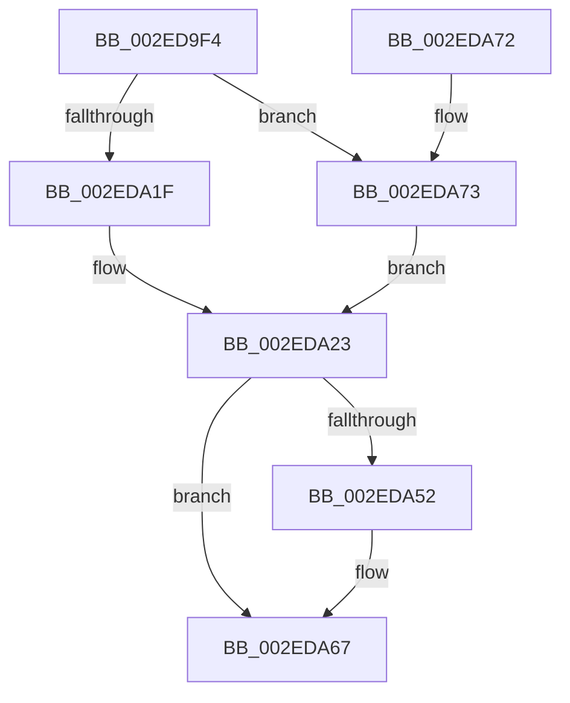

# RtlpHpVaMgrRangeFree

- RVA: `0x002ED9F4`–`0x002EDA79` (길이 `133` bytes)
- VA: `0x00000001402ED9F4`
- 실행 섹션: `.text`
- PDB 이름 있음: `예`; PDB Function 태그: `아니요`
- unwind 정보 RVA: `0x00071910`
- 디코드: `36`개 명령, `133/133` bytes 표시
- 미해석 바이트: `0` (있으면 어셈블리에 `.byte`로 보존)

> 이 문서는 커널 이미지의 기계어와 PDB 기호를 분석해 생성했습니다. 4번과 5번은 함수 원형과 자료형을 바이너리 사용 방식에서 추정한 C 해석이며 원본 소스 복구 결과는 아닙니다.

## 1. Dependencies

- 직접 호출 지점: **2**; 고유 호출 대상: **2**
- 직접 호출자로 확인된 함수: **1**
- RIP 상대 이미지 참조: **0**

### Outgoing calls
- `0x002EDA26` → [RtlpHpVaMgrRangeCleanup](RtlpHpVaMgrRangeCleanup_function_002EE0F0.md) (function, `0x002EE0F0`)
- `0x002EDA62` → [MmFreePoolMemory](../2C/MmFreePoolMemory_function_002C1578.md) (function, `0x002C1578`)

### Direct callers
- [RtlpHpVaMgrCtxFree](RtlpHpVaMgrCtxFree_function_002ED734.md) at `0x002ED929`

### Static image references
- 디코드된 RIP-relative 메모리 참조가 없습니다.

## 2. Other-region calls and transfers

- 다른 실행 섹션으로 향하는 call: **0**
- 별도 외부 분기/꼬리 이동을 확인하지 못했습니다.

## 3. Assembly (complete function range)

```asm
002ED9F4  48 89 5C 24 18                  mov qword ptr [rsp + 0x18], rbx
002ED9F9  57                              push rdi
002ED9FA  48 83 EC 20                     sub rsp, 0x20
002ED9FE  48 8B 41 18                     mov rax, qword ptr [rcx + 0x18]
002EDA02  48 8B FA                        mov rdi, rdx
002EDA05  4C 8B C1                        mov r8, rcx
002EDA08  48 2B 78 28                     sub rdi, qword ptr [rax + 0x28]
002EDA0C  8B 48 18                        mov ecx, dword ptr [rax + 0x18]
002EDA0F  48 D3 EF                        shr rdi, cl
002EDA12  48 C1 E7 14                     shl rdi, 0x14
002EDA16  48 03 78 08                     add rdi, qword ptr [rax + 8]
002EDA1A  F6 02 04                        test byte ptr [rdx], 4
002EDA1D  75 54                           jne 0x1402eda73
002EDA1F  0F B7 5A 18                     movzx ebx, word ptr [rdx + 0x18]
002EDA23  49 8B C8                        mov rcx, r8
002EDA26  E8 C5 06 00 00                  call 0x1402ee0f0
002EDA2B  48 C1 E3 14                     shl rbx, 0x14
002EDA2F  48 8D 87 FF FF 1F 00            lea rax, [rdi + 0x1fffff]
002EDA36  48 25 00 00 E0 FF               and rax, 0xffffffffffe00000
002EDA3C  48 2B D8                        sub rbx, rax
002EDA3F  48 89 44 24 38                  mov qword ptr [rsp + 0x38], rax
002EDA44  48 8D 04 3B                     lea rax, [rbx + rdi]
002EDA48  48 89 44 24 30                  mov qword ptr [rsp + 0x30], rax
002EDA4D  48 85 C0                        test rax, rax
002EDA50  74 15                           je 0x1402eda67
002EDA52  41 B8 00 80 00 00               mov r8d, 0x8000
002EDA58  48 8D 54 24 30                  lea rdx, [rsp + 0x30]
002EDA5D  48 8D 4C 24 38                  lea rcx, [rsp + 0x38]
002EDA62  E8 11 3B FD FF                  call 0x1402c1578
002EDA67  48 8B 5C 24 40                  mov rbx, qword ptr [rsp + 0x40]
002EDA6C  48 83 C4 20                     add rsp, 0x20
002EDA70  5F                              pop rdi
002EDA71  C3                              ret
002EDA72  CC                              int3
002EDA73  48 8B 5A 18                     mov rbx, qword ptr [rdx + 0x18]
002EDA77  EB AA                           jmp 0x1402eda23
```

## 4. C-style interpretation (structured pseudocode)

```c
__int64 __fastcall RtlpHpVaMgrRangeFree(__int64 a1, __int64 a2)
{
    __int64 result;
    __int64 v_rbx;
    __int64 v_rdi;
    __int64 v_rsp;
    unsigned __int64 v_stack_p10;
    unsigned __int64 v_stack_p18;
    unsigned __int64 v_stack_p8;

    v_stack_p18 = v_rbx;
    v_rsp = (v_rsp) - (32);
    v_rdi = (a2) - (*(unsigned __int64 *)(*(unsigned __int64 *)(a1 + 24) + 40));
    v_rdi = (v_rdi) >> ((unsigned __int8)((unsigned int)(*(unsigned int *)(*(unsigned __int64 *)(a1 + 24) + 24))));
    v_rdi = (v_rdi) << (20);
    v_rdi = (v_rdi) + (*(unsigned __int64 *)(*(unsigned __int64 *)(a1 + 24) + 8));
    if (((*(unsigned __int8 *)(a2)) & (4)) != 0) goto loc_002EDA73;
loc_002EDA23:
    result = RtlpHpVaMgrRangeCleanup(a1, a2, a1, a4);
    v_rbx = (*(unsigned __int16 *)(a2 + 24)) << (20);
    result = (v_rdi + 2097151) & (0xFFFFFFFFFFE00000ULL);
    v_rbx = (v_rbx) - (result);
    v_stack_p10 = result;
    v_stack_p8 = v_rbx + v_rdi * 1;
    result = v_rbx + v_rdi * 1;
    if (v_rbx + v_rdi * 1 != 0) {
        a3 = 0x8000ULL;
        a2 = v_stack_p8;
        a1 = v_stack_p10;
        result = MmFreePoolMemory(a1, a2, a3, a4);
    }
    v_rsp = (v_rsp) + (32);
    return result;
loc_002EDA73:
    goto loc_002EDA23;
}
```

## 5. (Beta) C Style

```c
int64_t RtlpHpVaMgrRangeFree(void *Arg1, void *Arg2)
{
    uint8_t *arg1 = (uint8_t *)Arg1;
    uint8_t *arg2 = (uint8_t *)Arg2;

    int64_t result;
    int64_t local_rbx;
    int64_t local_rdi;
    int64_t local_rsp;
    uint64_t v_stack_p10;
    uint64_t v_stack_p18;
    uint64_t v_stack_p8;

    v_stack_p18 = local_rbx;
    local_rsp = (local_rsp) - (32);
    local_rdi = (Arg2) - (*(uint64_t *)(*(uint64_t *)(arg1 + 0x18) + 0x28));
    local_rdi = (local_rdi) >> ((uint8_t)((uint32_t)(*(uint32_t *)(*(uint64_t *)(arg1 + 0x18) + 0x18))));
    local_rdi = (local_rdi) << (20);
    local_rdi = (local_rdi) + (*(uint64_t *)(*(uint64_t *)(arg1 + 0x18) + 0x8));
    if (((*(uint8_t *)(arg2)) & (4)) != 0) goto loc_002EDA73;
loc_002EDA23:
    result = RtlpHpVaMgrRangeCleanup(Arg1, Arg2, Arg1, a4);
    local_rbx = (*(uint16_t *)(arg2 + 0x18)) << (20);
    result = (local_rdi + 2097151) & (0xFFFFFFFFFFE00000ULL);
    local_rbx = (local_rbx) - (result);
    v_stack_p10 = result;
    v_stack_p8 = local_rbx + local_rdi * 1;
    result = local_rbx + local_rdi * 1;
    if (local_rbx + local_rdi * 1 != 0) {
        a3 = 0x8000ULL;
        Arg2 = v_stack_p8;
        Arg1 = v_stack_p10;
        result = MmFreePoolMemory(Arg1, Arg2, a3, a4);
    }
    local_rsp = (local_rsp) + (32);
    return result;
loc_002EDA73:
    goto loc_002EDA23;
}
```

### 관측된 메모리 오프셋

구조체 형식이 확인되지 않은 접근은 인자 기준의 오프셋으로만 기록했습니다.

| 기준 인자 | 오프셋 표현 | 폭 (bit) | 접근 |
|---|---:|---:|---|
| `Arg1` | `+ 0x18` | `64` | `R` |
| `Arg2` | `+ 0x0` | `8` | `R` |
| `Arg2` | `+ 0x18` | `16` | `R` |
| `Arg2` | `+ 0x18` | `64` | `R` |

## 6. Execution-region graph

[열기: 2D/3D 그래프와 함수 탐색 컨트롤 패널](../../../control-panel.html?section=text&rva=0x002ED9F4&view=graph)

- 2D 그래프는 위에서 아래로 흐르고, 3D 그래프는 빈 공간을 드래그해 회전합니다. Shift+드래그는 이동, 휠은 확대·축소, 함수 노드 선택은 대상 보고서 이동입니다.

### Static fallback


