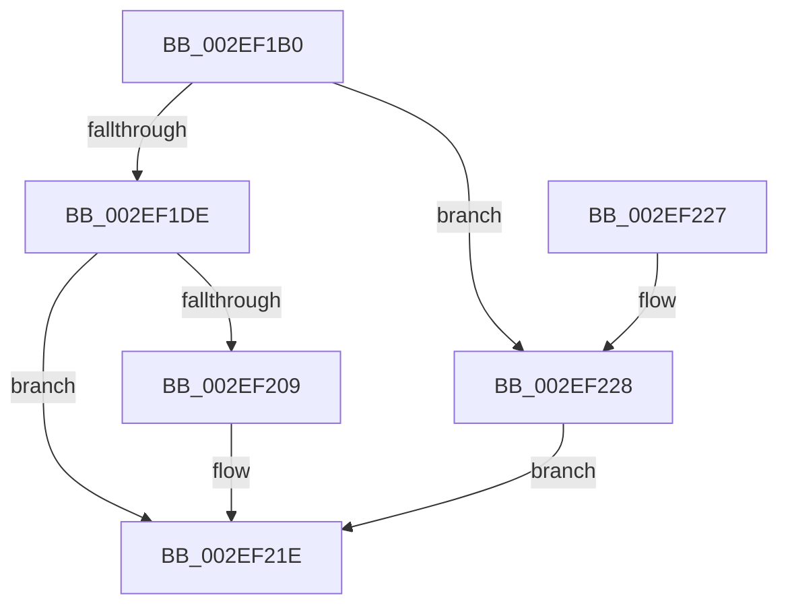

# RtlpHpVaMgrRegionAllocate

- RVA: `0x002EF1B0`–`0x002EF22C` (길이 `124` bytes)
- VA: `0x00000001402EF1B0`
- 실행 섹션: `.text`
- PDB 이름 있음: `예`; PDB Function 태그: `아니요`
- unwind 정보 RVA: `0x00071A68`
- 디코드: `34`개 명령, `124/124` bytes 표시
- 미해석 바이트: `0` (있으면 어셈블리에 `.byte`로 보존)

> 이 문서는 커널 이미지의 기계어와 PDB 기호를 분석해 생성했습니다. 4번과 5번은 함수 원형과 자료형을 바이너리 사용 방식에서 추정한 C 해석이며 원본 소스 복구 결과는 아닙니다.

## 1. Dependencies

- 직접 호출 지점: **3**; 고유 호출 대상: **3**
- 직접 호출자로 확인된 함수: **1**
- RIP 상대 이미지 참조: **0**

### Outgoing calls
- `0x002EF1CC` → [RtlpHpVaMgrAllocAligned](RtlpHpVaMgrAllocAligned_function_002EF234.md) (function, `0x002EF234`)
- `0x002EF1FC` → [RtlpHpVaMgrRangeCreate](RtlpHpVaMgrRangeCreate_function_002EF2BC.md) (function, `0x002EF2BC`)
- `0x002EF219` → [RtlpHpEnvFreeVA](../2C/RtlpHpEnvFreeVA_function_002C1534.md) (function, `0x002C1534`)

### Direct callers
- [RtlpHpVaMgrAlloc](RtlpHpVaMgrAlloc_function_002EDB1C.md) at `0x002EDC36`

### Static image references
- 디코드된 RIP-relative 메모리 참조가 없습니다.

## 2. Other-region calls and transfers

- 다른 실행 섹션으로 향하는 call: **0**
- 별도 외부 분기/꼬리 이동을 확인하지 못했습니다.

## 3. Assembly (complete function range)

```asm
002EF1B0  40 53                           push rbx
002EF1B2  48 83 EC 50                     sub rsp, 0x50
002EF1B6  44 0F B7 41 28                  movzx r8d, word ptr [rcx + 0x28]
002EF1BB  48 8D 54 24 60                  lea rdx, [rsp + 0x60]
002EF1C0  49 C1 E0 14                     shl r8, 0x14
002EF1C4  48 8B D9                        mov rbx, rcx
002EF1C7  4C 89 44 24 60                  mov qword ptr [rsp + 0x60], r8
002EF1CC  E8 63 00 00 00                  call 0x1402ef234
002EF1D1  48 89 44 24 68                  mov qword ptr [rsp + 0x68], rax
002EF1D6  48 8B D0                        mov rdx, rax
002EF1D9  48 85 C0                        test rax, rax
002EF1DC  74 4A                           je 0x1402ef228
002EF1DE  0F B7 43 28                     movzx eax, word ptr [rbx + 0x28]
002EF1E2  4C 8D 44 24 30                  lea r8, [rsp + 0x30]
002EF1E7  0F 57 C0                        xorps xmm0, xmm0
002EF1EA  48 8B CB                        mov rcx, rbx
002EF1ED  0F 11 44 24 40                  movups xmmword ptr [rsp + 0x40], xmm0
002EF1F2  66 89 44 24 48                  mov word ptr [rsp + 0x48], ax
002EF1F7  0F 11 44 24 30                  movups xmmword ptr [rsp + 0x30], xmm0
002EF1FC  E8 BB 00 00 00                  call 0x1402ef2bc
002EF201  48 8B D8                        mov rbx, rax
002EF204  48 85 C0                        test rax, rax
002EF207  75 15                           jne 0x1402ef21e
002EF209  41 B8 00 80 00 00               mov r8d, 0x8000
002EF20F  48 8D 54 24 60                  lea rdx, [rsp + 0x60]
002EF214  48 8D 4C 24 68                  lea rcx, [rsp + 0x68]
002EF219  E8 16 23 FD FF                  call 0x1402c1534
002EF21E  48 8B C3                        mov rax, rbx
002EF221  48 83 C4 50                     add rsp, 0x50
002EF225  5B                              pop rbx
002EF226  C3                              ret
002EF227  CC                              int3
002EF228  33 DB                           xor ebx, ebx
002EF22A  EB F2                           jmp 0x1402ef21e
```

## 4. C-style interpretation (structured pseudocode)

```c
__int64 __fastcall RtlpHpVaMgrRegionAllocate(__int64 a1)
{
    __int64 result;
    __int64 v_rbx;
    __int64 v_rsp;
    unsigned __int16 v_stack_m10;
    unsigned __int64 v_stack_m18;
    unsigned __int64 v_stack_m28;
    unsigned __int64 v_stack_p10;
    unsigned __int64 v_stack_p8;

    v_rsp = (v_rsp) - (80);
    a3 = (*(unsigned __int16 *)(a1 + 40)) << (20);
    v_stack_p8 = a3;
    result = RtlpHpVaMgrAllocAligned(a1, v_stack_p8, a3, a4);
    v_stack_p10 = result;
    if (result == 0) goto loc_002EF228;
    v_stack_m18 = v_xmm0;
    v_stack_m10 = (unsigned __int16)(*(unsigned __int16 *)(a1 + 40));
    v_stack_m28 = v_xmm0;
    result = RtlpHpVaMgrRangeCreate(a1, result, v_stack_m28, a4);
    if (result == 0) {
        a3 = 0x8000ULL;
        a2 = v_stack_p8;
        a1 = v_stack_p10;
        result = RtlpHpEnvFreeVA(a1, a2, a3, a4);
    }
    v_rsp = (v_rsp) + (80);
    return result;
loc_002EF228:
    v_rbx = 0;
    goto loc_002EF21E;
}
```

## 5. (Beta) C Style

```c
int64_t RtlpHpVaMgrRegionAllocate(void *Arg1)
{
    uint8_t *arg1 = (uint8_t *)Arg1;

    int64_t result;
    int64_t local_rbx;
    int64_t local_rsp;
    uint16_t v_stack_m10;
    uint64_t v_stack_m18;
    uint64_t v_stack_m28;
    uint64_t v_stack_p10;
    uint64_t v_stack_p8;

    local_rsp = (local_rsp) - (80);
    a3 = (*(uint16_t *)(arg1 + 0x28)) << (20);
    v_stack_p8 = a3;
    result = RtlpHpVaMgrAllocAligned(Arg1, v_stack_p8, a3, a4);
    v_stack_p10 = result;
    if (result == 0) goto loc_002EF228;
    v_stack_m18 = v_xmm0;
    v_stack_m10 = (uint16_t)(*(uint16_t *)(arg1 + 0x28));
    v_stack_m28 = v_xmm0;
    result = RtlpHpVaMgrRangeCreate(Arg1, result, v_stack_m28, a4);
    if (result == 0) {
        a3 = 0x8000ULL;
        a2 = v_stack_p8;
        Arg1 = v_stack_p10;
        result = RtlpHpEnvFreeVA(Arg1, a2, a3, a4);
    }
    local_rsp = (local_rsp) + (80);
    return result;
loc_002EF228:
    local_rbx = 0;
    goto loc_002EF21E;
}
```

### 관측된 메모리 오프셋

구조체 형식이 확인되지 않은 접근은 인자 기준의 오프셋으로만 기록했습니다.

| 기준 인자 | 오프셋 표현 | 폭 (bit) | 접근 |
|---|---:|---:|---|
| `Arg1` | `+ 0x28` | `16` | `R` |

## 6. Execution-region graph

[열기: 2D/3D 그래프와 함수 탐색 컨트롤 패널](../../../control-panel.html?section=text&rva=0x002EF1B0&view=graph)

- 2D 그래프는 위에서 아래로 흐르고, 3D 그래프는 빈 공간을 드래그해 회전합니다. Shift+드래그는 이동, 휠은 확대·축소, 함수 노드 선택은 대상 보고서 이동입니다.

### Static fallback


