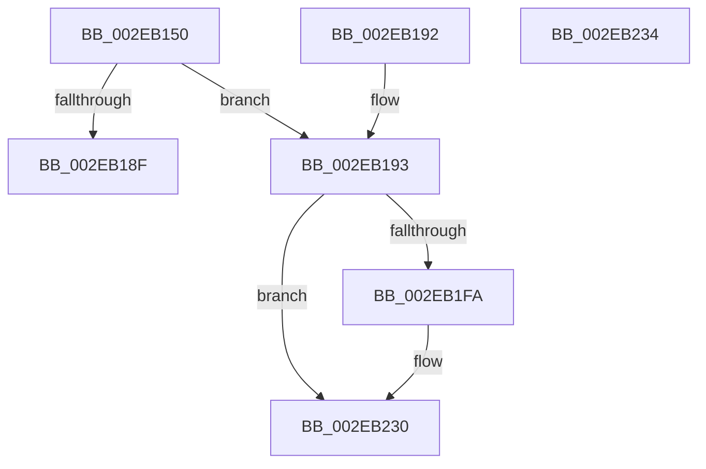

# RtlpHpVsChunkAlignSplit

- RVA: `0x002EB150`–`0x002EB235` (길이 `229` bytes)
- VA: `0x00000001402EB150`
- 실행 섹션: `.text`
- PDB 이름 있음: `예`; PDB Function 태그: `아니요`
- unwind 정보 RVA: `0x000DB714`
- 디코드: `62`개 명령, `229/229` bytes 표시
- 미해석 바이트: `0` (있으면 어셈블리에 `.byte`로 보존)

> 이 문서는 커널 이미지의 기계어와 PDB 기호를 분석해 생성했습니다. 4번과 5번은 함수 원형과 자료형을 바이너리 사용 방식에서 추정한 C 해석이며 원본 소스 복구 결과는 아닙니다.

## 1. Dependencies

- 직접 호출 지점: **0**; 고유 호출 대상: **0**
- 직접 호출자로 확인된 함수: **1**
- RIP 상대 이미지 참조: **2**

### Outgoing calls
- 직접 디코드된 call 명령이 없습니다.

### Direct callers
- [RtlpHpVsSlotAllocate](RtlpHpVsSlotAllocate_function_002EAB38.md) at `0x002EAD84`

### Static image references
- `0x002EB15C` → RVA `0x00E28302` (`.data`; read)
- `0x002EB1D1` → RVA `0x00E28300` (`.data`; read)

## 2. Other-region calls and transfers

- 다른 실행 섹션으로 향하는 call: **0**
- 별도 외부 분기/꼬리 이동을 확인하지 못했습니다.

## 3. Assembly (complete function range)

```asm
002EB150  41 0F B7 40 02                  movzx eax, word ptr [r8 + 2]
002EB155  4D 8D 88 0F 10 00 00            lea r9, [r8 + 0x100f]
002EB15C  44 0F B7 15 9E D1 B3 00         movzx r10d, word ptr [rip + 0xb3d19e]
002EB164  49 81 E1 00 F0 FF FF            and r9, 0xfffffffffffff000
002EB16B  48 89 4C 24 08                  mov qword ptr [rsp + 8], rcx
002EB170  4C 8B DA                        mov r11, rdx
002EB173  41 8B C8                        mov ecx, r8d
002EB176  49 8B D1                        mov rdx, r9
002EB179  C1 E9 10                        shr ecx, 0x10
002EB17C  49 2B D0                        sub rdx, r8
002EB17F  33 C1                           xor eax, ecx
002EB181  41 33 C2                        xor eax, r10d
002EB184  8B C8                           mov ecx, eax
002EB186  48 C1 E1 04                     shl rcx, 4
002EB18A  48 3B D1                        cmp rdx, rcx
002EB18D  72 04                           jb 0x1402eb193
002EB18F  33 C0                           xor eax, eax
002EB191  C3                              ret
002EB192  CC                              int3
002EB193  49 83 C1 E0                     add r9, -0x20
002EB197  41 8B C8                        mov ecx, r8d
002EB19A  C1 E9 10                        shr ecx, 0x10
002EB19D  0F 57 C0                        xorps xmm0, xmm0
002EB1A0  49 8B D1                        mov rdx, r9
002EB1A3  49 2B D0                        sub rdx, r8
002EB1A6  48 C1 FA 04                     sar rdx, 4
002EB1AA  66 33 CA                        xor cx, dx
002EB1AD  2B C2                           sub eax, edx
002EB1AF  66 41 33 CA                     xor cx, r10w
002EB1B3  66 41 89 48 02                  mov word ptr [r8 + 2], cx
002EB1B8  41 0F 11 01                     movups xmmword ptr [r9], xmm0
002EB1BC  44 8B C0                        mov r8d, eax
002EB1BF  41 0F 11 41 10                  movups xmmword ptr [r9 + 0x10], xmm0
002EB1C4  66 41 89 41 02                  mov word ptr [r9 + 2], ax
002EB1C9  66 41 89 51 04                  mov word ptr [r9 + 4], dx
002EB1CE  49 8B 09                        mov rcx, qword ptr [r9]
002EB1D1  48 33 0D 28 D1 B3 00            xor rcx, qword ptr [rip + 0xb3d128]
002EB1D8  49 33 C9                        xor rcx, r9
002EB1DB  49 C1 E0 04                     shl r8, 4
002EB1DF  49 89 09                        mov qword ptr [r9], rcx
002EB1E2  4D 03 C1                        add r8, r9
002EB1E5  41 0F B7 4B 20                  movzx ecx, word ptr [r11 + 0x20]
002EB1EA  48 83 C1 03                     add rcx, 3
002EB1EE  48 C1 E1 04                     shl rcx, 4
002EB1F2  49 03 CB                        add rcx, r11
002EB1F5  4C 3B C1                        cmp r8, rcx
002EB1F8  73 36                           jae 0x1402eb230
002EB1FA  48 8B 15 FF D0 B3 00            mov rdx, qword ptr [rip + 0xb3d0ff]
002EB201  0F B7 C8                        movzx ecx, ax
002EB204  48 C7 44 24 08 00 00 00 00      mov qword ptr [rsp + 8], 0
002EB20D  89 4C 24 0C                     mov dword ptr [rsp + 0xc], ecx
002EB211  48 8B 4C 24 08                  mov rcx, qword ptr [rsp + 8]
002EB216  48 C1 E9 20                     shr rcx, 0x20
002EB21A  48 C1 EA 20                     shr rdx, 0x20
002EB21E  66 33 D1                        xor dx, cx
002EB221  49 8B C8                        mov rcx, r8
002EB224  48 C1 E9 20                     shr rcx, 0x20
002EB228  66 33 D1                        xor dx, cx
002EB22B  66 41 89 50 04                  mov word ptr [r8 + 4], dx
002EB230  49 8B C1                        mov rax, r9
002EB233  C3                              ret
002EB234  CC                              int3
```

## 4. C-style interpretation (structured pseudocode)

```c
__int64 __fastcall RtlpHpVsChunkAlignSplit(__int64 a1, __int64 a2, __int64 a3)
{
    __int64 result;
    unsigned __int64 v_stack_p8;
    unsigned int v_stack_pC;

    a4 = (a3 + 4111) & (0xFFFFFFFFFFFFF000ULL);
    v_stack_p8 = a1;
    a1 = (unsigned int)(((unsigned int)((unsigned int)(a3))) >> (16));
    a2 = (a4) - (a3);
    result = (unsigned int)((*(unsigned __int16 *)(a3 + 2)) ^ ((unsigned int)(a1)));
    result = (unsigned int)((result) ^ ((unsigned int)(*(unsigned __int16 *)(v_rip + 11784606))));
    a1 = ((unsigned int)((unsigned int)(result))) << (4);
    if (a2 < a1) goto loc_002EB193;
    result = 0;
    return result;
loc_002EB193:
    a4 = (a4) + (-32);
    a1 = (unsigned int)(((unsigned int)((unsigned int)(a3))) >> (16));
    a2 = (a4) - (a3);
    a2 = (a2) >> (4);
    a1 = (unsigned __int16)((a1) ^ ((unsigned __int16)(a2)));
    result = (unsigned int)((result) - ((unsigned int)(a2)));
    a1 = (unsigned __int16)((a1) ^ ((unsigned __int16)(*(unsigned __int16 *)(v_rip + 11784606))));
    *(unsigned __int16 *)(a3 + 2) = (unsigned __int16)(a1);
    *(unsigned __int64 *)(a4) = v_xmm0;
    *(unsigned __int64 *)(a4 + 16) = v_xmm0;
    *(unsigned __int16 *)(a4 + 2) = (unsigned __int16)(result);
    *(unsigned __int16 *)(a4 + 4) = (unsigned __int16)(a2);
    a1 = (*(unsigned __int64 *)(a4)) ^ (*(unsigned __int64 *)(v_rip + 11784488));
    a1 = (a1) ^ (a4);
    a3 = ((unsigned int)((unsigned int)(result))) << (4);
    *(unsigned __int64 *)(a4) = a1;
    a3 = (a3) + (a4);
    a1 = (*(unsigned __int16 *)(a2 + 32)) + (3);
    a1 = (a1) << (4);
    a1 = (a1) + (a2);
    if (a3 < a1) {
        a2 = *(unsigned __int64 *)(v_rip + 11784447);
        a1 = (unsigned __int16)(result);
        v_stack_p8 = 0;
        v_stack_pC = (unsigned int)(a1);
        a1 = v_stack_p8;
        a1 = (a1) >> (32);
        a2 = (a2) >> (32);
        a2 = (unsigned __int16)((a2) ^ ((unsigned __int16)(a1)));
        a1 = a3;
        a1 = (a1) >> (32);
        a2 = (unsigned __int16)((a2) ^ ((unsigned __int16)(a1)));
        *(unsigned __int16 *)(a3 + 4) = (unsigned __int16)(a2);
    }
    return a4;
}
```

## 5. (Beta) C Style

```c
int64_t RtlpHpVsChunkAlignSplit(int64_t Arg1, void *Arg2, void *Arg3)
{
    uint8_t *arg2 = (uint8_t *)Arg2;
    uint8_t *arg3 = (uint8_t *)Arg3;

    int64_t result;
    uint64_t v_stack_p8;
    uint32_t v_stack_pC;

    a4 = (Arg3 + 4111) & (0xFFFFFFFFFFFFF000ULL);
    v_stack_p8 = Arg1;
    Arg1 = (uint32_t)(((uint32_t)((uint32_t)(Arg3))) >> (16));
    Arg2 = (a4) - (Arg3);
    result = (uint32_t)((*(uint16_t *)(arg3 + 0x2)) ^ ((uint32_t)(Arg1)));
    result = (uint32_t)((result) ^ ((uint32_t)(*(uint16_t *)(v_rip + 0xB3D19E))));
    Arg1 = ((uint32_t)((uint32_t)(result))) << (4);
    if (Arg2 < Arg1) goto loc_002EB193;
    result = 0;
    return result;
loc_002EB193:
    a4 = (a4) + (-32);
    Arg1 = (uint32_t)(((uint32_t)((uint32_t)(Arg3))) >> (16));
    Arg2 = (a4) - (Arg3);
    Arg2 = (Arg2) >> (4);
    Arg1 = (uint16_t)((Arg1) ^ ((uint16_t)(Arg2)));
    result = (uint32_t)((result) - ((uint32_t)(Arg2)));
    Arg1 = (uint16_t)((Arg1) ^ ((uint16_t)(*(uint16_t *)(v_rip + 0xB3D19E))));
    *(uint16_t *)(arg3 + 0x2) = (uint16_t)(Arg1);
    *(uint64_t *)(a4) = v_xmm0;
    *(uint64_t *)(a4 + 0x10) = v_xmm0;
    *(uint16_t *)(a4 + 0x2) = (uint16_t)(result);
    *(uint16_t *)(a4 + 0x4) = (uint16_t)(Arg2);
    Arg1 = (*(uint64_t *)(a4)) ^ (*(uint64_t *)(v_rip + 0xB3D128));
    Arg1 = (Arg1) ^ (a4);
    Arg3 = ((uint32_t)((uint32_t)(result))) << (4);
    *(uint64_t *)(a4) = Arg1;
    Arg3 = (Arg3) + (a4);
    Arg1 = (*(uint16_t *)(arg2 + 0x20)) + (3);
    Arg1 = (Arg1) << (4);
    Arg1 = (Arg1) + (Arg2);
    if (Arg3 < Arg1) {
        Arg2 = *(uint64_t *)(v_rip + 0xB3D0FF);
        Arg1 = (uint16_t)(result);
        v_stack_p8 = 0;
        v_stack_pC = (uint32_t)(Arg1);
        Arg1 = v_stack_p8;
        Arg1 = (Arg1) >> (32);
        Arg2 = (Arg2) >> (32);
        Arg2 = (uint16_t)((Arg2) ^ ((uint16_t)(Arg1)));
        Arg1 = Arg3;
        Arg1 = (Arg1) >> (32);
        Arg2 = (uint16_t)((Arg2) ^ ((uint16_t)(Arg1)));
        *(uint16_t *)(arg3 + 0x4) = (uint16_t)(Arg2);
    }
    return a4;
}
```

### 관측된 메모리 오프셋

구조체 형식이 확인되지 않은 접근은 인자 기준의 오프셋으로만 기록했습니다.

| 기준 인자 | 오프셋 표현 | 폭 (bit) | 접근 |
|---|---:|---:|---|
| `Arg2` | `+ 0x20` | `16` | `R` |
| `Arg3` | `+ 0x0` | `64` | `R` |
| `Arg3` | `+ 0x0` | `64` | `W` |
| `Arg3` | `+ 0x0` | `128` | `R` |
| `Arg3` | `+ 0x2` | `16` | `R` |
| `Arg3` | `+ 0x2` | `16` | `W` |
| `Arg3` | `+ 0x4` | `16` | `W` |
| `Arg3` | `+ 0x10` | `128` | `R` |
| `Arg3` | `+ 0x100F` | `64` | `R` |

## 6. Execution-region graph

[열기: 2D/3D 그래프와 함수 탐색 컨트롤 패널](../../../control-panel.html?section=text&rva=0x002EB150&view=graph)

- 2D 그래프는 위에서 아래로 흐르고, 3D 그래프는 빈 공간을 드래그해 회전합니다. Shift+드래그는 이동, 휠은 확대·축소, 함수 노드 선택은 대상 보고서 이동입니다.

### Static fallback


