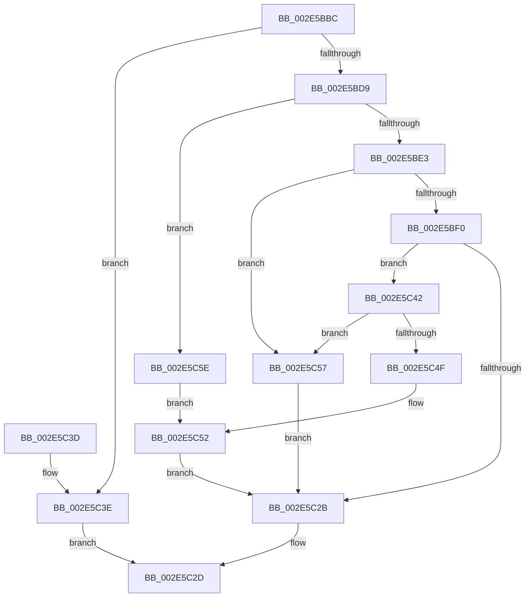

# RtlpHpVsCommitLimitCheck

- RVA: `0x002E5BBC`–`0x002E5C79` (길이 `189` bytes)
- VA: `0x00000001402E5BBC`
- 실행 섹션: `.text`
- PDB 이름 있음: `예`; PDB Function 태그: `아니요`
- unwind 정보 RVA: `0x00071224`
- 디코드: `58`개 명령, `189/189` bytes 표시
- 미해석 바이트: `0` (있으면 어셈블리에 `.byte`로 보존)

> 이 문서는 커널 이미지의 기계어와 PDB 기호를 분석해 생성했습니다. 4번과 5번은 함수 원형과 자료형을 바이너리 사용 방식에서 추정한 C 해석이며 원본 소스 복구 결과는 아닙니다.

## 1. Dependencies

- 직접 호출 지점: **1**; 고유 호출 대상: **1**
- 직접 호출자로 확인된 함수: **2**
- RIP 상대 이미지 참조: **0**

### Outgoing calls
- `0x002E5C46` → [RtlpHpEnvCompactionSchedule](../32/RtlpHpEnvCompactionSchedule_function_003264A0.md) (function, `0x003264A0`)

### Direct callers
- [RtlpHpVsChunkFree](RtlpHpVsChunkFree_function_002E3980.md) at `0x002E4068`
- [RtlpHpVsChunkSplit](RtlpHpVsChunkSplit_function_002E5C80.md) at `0x002E6677`

### Static image references
- 디코드된 RIP-relative 메모리 참조가 없습니다.

## 2. Other-region calls and transfers

- 다른 실행 섹션으로 향하는 call: **0**
- 별도 외부 분기/꼬리 이동을 확인하지 못했습니다.

## 3. Assembly (complete function range)

```asm
002E5BBC  48 89 5C 24 08                  mov qword ptr [rsp + 8], rbx
002E5BC1  48 89 74 24 10                  mov qword ptr [rsp + 0x10], rsi
002E5BC6  57                              push rdi
002E5BC7  48 83 EC 20                     sub rsp, 0x20
002E5BCB  33 DB                           xor ebx, ebx
002E5BCD  41 8B C0                        mov eax, r8d
002E5BD0  4C 8B C9                        mov r9, rcx
002E5BD3  66 39 5A 24                     cmp word ptr [rdx + 0x24], bx
002E5BD7  7C 65                           jl 0x1402e5c3e
002E5BD9  44 8D 53 08                     lea r10d, [rbx + 8]
002E5BDD  66 39 59 06                     cmp word ptr [rcx + 6], bx
002E5BE1  74 7B                           je 0x1402e5c5e
002E5BE3  4C 33 49 08                     xor r9, qword ptr [rcx + 8]
002E5BE7  44 8B C0                        mov r8d, eax
002E5BEA  45 84 51 0D                     test byte ptr [r9 + 0xd], r10b
002E5BEE  75 67                           jne 0x1402e5c57
002E5BF0  49 0F BF 41 16                  movsx rax, word ptr [r9 + 0x16]
002E5BF5  41 8A 49 0B                     mov cl, byte ptr [r9 + 0xb]
002E5BF9  4A 8B 74 08 18                  mov rsi, qword ptr [rax + r9 + 0x18]
002E5BFE  4A 03 74 08 10                  add rsi, qword ptr [rax + r9 + 0x10]
002E5C03  4A 8B 7C 08 08                  mov rdi, qword ptr [rax + r9 + 8]
002E5C08  48 8B C7                        mov rax, rdi
002E5C0B  48 D3 E8                        shr rax, cl
002E5C0E  41 8A 49 0C                     mov cl, byte ptr [r9 + 0xc]
002E5C12  49 3B C2                        cmp rax, r10
002E5C15  49 0F 46 C2                     cmovbe rax, r10
002E5C19  48 D3 EF                        shr rdi, cl
002E5C1C  49 3B FA                        cmp rdi, r10
002E5C1F  49 0F 46 FA                     cmovbe rdi, r10
002E5C23  49 03 F0                        add rsi, r8
002E5C26  48 3B F0                        cmp rsi, rax
002E5C29  77 17                           ja 0x1402e5c42
002E5C2B  8B C3                           mov eax, ebx
002E5C2D  48 8B 5C 24 30                  mov rbx, qword ptr [rsp + 0x30]
002E5C32  48 8B 74 24 38                  mov rsi, qword ptr [rsp + 0x38]
002E5C37  48 83 C4 20                     add rsp, 0x20
002E5C3B  5F                              pop rdi
002E5C3C  C3                              ret
002E5C3D  CC                              int3
002E5C3E  33 C0                           xor eax, eax
002E5C40  EB EB                           jmp 0x1402e5c2d
002E5C42  49 8B 49 38                     mov rcx, qword ptr [r9 + 0x38]
002E5C46  E8 55 08 04 00                  call 0x1403264a0
002E5C4B  85 C0                           test eax, eax
002E5C4D  78 08                           js 0x1402e5c57
002E5C4F  48 3B F7                        cmp rsi, rdi
002E5C52  0F 97 C3                        seta bl
002E5C55  EB D4                           jmp 0x1402e5c2b
002E5C57  BB 01 00 00 00                  mov ebx, 1
002E5C5C  EB CD                           jmp 0x1402e5c2b
002E5C5E  4C 8B 41 50                     mov r8, qword ptr [rcx + 0x50]
002E5C62  48 8B C8                        mov rcx, rax
002E5C65  49 C1 E8 07                     shr r8, 7
002E5C69  4D 3B C2                        cmp r8, r10
002E5C6C  4D 0F 46 C2                     cmovbe r8, r10
002E5C70  49 03 49 58                     add rcx, qword ptr [r9 + 0x58]
002E5C74  49 3B C8                        cmp rcx, r8
002E5C77  EB D9                           jmp 0x1402e5c52
```

## 4. C-style interpretation (structured pseudocode)

```c
__int64 __fastcall RtlpHpVsCommitLimitCheck(__int64 a1, __int64 a2, int a3)
{
    __int64 result;
    __int64 v_rbx;
    __int64 v_rdi;
    __int64 v_rsi;
    __int64 v_rsp;
    unsigned __int64 v_stack_p10;
    unsigned __int64 v_stack_p8;

    v_stack_p8 = v_rbx;
    v_stack_p10 = v_rsi;
    v_rsp = (v_rsp) - (32);
    v_rbx = 0;
    if ((*(unsigned __int16 *)(a2 + 36)) < 0) goto loc_002E5C3E;
    if ((*(unsigned __int16 *)(a1 + 6)) == 0) goto loc_002E5C5E;
    a4 = (a1) ^ (*(unsigned __int64 *)(a1 + 8));
    if (((*(unsigned __int8 *)(a4 + 13)) & ((unsigned __int8)(v_rbx + 8))) != 0) goto loc_002E5C57;
    v_rsi = (*(unsigned __int64 *)((__int16)(*(unsigned __int16 *)(a4 + 22)) + a4 * 1 + 24)) + (*(unsigned __int64 *)((__int16)(*(unsigned __int16 *)(a4 + 22)) + a4 * 1 + 16));
    result = (*(unsigned __int64 *)((__int16)(*(unsigned __int16 *)(a4 + 22)) + a4 * 1 + 8)) >> ((unsigned __int8)(*(unsigned __int8 *)(a4 + 11)));
    if (result <= (v_rbx + 8)) { result = v_rbx + 8; }
    v_rdi = (*(unsigned __int64 *)((__int16)(*(unsigned __int16 *)(a4 + 22)) + a4 * 1 + 8)) >> ((unsigned __int8)(*(unsigned __int8 *)(a4 + 12)));
    if (v_rdi <= (v_rbx + 8)) { v_rdi = v_rbx + 8; }
    v_rsi = (v_rsi) + ((unsigned int)((unsigned int)((unsigned int)(a3))));
    if (v_rsi > result) goto loc_002E5C42;
loc_002E5C2B:
loc_002E5C2D:
    v_rsp = (v_rsp) + (32);
    return 0;
loc_002E5C3E:
    result = 0;
    goto loc_002E5C2D;
loc_002E5C42:
    result = RtlpHpEnvCompactionSchedule(*(unsigned __int64 *)(a4 + 56), a2, (unsigned int)((unsigned int)((unsigned int)(a3))), a4);
    if (sign_flag) goto loc_002E5C57;
loc_002E5C52:
    v_rbx = (v_stack_p10 > v_rdi) ? 1 : 0;
    goto loc_002E5C2B;
loc_002E5C57:
    goto loc_002E5C2B;
loc_002E5C5E:
    a3 = (*(unsigned __int64 *)(*(unsigned __int64 *)(a4 + 56) + 80)) >> (7);
    if (a3 <= (v_rbx + 8)) { a3 = v_rbx + 8; }
    a1 = (result) + (*(unsigned __int64 *)(a4 + 88));
    goto loc_002E5C52;
}
```

## 5. (Beta) C Style

```c
int64_t RtlpHpVsCommitLimitCheck(void *Arg1, void *Arg2, int32_t Arg3)
{
    uint8_t *arg1 = (uint8_t *)Arg1;
    uint8_t *arg2 = (uint8_t *)Arg2;

    int64_t result;
    int64_t local_rbx;
    int64_t local_rdi;
    int64_t local_rsi;
    int64_t local_rsp;
    uint64_t v_stack_p10;
    uint64_t v_stack_p8;

    v_stack_p8 = local_rbx;
    v_stack_p10 = local_rsi;
    local_rsp = (local_rsp) - (32);
    local_rbx = 0;
    if ((*(uint16_t *)(arg2 + 0x24)) < 0) goto loc_002E5C3E;
    if ((*(uint16_t *)(arg1 + 0x6)) == 0) goto loc_002E5C5E;
    a4 = (Arg1) ^ (*(uint64_t *)(arg1 + 0x8));
    if (((*(uint8_t *)(a4 + 0xD)) & ((uint8_t)(local_rbx + 8))) != 0) goto loc_002E5C57;
    local_rsi = (*(uint64_t *)((int16_t)(*(uint16_t *)(a4 + 0x16)) + a4 * 1 + 0x18)) + (*(uint64_t *)((int16_t)(*(uint16_t *)(a4 + 0x16)) + a4 * 1 + 0x10));
    result = (*(uint64_t *)((int16_t)(*(uint16_t *)(a4 + 0x16)) + a4 * 1 + 0x8)) >> ((uint8_t)(*(uint8_t *)(a4 + 0xB)));
    if (result <= (local_rbx + 8)) { result = local_rbx + 8; }
    local_rdi = (*(uint64_t *)((int16_t)(*(uint16_t *)(a4 + 0x16)) + a4 * 1 + 0x8)) >> ((uint8_t)(*(uint8_t *)(a4 + 0xC)));
    if (local_rdi <= (local_rbx + 8)) { local_rdi = local_rbx + 8; }
    local_rsi = (local_rsi) + ((uint32_t)((uint32_t)((uint32_t)(Arg3))));
    if (local_rsi > result) goto loc_002E5C42;
loc_002E5C2B:
loc_002E5C2D:
    local_rsp = (local_rsp) + (32);
    return 0;
loc_002E5C3E:
    result = 0;
    goto loc_002E5C2D;
loc_002E5C42:
    result = RtlpHpEnvCompactionSchedule(*(uint64_t *)(a4 + 0x38), Arg2, (uint32_t)((uint32_t)((uint32_t)(Arg3))), a4);
    if (sign_flag) goto loc_002E5C57;
loc_002E5C52:
    local_rbx = (v_stack_p10 > local_rdi) ? 1 : 0;
    goto loc_002E5C2B;
loc_002E5C57:
    goto loc_002E5C2B;
loc_002E5C5E:
    Arg3 = (*(uint64_t *)(*(uint64_t *)(a4 + 0x38) + 0x50)) >> (7);
    if (Arg3 <= (local_rbx + 8)) { Arg3 = local_rbx + 8; }
    Arg1 = (result) + (*(uint64_t *)(a4 + 0x58));
    goto loc_002E5C52;
}
```

### 관측된 메모리 오프셋

구조체 형식이 확인되지 않은 접근은 인자 기준의 오프셋으로만 기록했습니다.

| 기준 인자 | 오프셋 표현 | 폭 (bit) | 접근 |
|---|---:|---:|---|
| `Arg1` | `+ 0x6` | `16` | `R` |
| `Arg1` | `+ 0x8` | `64` | `R` |
| `Arg1` | `+ 0xB` | `8` | `R` |
| `Arg1` | `+ 0xC` | `8` | `R` |
| `Arg1` | `+ 0xD` | `8` | `R` |
| `Arg1` | `+ 0x16` | `16` | `R` |
| `Arg1` | `+ 0x38` | `64` | `R` |
| `Arg1` | `+ 0x50` | `64` | `R` |
| `Arg1` | `+ 0x58` | `64` | `R` |
| `Arg2` | `+ 0x24` | `16` | `R` |

## 6. Execution-region graph

[열기: 2D/3D 그래프와 함수 탐색 컨트롤 패널](../../../control-panel.html?section=text&rva=0x002E5BBC&view=graph)

- 2D 그래프는 위에서 아래로 흐르고, 3D 그래프는 빈 공간을 드래그해 회전합니다. Shift+드래그는 이동, 휠은 확대·축소, 함수 노드 선택은 대상 보고서 이동입니다.

### Static fallback


