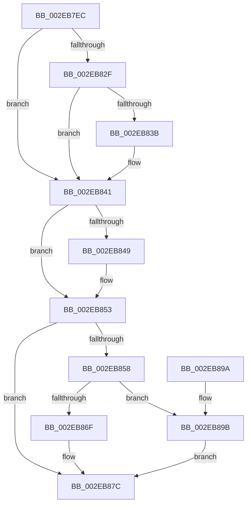

# RtlpHpVsContextAllocateFinalize

- RVA: `0x002EB7EC`–`0x002EB8B3` (길이 `199` bytes)
- VA: `0x00000001402EB7EC`
- 실행 섹션: `.text`
- PDB 이름 있음: `예`; PDB Function 태그: `아니요`
- unwind 정보 RVA: `0x00071698`
- 디코드: `58`개 명령, `199/199` bytes 표시
- 미해석 바이트: `0` (있으면 어셈블리에 `.byte`로 보존)

> 이 문서는 커널 이미지의 기계어와 PDB 기호를 분석해 생성했습니다. 4번과 5번은 함수 원형과 자료형을 바이너리 사용 방식에서 추정한 C 해석이며 원본 소스 복구 결과는 아닙니다.

## 1. Dependencies

- 직접 호출 지점: **1**; 고유 호출 대상: **1**
- 직접 호출자로 확인된 함수: **1**
- RIP 상대 이미지 참조: **1**

### Outgoing calls
- `0x002EB84E` → [RtlHeapZero](../6B/RtlHeapZero_function_006BBC10.md) (function, `0x006BBC10`)

### Direct callers
- [RtlpHpVsContextMultiAlloc](RtlpHpVsContextMultiAlloc_function_002EB6B4.md) at `0x002EB784`

### Static image references
- `0x002EB81A` → RVA `0x00E28302` (`.data`; read)

## 2. Other-region calls and transfers

- 다른 실행 섹션으로 향하는 call: **0**
- 별도 외부 분기/꼬리 이동을 확인하지 못했습니다.

## 3. Assembly (complete function range)

```asm
002EB7EC  48 8B C4                        mov rax, rsp
002EB7EF  48 89 58 08                     mov qword ptr [rax + 8], rbx
002EB7F3  48 89 68 10                     mov qword ptr [rax + 0x10], rbp
002EB7F7  48 89 70 18                     mov qword ptr [rax + 0x18], rsi
002EB7FB  48 89 78 20                     mov qword ptr [rax + 0x20], rdi
002EB7FF  41 56                           push r14
002EB801  48 83 EC 20                     sub rsp, 0x20
002EB805  0F B7 5A 02                     movzx ebx, word ptr [rdx + 2]
002EB809  48 8D 7A 10                     lea rdi, [rdx + 0x10]
002EB80D  8B C2                           mov eax, edx
002EB80F  45 8B F0                        mov r14d, r8d
002EB812  C1 E8 10                        shr eax, 0x10
002EB815  48 8B EA                        mov rbp, rdx
002EB818  33 D8                           xor ebx, eax
002EB81A  0F B7 05 E1 CA B3 00            movzx eax, word ptr [rip + 0xb3cae1]
002EB821  33 D8                           xor ebx, eax
002EB823  C1 E3 04                        shl ebx, 4
002EB826  83 EB 10                        sub ebx, 0x10
002EB829  F6 41 04 01                     test byte ptr [rcx + 4], 1
002EB82D  74 12                           je 0x1402eb841
002EB82F  48 8D 42 20                     lea rax, [rdx + 0x20]
002EB833  48 A9 FF 0F 00 00               test rax, 0xfff
002EB839  75 06                           jne 0x1402eb841
002EB83B  48 8B F8                        mov rdi, rax
002EB83E  83 C3 F0                        add ebx, -0x10
002EB841  8B F3                           mov esi, ebx
002EB843  41 F6 C1 02                     test r9b, 2
002EB847  74 0A                           je 0x1402eb853
002EB849  8B D6                           mov edx, esi
002EB84B  48 8B CF                        mov rcx, rdi
002EB84E  E8 BD 03 3D 00                  call 0x1406bbc10
002EB853  44 3B F3                        cmp r14d, ebx
002EB856  73 24                           jae 0x1402eb87c
002EB858  0F BA 6D 08 08                  bts dword ptr [rbp + 8], 8
002EB85D  41 2B DE                        sub ebx, r14d
002EB860  C6 44 3E FF 00                  mov byte ptr [rsi + rdi - 1], 0
002EB865  0F B7 44 3E FE                  movzx eax, word ptr [rsi + rdi - 2]
002EB86A  83 FB 01                        cmp ebx, 1
002EB86D  75 2C                           jne 0x1402eb89b
002EB86F  B9 00 80 00 00                  mov ecx, 0x8000
002EB874  66 0B C1                        or ax, cx
002EB877  66 89 44 3E FE                  mov word ptr [rsi + rdi - 2], ax
002EB87C  48 8B 5C 24 30                  mov rbx, qword ptr [rsp + 0x30]
002EB881  48 8B C7                        mov rax, rdi
002EB884  48 8B 7C 24 48                  mov rdi, qword ptr [rsp + 0x48]
002EB889  48 8B 6C 24 38                  mov rbp, qword ptr [rsp + 0x38]
002EB88E  48 8B 74 24 40                  mov rsi, qword ptr [rsp + 0x40]
002EB893  48 83 C4 20                     add rsp, 0x20
002EB897  41 5E                           pop r14
002EB899  C3                              ret
002EB89A  CC                              int3
002EB89B  0F B7 C8                        movzx ecx, ax
002EB89E  BA FF 1F 00 00                  mov edx, 0x1fff
002EB8A3  66 33 CB                        xor cx, bx
002EB8A6  66 23 CA                        and cx, dx
002EB8A9  66 33 C8                        xor cx, ax
002EB8AC  66 89 4C 3E FE                  mov word ptr [rsi + rdi - 2], cx
002EB8B1  EB C9                           jmp 0x1402eb87c
```

## 4. C-style interpretation (structured pseudocode)

```c
__int64 __fastcall RtlpHpVsContextAllocateFinalize(__int64 a1, __int64 a2, int a3, unsigned __int8 a4)
{
    __int64 result;
    __int64 v_rbx;
    __int64 v_rdi;
    __int64 v_rsp;
    unsigned __int64 v_stack_p10;
    unsigned __int64 v_stack_p18;
    unsigned __int64 v_stack_p20;
    unsigned __int64 v_stack_p8;

    *(unsigned __int64 *)(v_rsp + 8) = v_rbx;
    *(unsigned __int64 *)(v_rsp + 16) = v_rbp;
    *(unsigned __int64 *)(v_rsp + 24) = v_rsi;
    *(unsigned __int64 *)(v_rsp + 32) = v_rdi;
    v_rsp = (v_rsp) - (32);
    result = (unsigned int)(((unsigned int)((unsigned int)(a2))) >> (16));
    v_rbx = (unsigned int)((*(unsigned __int16 *)(a2 + 2)) ^ ((unsigned int)(result)));
    v_rbx = (unsigned int)((v_rbx) ^ ((unsigned int)(*(unsigned __int16 *)(v_rip + 11782881))));
    v_rbx = (unsigned int)((v_rbx) << (4));
    v_rbx = (unsigned int)((v_rbx) - (16));
    if (((*(unsigned __int8 *)(a1 + 4)) & (1)) == 0) goto loc_002EB841;
    v_rdi = a2 + 16;
    if (((a2 + 32) & (0xFFFULL)) == 0) {
        v_rdi = a2 + 32;
        v_rbx = (unsigned int)((v_rbx) + (-16));
    }
    result = a2 + 32;
    if (((a4) & (2)) != 0) {
        a2 = (unsigned int)((unsigned int)((unsigned int)(v_rbx)));
        a1 = v_rdi;
        result = RtlHeapZero(a1, a2, a3, a4);
    }
    if (((unsigned int)((unsigned int)(a3))) >= ((unsigned int)(v_rbx))) goto loc_002EB87C;
    v_rbx = (unsigned int)((v_rbx) - ((unsigned int)((unsigned int)(a3))));
    *(unsigned __int8 *)((unsigned int)((unsigned int)(v_rbx)) + v_rdi * 1 - 1) = 0;
    if (((unsigned int)(v_rbx)) != 1) goto loc_002EB89B;
    result = (unsigned __int16)((*(unsigned __int16 *)((unsigned int)((unsigned int)(v_rbx)) + v_rdi * 1 - 2)) | ((unsigned __int16)((unsigned int)(0x8000ULL))));
    *(unsigned __int16 *)((unsigned int)((unsigned int)(v_rbx)) + v_rdi * 1 - 2) = (unsigned __int16)(result);
loc_002EB87C:
    v_rsp = (v_rsp) + (32);
    return v_rdi;
loc_002EB89B:
    a1 = (unsigned __int16)(((unsigned __int16)(v_rdi)) ^ ((unsigned __int16)(v_stack_p8)));
    a1 = (unsigned __int16)((a1) & ((unsigned __int16)((unsigned int)(0x1FFFULL))));
    a1 = (unsigned __int16)((a1) ^ ((unsigned __int16)(v_rdi)));
    *(unsigned __int16 *)(v_stack_p18 + v_stack_p20 * 1 - 2) = (unsigned __int16)(a1);
    goto loc_002EB87C;
}
```

## 5. (Beta) C Style

```c
int64_t RtlpHpVsContextAllocateFinalize(void *Arg1, void *Arg2, int32_t Arg3, uint8_t Arg4)
{
    uint8_t *arg1 = (uint8_t *)Arg1;
    uint8_t *arg2 = (uint8_t *)Arg2;

    int64_t result;
    int64_t local_rbx;
    int64_t local_rdi;
    int64_t local_rsp;
    uint64_t v_stack_p10;
    uint64_t v_stack_p18;
    uint64_t v_stack_p20;
    uint64_t v_stack_p8;

    *(uint64_t *)(local_rsp + 0x8) = local_rbx;
    *(uint64_t *)(local_rsp + 0x10) = local_rbp;
    *(uint64_t *)(local_rsp + 0x18) = local_rsi;
    *(uint64_t *)(local_rsp + 0x20) = local_rdi;
    local_rsp = (local_rsp) - (32);
    result = (uint32_t)(((uint32_t)((uint32_t)(Arg2))) >> (16));
    local_rbx = (uint32_t)((*(uint16_t *)(arg2 + 0x2)) ^ ((uint32_t)(result)));
    local_rbx = (uint32_t)((local_rbx) ^ ((uint32_t)(*(uint16_t *)(v_rip + 0xB3CAE1))));
    local_rbx = (uint32_t)((local_rbx) << (4));
    local_rbx = (uint32_t)((local_rbx) - (16));
    if (((*(uint8_t *)(arg1 + 0x4)) & (1)) == 0) goto loc_002EB841;
    local_rdi = Arg2 + 16;
    if (((Arg2 + 32) & (0xFFFULL)) == 0) {
        local_rdi = Arg2 + 32;
        local_rbx = (uint32_t)((local_rbx) + (-16));
    }
    result = Arg2 + 32;
    if (((Arg4) & (2)) != 0) {
        Arg2 = (uint32_t)((uint32_t)((uint32_t)(local_rbx)));
        Arg1 = local_rdi;
        result = RtlHeapZero(Arg1, Arg2, Arg3, Arg4);
    }
    if (((uint32_t)((uint32_t)(Arg3))) >= ((uint32_t)(local_rbx))) goto loc_002EB87C;
    local_rbx = (uint32_t)((local_rbx) - ((uint32_t)((uint32_t)(Arg3))));
    *(uint8_t *)((uint32_t)((uint32_t)(local_rbx)) + local_rdi * 1 - 0x1) = 0;
    if (((uint32_t)(local_rbx)) != 1) goto loc_002EB89B;
    result = (uint16_t)((*(uint16_t *)((uint32_t)((uint32_t)(local_rbx)) + local_rdi * 1 - 0x2)) | ((uint16_t)((uint32_t)(0x8000ULL))));
    *(uint16_t *)((uint32_t)((uint32_t)(local_rbx)) + local_rdi * 1 - 0x2) = (uint16_t)(result);
loc_002EB87C:
    local_rsp = (local_rsp) + (32);
    return local_rdi;
loc_002EB89B:
    Arg1 = (uint16_t)(((uint16_t)(local_rdi)) ^ ((uint16_t)(v_stack_p8)));
    Arg1 = (uint16_t)((Arg1) & ((uint16_t)((uint32_t)(0x1FFFULL))));
    Arg1 = (uint16_t)((Arg1) ^ ((uint16_t)(local_rdi)));
    *(uint16_t *)(v_stack_p18 + v_stack_p20 * 1 - 0x2) = (uint16_t)(Arg1);
    goto loc_002EB87C;
}
```

### 관측된 메모리 오프셋

구조체 형식이 확인되지 않은 접근은 인자 기준의 오프셋으로만 기록했습니다.

| 기준 인자 | 오프셋 표현 | 폭 (bit) | 접근 |
|---|---:|---:|---|
| `Arg1` | `+ 0x4` | `8` | `R` |
| `Arg2` | `+ 0x2` | `16` | `R` |
| `Arg2` | `+ 0x8` | `32` | `R/W` |
| `Arg2` | `+ 0x10` | `64` | `R` |
| `Arg2` | `+ 0x20` | `64` | `R` |

## 6. Execution-region graph

[열기: 2D/3D 그래프와 함수 탐색 컨트롤 패널](../../../control-panel.html?section=text&rva=0x002EB7EC&view=graph)

- 2D 그래프는 위에서 아래로 흐르고, 3D 그래프는 빈 공간을 드래그해 회전합니다. Shift+드래그는 이동, 휠은 확대·축소, 함수 노드 선택은 대상 보고서 이동입니다.

### Static fallback


