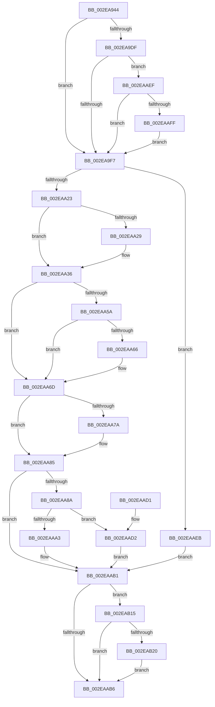

# RtlpHpVsContextAllocate

- RVA: `0x002EA944`–`0x002EAB31` (길이 `493` bytes)
- VA: `0x00000001402EA944`
- 실행 섹션: `.text`
- PDB 이름 있음: `예`; PDB Function 태그: `아니요`
- unwind 정보 RVA: `0x000715B0`
- 디코드: `137`개 명령, `493/493` bytes 표시
- 미해석 바이트: `0` (있으면 어셈블리에 `.byte`로 보존)

> 이 문서는 커널 이미지의 기계어와 PDB 기호를 분석해 생성했습니다. 4번과 5번은 함수 원형과 자료형을 바이너리 사용 방식에서 추정한 C 해석이며 원본 소스 복구 결과는 아닙니다.

## 1. Dependencies

- 직접 호출 지점: **6**; 고유 호출 대상: **6**
- 직접 호출자로 확인된 함수: **5**
- RIP 상대 이미지 참조: **1**

### Outgoing calls
- `0x002EA9EA` → [RtlpHpTryAcquireQueuedLockExclusive](RtlpHpTryAcquireQueuedLockExclusive_function_002EB23C.md) (function, `0x002EB23C`)
- `0x002EAA12` → [RtlpHpVsSlotAllocate](RtlpHpVsSlotAllocate_function_002EAB38.md) (function, `0x002EAB38`)
- `0x002EAA31` → [RtlpHpReleaseQueuedLockExclusive](RtlpHpReleaseQueuedLockExclusive_function_002E2A70.md) (function, `0x002E2A70`)
- `0x002EAA80` → [RtlHeapZero](../6B/RtlHeapZero_function_006BBC10.md) (function, `0x006BBC10`)
- `0x002EAB0B` → [RtlpHpAcquireQueuedLockExclusive](../32/RtlpHpAcquireQueuedLockExclusive_function_00324820.md) (function, `0x00324820`)
- `0x002EAB2A` → [RtlpHpVsContextHandleContention](RtlpHpVsContextHandleContention_function_002EB9D4.md) (function, `0x002EB9D4`)

### Direct callers
- [sub_002E9C01](Unknown_function_002E9C01.md) at `0x002E9C44`
- [RtlpHpAllocateHeapSlow](RtlpHpAllocateHeapSlow_function_002E9DEC.md) at `0x002EA42A`
- [RtlpAllocateNTHeapInternal](RtlpAllocateNTHeapInternal_function_002EB94C.md) at `0x002EB999`
- [RtlpHpMetadataAlloc](RtlpHpMetadataAlloc_function_002EC180.md) at `0x002EC4D0`
- [ExAllocateHeapPool](../35/ExAllocateHeapPool_function_0035BA30.md) at `0x0035D964`
- [ExAllocateHeapPool](../35/ExAllocateHeapPool_function_0035BA30.md) at `0x0035D99D`

### Static image references
- `0x002EAA45` → RVA `0x00E28302` (`.data`; read)

## 2. Other-region calls and transfers

- 다른 실행 섹션으로 향하는 call: **0**
- 별도 외부 분기/꼬리 이동을 확인하지 못했습니다.

## 3. Assembly (complete function range)

```asm
002EA944  4C 8B DC                        mov r11, rsp
002EA947  49 89 5B 08                     mov qword ptr [r11 + 8], rbx
002EA94B  45 89 4B 20                     mov dword ptr [r11 + 0x20], r9d
002EA94F  55                              push rbp
002EA950  56                              push rsi
002EA951  57                              push rdi
002EA952  41 54                           push r12
002EA954  41 55                           push r13
002EA956  41 56                           push r14
002EA958  41 57                           push r15
002EA95A  48 83 EC 50                     sub rsp, 0x50
002EA95E  0F B6 41 04                     movzx eax, byte ptr [rcx + 4]
002EA962  45 8D 50 02                     lea r10d, [r8 + 2]
002EA966  48 8B E9                        mov rbp, rcx
002EA969  41 3B D0                        cmp edx, r8d
002EA96C  0F B7 09                        movzx ecx, word ptr [rcx]
002EA96F  44 8B FA                        mov r15d, edx
002EA972  45 0F 44 D0                     cmove r10d, r8d
002EA976  0F 57 C0                        xorps xmm0, xmm0
002EA979  83 E0 01                        and eax, 1
002EA97C  48 C1 E1 06                     shl rcx, 6
002EA980  FF C0                           inc eax
002EA982  48 8D 5D 03                     lea rbx, [rbp + 3]
002EA986  41 83 C2 0F                     add r10d, 0xf
002EA98A  48 03 CD                        add rcx, rbp
002EA98D  41 C1 EA 04                     shr r10d, 4
002EA991  45 33 E4                        xor r12d, r12d
002EA994  41 03 C2                        add eax, r10d
002EA997  44 8B E8                        mov r13d, eax
002EA99A  89 84 24 98 00 00 00            mov dword ptr [rsp + 0x98], eax
002EA9A1  65 48 8B 04 25 88 01 00 00      mov rax, qword ptr gs:[0x188]
002EA9AA  41 C1 E5 10                     shl r13d, 0x10
002EA9AE  0F B6 90 75 07 00 00            movzx edx, byte ptr [rax + 0x775]
002EA9B5  0F B6 45 02                     movzx eax, byte ptr [rbp + 2]
002EA9B9  23 D0                           and edx, eax
002EA9BB  33 C0                           xor eax, eax
002EA9BD  89 94 24 A0 00 00 00            mov dword ptr [rsp + 0xa0], edx
002EA9C4  44 0F B7 34 91                  movzx r14d, word ptr [rcx + rdx*4]
002EA9C9  49 C1 E6 06                     shl r14, 6
002EA9CD  4C 03 F5                        add r14, rbp
002EA9D0  F6 45 05 01                     test byte ptr [rbp + 5], 1
002EA9D4  0F 11 44 24 30                  movups xmmword ptr [rsp + 0x30], xmm0
002EA9D9  49 89 43 B8                     mov qword ptr [r11 - 0x48], rax
002EA9DD  75 18                           jne 0x1402ea9f7
002EA9DF  0F B6 13                        movzx edx, byte ptr [rbx]
002EA9E2  4D 8D 43 A8                     lea r8, [r11 - 0x58]
002EA9E6  49 8D 4E 08                     lea rcx, [r14 + 8]
002EA9EA  E8 4D 08 00 00                  call 0x1402eb23c
002EA9EF  85 C0                           test eax, eax
002EA9F1  0F 84 F8 00 00 00               je 0x1402eaaef
002EA9F7  44 8B 84 24 98 00 00 00         mov r8d, dword ptr [rsp + 0x98]
002EA9FF  48 8D 44 24 30                  lea rax, [rsp + 0x30]
002EAA04  45 8B CD                        mov r9d, r13d
002EAA07  48 89 44 24 20                  mov qword ptr [rsp + 0x20], rax
002EAA0C  49 8B D6                        mov rdx, r14
002EAA0F  48 8B CD                        mov rcx, rbp
002EAA12  E8 21 01 00 00                  call 0x1402eab38
002EAA17  48 8B F0                        mov rsi, rax
002EAA1A  48 85 C0                        test rax, rax
002EAA1D  0F 84 C8 00 00 00               je 0x1402eaaeb
002EAA23  F6 45 05 01                     test byte ptr [rbp + 5], 1
002EAA27  75 0D                           jne 0x1402eaa36
002EAA29  0F B6 0B                        movzx ecx, byte ptr [rbx]
002EAA2C  48 8D 54 24 30                  lea rdx, [rsp + 0x30]
002EAA31  E8 3A 80 FF FF                  call 0x1402e2a70
002EAA36  0F B7 5E 02                     movzx ebx, word ptr [rsi + 2]
002EAA3A  48 8D 7E 10                     lea rdi, [rsi + 0x10]
002EAA3E  8B C6                           mov eax, esi
002EAA40  C1 E8 10                        shr eax, 0x10
002EAA43  33 D8                           xor ebx, eax
002EAA45  0F B7 05 B6 D8 B3 00            movzx eax, word ptr [rip + 0xb3d8b6]
002EAA4C  33 D8                           xor ebx, eax
002EAA4E  C1 E3 04                        shl ebx, 4
002EAA51  83 EB 10                        sub ebx, 0x10
002EAA54  F6 45 04 01                     test byte ptr [rbp + 4], 1
002EAA58  74 13                           je 0x1402eaa6d
002EAA5A  48 8D 46 20                     lea rax, [rsi + 0x20]
002EAA5E  48 A9 FF 0F 00 00               test rax, 0xfff
002EAA64  75 07                           jne 0x1402eaa6d
002EAA66  48 8D 7E 20                     lea rdi, [rsi + 0x20]
002EAA6A  83 C3 F0                        add ebx, -0x10
002EAA6D  F6 84 24 A8 00 00 00 02         test byte ptr [rsp + 0xa8], 2
002EAA75  44 8B F3                        mov r14d, ebx
002EAA78  74 0B                           je 0x1402eaa85
002EAA7A  41 8B D6                        mov edx, r14d
002EAA7D  48 8B CF                        mov rcx, rdi
002EAA80  E8 8B 11 3D 00                  call 0x1406bbc10
002EAA85  44 3B FB                        cmp r15d, ebx
002EAA88  73 27                           jae 0x1402eaab1
002EAA8A  0F BA 6E 08 08                  bts dword ptr [rsi + 8], 8
002EAA8F  41 2B DF                        sub ebx, r15d
002EAA92  41 C6 44 3E FF 00               mov byte ptr [r14 + rdi - 1], 0
002EAA98  41 0F B7 4C 3E FE               movzx ecx, word ptr [r14 + rdi - 2]
002EAA9E  83 FB 01                        cmp ebx, 1
002EAAA1  75 2F                           jne 0x1402eaad2
002EAAA3  B8 00 80 00 00                  mov eax, 0x8000
002EAAA8  66 0B C8                        or cx, ax
002EAAAB  66 41 89 4C 3E FE               mov word ptr [r14 + rdi - 2], cx
002EAAB1  45 85 E4                        test r12d, r12d
002EAAB4  75 5F                           jne 0x1402eab15
002EAAB6  48 8B 9C 24 90 00 00 00         mov rbx, qword ptr [rsp + 0x90]
002EAABE  48 8B C7                        mov rax, rdi
002EAAC1  48 83 C4 50                     add rsp, 0x50
002EAAC5  41 5F                           pop r15
002EAAC7  41 5E                           pop r14
002EAAC9  41 5D                           pop r13
002EAACB  41 5C                           pop r12
002EAACD  5F                              pop rdi
002EAACE  5E                              pop rsi
002EAACF  5D                              pop rbp
002EAAD0  C3                              ret
002EAAD1  CC                              int3
002EAAD2  0F B7 C1                        movzx eax, cx
002EAAD5  BA FF 1F 00 00                  mov edx, 0x1fff
002EAADA  66 33 C3                        xor ax, bx
002EAADD  66 23 C2                        and ax, dx
002EAAE0  66 33 C1                        xor ax, cx
002EAAE3  66 41 89 44 3E FE               mov word ptr [r14 + rdi - 2], ax
002EAAE9  EB C6                           jmp 0x1402eaab1
002EAAEB  33 FF                           xor edi, edi
002EAAED  EB C2                           jmp 0x1402eaab1
002EAAEF  41 BC 01 00 00 00               mov r12d, 1
002EAAF5  44 84 65 05                     test byte ptr [rbp + 5], r12b
002EAAF9  0F 85 F8 FE FF FF               jne 0x1402ea9f7
002EAAFF  0F B6 13                        movzx edx, byte ptr [rbx]
002EAB02  4C 8D 44 24 30                  lea r8, [rsp + 0x30]
002EAB07  49 8D 4E 08                     lea rcx, [r14 + 8]
002EAB0B  E8 10 9D 03 00                  call 0x140324820
002EAB10  E9 E2 FE FF FF                  jmp 0x1402ea9f7
002EAB15  0F B6 4D 02                     movzx ecx, byte ptr [rbp + 2]
002EAB19  FF C1                           inc ecx
002EAB1B  83 F9 01                        cmp ecx, 1
002EAB1E  76 96                           jbe 0x1402eaab6
002EAB20  8B 94 24 A0 00 00 00            mov edx, dword ptr [rsp + 0xa0]
002EAB27  48 8B CD                        mov rcx, rbp
002EAB2A  E8 A5 0E 00 00                  call 0x1402eb9d4
002EAB2F  EB 85                           jmp 0x1402eaab6
```

## 4. C-style interpretation (structured pseudocode)

```c
__int64 __fastcall RtlpHpVsContextAllocate(__int64 a1, int a2, __int64 a3, int a4)
{
    __int64 result;
    __int64 v_r10;
    __int64 v_r12;
    __int64 v_r13;
    __int64 v_r14;
    __int64 v_rbx;
    __int64 v_rdi;
    __int64 v_rsp;
    unsigned __int64 v_stack_m58;
    unsigned __int64 v_stack_m68;
    unsigned int v_stack_p10;
    unsigned int v_stack_p18;
    unsigned __int8 v_stack_p20;
    unsigned __int64 v_stack_p30;
    unsigned __int64 v_stack_p8;
    unsigned int v_stack_pA0;

    *(unsigned __int64 *)(v_rsp + 8) = v_rbx;
    *(unsigned int *)(v_rsp + 32) = a4;
    v_rsp = (v_rsp) - (80);
    v_r10 = a3 + 2;
    if (a2 == ((unsigned int)(a3))) { v_r10 = (unsigned int)(a3); }
    result = (unsigned int)((*(unsigned __int8 *)(a1 + 4)) & (1));
    a1 = (*(unsigned __int16 *)(a1)) << (6);
    result = (unsigned int)((result) + 1);
    v_r10 = (unsigned int)((v_r10) + (15));
    a1 = (a1) + (a1);
    v_r10 = (unsigned int)((v_r10) >> (4));
    v_r12 = 0;
    result = (unsigned int)((result) + ((unsigned int)(v_r10)));
    v_stack_p10 = (unsigned int)(result);
    v_r13 = (unsigned int)(((unsigned int)((unsigned int)(result))) << (16));
    a2 = (unsigned int)((*(unsigned __int8 *)(*(unsigned __int64 *)(gs_base + (0 + 392)) + 1909)) & ((unsigned int)(*(unsigned __int8 *)(a1 + 2))));
    result = 0;
    v_stack_p18 = a2;
    v_r14 = (*(unsigned __int16 *)(a1 + a2 * 4)) << (6);
    v_r14 = (v_r14) + (a1);
    v_stack_m58 = v_xmm0;
    *(unsigned __int64 *)(v_rsp - 72) = 0;
    if (((*(unsigned __int8 *)(a1 + 5)) & (1)) != 0) goto loc_002EA9F7;
    result = RtlpHpTryAcquireQueuedLockExclusive(v_r14 + 8, *(unsigned __int8 *)(a1 + 3), v_rsp - 88, a4);
    if ((unsigned int)(result) == 0) goto loc_002EAAEF;
loc_002EA9F7:
    v_stack_m68 = v_stack_m58;
    result = RtlpHpVsSlotAllocate(a1, v_r14, (unsigned int)(v_stack_p10), (unsigned int)((unsigned int)(v_r13)));
    if (result == 0) goto loc_002EAAEB;
    if (((*(unsigned __int8 *)(a1 + 5)) & (1)) == 0) {
        a1 = *(unsigned __int8 *)(a1 + 3);
        a2 = v_stack_m58;
        result = RtlpHpReleaseQueuedLockExclusive(a1, a2, (unsigned int)(v_stack_p10), (unsigned int)((unsigned int)(v_r13)));
    }
    result = (unsigned int)(((unsigned int)((unsigned int)(result))) >> (16));
    v_rbx = (unsigned int)((*(unsigned __int16 *)(result + 2)) ^ ((unsigned int)(result)));
    v_rbx = (unsigned int)((v_rbx) ^ ((unsigned int)(*(unsigned __int16 *)(v_rip + 11786422))));
    v_rbx = (unsigned int)((v_rbx) << (4));
    v_rbx = (unsigned int)((v_rbx) - (16));
    if (((*(unsigned __int8 *)(a1 + 4)) & (1)) == 0) goto loc_002EAA6D;
    v_rdi = result + 16;
    if (((result + 32) & (0xFFFULL)) == 0) {
        v_rdi = result + 32;
        v_rbx = (unsigned int)((v_rbx) + (-16));
    }
    result = result + 32;
    if (((v_stack_p20) & (2)) != 0) {
        a2 = (unsigned int)((unsigned int)((unsigned int)(v_rbx)));
        a1 = v_rdi;
        result = RtlHeapZero(a1, a2, (unsigned int)(v_stack_p10), (unsigned int)((unsigned int)(v_r13)));
    }
    if (((unsigned int)((unsigned int)(a2))) >= ((unsigned int)(v_rbx))) goto loc_002EAAB1;
    v_rbx = (unsigned int)((v_rbx) - ((unsigned int)((unsigned int)(a2))));
    *(unsigned __int8 *)((unsigned int)((unsigned int)(v_rbx)) + v_rdi * 1 - 1) = 0;
    if (((unsigned int)(v_rbx)) != 1) goto loc_002EAAD2;
    a1 = (unsigned __int16)((*(unsigned __int16 *)((unsigned int)((unsigned int)(v_rbx)) + v_rdi * 1 - 2)) | ((unsigned __int16)((unsigned int)(0x8000ULL))));
    *(unsigned __int16 *)((unsigned int)((unsigned int)(v_rbx)) + v_rdi * 1 - 2) = (unsigned __int16)(a1);
loc_002EAAB1:
    if (0 != 0) goto loc_002EAB15;
loc_002EAAB6:
    v_rsp = (v_rsp) + (80);
    return v_rdi;
loc_002EAAD2:
    result = (unsigned __int16)(((unsigned __int16)(a1)) ^ ((unsigned __int16)(v_stack_p8)));
    result = (unsigned __int16)((result) & ((unsigned __int16)((unsigned int)(0x1FFFULL))));
    result = (unsigned __int16)((result) ^ ((unsigned __int16)(a1)));
    *(unsigned __int16 *)((unsigned int)((unsigned int)(v_rbx)) + v_rdi * 1 - 2) = (unsigned __int16)(result);
    goto loc_002EAAB1;
loc_002EAAEB:
    v_rdi = 0;
    goto loc_002EAAB1;
loc_002EAAEF:
    if (((*(unsigned __int8 *)(a1 + 5)) & (1)) != 0) goto loc_002EA9F7;
    result = RtlpHpAcquireQueuedLockExclusive((unsigned int)((unsigned int)(v_rbx)) + 8, *(unsigned __int8 *)(v_stack_p8), v_stack_p30, (unsigned int)((unsigned int)(v_r13)));
    goto loc_002EA9F7;
loc_002EAB15:
    a1 = (unsigned int)((*(unsigned __int8 *)(a1 + 2)) + 1);
    if (((unsigned int)(a1)) <= 1) goto loc_002EAAB6;
    result = RtlpHpVsContextHandleContention(a1, (unsigned int)(v_stack_pA0), v_stack_p30, (unsigned int)((unsigned int)(v_r13)));
    goto loc_002EAAB6;
}
```

## 5. (Beta) C Style

```c
int64_t RtlpHpVsContextAllocate(void *Arg1, int32_t Arg2, void *Arg3, int32_t Arg4)
{
    uint8_t *arg1 = (uint8_t *)Arg1;
    uint8_t *arg3 = (uint8_t *)Arg3;

    int64_t result;
    int64_t local_r10;
    int64_t local_r12;
    int64_t local_r13;
    int64_t local_r14;
    int64_t local_rbx;
    int64_t local_rdi;
    int64_t local_rsp;
    uint64_t v_stack_m58;
    uint64_t v_stack_m68;
    uint32_t v_stack_p10;
    uint32_t v_stack_p18;
    uint8_t v_stack_p20;
    uint64_t v_stack_p30;
    uint64_t v_stack_p8;
    uint32_t v_stack_pA0;

    *(uint64_t *)(local_rsp + 0x8) = local_rbx;
    *(uint32_t *)(local_rsp + 0x20) = Arg4;
    local_rsp = (local_rsp) - (80);
    local_r10 = Arg3 + 2;
    if (Arg2 == ((uint32_t)(Arg3))) { local_r10 = (uint32_t)(Arg3); }
    result = (uint32_t)((*(uint8_t *)(arg1 + 0x4)) & (1));
    Arg1 = (*(uint16_t *)(arg1)) << (6);
    result = (uint32_t)((result) + 1);
    local_r10 = (uint32_t)((local_r10) + (15));
    Arg1 = (Arg1) + (Arg1);
    local_r10 = (uint32_t)((local_r10) >> (4));
    local_r12 = 0;
    result = (uint32_t)((result) + ((uint32_t)(local_r10)));
    v_stack_p10 = (uint32_t)(result);
    local_r13 = (uint32_t)(((uint32_t)((uint32_t)(result))) << (16));
    Arg2 = (uint32_t)((*(uint8_t *)(*(uint64_t *)(gs_base + (0 + 0x188)) + 0x775)) & ((uint32_t)(*(uint8_t *)(arg1 + 0x2))));
    result = 0;
    v_stack_p18 = Arg2;
    local_r14 = (*(uint16_t *)(arg1 + Arg2 * 4)) << (6);
    local_r14 = (local_r14) + (Arg1);
    v_stack_m58 = v_xmm0;
    *(uint64_t *)(local_rsp - 0x48) = 0;
    if (((*(uint8_t *)(arg1 + 0x5)) & (1)) != 0) goto loc_002EA9F7;
    result = RtlpHpTryAcquireQueuedLockExclusive(local_r14 + 8, *(uint8_t *)(arg1 + 0x3), local_rsp - 88, Arg4);
    if ((uint32_t)(result) == 0) goto loc_002EAAEF;
loc_002EA9F7:
    v_stack_m68 = v_stack_m58;
    result = RtlpHpVsSlotAllocate(Arg1, local_r14, (uint32_t)(v_stack_p10), (uint32_t)((uint32_t)(local_r13)));
    if (result == 0) goto loc_002EAAEB;
    if (((*(uint8_t *)(arg1 + 0x5)) & (1)) == 0) {
        Arg1 = *(uint8_t *)(arg1 + 0x3);
        Arg2 = v_stack_m58;
        result = RtlpHpReleaseQueuedLockExclusive(Arg1, Arg2, (uint32_t)(v_stack_p10), (uint32_t)((uint32_t)(local_r13)));
    }
    result = (uint32_t)(((uint32_t)((uint32_t)(result))) >> (16));
    local_rbx = (uint32_t)((*(uint16_t *)(result + 0x2)) ^ ((uint32_t)(result)));
    local_rbx = (uint32_t)((local_rbx) ^ ((uint32_t)(*(uint16_t *)(v_rip + 0xB3D8B6))));
    local_rbx = (uint32_t)((local_rbx) << (4));
    local_rbx = (uint32_t)((local_rbx) - (16));
    if (((*(uint8_t *)(arg1 + 0x4)) & (1)) == 0) goto loc_002EAA6D;
    local_rdi = result + 16;
    if (((result + 32) & (0xFFFULL)) == 0) {
        local_rdi = result + 32;
        local_rbx = (uint32_t)((local_rbx) + (-16));
    }
    result = result + 32;
    if (((v_stack_p20) & (2)) != 0) {
        Arg2 = (uint32_t)((uint32_t)((uint32_t)(local_rbx)));
        Arg1 = local_rdi;
        result = RtlHeapZero(Arg1, Arg2, (uint32_t)(v_stack_p10), (uint32_t)((uint32_t)(local_r13)));
    }
    if (((uint32_t)((uint32_t)(Arg2))) >= ((uint32_t)(local_rbx))) goto loc_002EAAB1;
    local_rbx = (uint32_t)((local_rbx) - ((uint32_t)((uint32_t)(Arg2))));
    *(uint8_t *)((uint32_t)((uint32_t)(local_rbx)) + local_rdi * 1 - 0x1) = 0;
    if (((uint32_t)(local_rbx)) != 1) goto loc_002EAAD2;
    Arg1 = (uint16_t)((*(uint16_t *)((uint32_t)((uint32_t)(local_rbx)) + local_rdi * 1 - 0x2)) | ((uint16_t)((uint32_t)(0x8000ULL))));
    *(uint16_t *)((uint32_t)((uint32_t)(local_rbx)) + local_rdi * 1 - 0x2) = (uint16_t)(Arg1);
loc_002EAAB1:
    if (0 != 0) goto loc_002EAB15;
loc_002EAAB6:
    local_rsp = (local_rsp) + (80);
    return local_rdi;
loc_002EAAD2:
    result = (uint16_t)(((uint16_t)(Arg1)) ^ ((uint16_t)(v_stack_p8)));
    result = (uint16_t)((result) & ((uint16_t)((uint32_t)(0x1FFFULL))));
    result = (uint16_t)((result) ^ ((uint16_t)(Arg1)));
    *(uint16_t *)((uint32_t)((uint32_t)(local_rbx)) + local_rdi * 1 - 0x2) = (uint16_t)(result);
    goto loc_002EAAB1;
loc_002EAAEB:
    local_rdi = 0;
    goto loc_002EAAB1;
loc_002EAAEF:
    if (((*(uint8_t *)(arg1 + 0x5)) & (1)) != 0) goto loc_002EA9F7;
    result = RtlpHpAcquireQueuedLockExclusive((uint32_t)((uint32_t)(local_rbx)) + 8, *(uint8_t *)(v_stack_p8), v_stack_p30, (uint32_t)((uint32_t)(local_r13)));
    goto loc_002EA9F7;
loc_002EAB15:
    Arg1 = (uint32_t)((*(uint8_t *)(arg1 + 0x2)) + 1);
    if (((uint32_t)(Arg1)) <= 1) goto loc_002EAAB6;
    result = RtlpHpVsContextHandleContention(Arg1, (uint32_t)(v_stack_pA0), v_stack_p30, (uint32_t)((uint32_t)(local_r13)));
    goto loc_002EAAB6;
}
```

### 관측된 메모리 오프셋

구조체 형식이 확인되지 않은 접근은 인자 기준의 오프셋으로만 기록했습니다.

| 기준 인자 | 오프셋 표현 | 폭 (bit) | 접근 |
|---|---:|---:|---|
| `Arg1` | `+ 0x0` | `8` | `R` |
| `Arg1` | `+ 0x0` | `16` | `R` |
| `Arg1` | `+ 0x2` | `8` | `R` |
| `Arg1` | `+ 0x3` | `64` | `R` |
| `Arg1` | `+ 0x4` | `8` | `R` |
| `Arg1` | `+ 0x5` | `8` | `R` |
| `Arg3` | `+ 0x2` | `32` | `R` |

## 6. Execution-region graph

[열기: 2D/3D 그래프와 함수 탐색 컨트롤 패널](../../../control-panel.html?section=text&rva=0x002EA944&view=graph)

- 2D 그래프는 위에서 아래로 흐르고, 3D 그래프는 빈 공간을 드래그해 회전합니다. Shift+드래그는 이동, 휠은 확대·축소, 함수 노드 선택은 대상 보고서 이동입니다.

### Static fallback


