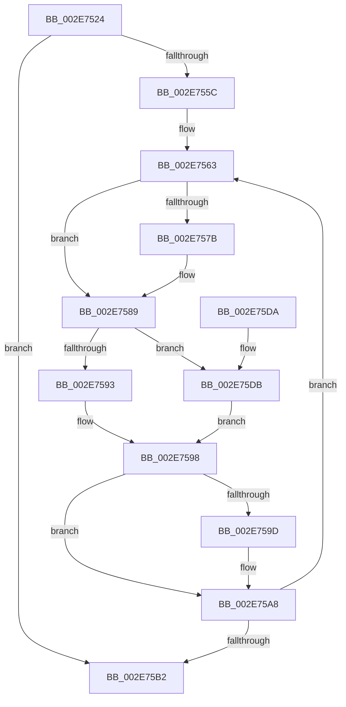

# RtlpHpVsContextCompact

- RVA: `0x002E7524`–`0x002E75E1` (길이 `189` bytes)
- VA: `0x00000001402E7524`
- 실행 섹션: `.text`
- PDB 이름 있음: `예`; PDB Function 태그: `아니요`
- unwind 정보 RVA: `0x00071308`
- 디코드: `53`개 명령, `189/189` bytes 표시
- 미해석 바이트: `0` (있으면 어셈블리에 `.byte`로 보존)

> 이 문서는 커널 이미지의 기계어와 PDB 기호를 분석해 생성했습니다. 4번과 5번은 함수 원형과 자료형을 바이너리 사용 방식에서 추정한 C 해석이며 원본 소스 복구 결과는 아닙니다.

## 1. Dependencies

- 직접 호출 지점: **5**; 고유 호출 대상: **5**
- 직접 호출자로 확인된 함수: **1**
- RIP 상대 이미지 참조: **1**

### Outgoing calls
- `0x002E7553` → [RtlpHpVsContextGetSlotInfo](RtlpHpVsContextGetSlotInfo_function_002E7BB4.md) (function, `0x002E7BB4`)
- `0x002E7571` → [ExpInterlockedFlushSList](../6B/ExpInterlockedFlushSList_function_006BA5F0.md) (function, `0x006BA5F0`)
- `0x002E7584` → [RtlpHpVsSlotFreeList](../36/RtlpHpVsSlotFreeList_function_00361ACC.md) (function, `0x00361ACC`)
- `0x002E75A3` → [RtlpHpVsSlotCompactChunks](RtlpHpVsSlotCompactChunks_function_002E6E00.md) (function, `0x002E6E00`)
- `0x002E75BD` → [_security_check_cookie](../6A/_security_check_cookie_function_006AC640.md) (function, `0x006AC640`)

### Direct callers
- [RtlpHpHeapCompact](RtlpHpHeapCompact_function_002E7654.md) at `0x002E7664`

### Static image references
- `0x002E7539` → RVA `0x00E0A740` (`.data`; read)

## 2. Other-region calls and transfers

- 다른 실행 섹션으로 향하는 call: **0**
- 별도 외부 분기/꼬리 이동을 확인하지 못했습니다.

## 3. Assembly (complete function range)

```asm
002E7524  48 89 5C 24 10                  mov qword ptr [rsp + 0x10], rbx
002E7529  48 89 6C 24 18                  mov qword ptr [rsp + 0x18], rbp
002E752E  56                              push rsi
002E752F  57                              push rdi
002E7530  41 56                           push r14
002E7532  48 81 EC 30 01 00 00            sub rsp, 0x130
002E7539  48 8B 05 00 32 B2 00            mov rax, qword ptr [rip + 0xb23200]
002E7540  48 33 C4                        xor rax, rsp
002E7543  48 89 84 24 20 01 00 00         mov qword ptr [rsp + 0x120], rax
002E754B  48 8D 54 24 20                  lea rdx, [rsp + 0x20]
002E7550  48 8B D9                        mov rbx, rcx
002E7553  E8 5C 06 00 00                  call 0x1402e7bb4
002E7558  85 C0                           test eax, eax
002E755A  74 56                           je 0x1402e75b2
002E755C  48 8D 74 24 20                  lea rsi, [rsp + 0x20]
002E7561  8B E8                           mov ebp, eax
002E7563  0F B7 3E                        movzx edi, word ptr [rsi]
002E7566  48 C1 E7 06                     shl rdi, 6
002E756A  48 03 FB                        add rdi, rbx
002E756D  48 8D 4F 40                     lea rcx, [rdi + 0x40]
002E7571  E8 7A 30 3D 00                  call 0x1406ba5f0
002E7576  48 85 C0                        test rax, rax
002E7579  74 0E                           je 0x1402e7589
002E757B  4C 8B C0                        mov r8, rax
002E757E  48 8B D7                        mov rdx, rdi
002E7581  48 8B CB                        mov rcx, rbx
002E7584  E8 43 A5 07 00                  call 0x140361acc
002E7589  48 0F BF 43 06                  movsx rax, word ptr [rbx + 6]
002E758E  66 85 C0                        test ax, ax
002E7591  74 48                           je 0x1402e75db
002E7593  48 8B 4C 18 20                  mov rcx, qword ptr [rax + rbx + 0x20]
002E7598  48 85 C9                        test rcx, rcx
002E759B  74 0B                           je 0x1402e75a8
002E759D  48 8B D7                        mov rdx, rdi
002E75A0  48 8B CB                        mov rcx, rbx
002E75A3  E8 58 F8 FF FF                  call 0x1402e6e00
002E75A8  48 83 C6 04                     add rsi, 4
002E75AC  48 83 ED 01                     sub rbp, 1
002E75B0  75 B1                           jne 0x1402e7563
002E75B2  48 8B 8C 24 20 01 00 00         mov rcx, qword ptr [rsp + 0x120]
002E75BA  48 33 CC                        xor rcx, rsp
002E75BD  E8 7E 50 3C 00                  call 0x1406ac640
002E75C2  4C 8D 9C 24 30 01 00 00         lea r11, [rsp + 0x130]
002E75CA  49 8B 5B 28                     mov rbx, qword ptr [r11 + 0x28]
002E75CE  49 8B 6B 30                     mov rbp, qword ptr [r11 + 0x30]
002E75D2  49 8B E3                        mov rsp, r11
002E75D5  41 5E                           pop r14
002E75D7  5F                              pop rdi
002E75D8  5E                              pop rsi
002E75D9  C3                              ret
002E75DA  CC                              int3
002E75DB  48 8B 4B 58                     mov rcx, qword ptr [rbx + 0x58]
002E75DF  EB B7                           jmp 0x1402e7598
```

## 4. C-style interpretation (structured pseudocode)

```c
__int64 __fastcall RtlpHpVsContextCompact(__int64 a1)
{
    __int64 result;
    __int64 v_rbp;
    __int64 v_rdi;
    __int64 v_rsi;
    __int64 v_rsp;
    unsigned __int64 v_stack_m128;
    unsigned __int64 v_stack_m18;
    unsigned __int64 v_stack_m28;
    unsigned __int64 v_stack_p10;
    unsigned __int64 v_stack_p18;

    v_stack_p10 = v_rbx;
    v_stack_p18 = v_rbp;
    v_rsp = (v_rsp) - (304);
    result = (*(unsigned __int64 *)(v_rip + 11678208)) ^ (v_rsp);
    v_stack_m28 = result;
    result = RtlpHpVsContextGetSlotInfo(a1, v_stack_m128, a3, a4);
    if ((unsigned int)(result) == 0) goto loc_002E75B2;
loc_002E7563:
    v_rdi = (*(unsigned __int16 *)(v_stack_m128)) << (6);
    v_rdi = (v_rdi) + (a1);
    result = ExpInterlockedFlushSList(v_rdi + 64, v_stack_m128, a3, a4);
    if (result != 0) {
        a3 = result;
        a2 = v_rdi;
        a1 = a1;
        result = RtlpHpVsSlotFreeList(a1, a2, a3, a4);
    }
    if ((unsigned __int16)((__int16)(*(unsigned __int16 *)(a1 + 6))) == 0) goto loc_002E75DB;
loc_002E7598:
    result = (__int16)(*(unsigned __int16 *)(a1 + 6));
    if (*(unsigned __int64 *)((__int16)(*(unsigned __int16 *)(a1 + 6)) + a1 * 1 + 32) != 0) {
        a2 = v_rdi;
        a1 = a1;
        result = RtlpHpVsSlotCompactChunks(a1, a2, a3, a4);
    }
    v_rsi = (v_stack_m128) + (4);
    v_rbp = ((unsigned int)((unsigned int)(result))) - (1);
    if (condition_is_not_equal) goto loc_002E7563;
loc_002E75B2:
    a1 = (v_stack_m28) ^ (v_rsp);
    result = _security_check_cookie(a1, a2, a3, a4);
    return result;
loc_002E75DB:
    goto loc_002E7598;
}
```

## 5. (Beta) C Style

```c
int64_t RtlpHpVsContextCompact(void *Arg1)
{
    uint8_t *arg1 = (uint8_t *)Arg1;

    int64_t result;
    int64_t local_rbp;
    int64_t local_rdi;
    int64_t local_rsi;
    int64_t local_rsp;
    uint64_t v_stack_m128;
    uint64_t v_stack_m18;
    uint64_t v_stack_m28;
    uint64_t v_stack_p10;
    uint64_t v_stack_p18;

    v_stack_p10 = local_rbx;
    v_stack_p18 = local_rbp;
    local_rsp = (local_rsp) - (304);
    result = (*(uint64_t *)(v_rip + 0xB23200)) ^ (local_rsp);
    v_stack_m28 = result;
    result = RtlpHpVsContextGetSlotInfo(Arg1, v_stack_m128, a3, a4);
    if ((uint32_t)(result) == 0) goto loc_002E75B2;
loc_002E7563:
    local_rdi = (*(uint16_t *)(v_stack_m128)) << (6);
    local_rdi = (local_rdi) + (Arg1);
    result = ExpInterlockedFlushSList(local_rdi + 64, v_stack_m128, a3, a4);
    if (result != 0) {
        a3 = result;
        a2 = local_rdi;
        Arg1 = Arg1;
        result = RtlpHpVsSlotFreeList(Arg1, a2, a3, a4);
    }
    if ((uint16_t)((int16_t)(*(uint16_t *)(arg1 + 0x6))) == 0) goto loc_002E75DB;
loc_002E7598:
    result = (int16_t)(*(uint16_t *)(arg1 + 0x6));
    if (*(uint64_t *)((int16_t)(*(uint16_t *)(arg1 + 0x6)) + arg1 * 1 + 0x20) != 0) {
        a2 = local_rdi;
        Arg1 = Arg1;
        result = RtlpHpVsSlotCompactChunks(Arg1, a2, a3, a4);
    }
    local_rsi = (v_stack_m128) + (4);
    local_rbp = ((uint32_t)((uint32_t)(result))) - (1);
    if (condition_is_not_equal) goto loc_002E7563;
loc_002E75B2:
    Arg1 = (v_stack_m28) ^ (local_rsp);
    result = _security_check_cookie(Arg1, a2, a3, a4);
    return result;
loc_002E75DB:
    goto loc_002E7598;
}
```

### 관측된 메모리 오프셋

구조체 형식이 확인되지 않은 접근은 인자 기준의 오프셋으로만 기록했습니다.

| 기준 인자 | 오프셋 표현 | 폭 (bit) | 접근 |
|---|---:|---:|---|
| `Arg1` | `+ 0x6` | `16` | `R` |
| `Arg1` | `+ 0x58` | `64` | `R` |

## 6. Execution-region graph

[열기: 2D/3D 그래프와 함수 탐색 컨트롤 패널](../../../control-panel.html?section=text&rva=0x002E7524&view=graph)

- 2D 그래프는 위에서 아래로 흐르고, 3D 그래프는 빈 공간을 드래그해 회전합니다. Shift+드래그는 이동, 휠은 확대·축소, 함수 노드 선택은 대상 보고서 이동입니다.

### Static fallback


