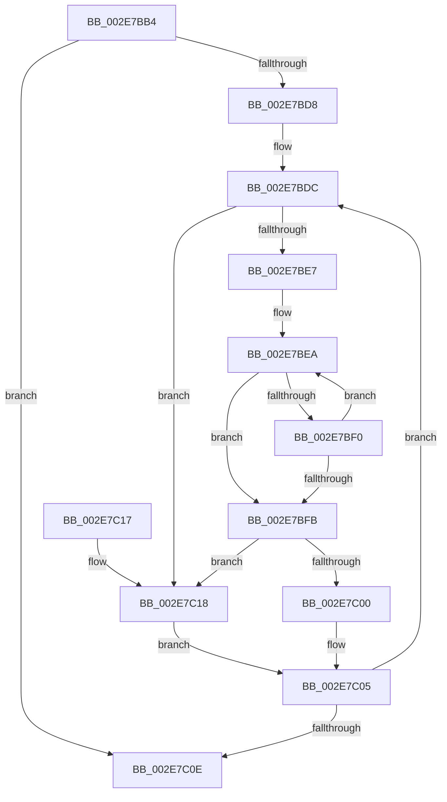

# RtlpHpVsContextGetSlotInfo

- RVA: `0x002E7BB4`–`0x002E7C28` (길이 `116` bytes)
- VA: `0x00000001402E7BB4`
- 실행 섹션: `.text`
- PDB 이름 있음: `예`; PDB Function 태그: `아니요`
- unwind 정보 RVA: `0x00071394`
- 디코드: `36`개 명령, `116/116` bytes 표시
- 미해석 바이트: `0` (있으면 어셈블리에 `.byte`로 보존)

> 이 문서는 커널 이미지의 기계어와 PDB 기호를 분석해 생성했습니다. 4번과 5번은 함수 원형과 자료형을 바이너리 사용 방식에서 추정한 C 해석이며 원본 소스 복구 결과는 아닙니다.

## 1. Dependencies

- 직접 호출 지점: **0**; 고유 호출 대상: **0**
- 직접 호출자로 확인된 함수: **3**
- RIP 상대 이미지 참조: **0**

### Outgoing calls
- 직접 디코드된 call 명령이 없습니다.

### Direct callers
- [RtlpHpVsContextCompact](RtlpHpVsContextCompact_function_002E7524.md) at `0x002E7553`
- [RtlpHpVsContextHandleContention](RtlpHpVsContextHandleContention_function_002EB9D4.md) at `0x002EBA80`
- [RtlpHpVsContextCleanup](../60/RtlpHpVsContextCleanup_function_00605644.md) at `0x0060567A`

### Static image references
- 디코드된 RIP-relative 메모리 참조가 없습니다.

## 2. Other-region calls and transfers

- 다른 실행 섹션으로 향하는 call: **0**
- 별도 외부 분기/꼬리 이동을 확인하지 못했습니다.

## 3. Assembly (complete function range)

```asm
002E7BB4  48 89 5C 24 08                  mov qword ptr [rsp + 8], rbx
002E7BB9  44 0F B7 09                     movzx r9d, word ptr [rcx]
002E7BBD  45 33 C0                        xor r8d, r8d
002E7BC0  44 0F B6 59 02                  movzx r11d, byte ptr [rcx + 2]
002E7BC5  49 C1 E1 06                     shl r9, 6
002E7BC9  49 FF C3                        inc r11
002E7BCC  4C 03 C9                        add r9, rcx
002E7BCF  4F 8D 1C 99                     lea r11, [r9 + r11*4]
002E7BD3  4D 3B CB                        cmp r9, r11
002E7BD6  73 36                           jae 0x1402e7c0e
002E7BD8  41 8D 58 01                     lea ebx, [r8 + 1]
002E7BDC  45 0F B7 11                     movzx r10d, word ptr [r9]
002E7BE0  33 C0                           xor eax, eax
002E7BE2  45 85 C0                        test r8d, r8d
002E7BE5  74 31                           je 0x1402e7c18
002E7BE7  48 8B CA                        mov rcx, rdx
002E7BEA  66 44 39 11                     cmp word ptr [rcx], r10w
002E7BEE  74 0B                           je 0x1402e7bfb
002E7BF0  03 C3                           add eax, ebx
002E7BF2  48 83 C1 04                     add rcx, 4
002E7BF6  41 3B C0                        cmp eax, r8d
002E7BF9  72 EF                           jb 0x1402e7bea
002E7BFB  41 3B C0                        cmp eax, r8d
002E7BFE  73 18                           jae 0x1402e7c18
002E7C00  66 01 5C 82 02                  add word ptr [rdx + rax*4 + 2], bx
002E7C05  49 83 C1 04                     add r9, 4
002E7C09  4D 3B CB                        cmp r9, r11
002E7C0C  72 CE                           jb 0x1402e7bdc
002E7C0E  48 8B 5C 24 08                  mov rbx, qword ptr [rsp + 8]
002E7C13  41 8B C0                        mov eax, r8d
002E7C16  C3                              ret
002E7C17  CC                              int3
002E7C18  66 46 89 14 82                  mov word ptr [rdx + r8*4], r10w
002E7C1D  66 42 89 5C 82 02               mov word ptr [rdx + r8*4 + 2], bx
002E7C23  44 03 C3                        add r8d, ebx
002E7C26  EB DD                           jmp 0x1402e7c05
```

## 4. C-style interpretation (structured pseudocode)

```c
__int64 __fastcall RtlpHpVsContextGetSlotInfo(__int64 a1, __int64 a2, int a3)
{
    __int64 result;
    __int64 v_r11;
    unsigned __int64 v_stack_p8;

    v_stack_p8 = v_rbx;
    a3 = 0;
    a4 = (*(unsigned __int16 *)(a1)) << (6);
    v_r11 = (*(unsigned __int8 *)(a1 + 2)) + 1;
    a4 = (a4) + (a1);
    if (a4 >= (a4 + v_r11 * 4)) goto loc_002E7C0E;
loc_002E7BDC:
    result = 0;
    if (0 == 0) goto loc_002E7C18;
loc_002E7BEA:
    if ((*(unsigned __int16 *)(a2)) == ((unsigned __int16)(*(unsigned __int16 *)(a4)))) goto loc_002E7BFB;
    result = (unsigned int)((result) + ((unsigned int)(a3 + 1)));
    a1 = (a2) + (4);
    if (((unsigned int)(result)) < 0) goto loc_002E7BEA;
loc_002E7BFB:
    if (((unsigned int)(result)) >= 0) goto loc_002E7C18;
loc_002E7C05:
    a4 = (a4) + (4);
    if (a4 < (a4 + v_r11 * 4)) goto loc_002E7BDC;
loc_002E7C0E:
    return 0;
loc_002E7C18:
    *(unsigned __int16 *)(a2 + a3 * 4) = (unsigned __int16)(*(unsigned __int16 *)(a4));
    *(unsigned __int16 *)(a2 + a3 * 4 + 2) = (unsigned __int16)(v_stack_p8);
    a3 = (unsigned int)((a3) + ((unsigned int)(v_stack_p8)));
    goto loc_002E7C05;
}
```

## 5. (Beta) C Style

```c
int64_t RtlpHpVsContextGetSlotInfo(void *Arg1, void *Arg2, int32_t Arg3)
{
    uint8_t *arg1 = (uint8_t *)Arg1;
    uint8_t *arg2 = (uint8_t *)Arg2;

    int64_t result;
    int64_t local_r11;
    uint64_t v_stack_p8;

    v_stack_p8 = local_rbx;
    Arg3 = 0;
    a4 = (*(uint16_t *)(arg1)) << (6);
    local_r11 = (*(uint8_t *)(arg1 + 0x2)) + 1;
    a4 = (a4) + (Arg1);
    if (a4 >= (a4 + local_r11 * 4)) goto loc_002E7C0E;
loc_002E7BDC:
    result = 0;
    if (0 == 0) goto loc_002E7C18;
loc_002E7BEA:
    if ((*(uint16_t *)(arg2)) == ((uint16_t)(*(uint16_t *)(a4)))) goto loc_002E7BFB;
    result = (uint32_t)((result) + ((uint32_t)(Arg3 + 1)));
    Arg1 = (Arg2) + (4);
    if (((uint32_t)(result)) < 0) goto loc_002E7BEA;
loc_002E7BFB:
    if (((uint32_t)(result)) >= 0) goto loc_002E7C18;
loc_002E7C05:
    a4 = (a4) + (4);
    if (a4 < (a4 + local_r11 * 4)) goto loc_002E7BDC;
loc_002E7C0E:
    return 0;
loc_002E7C18:
    *(uint16_t *)(arg2 + Arg3 * 4) = (uint16_t)(*(uint16_t *)(a4));
    *(uint16_t *)(arg2 + Arg3 * 4 + 0x2) = (uint16_t)(v_stack_p8);
    Arg3 = (uint32_t)((Arg3) + ((uint32_t)(v_stack_p8)));
    goto loc_002E7C05;
}
```

### 관측된 메모리 오프셋

구조체 형식이 확인되지 않은 접근은 인자 기준의 오프셋으로만 기록했습니다.

| 기준 인자 | 오프셋 표현 | 폭 (bit) | 접근 |
|---|---:|---:|---|
| `Arg1` | `+ 0x0` | `16` | `R` |
| `Arg1` | `+ 0x2` | `8` | `R` |
| `Arg2` | `+ 0x0` | `16` | `R` |
| `Arg2` | `+ 0x0 + r8*4` | `16` | `W` |
| `Arg2` | `+ 0x2 + r8*4` | `16` | `W` |
| `Arg2` | `+ 0x2 + rax*4` | `16` | `R/W` |

## 6. Execution-region graph

[열기: 2D/3D 그래프와 함수 탐색 컨트롤 패널](../../../control-panel.html?section=text&rva=0x002E7BB4&view=graph)

- 2D 그래프는 위에서 아래로 흐르고, 3D 그래프는 빈 공간을 드래그해 회전합니다. Shift+드래그는 이동, 휠은 확대·축소, 함수 노드 선택은 대상 보고서 이동입니다.

### Static fallback


