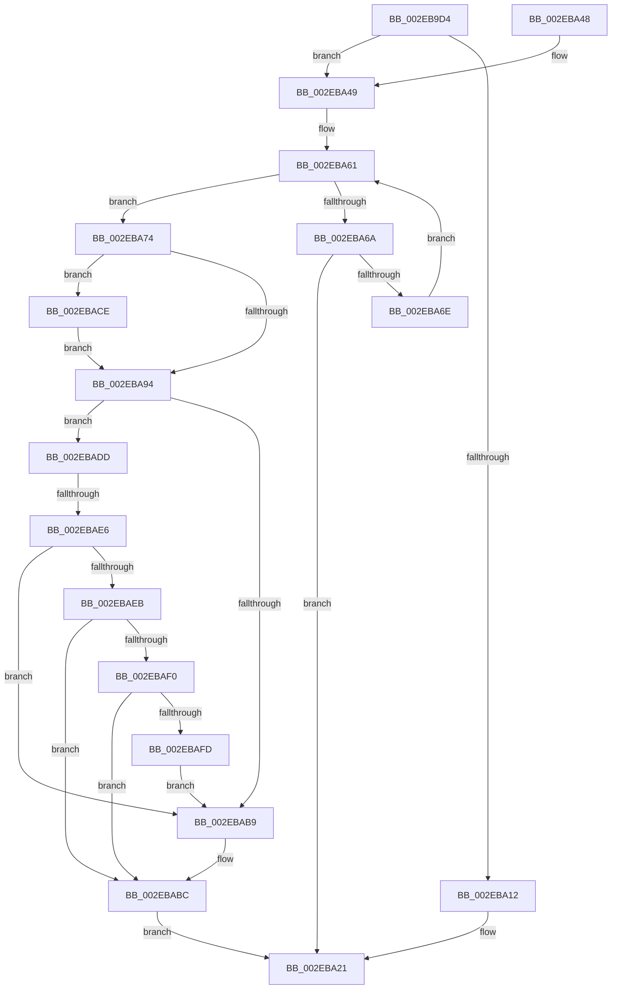

# RtlpHpVsContextHandleContention

- RVA: `0x002EB9D4`–`0x002EBB0F` (길이 `315` bytes)
- VA: `0x00000001402EB9D4`
- 실행 섹션: `.text`
- PDB 이름 있음: `예`; PDB Function 태그: `예`
- unwind 정보 RVA: `0x0007171C`
- 디코드: `93`개 명령, `315/315` bytes 표시
- 미해석 바이트: `0` (있으면 어셈블리에 `.byte`로 보존)

> 이 문서는 커널 이미지의 기계어와 PDB 기호를 분석해 생성했습니다. 4번과 5번은 함수 원형과 자료형을 바이너리 사용 방식에서 추정한 C 해석이며 원본 소스 복구 결과는 아닙니다.

## 1. Dependencies

- 직접 호출 지점: **5**; 고유 호출 대상: **5**
- 직접 호출자로 확인된 함수: **1**
- RIP 상대 이미지 참조: **1**

### Outgoing calls
- `0x002EBA2C` → [_security_check_cookie](../6A/_security_check_cookie_function_006AC640.md) (function, `0x006AC640`)
- `0x002EBA80` → [RtlpHpVsContextGetSlotInfo](RtlpHpVsContextGetSlotInfo_function_002E7BB4.md) (function, `0x002E7BB4`)
- `0x002EBAA6` → [RtlpHpAffinityMgrUpdateProcess](RtlpHpAffinityMgrUpdateProcess_function_002EBB94.md) (function, `0x002EBB94`)
- `0x002EBAC4` → [RtlpHpAffinityMgrUpdateComplete](RtlpHpAffinityMgrUpdateComplete_function_002EBD2C.md) (function, `0x002EBD2C`)
- `0x002EBAF3` → [RtlpHpVsSlotCreate](../60/RtlpHpVsSlotCreate_function_006057C0.md) (function, `0x006057C0`)

### Direct callers
- [RtlpHpVsContextAllocate](RtlpHpVsContextAllocate_function_002EA944.md) at `0x002EAB2A`

### Static image references
- `0x002EB9E7` → RVA `0x00E0A740` (`.data`; read)

## 2. Other-region calls and transfers

- 다른 실행 섹션으로 향하는 call: **0**
- call이 아닌 외부 분기/꼬리 이동: **1**
  - `0x002EBAE0` → [sub_006DE818](../6D/Unknown_function_006DE818.md) (`tail-transfer`)

## 3. Assembly (complete function range)

```asm
002EB9D4  48 89 5C 24 18                  mov qword ptr [rsp + 0x18], rbx
002EB9D9  55                              push rbp
002EB9DA  56                              push rsi
002EB9DB  57                              push rdi
002EB9DC  41 56                           push r14
002EB9DE  41 57                           push r15
002EB9E0  48 81 EC 50 01 00 00            sub rsp, 0x150
002EB9E7  48 8B 05 52 ED B1 00            mov rax, qword ptr [rip + 0xb1ed52]
002EB9EE  48 33 C4                        xor rax, rsp
002EB9F1  48 89 84 24 40 01 00 00         mov qword ptr [rsp + 0x140], rax
002EB9F9  65 48 8B 04 25 20 00 00 00      mov rax, qword ptr gs:[0x20]
002EBA02  48 8B F1                        mov rsi, rcx
002EBA05  8B 48 24                        mov ecx, dword ptr [rax + 0x24]
002EBA08  0F B6 46 02                     movzx eax, byte ptr [rsi + 2]
002EBA0C  23 C1                           and eax, ecx
002EBA0E  3B D0                           cmp edx, eax
002EBA10  74 37                           je 0x1402eba49
002EBA12  65 48 8B 04 25 88 01 00 00      mov rax, qword ptr gs:[0x188]
002EBA1B  88 88 75 07 00 00               mov byte ptr [rax + 0x775], cl
002EBA21  48 8B 8C 24 40 01 00 00         mov rcx, qword ptr [rsp + 0x140]
002EBA29  48 33 CC                        xor rcx, rsp
002EBA2C  E8 0F 0C 3C 00                  call 0x1406ac640
002EBA31  48 8B 9C 24 90 01 00 00         mov rbx, qword ptr [rsp + 0x190]
002EBA39  48 81 C4 50 01 00 00            add rsp, 0x150
002EBA40  41 5F                           pop r15
002EBA42  41 5E                           pop r14
002EBA44  5F                              pop rdi
002EBA45  5E                              pop rsi
002EBA46  5D                              pop rbp
002EBA47  C3                              ret
002EBA48  CC                              int3
002EBA49  0F B7 2E                        movzx ebp, word ptr [rsi]
002EBA4C  4C 8D 76 40                     lea r14, [rsi + 0x40]
002EBA50  48 C1 E5 04                     shl rbp, 4
002EBA54  8B C2                           mov eax, edx
002EBA56  48 03 E8                        add rbp, rax
002EBA59  33 FF                           xor edi, edi
002EBA5B  8B CF                           mov ecx, edi
002EBA5D  44 8D 7F 01                     lea r15d, [rdi + 1]
002EBA61  33 C0                           xor eax, eax
002EBA63  F0 45 0F B0 3E                  lock cmpxchg byte ptr [r14], r15b
002EBA68  74 0A                           je 0x1402eba74
002EBA6A  85 C9                           test ecx, ecx
002EBA6C  74 B3                           je 0x1402eba21
002EBA6E  F3 90                           pause
002EBA70  FF C9                           dec ecx
002EBA72  EB ED                           jmp 0x1402eba61
002EBA74  0F B7 1C AE                     movzx ebx, word ptr [rsi + rbp*4]
002EBA78  48 8D 54 24 40                  lea rdx, [rsp + 0x40]
002EBA7D  48 8B CE                        mov rcx, rsi
002EBA80  E8 2F C1 FF FF                  call 0x1402e7bb4
002EBA85  0F B7 4C AE 02                  movzx ecx, word ptr [rsi + rbp*4 + 2]
002EBA8A  44 8B C7                        mov r8d, edi
002EBA8D  8D 50 FF                        lea edx, [rax - 1]
002EBA90  3B CA                           cmp ecx, edx
002EBA92  73 3A                           jae 0x1402ebace
002EBA94  44 89 44 24 20                  mov dword ptr [rsp + 0x20], r8d
002EBA99  8B D3                           mov edx, ebx
002EBA9B  4C 8D 44 24 40                  lea r8, [rsp + 0x40]
002EBAA0  44 8B C8                        mov r9d, eax
002EBAA3  49 8B CE                        mov rcx, r14
002EBAA6  E8 E9 00 00 00                  call 0x1402ebb94
002EBAAB  48 89 44 24 30                  mov qword ptr [rsp + 0x30], rax
002EBAB0  48 8B D8                        mov rbx, rax
002EBAB3  8B C8                           mov ecx, eax
002EBAB5  85 C0                           test eax, eax
002EBAB7  75 24                           jne 0x1402ebadd
002EBAB9  41 8B FF                        mov edi, r15d
002EBABC  44 8B C7                        mov r8d, edi
002EBABF  8B D3                           mov edx, ebx
002EBAC1  49 8B CE                        mov rcx, r14
002EBAC4  E8 63 02 00 00                  call 0x1402ebd2c
002EBAC9  E9 53 FF FF FF                  jmp 0x1402eba21
002EBACE  0F B6 4E 02                     movzx ecx, byte ptr [rsi + 2]
002EBAD2  41 03 CF                        add ecx, r15d
002EBAD5  3B C1                           cmp eax, ecx
002EBAD7  45 0F 42 C7                     cmovb r8d, r15d
002EBADB  EB B7                           jmp 0x1402eba94
002EBADD  41 2B CF                        sub ecx, r15d
002EBAE0  0F 84 32 2D 3F 00               je 0x1406de818
002EBAE6  41 2B CF                        sub ecx, r15d
002EBAE9  74 CE                           je 0x1402ebab9
002EBAEB  41 3B CF                        cmp ecx, r15d
002EBAEE  75 CC                           jne 0x1402ebabc
002EBAF0  48 8B CE                        mov rcx, rsi
002EBAF3  E8 C8 9C 31 00                  call 0x1406057c0
002EBAF8  48 85 C0                        test rax, rax
002EBAFB  74 BF                           je 0x1402ebabc
002EBAFD  48 2B C6                        sub rax, rsi
002EBB00  48 C1 E8 06                     shr rax, 6
002EBB04  66 89 04 AE                     mov word ptr [rsi + rbp*4], ax
002EBB08  66 89 7C AE 02                  mov word ptr [rsi + rbp*4 + 2], di
002EBB0D  EB AA                           jmp 0x1402ebab9
```

## 4. C-style interpretation (structured pseudocode)

```c
__int64 __fastcall RtlpHpVsContextHandleContention(__int64 a1, int a2)
{
    __int64 result;
    __int64 v_rbp;
    __int64 v_rdi;
    __int64 v_rsp;
    unsigned __int64 v_stack_m38;
    unsigned __int64 v_stack_p18;
    unsigned int v_stack_p20;
    unsigned __int64 v_stack_p30;
    unsigned __int64 v_stack_p40;

    v_stack_p18 = v_rbx;
    v_rsp = (v_rsp) - (336);
    result = (*(unsigned __int64 *)(v_rip + 11660626)) ^ (v_rsp);
    v_stack_m38 = result;
    result = (unsigned int)((*(unsigned __int8 *)(a1 + 2)) & ((unsigned int)((unsigned int)(*(unsigned int *)(*(unsigned __int64 *)(gs_base + (0 + 32)) + 36)))));
    if (a2 == ((unsigned int)(result))) goto loc_002EBA49;
    *(unsigned __int8 *)(*(unsigned __int64 *)(gs_base + (0 + 392)) + 1909) = (unsigned __int8)((unsigned int)(*(unsigned int *)(*(unsigned __int64 *)(gs_base + (0 + 32)) + 36)));
loc_002EBA21:
    a1 = (v_stack_m38) ^ (v_rsp);
    result = _security_check_cookie(a1, a2, a3, a4);
    v_rsp = (v_rsp) + (336);
    return result;
loc_002EBA49:
    v_rbp = (*(unsigned __int16 *)(a1)) << (4);
    v_rbp = (v_rbp) + ((unsigned int)(a2));
    v_rdi = 0;
loc_002EBA61:
    result = 0;
    if (condition_is_equal) goto loc_002EBA74;
    if (0 == 0) goto loc_002EBA21;
    a1 = (unsigned int)((0) - 1);
    goto loc_002EBA61;
loc_002EBA74:
    result = RtlpHpVsContextGetSlotInfo(a1, v_stack_p40, a3, a4);
    if (((unsigned int)(*(unsigned __int16 *)(a1 + v_rbp * 4 + 2))) >= ((unsigned int)(result - 1))) goto loc_002EBACE;
loc_002EBA94:
    v_stack_p20 = 0;
    result = RtlpHpAffinityMgrUpdateProcess(a1 + 64, (unsigned int)((unsigned int)(*(unsigned __int16 *)(a1 + v_rbp * 4))), v_stack_p40, (unsigned int)((unsigned int)(result)));
    v_stack_p30 = result;
    if ((unsigned int)(result) != 0) goto loc_002EBADD;
loc_002EBAB9:
loc_002EBABC:
    result = RtlpHpAffinityMgrUpdateComplete(a1 + 64, (unsigned int)((unsigned int)(result)), (unsigned int)((unsigned int)((unsigned int)((unsigned int)(v_rdi + 1)))), (unsigned int)((unsigned int)(result)));
    goto loc_002EBA21;
loc_002EBACE:
    a1 = (unsigned int)((*(unsigned __int8 *)(a1 + 2)) + ((unsigned int)(v_rdi + 1)));
    a3 = (unsigned int)((unsigned int)((unsigned int)((unsigned int)(v_rdi + 1))));
    if (((unsigned int)(result)) < ((unsigned int)(a1))) { a3 = (unsigned int)(v_rdi + 1); }
    goto loc_002EBA94;
loc_002EBADD:
    a1 = (unsigned int)((a1) - ((unsigned int)(v_rdi + 1)));
    a1 = (unsigned int)((a1) - ((unsigned int)(v_rdi + 1)));
    if (condition_is_equal) goto loc_002EBAB9;
    if (((unsigned int)(a1)) != ((unsigned int)(v_rdi + 1))) goto loc_002EBABC;
    result = RtlpHpVsSlotCreate(a1, (unsigned int)((unsigned int)(result)), a3, (unsigned int)((unsigned int)(result)));
    if (result == 0) goto loc_002EBABC;
    result = (result) - (a1);
    result = (result) >> (6);
    *(unsigned __int16 *)(a1 + v_rbp * 4) = (unsigned __int16)(result);
    *(unsigned __int16 *)(a1 + v_rbp * 4 + 2) = (unsigned __int16)((unsigned int)((unsigned int)(v_rdi + 1)));
    goto loc_002EBAB9;
}
```

## 5. (Beta) C Style

```c
int64_t RtlpHpVsContextHandleContention(void *Arg1, int32_t Arg2)
{
    uint8_t *arg1 = (uint8_t *)Arg1;

    int64_t result;
    int64_t local_rbp;
    int64_t local_rdi;
    int64_t local_rsp;
    uint64_t v_stack_m38;
    uint64_t v_stack_p18;
    uint32_t v_stack_p20;
    uint64_t v_stack_p30;
    uint64_t v_stack_p40;

    v_stack_p18 = local_rbx;
    local_rsp = (local_rsp) - (336);
    result = (*(uint64_t *)(v_rip + 0xB1ED52)) ^ (local_rsp);
    v_stack_m38 = result;
    result = (uint32_t)((*(uint8_t *)(arg1 + 0x2)) & ((uint32_t)((uint32_t)(*(uint32_t *)(*(uint64_t *)(gs_base + (0 + 0x20)) + 0x24)))));
    if (Arg2 == ((uint32_t)(result))) goto loc_002EBA49;
    *(uint8_t *)(*(uint64_t *)(gs_base + (0 + 0x188)) + 0x775) = (uint8_t)((uint32_t)(*(uint32_t *)(*(uint64_t *)(gs_base + (0 + 0x20)) + 0x24)));
loc_002EBA21:
    Arg1 = (v_stack_m38) ^ (local_rsp);
    result = _security_check_cookie(Arg1, Arg2, a3, a4);
    local_rsp = (local_rsp) + (336);
    return result;
loc_002EBA49:
    local_rbp = (*(uint16_t *)(arg1)) << (4);
    local_rbp = (local_rbp) + ((uint32_t)(Arg2));
    local_rdi = 0;
loc_002EBA61:
    result = 0;
    if (condition_is_equal) goto loc_002EBA74;
    if (0 == 0) goto loc_002EBA21;
    Arg1 = (uint32_t)((0) - 1);
    goto loc_002EBA61;
loc_002EBA74:
    result = RtlpHpVsContextGetSlotInfo(Arg1, v_stack_p40, a3, a4);
    if (((uint32_t)(*(uint16_t *)(arg1 + local_rbp * 4 + 0x2))) >= ((uint32_t)(result - 1))) goto loc_002EBACE;
loc_002EBA94:
    v_stack_p20 = 0;
    result = RtlpHpAffinityMgrUpdateProcess(Arg1 + 64, (uint32_t)((uint32_t)(*(uint16_t *)(arg1 + local_rbp * 4))), v_stack_p40, (uint32_t)((uint32_t)(result)));
    v_stack_p30 = result;
    if ((uint32_t)(result) != 0) goto loc_002EBADD;
loc_002EBAB9:
loc_002EBABC:
    result = RtlpHpAffinityMgrUpdateComplete(Arg1 + 64, (uint32_t)((uint32_t)(result)), (uint32_t)((uint32_t)((uint32_t)((uint32_t)(local_rdi + 1)))), (uint32_t)((uint32_t)(result)));
    goto loc_002EBA21;
loc_002EBACE:
    Arg1 = (uint32_t)((*(uint8_t *)(arg1 + 0x2)) + ((uint32_t)(local_rdi + 1)));
    a3 = (uint32_t)((uint32_t)((uint32_t)((uint32_t)(local_rdi + 1))));
    if (((uint32_t)(result)) < ((uint32_t)(Arg1))) { a3 = (uint32_t)(local_rdi + 1); }
    goto loc_002EBA94;
loc_002EBADD:
    Arg1 = (uint32_t)((Arg1) - ((uint32_t)(local_rdi + 1)));
    Arg1 = (uint32_t)((Arg1) - ((uint32_t)(local_rdi + 1)));
    if (condition_is_equal) goto loc_002EBAB9;
    if (((uint32_t)(Arg1)) != ((uint32_t)(local_rdi + 1))) goto loc_002EBABC;
    result = RtlpHpVsSlotCreate(Arg1, (uint32_t)((uint32_t)(result)), a3, (uint32_t)((uint32_t)(result)));
    if (result == 0) goto loc_002EBABC;
    result = (result) - (Arg1);
    result = (result) >> (6);
    *(uint16_t *)(arg1 + local_rbp * 4) = (uint16_t)(result);
    *(uint16_t *)(arg1 + local_rbp * 4 + 0x2) = (uint16_t)((uint32_t)((uint32_t)(local_rdi + 1)));
    goto loc_002EBAB9;
}
```

### 관측된 메모리 오프셋

구조체 형식이 확인되지 않은 접근은 인자 기준의 오프셋으로만 기록했습니다.

| 기준 인자 | 오프셋 표현 | 폭 (bit) | 접근 |
|---|---:|---:|---|
| `Arg1` | `+ 0x0` | `8` | `R` |
| `Arg1` | `+ 0x0` | `16` | `R` |
| `Arg1` | `+ 0x0 + rbp*4` | `16` | `R` |
| `Arg1` | `+ 0x0 + rbp*4` | `16` | `W` |
| `Arg1` | `+ 0x2` | `8` | `R` |
| `Arg1` | `+ 0x2 + rbp*4` | `16` | `R` |
| `Arg1` | `+ 0x2 + rbp*4` | `16` | `W` |
| `Arg1` | `+ 0x40` | `64` | `R` |

## 6. Execution-region graph

[열기: 2D/3D 그래프와 함수 탐색 컨트롤 패널](../../../control-panel.html?section=text&rva=0x002EB9D4&view=graph)

- 2D 그래프는 위에서 아래로 흐르고, 3D 그래프는 빈 공간을 드래그해 회전합니다. Shift+드래그는 이동, 휠은 확대·축소, 함수 노드 선택은 대상 보고서 이동입니다.

### Static fallback


