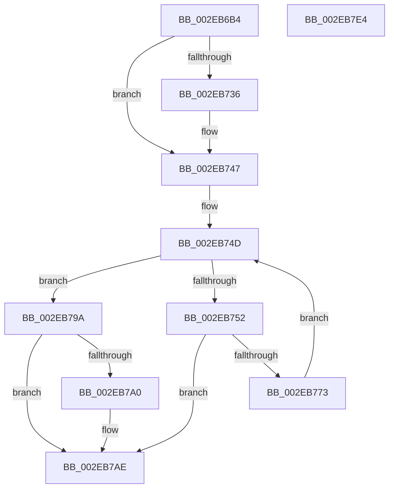

# RtlpHpVsContextMultiAlloc

- RVA: `0x002EB6B4`–`0x002EB7E5` (길이 `305` bytes)
- VA: `0x00000001402EB6B4`
- 실행 섹션: `.text`
- PDB 이름 있음: `예`; PDB Function 태그: `아니요`
- unwind 정보 RVA: `0x00071678`
- 디코드: `87`개 명령, `305/305` bytes 표시
- 미해석 바이트: `0` (있으면 어셈블리에 `.byte`로 보존)

> 이 문서는 커널 이미지의 기계어와 PDB 기호를 분석해 생성했습니다. 4번과 5번은 함수 원형과 자료형을 바이너리 사용 방식에서 추정한 C 해석이며 원본 소스 복구 결과는 아닙니다.

## 1. Dependencies

- 직접 호출 지점: **4**; 고유 호출 대상: **4**
- 직접 호출자로 확인된 함수: **1**
- RIP 상대 이미지 참조: **0**

### Outgoing calls
- `0x002EB742` → [RtlpHpAcquireQueuedLockExclusive](../32/RtlpHpAcquireQueuedLockExclusive_function_00324820.md) (function, `0x00324820`)
- `0x002EB769` → [RtlpHpVsSlotAllocate](RtlpHpVsSlotAllocate_function_002EAB38.md) (function, `0x002EAB38`)
- `0x002EB784` → [RtlpHpVsContextAllocateFinalize](RtlpHpVsContextAllocateFinalize_function_002EB7EC.md) (function, `0x002EB7EC`)
- `0x002EB7A9` → [RtlpHpReleaseQueuedLockExclusive](RtlpHpReleaseQueuedLockExclusive_function_002E2A70.md) (function, `0x002E2A70`)

### Direct callers
- [ExAllocateHeapPool](../35/ExAllocateHeapPool_function_0035BA30.md) at `0x0035F103`

### Static image references
- 디코드된 RIP-relative 메모리 참조가 없습니다.

## 2. Other-region calls and transfers

- 다른 실행 섹션으로 향하는 call: **0**
- 별도 외부 분기/꼬리 이동을 확인하지 못했습니다.

## 3. Assembly (complete function range)

```asm
002EB6B4  4C 8B DC                        mov r11, rsp
002EB6B7  49 89 5B 08                     mov qword ptr [r11 + 8], rbx
002EB6BB  49 89 6B 18                     mov qword ptr [r11 + 0x18], rbp
002EB6BF  49 89 73 20                     mov qword ptr [r11 + 0x20], rsi
002EB6C3  89 54 24 10                     mov dword ptr [rsp + 0x10], edx
002EB6C7  57                              push rdi
002EB6C8  41 54                           push r12
002EB6CA  41 55                           push r13
002EB6CC  41 56                           push r14
002EB6CE  41 57                           push r15
002EB6D0  48 83 EC 50                     sub rsp, 0x50
002EB6D4  44 0F B6 69 04                  movzx r13d, byte ptr [rcx + 4]
002EB6D9  8D 42 0F                        lea eax, [rdx + 0xf]
002EB6DC  C1 E8 04                        shr eax, 4
002EB6DF  41 83 E5 01                     and r13d, 1
002EB6E3  44 03 E8                        add r13d, eax
002EB6E6  0F 57 C0                        xorps xmm0, xmm0
002EB6E9  65 48 8B 04 25 88 01 00 00      mov rax, qword ptr gs:[0x188]
002EB6F2  45 8B E0                        mov r12d, r8d
002EB6F5  48 8B D9                        mov rbx, rcx
002EB6F8  45 8D 7D 01                     lea r15d, [r13 + 1]
002EB6FC  44 0F B6 88 75 07 00 00         movzx r9d, byte ptr [rax + 0x775]
002EB704  0F B6 41 02                     movzx eax, byte ptr [rcx + 2]
002EB708  4C 23 C8                        and r9, rax
002EB70B  41 C1 E7 10                     shl r15d, 0x10
002EB70F  0F B7 01                        movzx eax, word ptr [rcx]
002EB712  48 C1 E0 04                     shl rax, 4
002EB716  4C 03 C8                        add r9, rax
002EB719  33 C0                           xor eax, eax
002EB71B  46 0F B7 34 89                  movzx r14d, word ptr [rcx + r9*4]
002EB720  49 C1 E6 06                     shl r14, 6
002EB724  4C 03 F1                        add r14, rcx
002EB727  F6 41 05 01                     test byte ptr [rcx + 5], 1
002EB72B  0F 11 44 24 30                  movups xmmword ptr [rsp + 0x30], xmm0
002EB730  49 89 43 C8                     mov qword ptr [r11 - 0x38], rax
002EB734  75 11                           jne 0x1402eb747
002EB736  0F B6 51 03                     movzx edx, byte ptr [rcx + 3]
002EB73A  4D 8D 43 B8                     lea r8, [r11 - 0x48]
002EB73E  49 8D 4E 08                     lea rcx, [r14 + 8]
002EB742  E8 D9 90 03 00                  call 0x140324820
002EB747  33 ED                           xor ebp, ebp
002EB749  33 FF                           xor edi, edi
002EB74B  33 F6                           xor esi, esi
002EB74D  41 3B F4                        cmp esi, r12d
002EB750  73 48                           jae 0x1402eb79a
002EB752  48 8D 44 24 30                  lea rax, [rsp + 0x30]
002EB757  45 8B CF                        mov r9d, r15d
002EB75A  45 8D 45 01                     lea r8d, [r13 + 1]
002EB75E  48 89 44 24 20                  mov qword ptr [rsp + 0x20], rax
002EB763  49 8B D6                        mov rdx, r14
002EB766  48 8B CB                        mov rcx, rbx
002EB769  E8 CA F3 FF FF                  call 0x1402eab38
002EB76E  48 85 C0                        test rax, rax
002EB771  74 3B                           je 0x1402eb7ae
002EB773  44 8B 84 24 88 00 00 00         mov r8d, dword ptr [rsp + 0x88]
002EB77B  45 33 C9                        xor r9d, r9d
002EB77E  48 8B D0                        mov rdx, rax
002EB781  48 8B CB                        mov rcx, rbx
002EB784  E8 63 00 00 00                  call 0x1402eb7ec
002EB789  48 85 FF                        test rdi, rdi
002EB78C  48 0F 44 F8                     cmove rdi, rax
002EB790  FF C6                           inc esi
002EB792  48 89 28                        mov qword ptr [rax], rbp
002EB795  48 8B E8                        mov rbp, rax
002EB798  EB B3                           jmp 0x1402eb74d
002EB79A  F6 43 05 01                     test byte ptr [rbx + 5], 1
002EB79E  75 0E                           jne 0x1402eb7ae
002EB7A0  0F B6 4B 03                     movzx ecx, byte ptr [rbx + 3]
002EB7A4  48 8D 54 24 30                  lea rdx, [rsp + 0x30]
002EB7A9  E8 C2 72 FF FF                  call 0x1402e2a70
002EB7AE  48 8B 8C 24 A0 00 00 00         mov rcx, qword ptr [rsp + 0xa0]
002EB7B6  4C 8D 5C 24 50                  lea r11, [rsp + 0x50]
002EB7BB  49 8B 5B 30                     mov rbx, qword ptr [r11 + 0x30]
002EB7BF  8B C6                           mov eax, esi
002EB7C1  49 8B 73 48                     mov rsi, qword ptr [r11 + 0x48]
002EB7C5  48 89 29                        mov qword ptr [rcx], rbp
002EB7C8  48 8B 8C 24 A8 00 00 00         mov rcx, qword ptr [rsp + 0xa8]
002EB7D0  49 8B 6B 40                     mov rbp, qword ptr [r11 + 0x40]
002EB7D4  48 89 39                        mov qword ptr [rcx], rdi
002EB7D7  49 8B E3                        mov rsp, r11
002EB7DA  41 5F                           pop r15
002EB7DC  41 5E                           pop r14
002EB7DE  41 5D                           pop r13
002EB7E0  41 5C                           pop r12
002EB7E2  5F                              pop rdi
002EB7E3  C3                              ret
002EB7E4  CC                              int3
```

## 4. C-style interpretation (structured pseudocode)

```c
__int64 __fastcall RtlpHpVsContextMultiAlloc(__int64 a1, __int64 a2, int a3, __int64 a4, __int64 a5, __int64 a6)
{
    __int64 result;
    __int64 v_r13;
    __int64 v_r14;
    __int64 v_r15;
    __int64 v_rbp;
    __int64 v_rdi;
    __int64 v_rsi;
    __int64 v_rsp;
    unsigned __int64 v_stack_m28;
    unsigned __int64 v_stack_m48;
    unsigned __int64 v_stack_m58;
    unsigned int v_stack_p10;

    *(unsigned __int64 *)(v_rsp + 8) = v_rbx;
    *(unsigned __int64 *)(v_rsp + 24) = v_rbp;
    *(unsigned __int64 *)(v_rsp + 32) = v_rsi;
    v_stack_p10 = (unsigned int)(a2);
    v_rsp = (v_rsp) - (80);
    result = (unsigned int)((a2 + 15) >> (4));
    v_r13 = (unsigned int)((*(unsigned __int8 *)(a1 + 4)) & (1));
    v_r13 = (unsigned int)((v_r13) + ((unsigned int)(result)));
    a4 = (*(unsigned __int8 *)(*(unsigned __int64 *)(gs_base + (0 + 392)) + 1909)) & (*(unsigned __int8 *)(a1 + 2));
    v_r15 = (unsigned int)((v_r13 + 1) << (16));
    result = (*(unsigned __int16 *)(a1)) << (4);
    a4 = (a4) + (result);
    result = 0;
    v_r14 = (*(unsigned __int16 *)(a1 + a4 * 4)) << (6);
    v_r14 = (v_r14) + (a1);
    v_stack_m48 = v_xmm0;
    *(unsigned __int64 *)(v_rsp - 56) = 0;
    if (((*(unsigned __int8 *)(a1 + 5)) & (1)) == 0) {
        a2 = *(unsigned __int8 *)(a1 + 3);
        a3 = v_rsp - 72;
        a1 = v_r14 + 8;
        result = RtlpHpAcquireQueuedLockExclusive(a1, a2, a3, a4);
    }
    v_rbp = 0;
    v_rdi = 0;
    v_rsi = 0;
loc_002EB74D:
    if (0 >= ((unsigned int)((unsigned int)(a3)))) goto loc_002EB79A;
    v_stack_m58 = v_stack_m48;
    result = RtlpHpVsSlotAllocate(a1, v_r14, v_r13 + 1, (unsigned int)((unsigned int)(v_r15)));
    if (result == 0) goto loc_002EB7AE;
    a4 = 0;
    result = RtlpHpVsContextAllocateFinalize(a1, result, (unsigned int)(v_stack_p10), a4);
    if (0 == 0) { v_rdi = result; }
    v_rsi = (unsigned int)((v_rsi) + 1);
    *(unsigned __int64 *)(result) = 0;
    goto loc_002EB74D;
loc_002EB79A:
    if (((*(unsigned __int8 *)(a1 + 5)) & (1)) == 0) {
        a1 = *(unsigned __int8 *)(a1 + 3);
        a2 = v_stack_m48;
        result = RtlpHpReleaseQueuedLockExclusive(a1, a2, (unsigned int)(v_stack_p10), a4);
    }
    *(unsigned __int64 *)(a5) = result;
    *(unsigned __int64 *)(a6) = v_rdi;
    return (unsigned int)((unsigned int)(v_rsi));
}
```

## 5. (Beta) C Style

```c
int64_t RtlpHpVsContextMultiAlloc(void *Arg1, void *Arg2, int32_t Arg3, int64_t Arg4, void *Arg5, void *Arg6)
{
    uint8_t *arg1 = (uint8_t *)Arg1;
    uint8_t *arg2 = (uint8_t *)Arg2;
    uint8_t *arg5 = (uint8_t *)Arg5;
    uint8_t *arg6 = (uint8_t *)Arg6;

    int64_t result;
    int64_t local_r13;
    int64_t local_r14;
    int64_t local_r15;
    int64_t local_rbp;
    int64_t local_rdi;
    int64_t local_rsi;
    int64_t local_rsp;
    uint64_t v_stack_m28;
    uint64_t v_stack_m48;
    uint64_t v_stack_m58;
    uint32_t v_stack_p10;

    *(uint64_t *)(local_rsp + 0x8) = local_rbx;
    *(uint64_t *)(local_rsp + 0x18) = local_rbp;
    *(uint64_t *)(local_rsp + 0x20) = local_rsi;
    v_stack_p10 = (uint32_t)(Arg2);
    local_rsp = (local_rsp) - (80);
    result = (uint32_t)((Arg2 + 15) >> (4));
    local_r13 = (uint32_t)((*(uint8_t *)(arg1 + 0x4)) & (1));
    local_r13 = (uint32_t)((local_r13) + ((uint32_t)(result)));
    Arg4 = (*(uint8_t *)(*(uint64_t *)(gs_base + (0 + 0x188)) + 0x775)) & (*(uint8_t *)(arg1 + 0x2));
    local_r15 = (uint32_t)((local_r13 + 1) << (16));
    result = (*(uint16_t *)(arg1)) << (4);
    Arg4 = (Arg4) + (result);
    result = 0;
    local_r14 = (*(uint16_t *)(arg1 + Arg4 * 4)) << (6);
    local_r14 = (local_r14) + (Arg1);
    v_stack_m48 = v_xmm0;
    *(uint64_t *)(local_rsp - 0x38) = 0;
    if (((*(uint8_t *)(arg1 + 0x5)) & (1)) == 0) {
        Arg2 = *(uint8_t *)(arg1 + 0x3);
        Arg3 = local_rsp - 72;
        Arg1 = local_r14 + 8;
        result = RtlpHpAcquireQueuedLockExclusive(Arg1, Arg2, Arg3, Arg4);
    }
    local_rbp = 0;
    local_rdi = 0;
    local_rsi = 0;
loc_002EB74D:
    if (0 >= ((uint32_t)((uint32_t)(Arg3)))) goto loc_002EB79A;
    v_stack_m58 = v_stack_m48;
    result = RtlpHpVsSlotAllocate(Arg1, local_r14, local_r13 + 1, (uint32_t)((uint32_t)(local_r15)));
    if (result == 0) goto loc_002EB7AE;
    Arg4 = 0;
    result = RtlpHpVsContextAllocateFinalize(Arg1, result, (uint32_t)(v_stack_p10), Arg4);
    if (0 == 0) { local_rdi = result; }
    local_rsi = (uint32_t)((local_rsi) + 1);
    *(uint64_t *)(result) = 0;
    goto loc_002EB74D;
loc_002EB79A:
    if (((*(uint8_t *)(arg1 + 0x5)) & (1)) == 0) {
        Arg1 = *(uint8_t *)(arg1 + 0x3);
        Arg2 = v_stack_m48;
        result = RtlpHpReleaseQueuedLockExclusive(Arg1, Arg2, (uint32_t)(v_stack_p10), Arg4);
    }
    *(uint64_t *)(arg5) = result;
    *(uint64_t *)(arg6) = local_rdi;
    return (uint32_t)((uint32_t)(local_rsi));
}
```

### 관측된 메모리 오프셋

구조체 형식이 확인되지 않은 접근은 인자 기준의 오프셋으로만 기록했습니다.

| 기준 인자 | 오프셋 표현 | 폭 (bit) | 접근 |
|---|---:|---:|---|
| `Arg1` | `+ 0x0` | `16` | `R` |
| `Arg1` | `+ 0x0 + r9*4` | `16` | `R` |
| `Arg1` | `+ 0x2` | `8` | `R` |
| `Arg1` | `+ 0x3` | `8` | `R` |
| `Arg1` | `+ 0x4` | `8` | `R` |
| `Arg1` | `+ 0x5` | `8` | `R` |
| `Arg2` | `+ 0xF` | `32` | `R` |
| `Arg5` | `+ 0x0` | `64` | `W` |
| `Arg6` | `+ 0x0` | `64` | `W` |

## 6. Execution-region graph

[열기: 2D/3D 그래프와 함수 탐색 컨트롤 패널](../../../control-panel.html?section=text&rva=0x002EB6B4&view=graph)

- 2D 그래프는 위에서 아래로 흐르고, 3D 그래프는 빈 공간을 드래그해 회전합니다. Shift+드래그는 이동, 휠은 확대·축소, 함수 노드 선택은 대상 보고서 이동입니다.

### Static fallback


