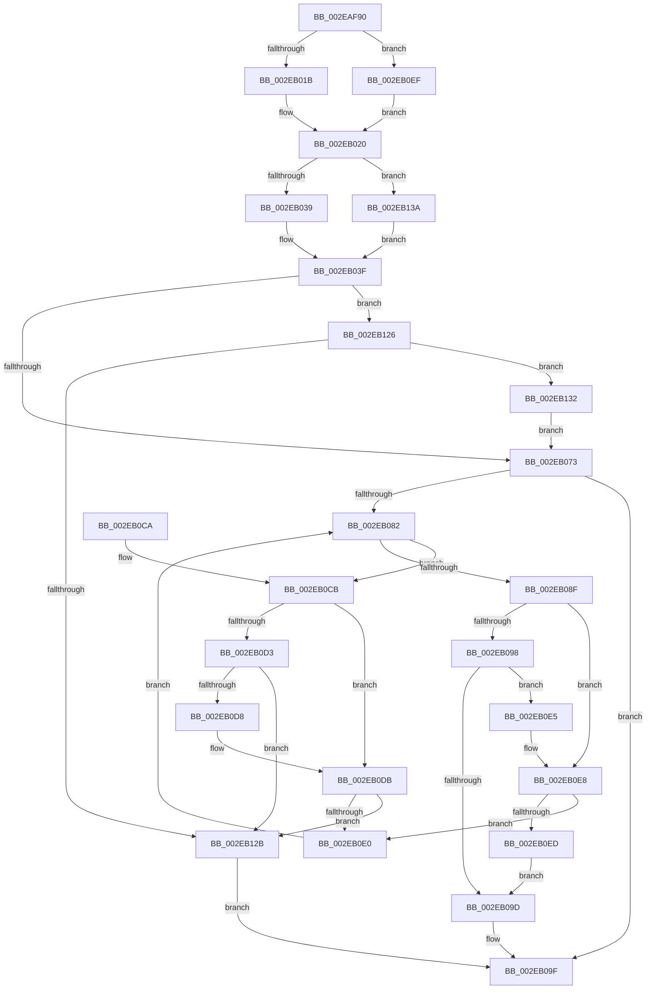

# RtlpHpVsFreeChunkInsert

- RVA: `0x002EAF90`–`0x002EB143` (길이 `435` bytes)
- VA: `0x00000001402EAF90`
- 실행 섹션: `.text`
- PDB 이름 있음: `예`; PDB Function 태그: `아니요`
- unwind 정보 RVA: `0x0007160C`
- 디코드: `122`개 명령, `435/435` bytes 표시
- 미해석 바이트: `0` (있으면 어셈블리에 `.byte`로 보존)

> 이 문서는 커널 이미지의 기계어와 PDB 기호를 분석해 생성했습니다. 4번과 5번은 함수 원형과 자료형을 바이너리 사용 방식에서 추정한 C 해석이며 원본 소스 복구 결과는 아닙니다.

## 1. Dependencies

- 직접 호출 지점: **1**; 고유 호출 대상: **1**
- 직접 호출자로 확인된 함수: **1**
- RIP 상대 이미지 참조: **2**

### Outgoing calls
- `0x002EB0AA` → [RtlRbInsertNodeEx](RtlRbInsertNodeEx_function_002E4570.md) (function, `0x002E4570`)

### Direct callers
- [RtlpHpVsSlotAllocate](RtlpHpVsSlotAllocate_function_002EAB38.md) at `0x002EAD9A`
- [RtlpHpVsSlotAllocate](RtlpHpVsSlotAllocate_function_002EAB38.md) at `0x002EADAC`

### Static image references
- `0x002EAFD7` → RVA `0x00E28302` (`.data`; read)
- `0x002EB04B` → RVA `0x00E28300` (`.data`; read)

## 2. Other-region calls and transfers

- 다른 실행 섹션으로 향하는 call: **0**
- 별도 외부 분기/꼬리 이동을 확인하지 못했습니다.

## 3. Assembly (complete function range)

```asm
002EAF90  48 89 5C 24 08                  mov qword ptr [rsp + 8], rbx
002EAF95  48 89 74 24 10                  mov qword ptr [rsp + 0x10], rsi
002EAF9A  48 89 7C 24 18                  mov qword ptr [rsp + 0x18], rdi
002EAF9F  4C 89 74 24 20                  mov qword ptr [rsp + 0x20], r14
002EAFA4  41 57                           push r15
002EAFA6  48 83 EC 20                     sub rsp, 0x20
002EAFAA  49 8B D9                        mov rbx, r9
002EAFAD  4D 8B F8                        mov r15, r8
002EAFB0  8B C3                           mov eax, ebx
002EAFB2  8B F3                           mov esi, ebx
002EAFB4  C1 E8 10                        shr eax, 0x10
002EAFB7  81 E6 FF 0F 00 00               and esi, 0xfff
002EAFBD  48 81 C6 FF 0F 00 00            add rsi, 0xfff
002EAFC4  8B FB                           mov edi, ebx
002EAFC6  44 0F B7 53 02                  movzx r10d, word ptr [rbx + 2]
002EAFCB  41 2B F8                        sub edi, r8d
002EAFCE  44 33 D0                        xor r10d, eax
002EAFD1  81 C7 1F 10 00 00               add edi, 0x101f
002EAFD7  0F B7 05 24 D3 B3 00            movzx eax, word ptr [rip + 0xb3d324]
002EAFDE  81 E7 00 F0 FF FF               and edi, 0xfffff000
002EAFE4  44 33 D0                        xor r10d, eax
002EAFE7  4C 8B F2                        mov r14, rdx
002EAFEA  41 C1 E2 04                     shl r10d, 4
002EAFEE  4C 8B C9                        mov r9, rcx
002EAFF1  49 03 F2                        add rsi, r10
002EAFF4  48 C1 EE 0C                     shr rsi, 0xc
002EAFF8  49 8D 82 FF 0F 00 00            lea rax, [r10 + 0xfff]
002EAFFF  45 2B D0                        sub r10d, r8d
002EB002  44 03 D3                        add r10d, ebx
002EB005  48 C1 E8 0C                     shr rax, 0xc
002EB009  41 81 E2 00 F0 FF FF            and r10d, 0xfffff000
002EB010  2B F0                           sub esi, eax
002EB012  41 3B FA                        cmp edi, r10d
002EB015  0F 82 D4 00 00 00               jb 0x1402eb0ef
002EB01B  33 D2                           xor edx, edx
002EB01D  44 8B C2                        mov r8d, edx
002EB020  49 0F BF 41 06                  movsx rax, word ptr [r9 + 6]
002EB025  F3 49 0F B8 C8                  popcnt rcx, r8
002EB02A  C1 EA 0C                        shr edx, 0xc
002EB02D  4C 63 C1                        movsxd r8, ecx
002EB030  66 85 C0                        test ax, ax
002EB033  0F 84 01 01 00 00               je 0x1402eb13a
002EB039  F0 4E 01 44 08 20               lock add qword ptr [rax + r9 + 0x20], r8
002EB03F  66 2B D1                        sub dx, cx
002EB042  4D 8D 56 10                     lea r10, [r14 + 0x10]
002EB046  66 03 D6                        add dx, si
002EB049  8B CB                           mov ecx, ebx
002EB04B  66 33 15 AE D2 B3 00            xor dx, word ptr [rip + 0xb3d2ae]
002EB052  66 33 D3                        xor dx, bx
002EB055  66 89 13                        mov word ptr [rbx], dx
002EB058  33 0B                           xor ecx, dword ptr [rbx]
002EB05A  4C 8B 05 9F D2 B3 00            mov r8, qword ptr [rip + 0xb3d29f]
002EB061  49 8B 42 08                     mov rax, qword ptr [r10 + 8]
002EB065  41 33 C8                        xor ecx, r8d
002EB068  49 8B 12                        mov rdx, qword ptr [r10]
002EB06B  A8 01                           test al, 1
002EB06D  0F 85 B3 00 00 00               jne 0x1402eb126
002EB073  44 0F B6 C8                     movzx r9d, al
002EB077  32 C0                           xor al, al
002EB079  41 83 E1 01                     and r9d, 1
002EB07D  48 85 D2                        test rdx, rdx
002EB080  74 1D                           je 0x1402eb09f
002EB082  48 8D 42 F8                     lea rax, [rdx - 8]
002EB086  33 00                           xor eax, dword ptr [rax]
002EB088  41 33 C0                        xor eax, r8d
002EB08B  3B C8                           cmp ecx, eax
002EB08D  72 3C                           jb 0x1402eb0cb
002EB08F  48 8B 42 08                     mov rax, qword ptr [rdx + 8]
002EB093  45 85 C9                        test r9d, r9d
002EB096  74 50                           je 0x1402eb0e8
002EB098  48 85 C0                        test rax, rax
002EB09B  75 48                           jne 0x1402eb0e5
002EB09D  B0 01                           mov al, 1
002EB09F  4C 8D 4B 08                     lea r9, [rbx + 8]
002EB0A3  44 0F B6 C0                     movzx r8d, al
002EB0A7  49 8B CA                        mov rcx, r10
002EB0AA  E8 C1 94 FF FF                  call 0x1402e4570
002EB0AF  48 8B 5C 24 30                  mov rbx, qword ptr [rsp + 0x30]
002EB0B4  48 8B 74 24 38                  mov rsi, qword ptr [rsp + 0x38]
002EB0B9  48 8B 7C 24 40                  mov rdi, qword ptr [rsp + 0x40]
002EB0BE  4C 8B 74 24 48                  mov r14, qword ptr [rsp + 0x48]
002EB0C3  48 83 C4 20                     add rsp, 0x20
002EB0C7  41 5F                           pop r15
002EB0C9  C3                              ret
002EB0CA  CC                              int3
002EB0CB  48 8B 02                        mov rax, qword ptr [rdx]
002EB0CE  45 85 C9                        test r9d, r9d
002EB0D1  74 08                           je 0x1402eb0db
002EB0D3  48 85 C0                        test rax, rax
002EB0D6  74 53                           je 0x1402eb12b
002EB0D8  48 33 C2                        xor rax, rdx
002EB0DB  48 85 C0                        test rax, rax
002EB0DE  74 4B                           je 0x1402eb12b
002EB0E0  48 8B D0                        mov rdx, rax
002EB0E3  EB 9D                           jmp 0x1402eb082
002EB0E5  48 33 C2                        xor rax, rdx
002EB0E8  48 85 C0                        test rax, rax
002EB0EB  75 F3                           jne 0x1402eb0e0
002EB0ED  EB AE                           jmp 0x1402eb09d
002EB0EF  41 8D 42 FF                     lea eax, [r10 - 1]
002EB0F3  B9 3F 00 00 00                  mov ecx, 0x3f
002EB0F8  48 C1 E8 0C                     shr rax, 0xc
002EB0FC  41 8B D2                        mov edx, r10d
002EB0FF  2A C8                           sub cl, al
002EB101  2B D7                           sub edx, edi
002EB103  48 C7 C0 FF FF FF FF            mov rax, 0xffffffffffffffff
002EB10A  C1 EF 0C                        shr edi, 0xc
002EB10D  4C 8B C0                        mov r8, rax
002EB110  49 D3 E8                        shr r8, cl
002EB113  40 0F B6 CF                     movzx ecx, dil
002EB117  48 D3 E0                        shl rax, cl
002EB11A  4C 23 C0                        and r8, rax
002EB11D  4D 23 47 10                     and r8, qword ptr [r15 + 0x10]
002EB121  E9 FA FE FF FF                  jmp 0x1402eb020
002EB126  48 85 D2                        test rdx, rdx
002EB129  75 07                           jne 0x1402eb132
002EB12B  32 C0                           xor al, al
002EB12D  E9 6D FF FF FF                  jmp 0x1402eb09f
002EB132  49 33 D2                        xor rdx, r10
002EB135  E9 39 FF FF FF                  jmp 0x1402eb073
002EB13A  4D 01 41 58                     add qword ptr [r9 + 0x58], r8
002EB13E  E9 FC FE FF FF                  jmp 0x1402eb03f
```

## 4. C-style interpretation (structured pseudocode)

```c
__int64 __fastcall RtlpHpVsFreeChunkInsert(__int64 a1, __int64 a2, __int64 a3, __int64 a4)
{
    __int64 result;
    __int64 v_r10;
    __int64 v_rdi;
    __int64 v_rsi;
    __int64 v_rsp;
    unsigned __int64 v_stack_p10;
    unsigned __int64 v_stack_p18;
    unsigned __int64 v_stack_p20;
    unsigned __int64 v_stack_p8;

    v_stack_p8 = v_rbx;
    v_stack_p10 = v_rsi;
    v_stack_p18 = v_rdi;
    v_stack_p20 = v_r14;
    v_rsp = (v_rsp) - (32);
    result = (unsigned int)(((unsigned int)((unsigned int)(a4))) >> (16));
    v_rsi = (unsigned int)(((unsigned int)((unsigned int)(a4))) & (0xFFFULL));
    v_rsi = (v_rsi) + (0xFFFULL);
    v_rdi = (unsigned int)(((unsigned int)((unsigned int)(a4))) - ((unsigned int)(a3)));
    v_r10 = (unsigned int)((*(unsigned __int16 *)(a4 + 2)) ^ ((unsigned int)(result)));
    v_rdi = (unsigned int)((v_rdi) + (0x101FULL));
    v_rdi = (unsigned int)((v_rdi) & (0xFFFFF000ULL));
    v_r10 = (unsigned int)((v_r10) ^ ((unsigned int)(*(unsigned __int16 *)(v_rip + 11784996))));
    v_r10 = (unsigned int)((v_r10) << (4));
    v_rsi = (v_rsi) + (v_r10);
    v_rsi = (v_rsi) >> (12);
    v_r10 = (unsigned int)((v_r10) - ((unsigned int)(a3)));
    v_r10 = (unsigned int)((v_r10) + ((unsigned int)(a4)));
    result = (v_r10 + 4095) >> (12);
    v_r10 = (unsigned int)((v_r10) & (0xFFFFF000ULL));
    v_rsi = (unsigned int)((v_rsi) - ((unsigned int)(result)));
    if (((unsigned int)(v_rdi)) < ((unsigned int)(v_r10))) goto loc_002EB0EF;
    a2 = 0;
loc_002EB020:
    a2 = (unsigned int)((a2) >> (12));
    if ((unsigned __int16)((__int16)(*(unsigned __int16 *)(a1 + 6))) == 0) goto loc_002EB13A;
loc_002EB03F:
    a2 = (unsigned __int16)((a2) - ((unsigned __int16)(a1)));
    a2 = (unsigned __int16)((a2) + ((unsigned __int16)(v_rsi)));
    a2 = (unsigned __int16)((a2) ^ (*(unsigned __int16 *)(v_rip + 11784878)));
    a2 = (unsigned __int16)((a2) ^ ((unsigned __int16)(a4)));
    *(unsigned __int16 *)(a4) = (unsigned __int16)(a2);
    a1 = (unsigned int)(((unsigned int)((unsigned int)(a4))) ^ (*(unsigned int *)(a4)));
    a1 = (unsigned int)((a1) ^ ((unsigned int)(*(unsigned __int64 *)(v_rip + 11784863))));
    if ((((unsigned __int8)(*(unsigned __int64 *)(a2 + 16 + 8))) & (1)) != 0) goto loc_002EB126;
loc_002EB073:
    result = 0;
    a4 = (unsigned int)(((unsigned __int8)(*(unsigned __int64 *)(a2 + 16 + 8))) & (1));
    if (*(unsigned __int64 *)(a2 + 16) == 0) goto loc_002EB09F;
loc_002EB082:
    result = (unsigned int)((*(unsigned __int64 *)(a2 + 16) - 8) ^ (*(unsigned int *)(*(unsigned __int64 *)(a2 + 16) - 8)));
    result = (unsigned int)((result) ^ ((unsigned int)(*(unsigned __int64 *)(v_rip + 11784863))));
    if (((unsigned int)(a1)) < ((unsigned int)(result))) goto loc_002EB0CB;
    if ((unsigned int)(a4) == 0) goto loc_002EB0E8;
    if (*(unsigned __int64 *)(*(unsigned __int64 *)(a2 + 16) + 8) != 0) goto loc_002EB0E5;
loc_002EB09D:
loc_002EB09F:
    result = RtlRbInsertNodeEx(a2 + 16, *(unsigned __int64 *)(a2 + 16), 1, a4 + 8);
    v_rsp = (v_rsp) + (32);
    return result;
loc_002EB0CB:
    if ((unsigned int)(a4 + 8) == 0) goto loc_002EB0DB;
    if (*(unsigned __int64 *)(*(unsigned __int64 *)(a2 + 16)) == 0) goto loc_002EB12B;
    result = (*(unsigned __int64 *)(*(unsigned __int64 *)(a2 + 16))) ^ (*(unsigned __int64 *)(a2 + 16));
loc_002EB0DB:
    if (result == 0) goto loc_002EB12B;
loc_002EB0E0:
    goto loc_002EB082;
loc_002EB0E5:
    result = (result) ^ (result);
loc_002EB0E8:
    if (result != 0) goto loc_002EB0E0;
    goto loc_002EB09D;
loc_002EB0EF:
    result = (a2 + 16 - 1) >> (12);
    a1 = (unsigned __int8)((63) - ((unsigned __int8)(result)));
    a2 = (unsigned int)(((unsigned int)((unsigned int)(a2 + 16))) - ((unsigned int)(v_stack_p18)));
    v_rdi = (unsigned int)((v_stack_p18) >> (12));
    a3 = (-1) >> ((unsigned __int8)(a1));
    result = (-1) << ((unsigned __int8)((unsigned __int8)(v_rdi)));
    a3 = (a3) & (result);
    a3 = (a3) & (*(unsigned __int64 *)(a3 + 16));
    goto loc_002EB020;
loc_002EB126:
    if (a2 != 0) goto loc_002EB132;
loc_002EB12B:
    result = 0;
    goto loc_002EB09F;
loc_002EB132:
    a2 = (a2) ^ (a2 + 16);
    goto loc_002EB073;
loc_002EB13A:
    goto loc_002EB03F;
}
```

## 5. (Beta) C Style

```c
int64_t RtlpHpVsFreeChunkInsert(void *Arg1, void *Arg2, void *Arg3, void *Arg4)
{
    uint8_t *arg1 = (uint8_t *)Arg1;
    uint8_t *arg2 = (uint8_t *)Arg2;
    uint8_t *arg3 = (uint8_t *)Arg3;
    uint8_t *arg4 = (uint8_t *)Arg4;

    int64_t result;
    int64_t local_r10;
    int64_t local_rdi;
    int64_t local_rsi;
    int64_t local_rsp;
    uint64_t v_stack_p10;
    uint64_t v_stack_p18;
    uint64_t v_stack_p20;
    uint64_t v_stack_p8;

    v_stack_p8 = local_rbx;
    v_stack_p10 = local_rsi;
    v_stack_p18 = local_rdi;
    v_stack_p20 = local_r14;
    local_rsp = (local_rsp) - (32);
    result = (uint32_t)(((uint32_t)((uint32_t)(Arg4))) >> (16));
    local_rsi = (uint32_t)(((uint32_t)((uint32_t)(Arg4))) & (0xFFFULL));
    local_rsi = (local_rsi) + (0xFFFULL);
    local_rdi = (uint32_t)(((uint32_t)((uint32_t)(Arg4))) - ((uint32_t)(Arg3)));
    local_r10 = (uint32_t)((*(uint16_t *)(arg4 + 0x2)) ^ ((uint32_t)(result)));
    local_rdi = (uint32_t)((local_rdi) + (0x101FULL));
    local_rdi = (uint32_t)((local_rdi) & (0xFFFFF000ULL));
    local_r10 = (uint32_t)((local_r10) ^ ((uint32_t)(*(uint16_t *)(v_rip + 0xB3D324))));
    local_r10 = (uint32_t)((local_r10) << (4));
    local_rsi = (local_rsi) + (local_r10);
    local_rsi = (local_rsi) >> (12);
    local_r10 = (uint32_t)((local_r10) - ((uint32_t)(Arg3)));
    local_r10 = (uint32_t)((local_r10) + ((uint32_t)(Arg4)));
    result = (local_r10 + 4095) >> (12);
    local_r10 = (uint32_t)((local_r10) & (0xFFFFF000ULL));
    local_rsi = (uint32_t)((local_rsi) - ((uint32_t)(result)));
    if (((uint32_t)(local_rdi)) < ((uint32_t)(local_r10))) goto loc_002EB0EF;
    Arg2 = 0;
loc_002EB020:
    Arg2 = (uint32_t)((Arg2) >> (12));
    if ((uint16_t)((int16_t)(*(uint16_t *)(arg1 + 0x6))) == 0) goto loc_002EB13A;
loc_002EB03F:
    Arg2 = (uint16_t)((Arg2) - ((uint16_t)(Arg1)));
    Arg2 = (uint16_t)((Arg2) + ((uint16_t)(local_rsi)));
    Arg2 = (uint16_t)((Arg2) ^ (*(uint16_t *)(v_rip + 0xB3D2AE)));
    Arg2 = (uint16_t)((Arg2) ^ ((uint16_t)(Arg4)));
    *(uint16_t *)(arg4) = (uint16_t)(Arg2);
    Arg1 = (uint32_t)(((uint32_t)((uint32_t)(Arg4))) ^ (*(uint32_t *)(arg4)));
    Arg1 = (uint32_t)((Arg1) ^ ((uint32_t)(*(uint64_t *)(v_rip + 0xB3D29F))));
    if ((((uint8_t)(*(uint64_t *)(arg2 + 0x10 + 0x8))) & (1)) != 0) goto loc_002EB126;
loc_002EB073:
    result = 0;
    Arg4 = (uint32_t)(((uint8_t)(*(uint64_t *)(arg2 + 0x10 + 0x8))) & (1));
    if (*(uint64_t *)(arg2 + 0x10) == 0) goto loc_002EB09F;
loc_002EB082:
    result = (uint32_t)((*(uint64_t *)(arg2 + 0x10) - 8) ^ (*(uint32_t *)(*(uint64_t *)(arg2 + 0x10) - 0x8)));
    result = (uint32_t)((result) ^ ((uint32_t)(*(uint64_t *)(v_rip + 0xB3D29F))));
    if (((uint32_t)(Arg1)) < ((uint32_t)(result))) goto loc_002EB0CB;
    if ((uint32_t)(Arg4) == 0) goto loc_002EB0E8;
    if (*(uint64_t *)(*(uint64_t *)(arg2 + 0x10) + 0x8) != 0) goto loc_002EB0E5;
loc_002EB09D:
loc_002EB09F:
    result = RtlRbInsertNodeEx(Arg2 + 16, *(uint64_t *)(arg2 + 0x10), 1, Arg4 + 8);
    local_rsp = (local_rsp) + (32);
    return result;
loc_002EB0CB:
    if ((uint32_t)(Arg4 + 8) == 0) goto loc_002EB0DB;
    if (*(uint64_t *)(*(uint64_t *)(arg2 + 0x10)) == 0) goto loc_002EB12B;
    result = (*(uint64_t *)(*(uint64_t *)(arg2 + 0x10))) ^ (*(uint64_t *)(arg2 + 0x10));
loc_002EB0DB:
    if (result == 0) goto loc_002EB12B;
loc_002EB0E0:
    goto loc_002EB082;
loc_002EB0E5:
    result = (result) ^ (result);
loc_002EB0E8:
    if (result != 0) goto loc_002EB0E0;
    goto loc_002EB09D;
loc_002EB0EF:
    result = (Arg2 + 16 - 1) >> (12);
    Arg1 = (uint8_t)((63) - ((uint8_t)(result)));
    Arg2 = (uint32_t)(((uint32_t)((uint32_t)(Arg2 + 16))) - ((uint32_t)(v_stack_p18)));
    local_rdi = (uint32_t)((v_stack_p18) >> (12));
    Arg3 = (-1) >> ((uint8_t)(Arg1));
    result = (-1) << ((uint8_t)((uint8_t)(local_rdi)));
    Arg3 = (Arg3) & (result);
    Arg3 = (Arg3) & (*(uint64_t *)(arg3 + 0x10));
    goto loc_002EB020;
loc_002EB126:
    if (Arg2 != NULL) goto loc_002EB132;
loc_002EB12B:
    result = 0;
    goto loc_002EB09F;
loc_002EB132:
    Arg2 = (Arg2) ^ (Arg2 + 16);
    goto loc_002EB073;
loc_002EB13A:
    goto loc_002EB03F;
}
```

### 관측된 메모리 오프셋

구조체 형식이 확인되지 않은 접근은 인자 기준의 오프셋으로만 기록했습니다.

| 기준 인자 | 오프셋 표현 | 폭 (bit) | 접근 |
|---|---:|---:|---|
| `Arg1` | `+ 0x6` | `16` | `R` |
| `Arg1` | `+ 0x58` | `64` | `R/W` |
| `Arg2` | `+ 0x0` | `64` | `R` |
| `Arg2` | `+ 0x8` | `64` | `R` |
| `Arg2` | `+ 0x10` | `64` | `R` |
| `Arg3` | `+ 0x10` | `64` | `R` |
| `Arg4` | `+ 0x0` | `16` | `W` |
| `Arg4` | `+ 0x0` | `32` | `R` |
| `Arg4` | `+ 0x2` | `16` | `R` |
| `Arg4` | `+ 0x8` | `64` | `R` |

## 6. Execution-region graph

[열기: 2D/3D 그래프와 함수 탐색 컨트롤 패널](../../../control-panel.html?section=text&rva=0x002EAF90&view=graph)

- 2D 그래프는 위에서 아래로 흐르고, 3D 그래프는 빈 공간을 드래그해 회전합니다. Shift+드래그는 이동, 휠은 확대·축소, 함수 노드 선택은 대상 보고서 이동입니다.

### Static fallback


