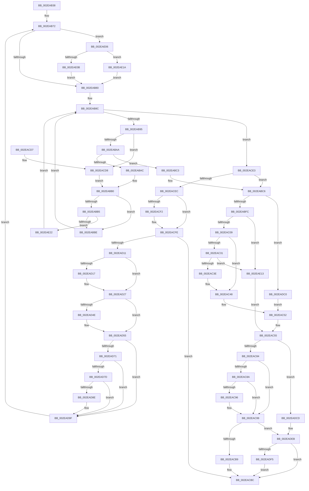

# RtlpHpVsSlotAllocate

- RVA: `0x002EAB38`–`0x002EAE2A` (길이 `754` bytes)
- VA: `0x00000001402EAB38`
- 실행 섹션: `.text`
- PDB 이름 있음: `예`; PDB Function 태그: `아니요`
- unwind 정보 RVA: `0x000715CC`
- 디코드: `210`개 명령, `754/754` bytes 표시
- 미해석 바이트: `0` (있으면 어셈블리에 `.byte`로 보존)

> 이 문서는 커널 이미지의 기계어와 PDB 기호를 분석해 생성했습니다. 4번과 5번은 함수 원형과 자료형을 바이너리 사용 방식에서 추정한 C 해석이며 원본 소스 복구 결과는 아닙니다.

## 1. Dependencies

- 직접 호출 지점: **9**; 고유 호출 대상: **7**
- 직접 호출자로 확인된 함수: **2**
- RIP 상대 이미지 참조: **1**

### Outgoing calls
- `0x002EACAC` → [RtlpHpVsChunkSplit](RtlpHpVsChunkSplit_function_002E5C80.md) (function, `0x002E5C80`)
- `0x002EACF9` → [RtlpHpReleaseQueuedLockExclusive](RtlpHpReleaseQueuedLockExclusive_function_002E2A70.md) (function, `0x002E2A70`)
- `0x002EAD04` → [RtlpHpVsSubsegmentCreate](RtlpHpVsSubsegmentCreate_function_002EAE30.md) (function, `0x002EAE30`)
- `0x002EAD22` → [RtlpHpAcquireQueuedLockExclusive](../32/RtlpHpAcquireQueuedLockExclusive_function_00324820.md) (function, `0x00324820`)
- `0x002EAD84` → [RtlpHpVsChunkAlignSplit](RtlpHpVsChunkAlignSplit_function_002EB150.md) (function, `0x002EB150`)
- `0x002EAD9A` → [RtlpHpVsFreeChunkInsert](RtlpHpVsFreeChunkInsert_function_002EAF90.md) (function, `0x002EAF90`)
- `0x002EADAC` → [RtlpHpVsFreeChunkInsert](RtlpHpVsFreeChunkInsert_function_002EAF90.md) (function, `0x002EAF90`)
- `0x002EADE6` → [RtlpLogHeapFailure](../35/RtlpLogHeapFailure_function_0035B7BC.md) (function, `0x0035B7BC`)
- `0x002EADFC` → [RtlpHpReleaseQueuedLockExclusive](RtlpHpReleaseQueuedLockExclusive_function_002E2A70.md) (function, `0x002E2A70`)

### Direct callers
- [RtlpHpVsContextAllocate](RtlpHpVsContextAllocate_function_002EA944.md) at `0x002EAA12`
- [RtlpHpVsContextMultiAlloc](RtlpHpVsContextMultiAlloc_function_002EB6B4.md) at `0x002EB769`

### Static image references
- `0x002EAB98` → RVA `0x00E28300` (`.data`; read)

## 2. Other-region calls and transfers

- 다른 실행 섹션으로 향하는 call: **0**
- 별도 외부 분기/꼬리 이동을 확인하지 못했습니다.

## 3. Assembly (complete function range)

```asm
002EAB38  48 8B C4                        mov rax, rsp
002EAB3B  48 89 58 08                     mov qword ptr [rax + 8], rbx
002EAB3F  48 89 70 10                     mov qword ptr [rax + 0x10], rsi
002EAB43  44 89 48 20                     mov dword ptr [rax + 0x20], r9d
002EAB47  44 89 40 18                     mov dword ptr [rax + 0x18], r8d
002EAB4B  57                              push rdi
002EAB4C  41 54                           push r12
002EAB4E  41 55                           push r13
002EAB50  41 56                           push r14
002EAB52  41 57                           push r15
002EAB54  48 83 EC 30                     sub rsp, 0x30
002EAB58  4C 8B A4 24 80 00 00 00         mov r12, qword ptr [rsp + 0x80]
002EAB60  4C 8D 7A 10                     lea r15, [rdx + 0x10]
002EAB64  45 8B D1                        mov r10d, r9d
002EAB67  45 8B F0                        mov r14d, r8d
002EAB6A  4C 8B EA                        mov r13, rdx
002EAB6D  48 8B F9                        mov rdi, rcx
002EAB70  33 DB                           xor ebx, ebx
002EAB72  41 F6 47 08 01                  test byte ptr [r15 + 8], 1
002EAB77  49 8B 0F                        mov rcx, qword ptr [r15]
002EAB7A  0F 85 86 02 00 00               jne 0x1402eae06
002EAB80  45 0F B6 47 08                  movzx r8d, byte ptr [r15 + 8]
002EAB85  4C 8B CB                        mov r9, rbx
002EAB88  41 83 E0 01                     and r8d, 1
002EAB8C  48 85 C9                        test rcx, rcx
002EAB8F  0F 84 4E 01 00 00               je 0x1402eace3
002EAB95  8D 51 F8                        lea edx, [rcx - 8]
002EAB98  33 15 62 D7 B3 00               xor edx, dword ptr [rip + 0xb3d762]
002EAB9E  33 51 F8                        xor edx, dword ptr [rcx - 8]
002EABA1  44 3B D2                        cmp r10d, edx
002EABA4  0F 82 2E 01 00 00               jb 0x1402eacd8
002EABAA  76 17                           jbe 0x1402eabc3
002EABAC  48 8B 41 08                     mov rax, qword ptr [rcx + 8]
002EABB0  45 85 C0                        test r8d, r8d
002EABB3  74 09                           je 0x1402eabbe
002EABB5  48 85 C0                        test rax, rax
002EABB8  0F 85 64 02 00 00               jne 0x1402eae22
002EABBE  48 8B C8                        mov rcx, rax
002EABC1  EB C9                           jmp 0x1402eab8c
002EABC3  4C 8B C9                        mov r9, rcx
002EABC6  4C 8B 15 33 D7 B3 00            mov r10, qword ptr [rip + 0xb3d733]
002EABCD  49 8D 71 F8                     lea rsi, [r9 - 8]
002EABD1  49 8B CA                        mov rcx, r10
002EABD4  48 8B C6                        mov rax, rsi
002EABD7  48 33 0E                        xor rcx, qword ptr [rsi]
002EABDA  41 BB 00 00 FF 00               mov r11d, 0xff0000
002EABE0  48 8B D1                        mov rdx, rcx
002EABE3  48 C1 E8 20                     shr rax, 0x20
002EABE7  48 C1 E9 20                     shr rcx, 0x20
002EABEB  48 33 D6                        xor rdx, rsi
002EABEE  33 C8                           xor ecx, eax
002EABF0  4C 8B C6                        mov r8, rsi
002EABF3  41 85 CB                        test r11d, ecx
002EABF6  0F 85 C4 01 00 00               jne 0x1402eadc0
002EABFC  48 C1 EA 20                     shr rdx, 0x20
002EAC00  66 85 D2                        test dx, dx
002EAC03  0F 84 0A 02 00 00               je 0x1402eae13
002EAC09  0F B7 C2                        movzx eax, dx
002EAC0C  48 C1 E0 04                     shl rax, 4
002EAC10  4C 2B C0                        sub r8, rax
002EAC13  49 8B D0                        mov rdx, r8
002EAC16  49 8B C0                        mov rax, r8
002EAC19  48 C1 E8 20                     shr rax, 0x20
002EAC1D  49 8B 08                        mov rcx, qword ptr [r8]
002EAC20  49 33 CA                        xor rcx, r10
002EAC23  48 33 D1                        xor rdx, rcx
002EAC26  48 C1 E9 20                     shr rcx, 0x20
002EAC2A  33 C1                           xor eax, ecx
002EAC2C  41 85 C3                        test r11d, eax
002EAC2F  75 17                           jne 0x1402eac48
002EAC31  48 C1 EA 20                     shr rdx, 0x20
002EAC35  66 85 D2                        test dx, dx
002EAC38  0F 84 D5 01 00 00               je 0x1402eae13
002EAC3E  0F B7 C2                        movzx eax, dx
002EAC41  48 C1 E0 04                     shl rax, 4
002EAC45  4C 2B C0                        sub r8, rax
002EAC48  41 8B C0                        mov eax, r8d
002EAC4B  41 33 40 08                     xor eax, dword ptr [r8 + 8]
002EAC4F  41 33 C2                        xor eax, r10d
002EAC52  0F B6 C8                        movzx ecx, al
002EAC55  C1 E1 0C                        shl ecx, 0xc
002EAC58  8B C1                           mov eax, ecx
002EAC5A  4C 2B C0                        sub r8, rax
002EAC5D  B8 ED 2B 00 00                  mov eax, 0x2bed
002EAC62  49 81 E0 00 F0 FF FF            and r8, 0xfffffffffffff000
002EAC69  41 0F B7 48 24                  movzx ecx, word ptr [r8 + 0x24]
002EAC6E  66 41 33 48 20                  xor cx, word ptr [r8 + 0x20]
002EAC73  66 33 C8                        xor cx, ax
002EAC76  B8 FF 7F 00 00                  mov eax, 0x7fff
002EAC7B  66 85 C8                        test ax, cx
002EAC7E  0F 85 49 01 00 00               jne 0x1402eadcd
002EAC84  F6 47 04 01                     test byte ptr [rdi + 4], 1
002EAC88  74 0F                           je 0x1402eac99
002EAC8A  48 8D 46 20                     lea rax, [rsi + 0x20]
002EAC8E  48 A9 FF 0F 00 00               test rax, 0xfff
002EAC94  74 03                           je 0x1402eac99
002EAC96  41 FF CE                        dec r14d
002EAC99  4C 89 64 24 28                  mov qword ptr [rsp + 0x28], r12
002EAC9E  4C 8B CE                        mov r9, rsi
002EACA1  49 8B D5                        mov rdx, r13
002EACA4  44 89 74 24 20                  mov dword ptr [rsp + 0x20], r14d
002EACA9  48 8B CF                        mov rcx, rdi
002EACAC  E8 CF AF FF FF                  call 0x1402e5c80
002EACB1  85 C0                           test eax, eax
002EACB3  0F 84 32 01 00 00               je 0x1402eadeb
002EACB9  48 8B DE                        mov rbx, rsi
002EACBC  48 8B 74 24 68                  mov rsi, qword ptr [rsp + 0x68]
002EACC1  48 8B C3                        mov rax, rbx
002EACC4  48 8B 5C 24 60                  mov rbx, qword ptr [rsp + 0x60]
002EACC9  48 83 C4 30                     add rsp, 0x30
002EACCD  41 5F                           pop r15
002EACCF  41 5E                           pop r14
002EACD1  41 5D                           pop r13
002EACD3  41 5C                           pop r12
002EACD5  5F                              pop rdi
002EACD6  C3                              ret
002EACD7  CC                              int3
002EACD8  48 8B 01                        mov rax, qword ptr [rcx]
002EACDB  4C 8B C9                        mov r9, rcx
002EACDE  E9 CD FE FF FF                  jmp 0x1402eabb0
002EACE3  4D 85 C9                        test r9, r9
002EACE6  0F 85 DA FE FF FF               jne 0x1402eabc6
002EACEC  F6 47 05 01                     test byte ptr [rdi + 5], 1
002EACF0  75 0C                           jne 0x1402eacfe
002EACF2  0F B6 4F 03                     movzx ecx, byte ptr [rdi + 3]
002EACF6  49 8B D4                        mov rdx, r12
002EACF9  E8 72 7D FF FF                  call 0x1402e2a70
002EACFE  41 8B D6                        mov edx, r14d
002EAD01  48 8B CF                        mov rcx, rdi
002EAD04  E8 27 01 00 00                  call 0x1402eae30
002EAD09  48 8B F0                        mov rsi, rax
002EAD0C  48 85 C0                        test rax, rax
002EAD0F  74 AB                           je 0x1402eacbc
002EAD11  F6 47 05 01                     test byte ptr [rdi + 5], 1
002EAD15  75 10                           jne 0x1402ead27
002EAD17  0F B6 57 03                     movzx edx, byte ptr [rdi + 3]
002EAD1B  49 8D 4D 08                     lea rcx, [r13 + 8]
002EAD1F  4D 8B C4                        mov r8, r12
002EAD22  E8 F9 9A 03 00                  call 0x140324820
002EAD27  49 8D 4D 20                     lea rcx, [r13 + 0x20]
002EAD2B  49 8B C5                        mov rax, r13
002EAD2E  48 2B C7                        sub rax, rdi
002EAD31  4C 8D 41 08                     lea r8, [rcx + 8]
002EAD35  48 C1 E8 06                     shr rax, 6
002EAD39  48 8B D1                        mov rdx, rcx
002EAD3C  66 89 46 22                     mov word ptr [rsi + 0x22], ax
002EAD40  49 33 10                        xor rdx, qword ptr [r8]
002EAD43  48 8B C2                        mov rax, rdx
002EAD46  48 33 02                        xor rax, qword ptr [rdx]
002EAD49  48 3B C1                        cmp rax, rcx
002EAD4C  74 07                           je 0x1402ead55
002EAD4E  B9 03 00 00 00                  mov ecx, 3
002EAD53  CD 29                           int 0x29
002EAD55  48 33 CE                        xor rcx, rsi
002EAD58  48 8B C2                        mov rax, rdx
002EAD5B  48 33 C6                        xor rax, rsi
002EAD5E  48 89 0E                        mov qword ptr [rsi], rcx
002EAD61  48 89 46 08                     mov qword ptr [rsi + 8], rax
002EAD65  48 89 02                        mov qword ptr [rdx], rax
002EAD68  49 89 08                        mov qword ptr [r8], rcx
002EAD6B  F6 47 04 01                     test byte ptr [rdi + 4], 1
002EAD6F  74 2E                           je 0x1402ead9f
002EAD71  48 8D 46 50                     lea rax, [rsi + 0x50]
002EAD75  48 A9 FF 0F 00 00               test rax, 0xfff
002EAD7B  74 22                           je 0x1402ead9f
002EAD7D  4C 8D 46 30                     lea r8, [rsi + 0x30]
002EAD81  48 8B D6                        mov rdx, rsi
002EAD84  E8 C7 03 00 00                  call 0x1402eb150
002EAD89  48 85 C0                        test rax, rax
002EAD8C  74 11                           je 0x1402ead9f
002EAD8E  4C 8B C8                        mov r9, rax
002EAD91  4C 8B C6                        mov r8, rsi
002EAD94  49 8B D5                        mov rdx, r13
002EAD97  48 8B CF                        mov rcx, rdi
002EAD9A  E8 F1 01 00 00                  call 0x1402eaf90
002EAD9F  4C 8D 4E 30                     lea r9, [rsi + 0x30]
002EADA3  4C 8B C6                        mov r8, rsi
002EADA6  49 8B D5                        mov rdx, r13
002EADA9  48 8B CF                        mov rcx, rdi
002EADAC  E8 DF 01 00 00                  call 0x1402eaf90
002EADB1  44 8B 54 24 78                  mov r10d, dword ptr [rsp + 0x78]
002EADB6  44 8B 74 24 70                  mov r14d, dword ptr [rsp + 0x70]
002EADBB  E9 B2 FD FF FF                  jmp 0x1402eab72
002EADC0  8B C6                           mov eax, esi
002EADC2  41 33 C2                        xor eax, r10d
002EADC5  41 33 01                        xor eax, dword ptr [r9]
002EADC8  E9 85 FE FF FF                  jmp 0x1402eac52
002EADCD  48 8B D7                        mov rdx, rdi
002EADD0  48 89 5C 24 28                  mov qword ptr [rsp + 0x28], rbx
002EADD5  48 33 57 08                     xor rdx, qword ptr [rdi + 8]
002EADD9  4C 8B CE                        mov r9, rsi
002EADDC  B9 12 00 00 00                  mov ecx, 0x12
002EADE1  48 89 5C 24 20                  mov qword ptr [rsp + 0x20], rbx
002EADE6  E8 D1 09 07 00                  call 0x14035b7bc
002EADEB  F6 47 05 01                     test byte ptr [rdi + 5], 1
002EADEF  0F 85 C7 FE FF FF               jne 0x1402eacbc
002EADF5  0F B6 4F 03                     movzx ecx, byte ptr [rdi + 3]
002EADF9  49 8B D4                        mov rdx, r12
002EADFC  E8 6F 7C FF FF                  call 0x1402e2a70
002EAE01  E9 B6 FE FF FF                  jmp 0x1402eacbc
002EAE06  48 85 C9                        test rcx, rcx
002EAE09  74 0F                           je 0x1402eae1a
002EAE0B  49 33 CF                        xor rcx, r15
002EAE0E  E9 6D FD FF FF                  jmp 0x1402eab80
002EAE13  8B CB                           mov ecx, ebx
002EAE15  E9 3B FE FF FF                  jmp 0x1402eac55
002EAE1A  48 8B CB                        mov rcx, rbx
002EAE1D  E9 5E FD FF FF                  jmp 0x1402eab80
002EAE22  48 33 C8                        xor rcx, rax
002EAE25  E9 62 FD FF FF                  jmp 0x1402eab8c
```

## 4. C-style interpretation (structured pseudocode)

```c
__int64 __fastcall RtlpHpVsSlotAllocate(__int64 a1, __int64 a2, int a3, int a4, __int64 a5)
{
    __int64 result;
    __int64 v_r14;
    __int64 v_rbx;
    __int64 v_rsp;
    unsigned __int64 v_stack_m30;
    unsigned int v_stack_m38;
    unsigned __int64 v_stack_p10;
    unsigned __int64 v_stack_p20;
    unsigned __int64 v_stack_p28;
    unsigned int v_stack_p70;
    unsigned int v_stack_p78;
    unsigned __int64 v_stack_p8;

    *(unsigned __int64 *)(v_rsp + 8) = v_rbx;
    *(unsigned __int64 *)(v_rsp + 16) = v_rsi;
    *(unsigned int *)(v_rsp + 32) = a4;
    *(unsigned int *)(v_rsp + 24) = a3;
    v_rsp = (v_rsp) - (48);
    v_rbx = 0;
loc_002EAB72:
    if (((*(unsigned __int8 *)(a2 + 16 + 8)) & (1)) != 0) goto loc_002EAE06;
loc_002EAB80:
    a3 = (unsigned int)((*(unsigned __int8 *)(a2 + 16 + 8)) & (1));
loc_002EAB8C:
    if (*(unsigned __int64 *)(a2 + 16) == 0) goto loc_002EACE3;
    a2 = (unsigned int)((*(unsigned __int64 *)(a2 + 16) - 8) ^ (*(unsigned int *)(v_rip + 11786082)));
    a2 = (unsigned int)((a2) ^ (*(unsigned int *)(*(unsigned __int64 *)(a2 + 16) - 8)));
    if (((unsigned int)((unsigned int)(a4))) < ((unsigned int)(a2))) goto loc_002EACD8;
    if (((unsigned int)((unsigned int)(a4))) <= ((unsigned int)(a2))) goto loc_002EABC3;
loc_002EABB0:
    if (a3 == 0) goto loc_002EABBE;
    if (*(unsigned __int64 *)(*(unsigned __int64 *)(a2 + 16) + 8) != 0) goto loc_002EAE22;
loc_002EABBE:
    goto loc_002EAB8C;
loc_002EABC3:
loc_002EABC6:
    a1 = (*(unsigned __int64 *)(v_rip + 11786035)) ^ (*(unsigned __int64 *)(*(unsigned __int64 *)(*(unsigned __int64 *)(a2 + 16) + 8) - 8));
    result = (*(unsigned __int64 *)(*(unsigned __int64 *)(a2 + 16) + 8) - 8) >> (32);
    a1 = (a1) >> (32);
    a2 = (a1) ^ (*(unsigned __int64 *)(*(unsigned __int64 *)(a2 + 16) + 8) - 8);
    a1 = (unsigned int)((a1) ^ ((unsigned int)(result)));
    if ((((unsigned int)((unsigned int)(0xFF0000ULL))) & ((unsigned int)(a1))) != 0) goto loc_002EADC0;
    a2 = (a2) >> (32);
    if ((unsigned __int16)(a2) == 0) goto loc_002EAE13;
    result = ((unsigned __int16)(a2)) << (4);
    a3 = (*(unsigned __int64 *)(*(unsigned __int64 *)(a2 + 16) + 8) - 8) - (result);
    result = (a3) >> (32);
    a1 = (*(unsigned __int64 *)(a3)) ^ (*(unsigned __int64 *)(v_rip + 11786035));
    a2 = (a3) ^ (a1);
    a1 = (a1) >> (32);
    result = (unsigned int)((result) ^ ((unsigned int)(a1)));
    if ((((unsigned int)((unsigned int)(0xFF0000ULL))) & ((unsigned int)(result))) != 0) goto loc_002EAC48;
    a2 = (a2) >> (32);
    if ((unsigned __int16)(a2) == 0) goto loc_002EAE13;
    result = ((unsigned __int16)(a2)) << (4);
    a3 = (a3) - (result);
loc_002EAC48:
    result = (unsigned int)(((unsigned int)(a3)) ^ (*(unsigned int *)(a3 + 8)));
    result = (unsigned int)((result) ^ ((unsigned int)(*(unsigned __int64 *)(v_rip + 11786035))));
loc_002EAC52:
loc_002EAC55:
    a1 = (unsigned int)(((unsigned __int8)(result)) << (12));
    a3 = (a3) - ((unsigned int)((unsigned int)(a1)));
    a3 = (a3) & (0xFFFFFFFFFFFFF000ULL);
    a1 = (unsigned __int16)((*(unsigned __int16 *)(a3 + 36)) ^ (*(unsigned __int16 *)(a3 + 32)));
    a1 = (unsigned __int16)((a1) ^ ((unsigned __int16)((unsigned int)(0x2BEDULL))));
    if ((((unsigned __int16)((unsigned int)(0x7FFFULL))) & ((unsigned __int16)(a1))) != 0) goto loc_002EADCD;
    if (((*(unsigned __int8 *)(a1 + 4)) & (1)) == 0) goto loc_002EAC99;
    v_r14 = (unsigned int)(a3);
    if (((*(unsigned __int64 *)(*(unsigned __int64 *)(a2 + 16) + 8) - 8 + 32) & (0xFFFULL)) != 0) {
        v_r14 = (unsigned int)(((unsigned int)(a3)) - 1);
    }
    v_stack_m30 = a5;
    v_stack_m38 = (unsigned int)(v_r14);
    result = RtlpHpVsChunkSplit(a1, a2, a3, *(unsigned __int64 *)(*(unsigned __int64 *)(a2 + 16) + 8) - 8);
    if ((unsigned int)(result) == 0) goto loc_002EADEB;
loc_002EACBC:
    v_rsp = (v_rsp) + (48);
    return *(unsigned __int64 *)(*(unsigned __int64 *)(a2 + 16) + 8) - 8;
loc_002EACD8:
    goto loc_002EABB0;
loc_002EACE3:
    if (a1 != 0) goto loc_002EABC6;
    result = *(unsigned __int64 *)(a1);
    if (((*(unsigned __int8 *)(a1 + 5)) & (1)) == 0) {
        a1 = *(unsigned __int8 *)(a1 + 3);
        a2 = a5;
        result = RtlpHpReleaseQueuedLockExclusive(a1, a2, a3, a1);
    }
    result = RtlpHpVsSubsegmentCreate(a1, (unsigned int)((unsigned int)(v_r14)), a3, a1);
    if (result == 0) goto loc_002EACBC;
    if (((*(unsigned __int8 *)(a1 + 5)) & (1)) == 0) {
        a2 = *(unsigned __int8 *)(a1 + 3);
        a1 = a2 + 8;
        a3 = a5;
        result = RtlpHpAcquireQueuedLockExclusive(a1, a2, a3, a1);
    }
    result = (a2) - (a1);
    result = (result) >> (6);
    *(unsigned __int16 *)(result + 34) = (unsigned __int16)(result);
    a2 = (a2 + 32) ^ (*(unsigned __int64 *)(a2 + 32 + 8));
    result = (a2) ^ (*(unsigned __int64 *)(a2));
    if (result != (a2 + 32)) {
        a1 = 3;
    }
    a1 = (a1) ^ (result);
    result = (a2) ^ (result);
    *(unsigned __int64 *)(result) = a1;
    *(unsigned __int64 *)(result + 8) = result;
    *(unsigned __int64 *)(a2) = result;
    *(unsigned __int64 *)(a2 + 32 + 8) = a1;
    if (((*(unsigned __int8 *)(a1 + 4)) & (1)) == 0) goto loc_002EAD9F;
    if (((result + 80) & (0xFFFULL)) == 0) goto loc_002EAD9F;
    result = RtlpHpVsChunkAlignSplit(a1, result, result + 48, a1);
    if (result != 0) {
        a4 = result;
        a3 = result;
        a2 = a2;
        a1 = a1;
        result = RtlpHpVsFreeChunkInsert(a1, a2, a3, a4);
    }
    result = RtlpHpVsFreeChunkInsert(a1, a2, result, result + 48);
    goto loc_002EAB72;
loc_002EADC0:
    result = (unsigned int)(((unsigned int)((unsigned int)(result))) ^ ((unsigned int)((unsigned int)(v_stack_p78))));
    result = (unsigned int)((result) ^ (*(unsigned int *)(result + 48)));
    goto loc_002EAC52;
loc_002EADCD:
    v_stack_p28 = v_stack_p8;
    a2 = (a1) ^ (*(unsigned __int64 *)(a1 + 8));
    v_stack_p20 = v_stack_p8;
    result = RtlpLogHeapFailure(18, a2, result, result);
loc_002EADEB:
    if (((*(unsigned __int8 *)(a1 + 5)) & (1)) != 0) goto loc_002EACBC;
    result = RtlpHpReleaseQueuedLockExclusive(*(unsigned __int8 *)(a1 + 3), a5, result, result);
    goto loc_002EACBC;
loc_002EAE06:
    if (*(unsigned __int8 *)(a1 + 3) == 0) goto loc_002EAE1A;
    a1 = (*(unsigned __int8 *)(a1 + 3)) ^ (a2 + 16);
    goto loc_002EAB80;
loc_002EAE13:
    goto loc_002EAC55;
loc_002EAE1A:
    goto loc_002EAB80;
loc_002EAE22:
    a1 = (v_stack_p8) ^ (result);
    goto loc_002EAB8C;
}
```

## 5. (Beta) C Style

```c
int64_t RtlpHpVsSlotAllocate(void *Arg1, void *Arg2, int32_t Arg3, int32_t Arg4, int64_t Arg5)
{
    uint8_t *arg1 = (uint8_t *)Arg1;
    uint8_t *arg2 = (uint8_t *)Arg2;

    int64_t result;
    int64_t local_r14;
    int64_t local_rbx;
    int64_t local_rsp;
    uint64_t v_stack_m30;
    uint32_t v_stack_m38;
    uint64_t v_stack_p10;
    uint64_t v_stack_p20;
    uint64_t v_stack_p28;
    uint32_t v_stack_p70;
    uint32_t v_stack_p78;
    uint64_t v_stack_p8;

    *(uint64_t *)(local_rsp + 0x8) = local_rbx;
    *(uint64_t *)(local_rsp + 0x10) = local_rsi;
    *(uint32_t *)(local_rsp + 0x20) = Arg4;
    *(uint32_t *)(local_rsp + 0x18) = Arg3;
    local_rsp = (local_rsp) - (48);
    local_rbx = 0;
loc_002EAB72:
    if (((*(uint8_t *)(arg2 + 0x10 + 0x8)) & (1)) != 0) goto loc_002EAE06;
loc_002EAB80:
    Arg3 = (uint32_t)((*(uint8_t *)(arg2 + 0x10 + 0x8)) & (1));
loc_002EAB8C:
    if (*(uint64_t *)(arg2 + 0x10) == 0) goto loc_002EACE3;
    Arg2 = (uint32_t)((*(uint64_t *)(arg2 + 0x10) - 8) ^ (*(uint32_t *)(v_rip + 0xB3D762)));
    Arg2 = (uint32_t)((Arg2) ^ (*(uint32_t *)(*(uint64_t *)(arg2 + 0x10) - 0x8)));
    if (((uint32_t)((uint32_t)(Arg4))) < ((uint32_t)(Arg2))) goto loc_002EACD8;
    if (((uint32_t)((uint32_t)(Arg4))) <= ((uint32_t)(Arg2))) goto loc_002EABC3;
loc_002EABB0:
    if (Arg3 == 0) goto loc_002EABBE;
    if (*(uint64_t *)(*(uint64_t *)(arg2 + 0x10) + 0x8) != 0) goto loc_002EAE22;
loc_002EABBE:
    goto loc_002EAB8C;
loc_002EABC3:
loc_002EABC6:
    Arg1 = (*(uint64_t *)(v_rip + 0xB3D733)) ^ (*(uint64_t *)(*(uint64_t *)(*(uint64_t *)(arg2 + 0x10) + 0x8) - 0x8));
    result = (*(uint64_t *)(*(uint64_t *)(arg2 + 0x10) + 0x8) - 8) >> (32);
    Arg1 = (Arg1) >> (32);
    Arg2 = (Arg1) ^ (*(uint64_t *)(*(uint64_t *)(arg2 + 0x10) + 0x8) - 8);
    Arg1 = (uint32_t)((Arg1) ^ ((uint32_t)(result)));
    if ((((uint32_t)((uint32_t)(0xFF0000ULL))) & ((uint32_t)(Arg1))) != 0) goto loc_002EADC0;
    Arg2 = (Arg2) >> (32);
    if ((uint16_t)(Arg2) == 0) goto loc_002EAE13;
    result = ((uint16_t)(Arg2)) << (4);
    Arg3 = (*(uint64_t *)(*(uint64_t *)(arg2 + 0x10) + 0x8) - 8) - (result);
    result = (Arg3) >> (32);
    Arg1 = (*(uint64_t *)(Arg3)) ^ (*(uint64_t *)(v_rip + 0xB3D733));
    Arg2 = (Arg3) ^ (Arg1);
    Arg1 = (Arg1) >> (32);
    result = (uint32_t)((result) ^ ((uint32_t)(Arg1)));
    if ((((uint32_t)((uint32_t)(0xFF0000ULL))) & ((uint32_t)(result))) != 0) goto loc_002EAC48;
    Arg2 = (Arg2) >> (32);
    if ((uint16_t)(Arg2) == 0) goto loc_002EAE13;
    result = ((uint16_t)(Arg2)) << (4);
    Arg3 = (Arg3) - (result);
loc_002EAC48:
    result = (uint32_t)(((uint32_t)(Arg3)) ^ (*(uint32_t *)(Arg3 + 0x8)));
    result = (uint32_t)((result) ^ ((uint32_t)(*(uint64_t *)(v_rip + 0xB3D733))));
loc_002EAC52:
loc_002EAC55:
    Arg1 = (uint32_t)(((uint8_t)(result)) << (12));
    Arg3 = (Arg3) - ((uint32_t)((uint32_t)(Arg1)));
    Arg3 = (Arg3) & (0xFFFFFFFFFFFFF000ULL);
    Arg1 = (uint16_t)((*(uint16_t *)(Arg3 + 0x24)) ^ (*(uint16_t *)(Arg3 + 0x20)));
    Arg1 = (uint16_t)((Arg1) ^ ((uint16_t)((uint32_t)(0x2BEDULL))));
    if ((((uint16_t)((uint32_t)(0x7FFFULL))) & ((uint16_t)(Arg1))) != 0) goto loc_002EADCD;
    if (((*(uint8_t *)(arg1 + 0x4)) & (1)) == 0) goto loc_002EAC99;
    local_r14 = (uint32_t)(Arg3);
    if (((*(uint64_t *)(*(uint64_t *)(arg2 + 0x10) + 0x8) - 8 + 32) & (0xFFFULL)) != 0) {
        local_r14 = (uint32_t)(((uint32_t)(Arg3)) - 1);
    }
    v_stack_m30 = Arg5;
    v_stack_m38 = (uint32_t)(local_r14);
    result = RtlpHpVsChunkSplit(Arg1, Arg2, Arg3, *(uint64_t *)(*(uint64_t *)(arg2 + 0x10) + 0x8) - 8);
    if ((uint32_t)(result) == 0) goto loc_002EADEB;
loc_002EACBC:
    local_rsp = (local_rsp) + (48);
    return *(uint64_t *)(*(uint64_t *)(arg2 + 0x10) + 0x8) - 8;
loc_002EACD8:
    goto loc_002EABB0;
loc_002EACE3:
    if (Arg1 != NULL) goto loc_002EABC6;
    result = *(uint64_t *)(arg1);
    if (((*(uint8_t *)(arg1 + 0x5)) & (1)) == 0) {
        Arg1 = *(uint8_t *)(arg1 + 0x3);
        Arg2 = Arg5;
        result = RtlpHpReleaseQueuedLockExclusive(Arg1, Arg2, Arg3, Arg1);
    }
    result = RtlpHpVsSubsegmentCreate(Arg1, (uint32_t)((uint32_t)(local_r14)), Arg3, Arg1);
    if (result == 0) goto loc_002EACBC;
    if (((*(uint8_t *)(arg1 + 0x5)) & (1)) == 0) {
        Arg2 = *(uint8_t *)(arg1 + 0x3);
        Arg1 = Arg2 + 8;
        Arg3 = Arg5;
        result = RtlpHpAcquireQueuedLockExclusive(Arg1, Arg2, Arg3, Arg1);
    }
    result = (Arg2) - (Arg1);
    result = (result) >> (6);
    *(uint16_t *)(result + 0x22) = (uint16_t)(result);
    Arg2 = (Arg2 + 32) ^ (*(uint64_t *)(arg2 + 0x20 + 0x8));
    result = (Arg2) ^ (*(uint64_t *)(arg2));
    if (result != (Arg2 + 32)) {
        Arg1 = 3;
    }
    Arg1 = (Arg1) ^ (result);
    result = (Arg2) ^ (result);
    *(void **)(result) = Arg1;
    *(uint64_t *)(result + 0x8) = result;
    *(uint64_t *)(arg2) = result;
    *(void **)(arg2 + 0x20 + 0x8) = Arg1;
    if (((*(uint8_t *)(arg1 + 0x4)) & (1)) == 0) goto loc_002EAD9F;
    if (((result + 80) & (0xFFFULL)) == 0) goto loc_002EAD9F;
    result = RtlpHpVsChunkAlignSplit(Arg1, result, result + 48, Arg1);
    if (result != 0) {
        Arg4 = result;
        Arg3 = result;
        Arg2 = Arg2;
        Arg1 = Arg1;
        result = RtlpHpVsFreeChunkInsert(Arg1, Arg2, Arg3, Arg4);
    }
    result = RtlpHpVsFreeChunkInsert(Arg1, Arg2, result, result + 48);
    goto loc_002EAB72;
loc_002EADC0:
    result = (uint32_t)(((uint32_t)((uint32_t)(result))) ^ ((uint32_t)((uint32_t)(v_stack_p78))));
    result = (uint32_t)((result) ^ (*(uint32_t *)(result + 0x30)));
    goto loc_002EAC52;
loc_002EADCD:
    v_stack_p28 = v_stack_p8;
    Arg2 = (Arg1) ^ (*(uint64_t *)(arg1 + 0x8));
    v_stack_p20 = v_stack_p8;
    result = RtlpLogHeapFailure(18, Arg2, result, result);
loc_002EADEB:
    if (((*(uint8_t *)(arg1 + 0x5)) & (1)) != 0) goto loc_002EACBC;
    result = RtlpHpReleaseQueuedLockExclusive(*(uint8_t *)(arg1 + 0x3), Arg5, result, result);
    goto loc_002EACBC;
loc_002EAE06:
    if (*(uint8_t *)(arg1 + 0x3) == 0) goto loc_002EAE1A;
    Arg1 = (*(uint8_t *)(arg1 + 0x3)) ^ (Arg2 + 16);
    goto loc_002EAB80;
loc_002EAE13:
    goto loc_002EAC55;
loc_002EAE1A:
    goto loc_002EAB80;
loc_002EAE22:
    Arg1 = (v_stack_p8) ^ (result);
    goto loc_002EAB8C;
}
```

### 관측된 메모리 오프셋

구조체 형식이 확인되지 않은 접근은 인자 기준의 오프셋으로만 기록했습니다.

| 기준 인자 | 오프셋 표현 | 폭 (bit) | 접근 |
|---|---:|---:|---|
| `Arg1` | `+ 0x3` | `8` | `R` |
| `Arg1` | `+ 0x4` | `8` | `R` |
| `Arg1` | `+ 0x5` | `8` | `R` |
| `Arg1` | `+ 0x8` | `64` | `R` |
| `Arg2` | `+ 0x0` | `64` | `R` |
| `Arg2` | `+ 0x0` | `64` | `W` |
| `Arg2` | `+ 0x8` | `8` | `R` |
| `Arg2` | `+ 0x8` | `64` | `R` |
| `Arg2` | `+ 0x10` | `64` | `R` |
| `Arg2` | `+ 0x20` | `64` | `R` |

## 6. Execution-region graph

[열기: 2D/3D 그래프와 함수 탐색 컨트롤 패널](../../../control-panel.html?section=text&rva=0x002EAB38&view=graph)

- 2D 그래프는 위에서 아래로 흐르고, 3D 그래프는 빈 공간을 드래그해 회전합니다. Shift+드래그는 이동, 휠은 확대·축소, 함수 노드 선택은 대상 보고서 이동입니다.

### Static fallback


