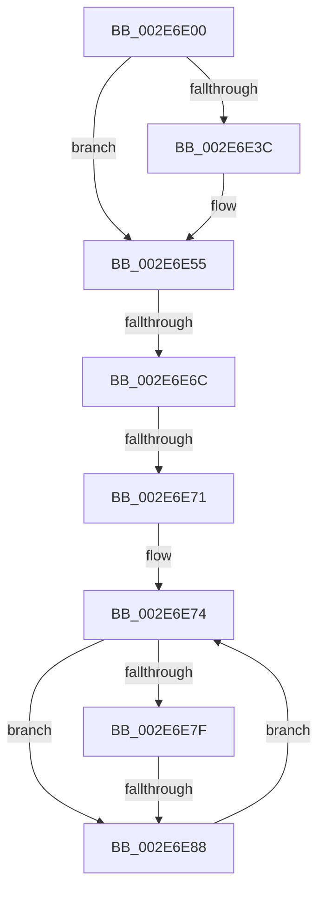

# RtlpHpVsSlotCompactChunks

- RVA: `0x002E6E00`–`0x002E6E90` (길이 `144` bytes)
- VA: `0x00000001402E6E00`
- 실행 섹션: `.text`
- PDB 이름 있음: `예`; PDB Function 태그: `아니요`
- unwind 정보 RVA: `0x00071280`
- 디코드: `42`개 명령, `144/144` bytes 표시
- 미해석 바이트: `0` (있으면 어셈블리에 `.byte`로 보존)

> 이 문서는 커널 이미지의 기계어와 PDB 기호를 분석해 생성했습니다. 4번과 5번은 함수 원형과 자료형을 바이너리 사용 방식에서 추정한 C 해석이며 원본 소스 복구 결과는 아닙니다.

## 1. Dependencies

- 직접 호출 지점: **1**; 고유 호출 대상: **1**
- 직접 호출자로 확인된 함수: **1**
- RIP 상대 이미지 참조: **0**

### Outgoing calls
- `0x002E6E48` → [RtlpHpAcquireQueuedLockExclusive](../32/RtlpHpAcquireQueuedLockExclusive_function_00324820.md) (function, `0x00324820`)

### Direct callers
- [RtlpHpVsContextCompact](RtlpHpVsContextCompact_function_002E7524.md) at `0x002E75A3`

### Static image references
- 디코드된 RIP-relative 메모리 참조가 없습니다.

## 2. Other-region calls and transfers

- 다른 실행 섹션으로 향하는 call: **0**
- call이 아닌 외부 분기/꼬리 이동: **3**
  - `0x002E6E66` → [sub_002E7362](Unknown_function_002E7362.md) (`tail-transfer`)
  - `0x002E6E6F` → [sub_002E6E90](Unknown_function_002E6E90.md) (`tail-transfer`)
  - `0x002E6E82` → [sub_002E7388](Unknown_function_002E7388.md) (`tail-transfer`)

## 3. Assembly (complete function range)

```asm
002E6E00  4C 8B DC                        mov r11, rsp
002E6E03  49 89 53 10                     mov qword ptr [r11 + 0x10], rdx
002E6E07  53                              push rbx
002E6E08  41 54                           push r12
002E6E0A  41 55                           push r13
002E6E0C  41 56                           push r14
002E6E0E  48 83 EC 68                     sub rsp, 0x68
002E6E12  33 C0                           xor eax, eax
002E6E14  0F 57 C0                        xorps xmm0, xmm0
002E6E17  F6 41 05 01                     test byte ptr [rcx + 5], 1
002E6E1B  4C 8B D2                        mov r10, rdx
002E6E1E  0F 11 44 24 40                  movups xmmword ptr [rsp + 0x40], xmm0
002E6E23  49 89 43 C8                     mov qword ptr [r11 - 0x38], rax
002E6E27  4C 8B E9                        mov r13, rcx
002E6E2A  49 8D 43 A8                     lea rax, [r11 - 0x58]
002E6E2E  49 89 43 B0                     mov qword ptr [r11 - 0x50], rax
002E6E32  49 8D 43 A8                     lea rax, [r11 - 0x58]
002E6E36  49 89 43 A8                     mov qword ptr [r11 - 0x58], rax
002E6E3A  75 19                           jne 0x1402e6e55
002E6E3C  0F B6 51 03                     movzx edx, byte ptr [rcx + 3]
002E6E40  4D 8D 43 B8                     lea r8, [r11 - 0x48]
002E6E44  49 8D 4A 08                     lea rcx, [r10 + 8]
002E6E48  E8 D3 D9 03 00                  call 0x140324820
002E6E4D  4C 8B 94 24 98 00 00 00         mov r10, qword ptr [rsp + 0x98]
002E6E55  49 8B 52 18                     mov rdx, qword ptr [r10 + 0x18]
002E6E59  4D 8D 62 10                     lea r12, [r10 + 0x10]
002E6E5D  49 8B 04 24                     mov rax, qword ptr [r12]
002E6E61  33 DB                           xor ebx, ebx
002E6E63  F6 C2 01                        test dl, 1
002E6E66  0F 85 F6 04 00 00               jne 0x1402e7362
002E6E6C  48 85 C0                        test rax, rax
002E6E6F  74 1F                           je 0x1402e6e90
002E6E71  80 E2 01                        and dl, 1
002E6E74  48 8B 48 08                     mov rcx, qword ptr [rax + 8]
002E6E78  48 8B D8                        mov rbx, rax
002E6E7B  84 D2                           test dl, dl
002E6E7D  74 09                           je 0x1402e6e88
002E6E7F  48 85 C9                        test rcx, rcx
002E6E82  0F 85 00 05 00 00               jne 0x1402e7388
002E6E88  48 8B C1                        mov rax, rcx
002E6E8B  48 85 C0                        test rax, rax
002E6E8E  75 E4                           jne 0x1402e6e74
```

## 4. C-style interpretation (structured pseudocode)

```c
__int64 __fastcall RtlpHpVsSlotCompactChunks(__int64 a1, __int64 a2)
{
    __int64 result;
    __int64 v_r10;
    __int64 v_rbx;
    __int64 v_rsp;
    unsigned __int64 v_stack_m48;
    unsigned __int64 v_stack_p10;

    *(unsigned __int64 *)(v_rsp + 16) = a2;
    v_rsp = (v_rsp) - (104);
    result = 0;
    v_stack_m48 = v_xmm0;
    *(unsigned __int64 *)(v_rsp - 56) = 0;
    *(unsigned __int64 *)(v_rsp - 80) = v_rsp - 88;
    *(unsigned __int64 *)(v_rsp - 88) = v_rsp - 88;
    result = v_rsp - 88;
    v_r10 = a2;
    if (((*(unsigned __int8 *)(a1 + 5)) & (1)) == 0) {
        a2 = *(unsigned __int8 *)(a1 + 3);
        a3 = v_rsp - 72;
        a1 = a2 + 8;
        result = RtlpHpAcquireQueuedLockExclusive(a1, a2, a3, a4);
        v_r10 = v_stack_p10;
    }
    v_rbx = 0;
    a2 = (unsigned __int8)((*(unsigned __int64 *)(v_r10 + 24)) & (1));
loc_002E6E74:
    if ((unsigned __int8)(a2) == 0) goto loc_002E6E88;
loc_002E6E88:
    if (*(unsigned __int64 *)(*(unsigned __int64 *)(v_r10 + 16) + 8) != 0) goto loc_002E6E74;
}
```

## 5. (Beta) C Style

```c
int64_t RtlpHpVsSlotCompactChunks(void *Arg1, void *Arg2)
{
    uint8_t *arg1 = (uint8_t *)Arg1;
    uint8_t *arg2 = (uint8_t *)Arg2;

    int64_t result;
    int64_t local_r10;
    int64_t local_rbx;
    int64_t local_rsp;
    uint64_t v_stack_m48;
    uint64_t v_stack_p10;

    *(void **)(local_rsp + 0x10) = Arg2;
    local_rsp = (local_rsp) - (104);
    result = 0;
    v_stack_m48 = v_xmm0;
    *(uint64_t *)(local_rsp - 0x38) = 0;
    *(uint64_t *)(local_rsp - 0x50) = local_rsp - 88;
    *(uint64_t *)(local_rsp - 0x58) = local_rsp - 88;
    result = local_rsp - 88;
    local_r10 = Arg2;
    if (((*(uint8_t *)(arg1 + 0x5)) & (1)) == 0) {
        Arg2 = *(uint8_t *)(arg1 + 0x3);
        a3 = local_rsp - 72;
        Arg1 = Arg2 + 8;
        result = RtlpHpAcquireQueuedLockExclusive(Arg1, Arg2, a3, a4);
        local_r10 = v_stack_p10;
    }
    local_rbx = 0;
    Arg2 = (uint8_t)((*(uint64_t *)(local_r10 + 0x18)) & (1));
loc_002E6E74:
    if ((uint8_t)(Arg2) == 0) goto loc_002E6E88;
loc_002E6E88:
    if (*(uint64_t *)(*(uint64_t *)(local_r10 + 0x10) + 0x8) != 0) goto loc_002E6E74;
}
```

### 관측된 메모리 오프셋

구조체 형식이 확인되지 않은 접근은 인자 기준의 오프셋으로만 기록했습니다.

| 기준 인자 | 오프셋 표현 | 폭 (bit) | 접근 |
|---|---:|---:|---|
| `Arg1` | `+ 0x3` | `8` | `R` |
| `Arg1` | `+ 0x5` | `8` | `R` |
| `Arg2` | `+ 0x8` | `64` | `R` |

## 6. Execution-region graph

[열기: 2D/3D 그래프와 함수 탐색 컨트롤 패널](../../../control-panel.html?section=text&rva=0x002E6E00&view=graph)

- 2D 그래프는 위에서 아래로 흐르고, 3D 그래프는 빈 공간을 드래그해 회전합니다. Shift+드래그는 이동, 휠은 확대·축소, 함수 노드 선택은 대상 보고서 이동입니다.

### Static fallback


