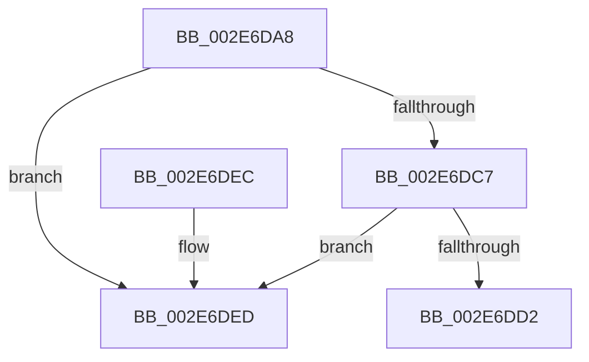

# RtlpHpVsSubsegmentCleanup

- RVA: `0x002E6DA8`–`0x002E6DF4` (길이 `76` bytes)
- VA: `0x00000001402E6DA8`
- 실행 섹션: `.text`
- PDB 이름 있음: `예`; PDB Function 태그: `아니요`
- unwind 정보 RVA: `0x000DB714`
- 디코드: `25`개 명령, `76/76` bytes 표시
- 미해석 바이트: `0` (있으면 어셈블리에 `.byte`로 보존)

> 이 문서는 커널 이미지의 기계어와 PDB 기호를 분석해 생성했습니다. 4번과 5번은 함수 원형과 자료형을 바이너리 사용 방식에서 추정한 C 해석이며 원본 소스 복구 결과는 아닙니다.

## 1. Dependencies

- 직접 호출 지점: **0**; 고유 호출 대상: **0**
- 직접 호출자로 확인된 함수: **3**
- RIP 상대 이미지 참조: **0**

### Outgoing calls
- 직접 디코드된 call 명령이 없습니다.

### Direct callers
- [RtlpHpVsChunkFree](RtlpHpVsChunkFree_function_002E3980.md) at `0x002E42FD`
- [RtlpHpVsChunkSplit](RtlpHpVsChunkSplit_function_002E5C80.md) at `0x002E6AE0`
- [RtlpHpVsContextCleanup](../60/RtlpHpVsContextCleanup_function_00605644.md) at `0x006056A7`

### Static image references
- 디코드된 RIP-relative 메모리 참조가 없습니다.

## 2. Other-region calls and transfers

- 다른 실행 섹션으로 향하는 call: **0**
- 별도 외부 분기/꼬리 이동을 확인하지 못했습니다.

## 3. Assembly (complete function range)

```asm
002E6DA8  4C 8B CA                        mov r9, rdx
002E6DAB  4C 8B D1                        mov r10, rcx
002E6DAE  4C 33 0A                        xor r9, qword ptr [rdx]
002E6DB1  4C 8B C2                        mov r8, rdx
002E6DB4  4C 33 42 08                     xor r8, qword ptr [rdx + 8]
002E6DB8  49 8B C1                        mov rax, r9
002E6DBB  49 8D 49 08                     lea rcx, [r9 + 8]
002E6DBF  48 33 01                        xor rax, qword ptr [rcx]
002E6DC2  48 3B C2                        cmp rax, rdx
002E6DC5  75 26                           jne 0x1402e6ded
002E6DC7  49 8B C0                        mov rax, r8
002E6DCA  49 33 00                        xor rax, qword ptr [r8]
002E6DCD  48 3B C2                        cmp rax, rdx
002E6DD0  75 1B                           jne 0x1402e6ded
002E6DD2  4D 33 C8                        xor r9, r8
002E6DD5  4D 89 08                        mov qword ptr [r8], r9
002E6DD8  4C 89 09                        mov qword ptr [rcx], r9
002E6DDB  F3 48 0F B8 42 10               popcnt rax, qword ptr [rdx + 0x10]
002E6DE1  F7 D8                           neg eax
002E6DE3  48 63 C8                        movsxd rcx, eax
002E6DE6  F0 49 01 4A 50                  lock add qword ptr [r10 + 0x50], rcx
002E6DEB  C3                              ret
002E6DEC  CC                              int3
002E6DED  B9 03 00 00 00                  mov ecx, 3
002E6DF2  CD 29                           int 0x29
```

## 4. C-style interpretation (structured pseudocode)

```c
__int64 __fastcall RtlpHpVsSubsegmentCleanup(__int64 a1, __int64 a2)
{
    __int64 result;

    a4 = (a2) ^ (*(unsigned __int64 *)(a2));
    a3 = (a2) ^ (*(unsigned __int64 *)(a2 + 8));
    result = (a4) ^ (*(unsigned __int64 *)(a4 + 8));
    if (result != a2) goto loc_002E6DED;
    result = (a3) ^ (*(unsigned __int64 *)(a3));
    if (result != a2) goto loc_002E6DED;
    a4 = (a4) ^ (a3);
    *(unsigned __int64 *)(a3) = a4;
    *(unsigned __int64 *)(a4 + 8) = a4;
    result = (unsigned int)(-(result));
    return result;
loc_002E6DED:
    return result;
}
```

## 5. (Beta) C Style

```c
int64_t RtlpHpVsSubsegmentCleanup(void *Arg1, void *Arg2)
{
    uint8_t *arg1 = (uint8_t *)Arg1;
    uint8_t *arg2 = (uint8_t *)Arg2;

    int64_t result;

    a4 = (Arg2) ^ (*(uint64_t *)(arg2));
    a3 = (Arg2) ^ (*(uint64_t *)(arg2 + 0x8));
    result = (a4) ^ (*(uint64_t *)(a4 + 0x8));
    if (result != Arg2) goto loc_002E6DED;
    result = (a3) ^ (*(uint64_t *)(a3));
    if (result != Arg2) goto loc_002E6DED;
    a4 = (a4) ^ (a3);
    *(uint64_t *)(a3) = a4;
    *(uint64_t *)(a4 + 0x8) = a4;
    result = (uint32_t)(-(result));
    return result;
loc_002E6DED:
    return result;
}
```

### 관측된 메모리 오프셋

구조체 형식이 확인되지 않은 접근은 인자 기준의 오프셋으로만 기록했습니다.

| 기준 인자 | 오프셋 표현 | 폭 (bit) | 접근 |
|---|---:|---:|---|
| `Arg1` | `+ 0x50` | `64` | `R/W` |
| `Arg2` | `+ 0x0` | `64` | `R` |
| `Arg2` | `+ 0x0` | `64` | `W` |
| `Arg2` | `+ 0x8` | `64` | `R` |
| `Arg2` | `+ 0x10` | `64` | `R` |

## 6. Execution-region graph

[열기: 2D/3D 그래프와 함수 탐색 컨트롤 패널](../../../control-panel.html?section=text&rva=0x002E6DA8&view=graph)

- 2D 그래프는 위에서 아래로 흐르고, 3D 그래프는 빈 공간을 드래그해 회전합니다. Shift+드래그는 이동, 휠은 확대·축소, 함수 노드 선택은 대상 보고서 이동입니다.

### Static fallback


