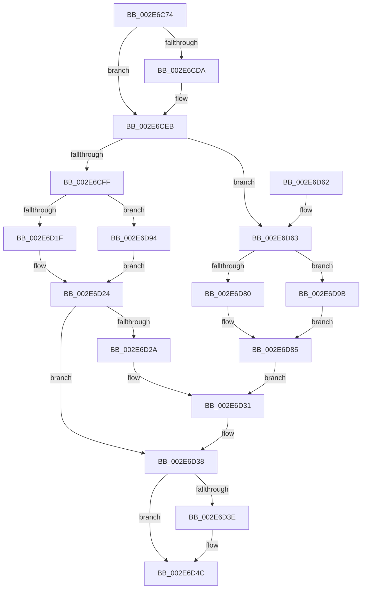

# RtlpHpVsSubsegmentCommitPages

- RVA: `0x002E6C74`–`0x002E6DA2` (길이 `302` bytes)
- VA: `0x00000001402E6C74`
- 실행 섹션: `.text`
- PDB 이름 있음: `예`; PDB Function 태그: `아니요`
- unwind 정보 RVA: `0x00071268`
- 디코드: `90`개 명령, `302/302` bytes 표시
- 미해석 바이트: `0` (있으면 어셈블리에 `.byte`로 보존)

> 이 문서는 커널 이미지의 기계어와 PDB 기호를 분석해 생성했습니다. 4번과 5번은 함수 원형과 자료형을 바이너리 사용 방식에서 추정한 C 해석이며 원본 소스 복구 결과는 아닙니다.

## 1. Dependencies

- 직접 호출 지점: **6**; 고유 호출 대상: **5**
- 직접 호출자로 확인된 함수: **2**
- RIP 상대 이미지 참조: **3**

### Outgoing calls
- `0x002E6CE6` → [RtlpHpAcquireQueuedLockExclusive](../32/RtlpHpAcquireQueuedLockExclusive_function_00324820.md) (function, `0x00324820`)
- `0x002E6D1F` → [RtlpHpSegLfhVsCommit](../32/RtlpHpSegLfhVsCommit_function_00325750.md) (function, `0x00325750`)
- `0x002E6D47` → [RtlpHpReleaseQueuedLockExclusive](RtlpHpReleaseQueuedLockExclusive_function_002E2A70.md) (function, `0x002E2A70`)
- `0x002E6D80` → [RtlpHpSegLfhVsDecommit](../32/RtlpHpSegLfhVsDecommit_function_003243F0.md) (function, `0x003243F0`)
- `0x002E6D94` → [guard_dispatch_icall](../6B/guard_dispatch_icall_function_006BAAD0.md) (function, `0x006BAAD0`)
- `0x002E6D9B` → [guard_dispatch_icall](../6B/guard_dispatch_icall_function_006BAAD0.md) (function, `0x006BAAD0`)

### Direct callers
- [RtlpHpVsChunkFree](RtlpHpVsChunkFree_function_002E3980.md) at `0x002E40F3`
- [RtlpHpVsChunkSplit](RtlpHpVsChunkSplit_function_002E5C80.md) at `0x002E670C`

### Static image references
- `0x002E6D03` → RVA `0x00325750` (`RtlpHpSegLfhVsCommit`; read)
- `0x002E6D0A` → RVA `0x00E28300` (`.data`; read)
- `0x002E6D67` → RVA `0x003243F0` (`RtlpHpSegLfhVsDecommit`; read)

## 2. Other-region calls and transfers

- 다른 실행 섹션으로 향하는 call: **0**
- 별도 외부 분기/꼬리 이동을 확인하지 못했습니다.

## 3. Assembly (complete function range)

```asm
002E6C74  4C 8B DC                        mov r11, rsp
002E6C77  49 89 5B 18                     mov qword ptr [r11 + 0x18], rbx
002E6C7B  55                              push rbp
002E6C7C  56                              push rsi
002E6C7D  57                              push rdi
002E6C7E  41 56                           push r14
002E6C80  41 57                           push r15
002E6C82  48 83 EC 50                     sub rsp, 0x50
002E6C86  4D 0F BC D0                     bsf r10, r8
002E6C8A  33 C0                           xor eax, eax
002E6C8C  45 8B F1                        mov r14d, r9d
002E6C8F  48 8B D9                        mov rbx, rcx
002E6C92  45 89 53 08                     mov dword ptr [r11 + 8], r10d
002E6C96  41 8B FA                        mov edi, r10d
002E6C99  0F 57 C0                        xorps xmm0, xmm0
002E6C9C  C1 E7 0C                        shl edi, 0xc
002E6C9F  BD 01 00 00 00                  mov ebp, 1
002E6CA4  0F 11 44 24 30                  movups xmmword ptr [rsp + 0x30], xmm0
002E6CA9  49 89 43 C8                     mov qword ptr [r11 - 0x38], rax
002E6CAD  48 03 FA                        add rdi, rdx
002E6CB0  49 0F BD C0                     bsr rax, r8
002E6CB4  48 8B F2                        mov rsi, rdx
002E6CB7  41 89 43 10                     mov dword ptr [r11 + 0x10], eax
002E6CBB  41 2B C2                        sub eax, r10d
002E6CBE  8D 48 01                        lea ecx, [rax + 1]
002E6CC1  48 D3 E5                        shl rbp, cl
002E6CC4  44 8B F9                        mov r15d, ecx
002E6CC7  48 FF CD                        dec rbp
002E6CCA  41 C1 E7 0C                     shl r15d, 0xc
002E6CCE  41 8B CA                        mov ecx, r10d
002E6CD1  48 D3 E5                        shl rbp, cl
002E6CD4  F6 43 05 01                     test byte ptr [rbx + 5], 1
002E6CD8  75 11                           jne 0x1402e6ceb
002E6CDA  0F B6 53 03                     movzx edx, byte ptr [rbx + 3]
002E6CDE  48 8D 4E 18                     lea rcx, [rsi + 0x18]
002E6CE2  4D 8D 43 B8                     lea r8, [r11 - 0x48]
002E6CE6  E8 35 DB 03 00                  call 0x140324820
002E6CEB  48 8B 4B 08                     mov rcx, qword ptr [rbx + 8]
002E6CEF  45 8B C7                        mov r8d, r15d
002E6CF2  48 33 CB                        xor rcx, rbx
002E6CF5  83 BC 24 A0 00 00 00 00         cmp dword ptr [rsp + 0xa0], 0
002E6CFD  74 64                           je 0x1402e6d63
002E6CFF  48 8B 43 20                     mov rax, qword ptr [rbx + 0x20]
002E6D03  48 8D 15 46 EA 03 00            lea rdx, [rip + 0x3ea46]
002E6D0A  48 33 05 EF 15 B4 00            xor rax, qword ptr [rip + 0xb415ef]
002E6D11  45 33 C9                        xor r9d, r9d
002E6D14  48 33 C3                        xor rax, rbx
002E6D17  48 3B C2                        cmp rax, rdx
002E6D1A  48 8B D7                        mov rdx, rdi
002E6D1D  75 75                           jne 0x1402e6d94
002E6D1F  E8 2C EA 03 00                  call 0x140325750
002E6D24  8B F8                           mov edi, eax
002E6D26  85 C0                           test eax, eax
002E6D28  78 0E                           js 0x1402e6d38
002E6D2A  48 09 6E 10                     or qword ptr [rsi + 0x10], rbp
002E6D2E  49 8B C6                        mov rax, r14
002E6D31  F0 48 01 43 50                  lock add qword ptr [rbx + 0x50], rax
002E6D36  33 FF                           xor edi, edi
002E6D38  F6 43 05 01                     test byte ptr [rbx + 5], 1
002E6D3C  75 0E                           jne 0x1402e6d4c
002E6D3E  0F B6 4B 03                     movzx ecx, byte ptr [rbx + 3]
002E6D42  48 8D 54 24 30                  lea rdx, [rsp + 0x30]
002E6D47  E8 24 BD FF FF                  call 0x1402e2a70
002E6D4C  48 8B 9C 24 90 00 00 00         mov rbx, qword ptr [rsp + 0x90]
002E6D54  8B C7                           mov eax, edi
002E6D56  48 83 C4 50                     add rsp, 0x50
002E6D5A  41 5F                           pop r15
002E6D5C  41 5E                           pop r14
002E6D5E  5F                              pop rdi
002E6D5F  5E                              pop rsi
002E6D60  5D                              pop rbp
002E6D61  C3                              ret
002E6D62  CC                              int3
002E6D63  48 8B 43 28                     mov rax, qword ptr [rbx + 0x28]
002E6D67  48 8D 15 82 D6 03 00            lea rdx, [rip + 0x3d682]
002E6D6E  48 33 05 8B 15 B4 00            xor rax, qword ptr [rip + 0xb4158b]
002E6D75  48 33 C3                        xor rax, rbx
002E6D78  48 3B C2                        cmp rax, rdx
002E6D7B  48 8B D7                        mov rdx, rdi
002E6D7E  75 1B                           jne 0x1402e6d9b
002E6D80  E8 6B D6 03 00                  call 0x1403243f0
002E6D85  48 F7 D5                        not rbp
002E6D88  48 21 6E 10                     and qword ptr [rsi + 0x10], rbp
002E6D8C  41 F7 DE                        neg r14d
002E6D8F  49 63 C6                        movsxd rax, r14d
002E6D92  EB 9D                           jmp 0x1402e6d31
002E6D94  E8 37 3D 3D 00                  call 0x1406baad0
002E6D99  EB 89                           jmp 0x1402e6d24
002E6D9B  E8 30 3D 3D 00                  call 0x1406baad0
002E6DA0  EB E3                           jmp 0x1402e6d85
```

## 4. C-style interpretation (structured pseudocode)

```c
__int64 __fastcall RtlpHpVsSubsegmentCommitPages(__int64 a1, __int64 a2, __int64 a3, int a4, unsigned int a5)
{
    __int64 result;
    __int64 v_r14;
    __int64 v_r15;
    __int64 v_rbp;
    __int64 v_rdi;
    __int64 v_rsp;
    unsigned __int64 v_stack_m48;
    unsigned __int64 v_stack_p18;

    *(unsigned __int64 *)(v_rsp + 24) = v_rbx;
    v_rsp = (v_rsp) - (80);
    result = 0;
    *(unsigned int *)(v_rsp + 8) = (unsigned int)(v_r10);
    v_rdi = (unsigned int)(((unsigned int)((unsigned int)(v_r10))) << (12));
    v_stack_m48 = v_xmm0;
    *(unsigned __int64 *)(v_rsp - 56) = 0;
    v_rdi = (v_rdi) + (a2);
    *(unsigned int *)(v_rsp + 16) = 0;
    result = (unsigned int)((result) - ((unsigned int)(v_r10)));
    v_rbp = (1) << ((unsigned __int8)(result + 1));
    v_rbp = (v_rbp) - 1;
    v_r15 = (unsigned int)(((unsigned int)((unsigned int)(result + 1))) << (12));
    v_rbp = (v_rbp) << ((unsigned __int8)((unsigned int)((unsigned int)(v_r10))));
    if (((*(unsigned __int8 *)(a1 + 5)) & (1)) == 0) {
        a2 = *(unsigned __int8 *)(a1 + 3);
        a1 = a2 + 24;
        a3 = v_rsp - 72;
        result = RtlpHpAcquireQueuedLockExclusive(a1, a2, a3, a4);
    }
    a1 = (*(unsigned __int64 *)(a1 + 8)) ^ (a1);
    if (a5 == 0) goto loc_002E6D63;
    result = (*(unsigned __int64 *)(a1 + 32)) ^ (*(unsigned __int64 *)(v_rip + 11802095));
    a4 = 0;
    result = (result) ^ (a1);
    if (result != (v_rip + 256582)) goto loc_002E6D94;
    result = RtlpHpSegLfhVsCommit(a1, v_rdi, (unsigned int)((unsigned int)(v_r15)), a4);
loc_002E6D24:
    if (sign_flag) goto loc_002E6D38;
loc_002E6D31:
    v_rdi = 0;
loc_002E6D38:
    result = (unsigned int)(a4);
    if (((*(unsigned __int8 *)(a1 + 5)) & (1)) == 0) {
        a1 = *(unsigned __int8 *)(a1 + 3);
        a2 = v_stack_m48;
        result = RtlpHpReleaseQueuedLockExclusive(a1, a2, (unsigned int)((unsigned int)(v_r15)), a4);
    }
    v_rsp = (v_rsp) + (80);
    return 0;
loc_002E6D63:
    result = (*(unsigned __int64 *)(v_stack_p18 + 40)) ^ (*(unsigned __int64 *)(v_rip + 11801995));
    result = (result) ^ (v_stack_p18);
    if (result != (v_rip + 251522)) goto loc_002E6D9B;
    result = RtlpHpSegLfhVsDecommit(a1, 0, (unsigned int)((unsigned int)(v_r15)), a4);
loc_002E6D85:
    v_rbp = ~(v_rbp);
    v_r14 = (unsigned int)(-((unsigned int)(a4)));
    goto loc_002E6D31;
loc_002E6D94:
    result = guard_dispatch_icall(a1, 0, (unsigned int)((unsigned int)(v_r15)), a4);
    goto loc_002E6D24;
loc_002E6D9B:
    result = guard_dispatch_icall(a1, 0, (unsigned int)((unsigned int)(v_r15)), a4);
    goto loc_002E6D85;
}
```

## 5. (Beta) C Style

```c
int64_t RtlpHpVsSubsegmentCommitPages(void *Arg1, void *Arg2, int64_t Arg3, int32_t Arg4, uint32_t Arg5)
{
    uint8_t *arg1 = (uint8_t *)Arg1;
    uint8_t *arg2 = (uint8_t *)Arg2;

    int64_t result;
    int64_t local_r14;
    int64_t local_r15;
    int64_t local_rbp;
    int64_t local_rdi;
    int64_t local_rsp;
    uint64_t v_stack_m48;
    uint64_t v_stack_p18;

    *(uint64_t *)(local_rsp + 0x18) = local_rbx;
    local_rsp = (local_rsp) - (80);
    result = 0;
    *(uint32_t *)(local_rsp + 0x8) = (uint32_t)(local_r10);
    local_rdi = (uint32_t)(((uint32_t)((uint32_t)(local_r10))) << (12));
    v_stack_m48 = v_xmm0;
    *(uint64_t *)(local_rsp - 0x38) = 0;
    local_rdi = (local_rdi) + (Arg2);
    *(uint32_t *)(local_rsp + 0x10) = 0;
    result = (uint32_t)((result) - ((uint32_t)(local_r10)));
    local_rbp = (1) << ((uint8_t)(result + 1));
    local_rbp = (local_rbp) - 1;
    local_r15 = (uint32_t)(((uint32_t)((uint32_t)(result + 1))) << (12));
    local_rbp = (local_rbp) << ((uint8_t)((uint32_t)((uint32_t)(local_r10))));
    if (((*(uint8_t *)(arg1 + 0x5)) & (1)) == 0) {
        Arg2 = *(uint8_t *)(arg1 + 0x3);
        Arg1 = Arg2 + 24;
        Arg3 = local_rsp - 72;
        result = RtlpHpAcquireQueuedLockExclusive(Arg1, Arg2, Arg3, Arg4);
    }
    Arg1 = (*(uint64_t *)(arg1 + 0x8)) ^ (Arg1);
    if (Arg5 == 0) goto loc_002E6D63;
    result = (*(uint64_t *)(arg1 + 0x20)) ^ (*(uint64_t *)(v_rip + 0xB415EF));
    Arg4 = 0;
    result = (result) ^ (Arg1);
    if (result != (v_rip + 256582)) goto loc_002E6D94;
    result = RtlpHpSegLfhVsCommit(Arg1, local_rdi, (uint32_t)((uint32_t)(local_r15)), Arg4);
loc_002E6D24:
    if (sign_flag) goto loc_002E6D38;
loc_002E6D31:
    local_rdi = 0;
loc_002E6D38:
    result = (uint32_t)(Arg4);
    if (((*(uint8_t *)(arg1 + 0x5)) & (1)) == 0) {
        Arg1 = *(uint8_t *)(arg1 + 0x3);
        Arg2 = v_stack_m48;
        result = RtlpHpReleaseQueuedLockExclusive(Arg1, Arg2, (uint32_t)((uint32_t)(local_r15)), Arg4);
    }
    local_rsp = (local_rsp) + (80);
    return 0;
loc_002E6D63:
    result = (*(uint64_t *)(v_stack_p18 + 0x28)) ^ (*(uint64_t *)(v_rip + 0xB4158B));
    result = (result) ^ (v_stack_p18);
    if (result != (v_rip + 251522)) goto loc_002E6D9B;
    result = RtlpHpSegLfhVsDecommit(Arg1, 0, (uint32_t)((uint32_t)(local_r15)), Arg4);
loc_002E6D85:
    local_rbp = ~(local_rbp);
    local_r14 = (uint32_t)(-((uint32_t)(Arg4)));
    goto loc_002E6D31;
loc_002E6D94:
    result = guard_dispatch_icall(Arg1, 0, (uint32_t)((uint32_t)(local_r15)), Arg4);
    goto loc_002E6D24;
loc_002E6D9B:
    result = guard_dispatch_icall(Arg1, 0, (uint32_t)((uint32_t)(local_r15)), Arg4);
    goto loc_002E6D85;
}
```

### 관측된 메모리 오프셋

구조체 형식이 확인되지 않은 접근은 인자 기준의 오프셋으로만 기록했습니다.

| 기준 인자 | 오프셋 표현 | 폭 (bit) | 접근 |
|---|---:|---:|---|
| `Arg1` | `+ 0x3` | `8` | `R` |
| `Arg1` | `+ 0x5` | `8` | `R` |
| `Arg1` | `+ 0x8` | `64` | `R` |
| `Arg1` | `+ 0x20` | `64` | `R` |
| `Arg1` | `+ 0x28` | `64` | `R` |
| `Arg1` | `+ 0x50` | `64` | `R/W` |
| `Arg2` | `+ 0x10` | `64` | `R/W` |
| `Arg2` | `+ 0x18` | `64` | `R` |

## 6. Execution-region graph

[열기: 2D/3D 그래프와 함수 탐색 컨트롤 패널](../../../control-panel.html?section=text&rva=0x002E6C74&view=graph)

- 2D 그래프는 위에서 아래로 흐르고, 3D 그래프는 빈 공간을 드래그해 회전합니다. Shift+드래그는 이동, 휠은 확대·축소, 함수 노드 선택은 대상 보고서 이동입니다.

### Static fallback


