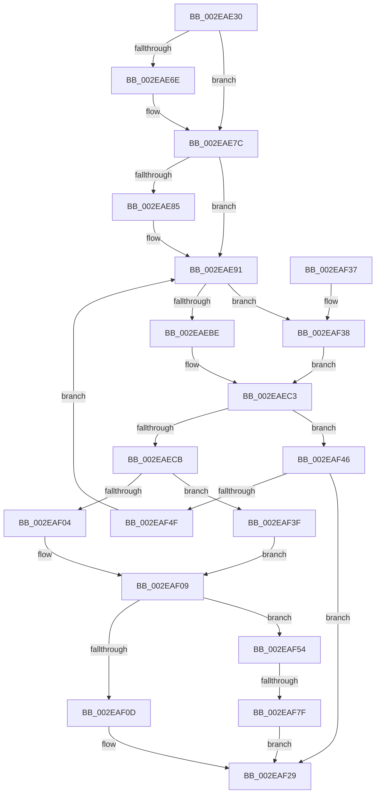

# RtlpHpVsSubsegmentCreate

- RVA: `0x002EAE30`–`0x002EAF86` (길이 `342` bytes)
- VA: `0x00000001402EAE30`
- 실행 섹션: `.text`
- PDB 이름 있음: `예`; PDB Function 태그: `예`
- unwind 정보 RVA: `0x000715E8`
- 디코드: `101`개 명령, `342/342` bytes 표시
- 미해석 바이트: `0` (있으면 어셈블리에 `.byte`로 보존)

> 이 문서는 커널 이미지의 기계어와 PDB 기호를 분석해 생성했습니다. 4번과 5번은 함수 원형과 자료형을 바이너리 사용 방식에서 추정한 C 해석이며 원본 소스 복구 결과는 아닙니다.

## 1. Dependencies

- 직접 호출 지점: **6**; 고유 호출 대상: **5**
- 직접 호출자로 확인된 함수: **1**
- RIP 상대 이미지 참조: **4**

### Outgoing calls
- `0x002EAEBE` → [RtlpHpSegVsAllocate](RtlpHpSegVsAllocate_function_002EB320.md) (function, `0x002EB320`)
- `0x002EAF04` → [RtlpHpSegLfhVsCommit](../32/RtlpHpSegLfhVsCommit_function_00325750.md) (function, `0x00325750`)
- `0x002EAF21` → [RtlpHpVsSubsegmentInitialize](RtlpHpVsSubsegmentInitialize_function_002EB3FC.md) (function, `0x002EB3FC`)
- `0x002EAF38` → [guard_dispatch_icall](../6B/guard_dispatch_icall_function_006BAAD0.md) (function, `0x006BAAD0`)
- `0x002EAF3F` → [guard_dispatch_icall](../6B/guard_dispatch_icall_function_006BAAD0.md) (function, `0x006BAAD0`)
- `0x002EAF7F` → [RtlpHpSegLfhVsFree](RtlpHpSegLfhVsFree_function_002E7DF0.md) (function, `0x002E7DF0`)

### Direct callers
- [RtlpHpVsSlotAllocate](RtlpHpVsSlotAllocate_function_002EAB38.md) at `0x002EAD04`

### Static image references
- `0x002EAE95` → RVA `0x002EB320` (`RtlpHpSegVsAllocate`; read)
- `0x002EAE9C` → RVA `0x00E28300` (`.data`; read)
- `0x002EAED0` → RVA `0x00325750` (`RtlpHpSegLfhVsCommit`; read)
- `0x002EAF58` → RVA `0x002E7DF0` (`RtlpHpSegLfhVsFree`; read)

## 2. Other-region calls and transfers

- 다른 실행 섹션으로 향하는 call: **0**
- call이 아닌 외부 분기/꼬리 이동: **1**
  - `0x002EAF79` → [sub_006DE674](../6D/Unknown_function_006DE674.md) (`tail-transfer`)

## 3. Assembly (complete function range)

```asm
002EAE30  40 53                           push rbx
002EAE32  55                              push rbp
002EAE33  56                              push rsi
002EAE34  57                              push rdi
002EAE35  41 56                           push r14
002EAE37  48 83 EC 30                     sub rsp, 0x30
002EAE3B  33 FF                           xor edi, edi
002EAE3D  44 8B F2                        mov r14d, edx
002EAE40  41 C1 E6 04                     shl r14d, 4
002EAE44  48 8B F1                        mov rsi, rcx
002EAE47  C1 E2 05                        shl edx, 5
002EAE4A  41 81 C6 2F 10 00 00            add r14d, 0x102f
002EAE51  83 C2 30                        add edx, 0x30
002EAE54  89 7C 24 68                     mov dword ptr [rsp + 0x68], edi
002EAE58  41 81 E6 00 F0 FF FF            and r14d, 0xfffff000
002EAE5F  89 7C 24 60                     mov dword ptr [rsp + 0x60], edi
002EAE63  89 7C 24 70                     mov dword ptr [rsp + 0x70], edi
002EAE67  8D 42 FF                        lea eax, [rdx - 1]
002EAE6A  85 C2                           test edx, eax
002EAE6C  74 0E                           je 0x1402eae7c
002EAE6E  0F BD CA                        bsr ecx, edx
002EAE71  8D 57 01                        lea edx, [rdi + 1]
002EAE74  89 4C 24 70                     mov dword ptr [rsp + 0x70], ecx
002EAE78  FF C1                           inc ecx
002EAE7A  D3 E2                           shl edx, cl
002EAE7C  BB 00 00 01 00                  mov ebx, 0x10000
002EAE81  3B D3                           cmp edx, ebx
002EAE83  76 0C                           jbe 0x1402eae91
002EAE85  B8 00 00 04 00                  mov eax, 0x40000
002EAE8A  8B DA                           mov ebx, edx
002EAE8C  3B D0                           cmp edx, eax
002EAE8E  0F 43 D8                        cmovae ebx, eax
002EAE91  48 8B 46 10                     mov rax, qword ptr [rsi + 0x10]
002EAE95  48 8D 15 84 04 00 00            lea rdx, [rip + 0x484]
002EAE9C  48 33 05 5D D4 B3 00            xor rax, qword ptr [rip + 0xb3d45d]
002EAEA3  4C 8D 4C 24 68                  lea r9, [rsp + 0x68]
002EAEA8  48 8B CE                        mov rcx, rsi
002EAEAB  4C 8D 44 24 60                  lea r8, [rsp + 0x60]
002EAEB0  48 33 4E 08                     xor rcx, qword ptr [rsi + 8]
002EAEB4  48 33 C6                        xor rax, rsi
002EAEB7  48 3B C2                        cmp rax, rdx
002EAEBA  8B D3                           mov edx, ebx
002EAEBC  75 7A                           jne 0x1402eaf38
002EAEBE  E8 5D 04 00 00                  call 0x1402eb320
002EAEC3  48 8B E8                        mov rbp, rax
002EAEC6  48 85 C0                        test rax, rax
002EAEC9  74 7B                           je 0x1402eaf46
002EAECB  F6 44 24 60 01                  test byte ptr [rsp + 0x60], 1
002EAED0  48 8D 15 79 A8 03 00            lea rdx, [rip + 0x3a879]
002EAED7  48 8B 46 20                     mov rax, qword ptr [rsi + 0x20]
002EAEDB  41 BE 00 10 00 00               mov r14d, 0x1000
002EAEE1  44 0F 45 F3                     cmovne r14d, ebx
002EAEE5  48 8B CE                        mov rcx, rsi
002EAEE8  48 33 05 11 D4 B3 00            xor rax, qword ptr [rip + 0xb3d411]
002EAEEF  45 33 C9                        xor r9d, r9d
002EAEF2  48 33 4E 08                     xor rcx, qword ptr [rsi + 8]
002EAEF6  48 33 C6                        xor rax, rsi
002EAEF9  48 3B C2                        cmp rax, rdx
002EAEFC  45 8B C6                        mov r8d, r14d
002EAEFF  48 8B D5                        mov rdx, rbp
002EAF02  75 3B                           jne 0x1402eaf3f
002EAF04  E8 47 A8 03 00                  call 0x140325750
002EAF09  85 C0                           test eax, eax
002EAF0B  78 47                           js 0x1402eaf54
002EAF0D  41 8B C6                        mov eax, r14d
002EAF10  48 C1 E8 0C                     shr rax, 0xc
002EAF14  F0 48 01 46 50                  lock add qword ptr [rsi + 0x50], rax
002EAF19  45 8B C6                        mov r8d, r14d
002EAF1C  8B D3                           mov edx, ebx
002EAF1E  48 8B CD                        mov rcx, rbp
002EAF21  E8 D6 04 00 00                  call 0x1402eb3fc
002EAF26  48 8B FD                        mov rdi, rbp
002EAF29  48 8B C7                        mov rax, rdi
002EAF2C  48 83 C4 30                     add rsp, 0x30
002EAF30  41 5E                           pop r14
002EAF32  5F                              pop rdi
002EAF33  5E                              pop rsi
002EAF34  5D                              pop rbp
002EAF35  5B                              pop rbx
002EAF36  C3                              ret
002EAF37  CC                              int3
002EAF38  E8 93 FB 3C 00                  call 0x1406baad0
002EAF3D  EB 84                           jmp 0x1402eaec3
002EAF3F  E8 8C FB 3C 00                  call 0x1406baad0
002EAF44  EB C3                           jmp 0x1402eaf09
002EAF46  8B 5C 24 68                     mov ebx, dword ptr [rsp + 0x68]
002EAF4A  41 3B DE                        cmp ebx, r14d
002EAF4D  72 DA                           jb 0x1402eaf29
002EAF4F  E9 3D FF FF FF                  jmp 0x1402eae91
002EAF54  48 8B 46 18                     mov rax, qword ptr [rsi + 0x18]
002EAF58  48 8D 15 91 CE FF FF            lea rdx, [rip - 0x316f]
002EAF5F  48 33 05 9A D3 B3 00            xor rax, qword ptr [rip + 0xb3d39a]
002EAF66  48 8B CE                        mov rcx, rsi
002EAF69  48 33 4E 08                     xor rcx, qword ptr [rsi + 8]
002EAF6D  48 33 C6                        xor rax, rsi
002EAF70  48 3B C2                        cmp rax, rdx
002EAF73  44 8B C3                        mov r8d, ebx
002EAF76  48 8B D5                        mov rdx, rbp
002EAF79  0F 85 F5 36 3F 00               jne 0x1406de674
002EAF7F  E8 6C CE FF FF                  call 0x1402e7df0
002EAF84  EB A3                           jmp 0x1402eaf29
```

## 4. C-style interpretation (structured pseudocode)

```c
__int64 __fastcall RtlpHpVsSubsegmentCreate(__int64 a1, int a2)
{
    __int64 result;
    __int64 v_r14;
    __int64 v_rbx;
    __int64 v_rdi;
    __int64 v_rsp;
    unsigned int v_stack_p10;
    unsigned int v_stack_p18;
    unsigned int v_stack_p68;
    unsigned int v_stack_p8;

    v_rsp = (v_rsp) - (48);
    v_rdi = 0;
    v_r14 = (unsigned int)(((unsigned int)(a2)) << (4));
    a2 = (unsigned int)((a2) << (5));
    v_r14 = (unsigned int)((v_r14) + (0x102FULL));
    a2 = (unsigned int)((a2) + (48));
    v_stack_p10 = 0;
    v_r14 = (unsigned int)((v_r14) & (0xFFFFF000ULL));
    v_stack_p8 = 0;
    v_stack_p18 = 0;
    if (((a2) & ((unsigned int)(a2 - 1))) != 0) {
        a2 = v_rdi + 1;
        v_stack_p18 = (unsigned int)(a1);
        a1 = (unsigned int)((a1) + 1);
        a2 = (unsigned int)((a2) << ((unsigned __int8)(a1)));
    }
    result = a2 - 1;
    v_rbx = (unsigned int)(0x10000ULL);
    if (a2 >= = ((unsigned int)((unsigned int)(0x10000ULL)))) {
        result = 0x40000ULL;
        v_rbx = a2;
        if (a2 >= ((unsigned int)(result))) { v_rbx = (unsigned int)(result); }
    }
    result = (*(unsigned __int64 *)(a1 + 16)) ^ (*(unsigned __int64 *)(v_rip + 11785309));
    a1 = (a1) ^ (*(unsigned __int64 *)(a1 + 8));
    result = (result) ^ (a1);
    if (result != (v_rip + 1156)) goto loc_002EAF38;
    result = RtlpHpSegVsAllocate(a1, (unsigned int)((unsigned int)(v_rbx)), v_stack_p8, v_stack_p10);
loc_002EAEC3:
    if (result == 0) goto loc_002EAF46;
    v_r14 = (unsigned int)(0x1000ULL);
    if (((v_stack_p8) & (1)) != 0) { v_r14 = (unsigned int)(v_rbx); }
    result = (*(unsigned __int64 *)(a1 + 32)) ^ (*(unsigned __int64 *)(v_rip + 11785233));
    a4 = 0;
    a1 = (a1) ^ (*(unsigned __int64 *)(a1 + 8));
    result = (result) ^ (a1);
    if (result != (v_rip + 239737)) goto loc_002EAF3F;
    result = RtlpHpSegLfhVsCommit(a1, result, (unsigned int)((unsigned int)(v_r14)), a4);
loc_002EAF09:
    if (sign_flag) goto loc_002EAF54;
    result = ((unsigned int)((unsigned int)(v_r14))) >> (12);
    result = RtlpHpVsSubsegmentInitialize(result, (unsigned int)((unsigned int)(v_rbx)), (unsigned int)((unsigned int)(v_r14)), a4);
loc_002EAF29:
    v_rsp = (v_rsp) + (48);
    return result;
loc_002EAF38:
    result = guard_dispatch_icall(result, (unsigned int)((unsigned int)(v_rbx)), (unsigned int)((unsigned int)(v_r14)), a4);
    goto loc_002EAEC3;
loc_002EAF3F:
    result = guard_dispatch_icall(result, (unsigned int)((unsigned int)(v_rbx)), (unsigned int)((unsigned int)(v_r14)), a4);
    goto loc_002EAF09;
loc_002EAF46:
    if (((unsigned int)((unsigned int)(v_stack_p68))) < ((unsigned int)(v_r14))) goto loc_002EAF29;
    goto loc_002EAE91;
loc_002EAF54:
    result = (*(unsigned __int64 *)(a1 + 24)) ^ (*(unsigned __int64 *)(v_rip + 11785114));
    a1 = (a1) ^ (*(unsigned __int64 *)(a1 + 8));
    result = (result) ^ (a1);
    result = RtlpHpSegLfhVsFree(a1, result, (unsigned int)((unsigned int)((unsigned int)(v_stack_p68))), a4);
    goto loc_002EAF29;
}
```

## 5. (Beta) C Style

```c
int64_t RtlpHpVsSubsegmentCreate(void *Arg1, int32_t Arg2)
{
    uint8_t *arg1 = (uint8_t *)Arg1;

    int64_t result;
    int64_t local_r14;
    int64_t local_rbx;
    int64_t local_rdi;
    int64_t local_rsp;
    uint32_t v_stack_p10;
    uint32_t v_stack_p18;
    uint32_t v_stack_p68;
    uint32_t v_stack_p8;

    local_rsp = (local_rsp) - (48);
    local_rdi = 0;
    local_r14 = (uint32_t)(((uint32_t)(Arg2)) << (4));
    Arg2 = (uint32_t)((Arg2) << (5));
    local_r14 = (uint32_t)((local_r14) + (0x102FULL));
    Arg2 = (uint32_t)((Arg2) + (48));
    v_stack_p10 = 0;
    local_r14 = (uint32_t)((local_r14) & (0xFFFFF000ULL));
    v_stack_p8 = 0;
    v_stack_p18 = 0;
    if (((Arg2) & ((uint32_t)(Arg2 - 1))) != 0) {
        Arg2 = local_rdi + 1;
        v_stack_p18 = (uint32_t)(Arg1);
        Arg1 = (uint32_t)((Arg1) + 1);
        Arg2 = (uint32_t)((Arg2) << ((uint8_t)(Arg1)));
    }
    result = Arg2 - 1;
    local_rbx = (uint32_t)(0x10000ULL);
    if (Arg2 >= = ((uint32_t)((uint32_t)(0x10000ULL)))) {
        result = 0x40000ULL;
        local_rbx = Arg2;
        if (Arg2 >= ((uint32_t)(result))) { local_rbx = (uint32_t)(result); }
    }
    result = (*(uint64_t *)(arg1 + 0x10)) ^ (*(uint64_t *)(v_rip + 0xB3D45D));
    Arg1 = (Arg1) ^ (*(uint64_t *)(arg1 + 0x8));
    result = (result) ^ (Arg1);
    if (result != (v_rip + 1156)) goto loc_002EAF38;
    result = RtlpHpSegVsAllocate(Arg1, (uint32_t)((uint32_t)(local_rbx)), v_stack_p8, v_stack_p10);
loc_002EAEC3:
    if (result == 0) goto loc_002EAF46;
    local_r14 = (uint32_t)(0x1000ULL);
    if (((v_stack_p8) & (1)) != 0) { local_r14 = (uint32_t)(local_rbx); }
    result = (*(uint64_t *)(arg1 + 0x20)) ^ (*(uint64_t *)(v_rip + 0xB3D411));
    a4 = 0;
    Arg1 = (Arg1) ^ (*(uint64_t *)(arg1 + 0x8));
    result = (result) ^ (Arg1);
    if (result != (v_rip + 239737)) goto loc_002EAF3F;
    result = RtlpHpSegLfhVsCommit(Arg1, result, (uint32_t)((uint32_t)(local_r14)), a4);
loc_002EAF09:
    if (sign_flag) goto loc_002EAF54;
    result = ((uint32_t)((uint32_t)(local_r14))) >> (12);
    result = RtlpHpVsSubsegmentInitialize(result, (uint32_t)((uint32_t)(local_rbx)), (uint32_t)((uint32_t)(local_r14)), a4);
loc_002EAF29:
    local_rsp = (local_rsp) + (48);
    return result;
loc_002EAF38:
    result = guard_dispatch_icall(result, (uint32_t)((uint32_t)(local_rbx)), (uint32_t)((uint32_t)(local_r14)), a4);
    goto loc_002EAEC3;
loc_002EAF3F:
    result = guard_dispatch_icall(result, (uint32_t)((uint32_t)(local_rbx)), (uint32_t)((uint32_t)(local_r14)), a4);
    goto loc_002EAF09;
loc_002EAF46:
    if (((uint32_t)((uint32_t)(v_stack_p68))) < ((uint32_t)(local_r14))) goto loc_002EAF29;
    goto loc_002EAE91;
loc_002EAF54:
    result = (*(uint64_t *)(arg1 + 0x18)) ^ (*(uint64_t *)(v_rip + 0xB3D39A));
    Arg1 = (Arg1) ^ (*(uint64_t *)(arg1 + 0x8));
    result = (result) ^ (Arg1);
    result = RtlpHpSegLfhVsFree(Arg1, result, (uint32_t)((uint32_t)((uint32_t)(v_stack_p68))), a4);
    goto loc_002EAF29;
}
```

### 관측된 메모리 오프셋

구조체 형식이 확인되지 않은 접근은 인자 기준의 오프셋으로만 기록했습니다.

| 기준 인자 | 오프셋 표현 | 폭 (bit) | 접근 |
|---|---:|---:|---|
| `Arg1` | `+ 0x8` | `64` | `R` |
| `Arg1` | `+ 0x10` | `64` | `R` |
| `Arg1` | `+ 0x18` | `64` | `R` |
| `Arg1` | `+ 0x20` | `64` | `R` |
| `Arg1` | `+ 0x50` | `64` | `R/W` |

## 6. Execution-region graph

[열기: 2D/3D 그래프와 함수 탐색 컨트롤 패널](../../../control-panel.html?section=text&rva=0x002EAE30&view=graph)

- 2D 그래프는 위에서 아래로 흐르고, 3D 그래프는 빈 공간을 드래그해 회전합니다. Shift+드래그는 이동, 휠은 확대·축소, 함수 노드 선택은 대상 보고서 이동입니다.

### Static fallback


