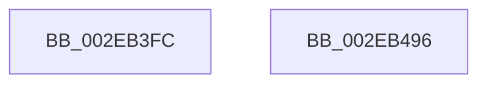

# RtlpHpVsSubsegmentInitialize

- RVA: `0x002EB3FC`–`0x002EB497` (길이 `155` bytes)
- VA: `0x00000001402EB3FC`
- 실행 섹션: `.text`
- PDB 이름 있음: `예`; PDB Function 태그: `아니요`
- unwind 정보 RVA: `0x000DB714`
- 디코드: `42`개 명령, `155/155` bytes 표시
- 미해석 바이트: `0` (있으면 어셈블리에 `.byte`로 보존)

> 이 문서는 커널 이미지의 기계어와 PDB 기호를 분석해 생성했습니다. 4번과 5번은 함수 원형과 자료형을 바이너리 사용 방식에서 추정한 C 해석이며 원본 소스 복구 결과는 아닙니다.

## 1. Dependencies

- 직접 호출 지점: **0**; 고유 호출 대상: **0**
- 직접 호출자로 확인된 함수: **1**
- RIP 상대 이미지 참조: **1**

### Outgoing calls
- 직접 디코드된 call 명령이 없습니다.

### Direct callers
- [RtlpHpVsSubsegmentCreate](RtlpHpVsSubsegmentCreate_function_002EAE30.md) at `0x002EAF21`

### Static image references
- `0x002EB488` → RVA `0x00E28300` (`.data`; read)

## 2. Other-region calls and transfers

- 다른 실행 섹션으로 향하는 call: **0**
- 별도 외부 분기/꼬리 이동을 확인하지 못했습니다.

## 3. Assembly (complete function range)

```asm
002EB3FC  33 C0                           xor eax, eax
002EB3FE  4C 8D 52 D0                     lea r10, [rdx - 0x30]
002EB402  4C 8B C9                        mov r9, rcx
002EB405  49 C1 EA 04                     shr r10, 4
002EB409  0F 57 C0                        xorps xmm0, xmm0
002EB40C  45 33 DB                        xor r11d, r11d
002EB40F  0F 11 01                        movups xmmword ptr [rcx], xmm0
002EB412  0F 11 41 10                     movups xmmword ptr [rcx + 0x10], xmm0
002EB416  48 89 41 20                     mov qword ptr [rcx + 0x20], rax
002EB41A  B9 40 00 00 00                  mov ecx, 0x40
002EB41F  66 45 89 51 20                  mov word ptr [r9 + 0x20], r10w
002EB424  41 8B C0                        mov eax, r8d
002EB427  48 C1 E8 0C                     shr rax, 0xc
002EB42B  2A C8                           sub cl, al
002EB42D  48 83 C8 FF                     or rax, 0xffffffffffffffff
002EB431  48 D3 E8                        shr rax, cl
002EB434  41 8B CB                        mov ecx, r11d
002EB437  49 89 41 10                     mov qword ptr [r9 + 0x10], rax
002EB43B  44 3B C2                        cmp r8d, edx
002EB43E  B8 00 80 00 00                  mov eax, 0x8000
002EB443  41 B8 FF 7F 00 00               mov r8d, 0x7fff
002EB449  66 0F 44 C8                     cmove cx, ax
002EB44D  BA ED 2B 00 00                  mov edx, 0x2bed
002EB452  41 0F B7 41 24                  movzx eax, word ptr [r9 + 0x24]
002EB457  66 41 23 C0                     and ax, r8w
002EB45B  66 0B C8                        or cx, ax
002EB45E  0F B7 C1                        movzx eax, cx
002EB461  66 41 33 C2                     xor ax, r10w
002EB465  66 33 C2                        xor ax, dx
002EB468  66 41 23 C0                     and ax, r8w
002EB46C  66 33 C1                        xor ax, cx
002EB46F  49 8D 49 30                     lea rcx, [r9 + 0x30]
002EB473  66 41 89 41 24                  mov word ptr [r9 + 0x24], ax
002EB478  0F 11 01                        movups xmmword ptr [rcx], xmm0
002EB47B  66 44 89 51 02                  mov word ptr [rcx + 2], r10w
002EB480  66 44 89 59 04                  mov word ptr [rcx + 4], r11w
002EB485  48 8B 01                        mov rax, qword ptr [rcx]
002EB488  48 33 05 71 CE B3 00            xor rax, qword ptr [rip + 0xb3ce71]
002EB48F  48 33 C1                        xor rax, rcx
002EB492  48 89 01                        mov qword ptr [rcx], rax
002EB495  C3                              ret
002EB496  CC                              int3
```

## 4. C-style interpretation (structured pseudocode)

```c
__int64 __fastcall RtlpHpVsSubsegmentInitialize(__int64 a1, __int64 a2, int a3)
{
    __int64 result;
    __int64 v_r10;
    __int64 v_r11;

    result = 0;
    v_r10 = (a2 - 48) >> (4);
    v_r11 = 0;
    *(unsigned __int64 *)(a1) = v_xmm0;
    *(unsigned __int64 *)(a1 + 16) = v_xmm0;
    *(unsigned __int64 *)(a1 + 32) = 0;
    *(unsigned __int16 *)(a1 + 32) = (unsigned __int16)(v_r10);
    result = ((unsigned int)(a3)) >> (12);
    a1 = (unsigned __int8)((64) - ((unsigned __int8)(result)));
    result = (result) | (-1);
    result = (result) >> ((unsigned __int8)(a1));
    *(unsigned __int64 *)(a1 + 16) = result;
    a1 = 0;
    if (a3 == ((unsigned int)(a2))) { a1 = (unsigned __int16)((unsigned int)(0x8000ULL)); }
    result = (unsigned __int16)((*(unsigned __int16 *)(a1 + 36)) & ((unsigned __int16)((unsigned int)(0x7FFFULL))));
    a1 = (unsigned __int16)((a1) | ((unsigned __int16)(result)));
    result = (unsigned __int16)(((unsigned __int16)(a1)) ^ ((unsigned __int16)(v_r10)));
    result = (unsigned __int16)((result) ^ ((unsigned __int16)((unsigned int)(0x2BEDULL))));
    result = (unsigned __int16)((result) & ((unsigned __int16)((unsigned int)(0x7FFFULL))));
    result = (unsigned __int16)((result) ^ ((unsigned __int16)(a1)));
    *(unsigned __int16 *)(a1 + 36) = (unsigned __int16)(result);
    *(unsigned __int64 *)(a1 + 48) = v_xmm0;
    *(unsigned __int16 *)(a1 + 48 + 2) = (unsigned __int16)(v_r10);
    *(unsigned __int16 *)(a1 + 48 + 4) = 0;
    result = (*(unsigned __int64 *)(a1 + 48)) ^ (*(unsigned __int64 *)(v_rip + 11783793));
    result = (result) ^ (a1 + 48);
    *(unsigned __int64 *)(a1 + 48) = result;
    return result;
}
```

## 5. (Beta) C Style

```c
int64_t RtlpHpVsSubsegmentInitialize(void *Arg1, void *Arg2, int32_t Arg3)
{
    uint8_t *arg1 = (uint8_t *)Arg1;
    uint8_t *arg2 = (uint8_t *)Arg2;

    int64_t result;
    int64_t local_r10;
    int64_t local_r11;

    result = 0;
    local_r10 = (Arg2 - 48) >> (4);
    local_r11 = 0;
    *(uint64_t *)(arg1) = v_xmm0;
    *(uint64_t *)(arg1 + 0x10) = v_xmm0;
    *(uint64_t *)(arg1 + 0x20) = 0;
    *(uint16_t *)(arg1 + 0x20) = (uint16_t)(local_r10);
    result = ((uint32_t)(Arg3)) >> (12);
    Arg1 = (uint8_t)((64) - ((uint8_t)(result)));
    result = (result) | (-1);
    result = (result) >> ((uint8_t)(Arg1));
    *(uint64_t *)(arg1 + 0x10) = result;
    Arg1 = 0;
    if (Arg3 == ((uint32_t)(Arg2))) { Arg1 = (uint16_t)((uint32_t)(0x8000ULL)); }
    result = (uint16_t)((*(uint16_t *)(arg1 + 0x24)) & ((uint16_t)((uint32_t)(0x7FFFULL))));
    Arg1 = (uint16_t)((Arg1) | ((uint16_t)(result)));
    result = (uint16_t)(((uint16_t)(Arg1)) ^ ((uint16_t)(local_r10)));
    result = (uint16_t)((result) ^ ((uint16_t)((uint32_t)(0x2BEDULL))));
    result = (uint16_t)((result) & ((uint16_t)((uint32_t)(0x7FFFULL))));
    result = (uint16_t)((result) ^ ((uint16_t)(Arg1)));
    *(uint16_t *)(arg1 + 0x24) = (uint16_t)(result);
    *(uint64_t *)(arg1 + 0x30) = v_xmm0;
    *(uint16_t *)(arg1 + 0x30 + 0x2) = (uint16_t)(local_r10);
    *(uint16_t *)(arg1 + 0x30 + 0x4) = 0;
    result = (*(uint64_t *)(arg1 + 0x30)) ^ (*(uint64_t *)(v_rip + 0xB3CE71));
    result = (result) ^ (Arg1 + 48);
    *(uint64_t *)(arg1 + 0x30) = result;
    return result;
}
```

### 관측된 메모리 오프셋

구조체 형식이 확인되지 않은 접근은 인자 기준의 오프셋으로만 기록했습니다.

| 기준 인자 | 오프셋 표현 | 폭 (bit) | 접근 |
|---|---:|---:|---|
| `Arg1` | `+ 0x0` | `64` | `R` |
| `Arg1` | `+ 0x0` | `64` | `W` |
| `Arg1` | `+ 0x0` | `128` | `R` |
| `Arg1` | `+ 0x2` | `16` | `W` |
| `Arg1` | `+ 0x4` | `16` | `W` |
| `Arg1` | `+ 0x10` | `64` | `W` |
| `Arg1` | `+ 0x10` | `128` | `R` |
| `Arg1` | `+ 0x20` | `16` | `W` |
| `Arg1` | `+ 0x20` | `64` | `W` |
| `Arg1` | `+ 0x24` | `16` | `R` |
| `Arg1` | `+ 0x24` | `16` | `W` |
| `Arg1` | `+ 0x30` | `64` | `R` |
| `Arg2` | `- 0x30` | `64` | `R` |

## 6. Execution-region graph

[열기: 2D/3D 그래프와 함수 탐색 컨트롤 패널](../../../control-panel.html?section=text&rva=0x002EB3FC&view=graph)

- 2D 그래프는 위에서 아래로 흐르고, 3D 그래프는 빈 공간을 드래그해 회전합니다. Shift+드래그는 이동, 휠은 확대·축소, 함수 노드 선택은 대상 보고서 이동입니다.

### Static fallback


