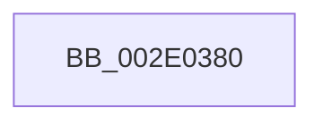

# SMKM_STORE_MGR&lt;SM_TRAITS&gt;::SmProcessIoCompletion

- RVA: `0x002E0380`–`0x002E03B8` (길이 `56` bytes)
- VA: `0x00000001402E0380`
- 실행 섹션: `.text`
- PDB 이름 있음: `예`; PDB Function 태그: `예`
- unwind 정보 RVA: `0x00070B84`
- 디코드: `16`개 명령, `56/56` bytes 표시
- 미해석 바이트: `0` (있으면 어셈블리에 `.byte`로 보존)

> 이 문서는 커널 이미지의 기계어와 PDB 기호를 분석해 생성했습니다. 4번과 5번은 함수 원형과 자료형을 바이너리 사용 방식에서 추정한 C 해석이며 원본 소스 복구 결과는 아닙니다.

## 1. Dependencies

- 직접 호출 지점: **0**; 고유 호출 대상: **0**
- 직접 호출자로 확인된 함수: **1**
- RIP 상대 이미지 참조: **1**

### Outgoing calls
- 직접 디코드된 call 명령이 없습니다.

### Direct callers
- [SMKM_STORE_MGR&lt;SM_TRAITS&gt;::SmProcessAddCompletion](../47/SMKM_STORE_MGR_SM_TRAITS_SmProcessAddCompletion_function_00471510.md) at `0x00471573`
- [SMKM_STORE_MGR&lt;SM_TRAITS&gt;::SmProcessAddCompletion](../47/SMKM_STORE_MGR_SM_TRAITS_SmProcessAddCompletion_function_00471510.md) at `0x004715CB`

### Static image references
- `0x002E0394` → RVA `0x00E0A740` (`.data`; read)

## 2. Other-region calls and transfers

- 다른 실행 섹션으로 향하는 call: **0**
- call이 아닌 외부 분기/꼬리 이동: **1**
  - `0x002E03B2` → [sub_002E07A1](Unknown_function_002E07A1.md) (`tail-transfer`)

## 3. Assembly (complete function range)

```asm
002E0380  4C 8B DC                        mov r11, rsp
002E0383  55                              push rbp
002E0384  53                              push rbx
002E0385  41 55                           push r13
002E0387  41 57                           push r15
002E0389  49 8D 6B C8                     lea rbp, [r11 - 0x38]
002E038D  48 81 EC 18 01 00 00            sub rsp, 0x118
002E0394  48 8B 05 A5 A3 B2 00            mov rax, qword ptr [rip + 0xb2a3a5]
002E039B  48 33 C4                        xor rax, rsp
002E039E  48 89 45 F0                     mov qword ptr [rbp - 0x10], rax
002E03A2  83 7D 68 00                     cmp dword ptr [rbp + 0x68], 0
002E03A6  45 8B E8                        mov r13d, r8d
002E03A9  8B 1A                           mov ebx, dword ptr [rdx]
002E03AB  4C 8B F9                        mov r15, rcx
002E03AE  89 5C 24 30                     mov dword ptr [rsp + 0x30], ebx
002E03B2  0F 84 E9 03 00 00               je 0x1402e07a1
```

## 4. C-style interpretation (structured pseudocode)

```c
__int64 __fastcall SMKM_STORE_MGR_SM_TRAITS___SmProcessIoCompletion(__int64 a1, __int64 a2, int a3)
{
    __int64 result;
    __int64 v_rsp;
    unsigned int v_stack_m108;

    v_rsp = (v_rsp) - (280);
    result = (*(unsigned __int64 *)(v_rip + 11707301)) ^ (v_rsp);
    *(unsigned __int64 *)(v_rsp - 56 - 16) = result;
    v_stack_m108 = (unsigned int)((unsigned int)(*(unsigned int *)(a2)));
}
```

## 5. (Beta) C Style

```c
int64_t SMKM_STORE_MGR_SM_TRAITS___SmProcessIoCompletion(int64_t Arg1, void *Arg2, int32_t Arg3)
{
    uint8_t *arg2 = (uint8_t *)Arg2;

    int64_t result;
    int64_t local_rsp;
    uint32_t v_stack_m108;

    local_rsp = (local_rsp) - (280);
    result = (*(uint64_t *)(v_rip + 0xB2A3A5)) ^ (local_rsp);
    *(uint64_t *)(local_rsp - 0x38 - 0x10) = result;
    v_stack_m108 = (uint32_t)((uint32_t)(*(uint32_t *)(arg2)));
}
```

### 관측된 메모리 오프셋

구조체 형식이 확인되지 않은 접근은 인자 기준의 오프셋으로만 기록했습니다.

| 기준 인자 | 오프셋 표현 | 폭 (bit) | 접근 |
|---|---:|---:|---|
| `Arg2` | `+ 0x0` | `32` | `R` |

## 6. Execution-region graph

[열기: 2D/3D 그래프와 함수 탐색 컨트롤 패널](../../../control-panel.html?section=text&rva=0x002E0380&view=graph)

- 2D 그래프는 위에서 아래로 흐르고, 3D 그래프는 빈 공간을 드래그해 회전합니다. Shift+드래그는 이동, 휠은 확대·축소, 함수 노드 선택은 대상 보고서 이동입니다.

### Static fallback


