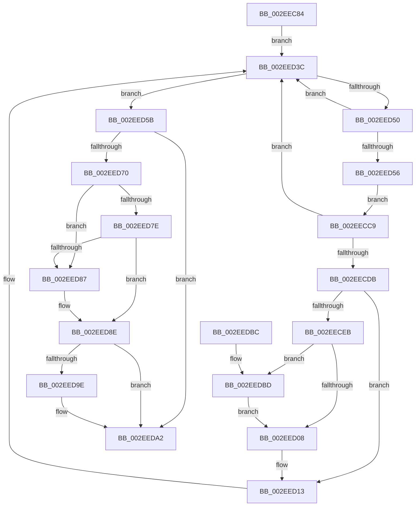

# SepCleanupMarkedForDeletionEntries

- RVA: `0x002EEC84`–`0x002EEDDA` (길이 `342` bytes)
- VA: `0x00000001402EEC84`
- 실행 섹션: `.text`
- PDB 이름 있음: `예`; PDB Function 태그: `아니요`
- unwind 정보 RVA: `0x00071A14`
- 디코드: `96`개 명령, `342/342` bytes 표시
- 미해석 바이트: `0` (있으면 어셈블리에 `.byte`로 보존)

> 이 문서는 커널 이미지의 기계어와 PDB 기호를 분석해 생성했습니다. 4번과 5번은 함수 원형과 자료형을 바이너리 사용 방식에서 추정한 C 해석이며 원본 소스 복구 결과는 아닙니다.

## 1. Dependencies

- 직접 호출 지점: **9**; 고유 호출 대상: **8**
- 직접 호출자로 확인된 함수: **1**
- RIP 상대 이미지 참조: **1**

### Outgoing calls
- `0x002EECC2` → [RtlInitEnumerationHashTable](RtlInitEnumerationHashTable_function_002ED0C0.md) (function, `0x002ED0C0`)
- `0x002EECD2` → [RtlRemoveEntryHashTable](RtlRemoveEntryHashTable_function_002EEF00.md) (function, `0x002EEF00`)
- `0x002EECDE` → [SepGetSingletonEntryFromIndexNumber](../2F/SepGetSingletonEntryFromIndexNumber_function_002F095C.md) (function, `0x002F095C`)
- `0x002EECEE` → [ExAcquireSpinLockExclusive](../24/ExAcquireSpinLockExclusive_function_00248690.md) (function, `0x00248690`)
- `0x002EED0E` → [ExReleaseSpinLockExclusive](../2C/ExReleaseSpinLockExclusive_function_002C0EF0.md) (function, `0x002C0EF0`)
- `0x002EED37` → [ExFreePoolWithTag](../../poolcode/B8/ExFreePoolWithTag_function_00B82870.md) (function, `0x00B82870`)
- `0x002EED43` → [RtlEnumerateEntryHashTable](RtlEnumerateEntryHashTable_function_002EEDE0.md) (function, `0x002EEDE0`)
- `0x002EEDBD` → [AuthzBasepFreeSecurityAttributesList](../30/AuthzBasepFreeSecurityAttributesList_function_00301230.md) (function, `0x00301230`)
- `0x002EEDCB` → [ExFreePoolWithTag](../../poolcode/B8/ExFreePoolWithTag_function_00B82870.md) (function, `0x00B82870`)

### Direct callers
- [SepAddLuidToIndexEntry](../../page/A4/SepAddLuidToIndexEntry_function_00A425C0.md) at `0x00A42682`

### Static image references
- `0x002EEC9F` → RVA `0x00FD8068` (`PAGEDATA`; read)

## 2. Other-region calls and transfers

- 다른 실행 섹션으로 향하는 call: **2**
  - `0x002EED37` → [ExFreePoolWithTag](../../poolcode/B8/ExFreePoolWithTag_function_00B82870.md) (`.text` → `POOLCODE`)
  - `0x002EEDCB` → [ExFreePoolWithTag](../../poolcode/B8/ExFreePoolWithTag_function_00B82870.md) (`.text` → `POOLCODE`)
- 별도 외부 분기/꼬리 이동을 확인하지 못했습니다.

## 3. Assembly (complete function range)

```asm
002EEC84  48 8B C4                        mov rax, rsp
002EEC87  48 89 58 08                     mov qword ptr [rax + 8], rbx
002EEC8B  48 89 70 10                     mov qword ptr [rax + 0x10], rsi
002EEC8F  48 89 78 18                     mov qword ptr [rax + 0x18], rdi
002EEC93  4C 89 70 20                     mov qword ptr [rax + 0x20], r14
002EEC97  55                              push rbp
002EEC98  48 8B EC                        mov rbp, rsp
002EEC9B  48 83 EC 50                     sub rsp, 0x50
002EEC9F  48 8B 05 C2 93 CE 00            mov rax, qword ptr [rip + 0xce93c2]
002EECA6  48 8D 55 D0                     lea rdx, [rbp - 0x30]
002EECAA  0F 57 C0                        xorps xmm0, xmm0
002EECAD  0F 11 45 D0                     movups xmmword ptr [rbp - 0x30], xmm0
002EECB1  48 8B 58 08                     mov rbx, qword ptr [rax + 8]
002EECB5  33 C0                           xor eax, eax
002EECB7  48 8B CB                        mov rcx, rbx
002EECBA  48 89 45 F0                     mov qword ptr [rbp - 0x10], rax
002EECBE  0F 11 45 E0                     movups xmmword ptr [rbp - 0x20], xmm0
002EECC2  E8 F9 E3 FF FF                  call 0x1402ed0c0
002EECC7  EB 73                           jmp 0x1402eed3c
002EECC9  45 33 C0                        xor r8d, r8d
002EECCC  48 8B D7                        mov rdx, rdi
002EECCF  48 8B CB                        mov rcx, rbx
002EECD2  E8 29 02 00 00                  call 0x1402eef00
002EECD7  84 C0                           test al, al
002EECD9  74 61                           je 0x1402eed3c
002EECDB  8B 4F 28                        mov ecx, dword ptr [rdi + 0x28]
002EECDE  E8 79 1C 00 00                  call 0x1402f095c
002EECE3  48 8B F0                        mov rsi, rax
002EECE6  48 85 C0                        test rax, rax
002EECE9  74 28                           je 0x1402eed13
002EECEB  48 8B C8                        mov rcx, rax
002EECEE  E8 9D 99 F5 FF                  call 0x140248690
002EECF3  48 8B 4E 10                     mov rcx, qword ptr [rsi + 0x10]
002EECF7  44 8A F0                        mov r14b, al
002EECFA  48 83 66 08 00                  and qword ptr [rsi + 8], 0
002EECFF  48 85 C9                        test rcx, rcx
002EED02  0F 85 B5 00 00 00               jne 0x1402eedbd
002EED08  41 8A D6                        mov dl, r14b
002EED0B  48 8B CE                        mov rcx, rsi
002EED0E  E8 DD 21 FD FF                  call 0x1402c0ef0
002EED13  8B 4F 28                        mov ecx, dword ptr [rdi + 0x28]
002EED16  48 8B 05 4B 93 CE 00            mov rax, qword ptr [rip + 0xce934b]
002EED1D  8B D1                           mov edx, ecx
002EED1F  48 C1 EA 03                     shr rdx, 3
002EED23  83 E1 07                        and ecx, 7
002EED26  48 03 50 18                     add rdx, qword ptr [rax + 0x18]
002EED2A  0F BE 02                        movsx eax, byte ptr [rdx]
002EED2D  0F B3 C8                        btr eax, ecx
002EED30  48 8B CF                        mov rcx, rdi
002EED33  88 02                           mov byte ptr [rdx], al
002EED35  33 D2                           xor edx, edx
002EED37  E8 34 3B 89 00                  call 0x140b82870
002EED3C  48 8D 55 D0                     lea rdx, [rbp - 0x30]
002EED40  48 8B CB                        mov rcx, rbx
002EED43  E8 98 00 00 00                  call 0x1402eede0
002EED48  48 8B F8                        mov rdi, rax
002EED4B  48 85 C0                        test rax, rax
002EED4E  74 0B                           je 0x1402eed5b
002EED50  80 78 30 00                     cmp byte ptr [rax + 0x30], 0
002EED54  74 E6                           je 0x1402eed3c
002EED56  E9 6E FF FF FF                  jmp 0x1402eecc9
002EED5B  41 83 C8 FF                     or r8d, 0xffffffff
002EED5F  48 8D 4D D0                     lea rcx, [rbp - 0x30]
002EED63  44 01 43 1C                     add dword ptr [rbx + 0x1c], r8d
002EED67  48 8B 45 D0                     mov rax, qword ptr [rbp - 0x30]
002EED6B  48 3B C1                        cmp rax, rcx
002EED6E  74 32                           je 0x1402eeda2
002EED70  48 8B 4D D8                     mov rcx, qword ptr [rbp - 0x28]
002EED74  48 8D 55 D0                     lea rdx, [rbp - 0x30]
002EED78  48 39 50 08                     cmp qword ptr [rax + 8], rdx
002EED7C  75 09                           jne 0x1402eed87
002EED7E  48 8D 55 D0                     lea rdx, [rbp - 0x30]
002EED82  48 39 11                        cmp qword ptr [rcx], rdx
002EED85  74 07                           je 0x1402eed8e
002EED87  B9 03 00 00 00                  mov ecx, 3
002EED8C  CD 29                           int 0x29
002EED8E  48 89 01                        mov qword ptr [rcx], rax
002EED91  48 89 48 08                     mov qword ptr [rax + 8], rcx
002EED95  48 8B 45 E8                     mov rax, qword ptr [rbp - 0x18]
002EED99  48 39 00                        cmp qword ptr [rax], rax
002EED9C  75 04                           jne 0x1402eeda2
002EED9E  44 01 43 18                     add dword ptr [rbx + 0x18], r8d
002EEDA2  48 8B 5C 24 60                  mov rbx, qword ptr [rsp + 0x60]
002EEDA7  48 8B 74 24 68                  mov rsi, qword ptr [rsp + 0x68]
002EEDAC  48 8B 7C 24 70                  mov rdi, qword ptr [rsp + 0x70]
002EEDB1  4C 8B 74 24 78                  mov r14, qword ptr [rsp + 0x78]
002EEDB6  48 83 C4 50                     add rsp, 0x50
002EEDBA  5D                              pop rbp
002EEDBB  C3                              ret
002EEDBC  CC                              int3
002EEDBD  E8 6E 24 01 00                  call 0x140301230
002EEDC2  48 8B 4E 10                     mov rcx, qword ptr [rsi + 0x10]
002EEDC6  BA 53 65 44 74                  mov edx, 0x74446553
002EEDCB  E8 A0 3A 89 00                  call 0x140b82870
002EEDD0  48 83 66 10 00                  and qword ptr [rsi + 0x10], 0
002EEDD5  E9 2E FF FF FF                  jmp 0x1402eed08
```

## 4. C-style interpretation (structured pseudocode)

```c
__int64 __fastcall SepCleanupMarkedForDeletionEntries(__int64 a1, __int64 a2, int a3)
{
    __int64 result;
    __int64 v_rsp;
    unsigned __int64 v_stack_m18;
    unsigned __int64 v_stack_m20;
    unsigned __int64 v_stack_m28;
    unsigned __int64 v_stack_m30;
    unsigned __int64 v_stack_m38;
    unsigned __int64 v_stack_p10;
    unsigned __int64 v_stack_p18;
    unsigned __int64 v_stack_p20;
    unsigned __int64 v_stack_p8;

    *(unsigned __int64 *)(v_rsp + 8) = v_rbx;
    *(unsigned __int64 *)(v_rsp + 16) = v_rsi;
    *(unsigned __int64 *)(v_rsp + 24) = v_rdi;
    *(unsigned __int64 *)(v_rsp + 32) = v_r14;
    v_rsp = (v_rsp) - (80);
    v_stack_m38 = v_xmm0;
    result = 0;
    v_stack_m18 = 0;
    v_stack_m28 = v_xmm0;
    result = RtlInitEnumerationHashTable(*(unsigned __int64 *)(*(unsigned __int64 *)(v_rip + 13538242) + 8), v_stack_m38, a3, a4);
    goto loc_002EED3C;
loc_002EECC9:
    a3 = 0;
    result = RtlRemoveEntryHashTable(*(unsigned __int64 *)(*(unsigned __int64 *)(v_rip + 13538242) + 8), v_rdi, a3, a4);
    if ((unsigned __int8)(result) == 0) goto loc_002EED3C;
    result = SepGetSingletonEntryFromIndexNumber((unsigned int)(*(unsigned int *)(v_rdi + 40)), v_rdi, a3, a4);
    if (result == 0) goto loc_002EED13;
    result = ExAcquireSpinLockExclusive(result, v_rdi, a3, a4);
    if (*(unsigned __int64 *)(result + 16) != 0) goto loc_002EEDBD;
loc_002EED08:
    result = ExReleaseSpinLockExclusive(result, (unsigned __int8)((unsigned __int8)(result)), a3, a4);
loc_002EED13:
    a2 = ((unsigned int)((unsigned int)((unsigned int)(*(unsigned int *)(v_rdi + 40))))) >> (3);
    a1 = (unsigned int)(((unsigned int)(*(unsigned int *)(v_rdi + 40))) & (7));
    a2 = (a2) + (*(unsigned __int64 *)(*(unsigned __int64 *)(v_rip + 13538123) + 24));
    *(unsigned __int8 *)(a2) = (unsigned __int8)((__int8)(*(unsigned __int8 *)(a2)));
    a2 = 0;
    result = ExFreePoolWithTag(v_rdi, a2, a3, a4);
loc_002EED3C:
    result = RtlEnumerateEntryHashTable(*(unsigned __int64 *)(*(unsigned __int64 *)(v_rip + 13538242) + 8), v_stack_m38, a3, a4);
    if (result == 0) goto loc_002EED5B;
    if ((*(unsigned __int8 *)(result + 48)) == 0) goto loc_002EED3C;
    goto loc_002EECC9;
loc_002EED5B:
    a3 = (unsigned int)((a3) | (0xFFFFFFFFULL));
    if (v_stack_m38 == v_stack_m38) goto loc_002EEDA2;
    if ((*(unsigned __int64 *)(v_stack_m38 + 8)) != v_stack_m38) goto loc_002EED87;
    if ((*(unsigned __int64 *)(v_stack_m30)) != v_stack_m38) {
        a1 = 3;
    }
    *(unsigned __int64 *)(a1) = v_stack_m38;
    *(unsigned __int64 *)(v_stack_m38 + 8) = a1;
    if ((*(unsigned __int64 *)(v_stack_m20)) == v_stack_m20) {
    }
    v_rsp = (v_rsp) + (80);
    return v_stack_m20;
loc_002EEDBD:
    result = AuthzBasepFreeSecurityAttributesList(a1, v_stack_m38, a3, a4);
    result = ExFreePoolWithTag(*(unsigned __int64 *)(v_stack_p10 + 16), (unsigned int)(0x74446553ULL), a3, a4);
    goto loc_002EED08;
}
```

## 5. (Beta) C Style

```c
int64_t SepCleanupMarkedForDeletionEntries(int64_t Arg1, int64_t Arg2, int32_t Arg3)
{
    int64_t result;
    int64_t local_rsp;
    uint64_t v_stack_m18;
    uint64_t v_stack_m20;
    uint64_t v_stack_m28;
    uint64_t v_stack_m30;
    uint64_t v_stack_m38;
    uint64_t v_stack_p10;
    uint64_t v_stack_p18;
    uint64_t v_stack_p20;
    uint64_t v_stack_p8;

    *(uint64_t *)(local_rsp + 0x8) = local_rbx;
    *(uint64_t *)(local_rsp + 0x10) = local_rsi;
    *(uint64_t *)(local_rsp + 0x18) = local_rdi;
    *(uint64_t *)(local_rsp + 0x20) = local_r14;
    local_rsp = (local_rsp) - (80);
    v_stack_m38 = v_xmm0;
    result = 0;
    v_stack_m18 = 0;
    v_stack_m28 = v_xmm0;
    result = RtlInitEnumerationHashTable(*(uint64_t *)(*(uint64_t *)(v_rip + 0xCE93C2) + 0x8), v_stack_m38, Arg3, a4);
    goto loc_002EED3C;
loc_002EECC9:
    Arg3 = 0;
    result = RtlRemoveEntryHashTable(*(uint64_t *)(*(uint64_t *)(v_rip + 0xCE93C2) + 0x8), local_rdi, Arg3, a4);
    if ((uint8_t)(result) == 0) goto loc_002EED3C;
    result = SepGetSingletonEntryFromIndexNumber((uint32_t)(*(uint32_t *)(local_rdi + 0x28)), local_rdi, Arg3, a4);
    if (result == 0) goto loc_002EED13;
    result = ExAcquireSpinLockExclusive(result, local_rdi, Arg3, a4);
    if (*(uint64_t *)(result + 0x10) != 0) goto loc_002EEDBD;
loc_002EED08:
    result = ExReleaseSpinLockExclusive(result, (uint8_t)((uint8_t)(result)), Arg3, a4);
loc_002EED13:
    Arg2 = ((uint32_t)((uint32_t)((uint32_t)(*(uint32_t *)(local_rdi + 0x28))))) >> (3);
    Arg1 = (uint32_t)(((uint32_t)(*(uint32_t *)(local_rdi + 0x28))) & (7));
    Arg2 = (Arg2) + (*(uint64_t *)(*(uint64_t *)(v_rip + 0xCE934B) + 0x18));
    *(uint8_t *)(Arg2) = (uint8_t)((int8_t)(*(uint8_t *)(Arg2)));
    Arg2 = 0;
    result = ExFreePoolWithTag(local_rdi, Arg2, Arg3, a4);
loc_002EED3C:
    result = RtlEnumerateEntryHashTable(*(uint64_t *)(*(uint64_t *)(v_rip + 0xCE93C2) + 0x8), v_stack_m38, Arg3, a4);
    if (result == 0) goto loc_002EED5B;
    if ((*(uint8_t *)(result + 0x30)) == 0) goto loc_002EED3C;
    goto loc_002EECC9;
loc_002EED5B:
    Arg3 = (uint32_t)((Arg3) | (0xFFFFFFFFULL));
    if (v_stack_m38 == v_stack_m38) goto loc_002EEDA2;
    if ((*(uint64_t *)(v_stack_m38 + 0x8)) != v_stack_m38) goto loc_002EED87;
    if ((*(uint64_t *)(v_stack_m30)) != v_stack_m38) {
        Arg1 = 3;
    }
    *(uint64_t *)(Arg1) = v_stack_m38;
    *(uint64_t *)(v_stack_m38 + 0x8) = Arg1;
    if ((*(uint64_t *)(v_stack_m20)) == v_stack_m20) {
    }
    local_rsp = (local_rsp) + (80);
    return v_stack_m20;
loc_002EEDBD:
    result = AuthzBasepFreeSecurityAttributesList(Arg1, v_stack_m38, Arg3, a4);
    result = ExFreePoolWithTag(*(uint64_t *)(v_stack_p10 + 0x10), (uint32_t)(0x74446553ULL), Arg3, a4);
    goto loc_002EED08;
}
```

## 6. Execution-region graph

[열기: 2D/3D 그래프와 함수 탐색 컨트롤 패널](../../../control-panel.html?section=text&rva=0x002EEC84&view=graph)

- 2D 그래프는 위에서 아래로 흐르고, 3D 그래프는 빈 공간을 드래그해 회전합니다. Shift+드래그는 이동, 휠은 확대·축소, 함수 노드 선택은 대상 보고서 이동입니다.

### Static fallback


