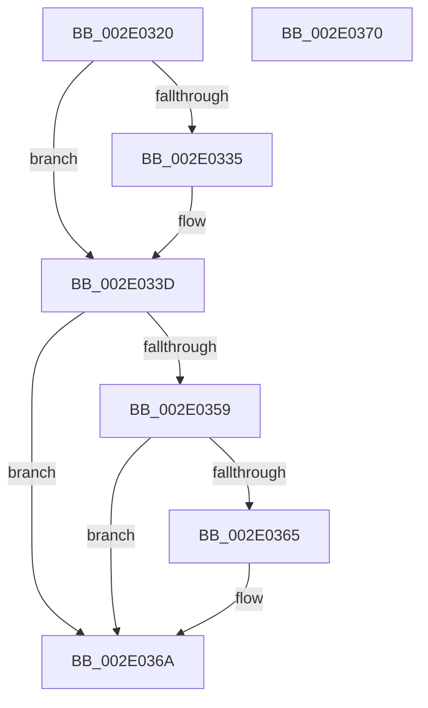

# StLockReleaseShared

- RVA: `0x002E0320`–`0x002E0371` (길이 `81` bytes)
- VA: `0x00000001402E0320`
- 실행 섹션: `.text`
- PDB 이름 있음: `예`; PDB Function 태그: `아니요`
- unwind 정보 RVA: `0x0005CF00`
- 디코드: `24`개 명령, `81/81` bytes 표시
- 미해석 바이트: `0` (있으면 어셈블리에 `.byte`로 보존)

> 이 문서는 커널 이미지의 기계어와 PDB 기호를 분석해 생성했습니다. 4번과 5번은 함수 원형과 자료형을 바이너리 사용 방식에서 추정한 C 해석이며 원본 소스 복구 결과는 아닙니다.

## 1. Dependencies

- 직접 호출 지점: **3**; 고유 호출 대상: **3**
- 직접 호출자로 확인된 함수: **7**
- RIP 상대 이미지 참조: **0**

### Outgoing calls
- `0x002E0338` → [ExfReleasePushLockShared](../26/ExfReleasePushLockShared_function_00263440.md) (function, `0x00263440`)
- `0x002E0340` → [KeAbPostRelease](KeAbPostRelease_function_002E1600.md) (function, `0x002E1600`)
- `0x002E0365` → [KiCheckForKernelApcDelivery](KiCheckForKernelApcDelivery_function_002E2C80.md) (function, `0x002E2C80`)

### Direct callers
- [SMKM_STORE_MGR&lt;SM_TRAITS&gt;::SmReadPickStore](../34/SMKM_STORE_MGR_SM_TRAITS_SmReadPickStore_function_0034C494.md) at `0x0034C4FC`
- [SMKM_STORE&lt;SM_TRAITS&gt;::SmStTrimWsStoreBatch](../34/SMKM_STORE_SM_TRAITS_SmStTrimWsStoreBatch_function_0034C880.md) at `0x0034C8B6`
- [SMKM_STORE&lt;SM_TRAITS&gt;::SmStPrioritizeRegionsStore](../34/SMKM_STORE_SM_TRAITS_SmStPrioritizeRegionsStore_function_0034DE28.md) at `0x0034DF60`
- [SMKM_STORE&lt;SM_TRAITS&gt;::SmStPrioritizeRegionsStore](../34/SMKM_STORE_SM_TRAITS_SmStPrioritizeRegionsStore_function_0034DE28.md) at `0x0034E138`
- [SMKM_STORE&lt;SM_TRAITS&gt;::SmStInSwapStore](../49/SMKM_STORE_SM_TRAITS_SmStInSwapStore_function_00496BC8.md) at `0x00496C5A`
- [SMKM_STORE&lt;SM_TRAITS&gt;::SmStOutSwapStore](../49/SMKM_STORE_SM_TRAITS_SmStOutSwapStore_function_00496C84.md) at `0x00496EF8`
- [SMKM_STORE&lt;SM_TRAITS&gt;::SmStOutSwapStore](../49/SMKM_STORE_SM_TRAITS_SmStOutSwapStore_function_00496C84.md) at `0x00496F74`
- [SMKM_STORE&lt;SM_TRAITS&gt;::SmStTrimWsStore](../4B/SMKM_STORE_SM_TRAITS_SmStTrimWsStore_function_004BEB4C.md) at `0x004BEEBC`
- [ST_STORE&lt;SM_TRAITS&gt;::StDmHandleDecompressionFailure](../60/ST_STORE_SM_TRAITS_StDmHandleDecompressionFailure_function_0060DA74.md) at `0x0060DBC9`

### Static image references
- 디코드된 RIP-relative 메모리 참조가 없습니다.

## 2. Other-region calls and transfers

- 다른 실행 섹션으로 향하는 call: **0**
- 별도 외부 분기/꼬리 이동을 확인하지 못했습니다.

## 3. Assembly (complete function range)

```asm
002E0320  40 53                           push rbx
002E0322  48 83 EC 20                     sub rsp, 0x20
002E0326  48 8B D9                        mov rbx, rcx
002E0329  33 C9                           xor ecx, ecx
002E032B  8D 41 11                        lea eax, [rcx + 0x11]
002E032E  F0 48 0F B1 0B                  lock cmpxchg qword ptr [rbx], rcx
002E0333  74 08                           je 0x1402e033d
002E0335  48 8B CB                        mov rcx, rbx
002E0338  E8 03 31 F8 FF                  call 0x140263440
002E033D  48 8B CB                        mov rcx, rbx
002E0340  E8 BB 12 00 00                  call 0x1402e1600
002E0345  65 48 8B 04 25 88 01 00 00      mov rax, qword ptr gs:[0x188]
002E034E  90                              nop
002E034F  66 83 80 E6 01 00 00 01         add word ptr [rax + 0x1e6], 1
002E0357  75 11                           jne 0x1402e036a
002E0359  48 05 98 00 00 00               add rax, 0x98
002E035F  90                              nop
002E0360  48 39 00                        cmp qword ptr [rax], rax
002E0363  74 05                           je 0x1402e036a
002E0365  E8 16 29 00 00                  call 0x1402e2c80
002E036A  48 83 C4 20                     add rsp, 0x20
002E036E  5B                              pop rbx
002E036F  C3                              ret
002E0370  CC                              int3
```

## 4. C-style interpretation (structured pseudocode)

```c
__int64 __fastcall StLockReleaseShared(__int64 a1)
{
    __int64 result;
    __int64 v_rsp;

    v_rsp = (v_rsp) - (32);
    a1 = 0;
    result = a1 + 17;
    if (!(condition_is_equal)) {
        a1 = 0;
        result = ExfReleasePushLockShared(a1, a2, a3, a4);
    }
    result = KeAbPostRelease(a1, a2, a3, a4);
    if (condition_is_not_equal) goto loc_002E036A;
    result = (*(unsigned __int64 *)(gs_base + (0 + 392))) + (152);
    if ((*(unsigned __int64 *)(result)) != result) {
        result = KiCheckForKernelApcDelivery(a1, a2, a3, a4);
    }
    v_rsp = (v_rsp) + (32);
    return result;
}
```

## 5. (Beta) C Style

```c
int64_t StLockReleaseShared(void *Arg1)
{
    uint8_t *arg1 = (uint8_t *)Arg1;

    int64_t result;
    int64_t local_rsp;

    local_rsp = (local_rsp) - (32);
    Arg1 = 0;
    result = Arg1 + 17;
    if (!(condition_is_equal)) {
        Arg1 = 0;
        result = ExfReleasePushLockShared(Arg1, a2, a3, a4);
    }
    result = KeAbPostRelease(Arg1, a2, a3, a4);
    if (condition_is_not_equal) goto loc_002E036A;
    result = (*(uint64_t *)(gs_base + (0 + 0x188))) + (152);
    if ((*(uint64_t *)(result)) != result) {
        result = KiCheckForKernelApcDelivery(Arg1, a2, a3, a4);
    }
    local_rsp = (local_rsp) + (32);
    return result;
}
```

### 관측된 메모리 오프셋

구조체 형식이 확인되지 않은 접근은 인자 기준의 오프셋으로만 기록했습니다.

| 기준 인자 | 오프셋 표현 | 폭 (bit) | 접근 |
|---|---:|---:|---|
| `Arg1` | `+ 0x0` | `64` | `R` |

## 6. Execution-region graph

[열기: 2D/3D 그래프와 함수 탐색 컨트롤 패널](../../../control-panel.html?section=text&rva=0x002E0320&view=graph)

- 2D 그래프는 위에서 아래로 흐르고, 3D 그래프는 빈 공간을 드래그해 회전합니다. Shift+드래그는 이동, 휠은 확대·축소, 함수 노드 선택은 대상 보고서 이동입니다.

### Static fallback


