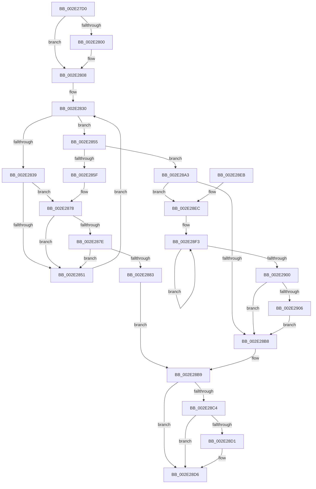

# UNLOCK_PAGE_TABLE_COMMITMENT

- RVA: `0x002E27D0`–`0x002E290D` (길이 `317` bytes)
- VA: `0x00000001402E27D0`
- 실행 섹션: `.text`
- PDB 이름 있음: `예`; PDB Function 태그: `아니요`
- unwind 정보 RVA: `0x00070D2C`
- 디코드: `88`개 명령, `317/317` bytes 표시
- 미해석 바이트: `0` (있으면 어셈블리에 `.byte`로 보존)

> 이 문서는 커널 이미지의 기계어와 PDB 기호를 분석해 생성했습니다. 4번과 5번은 함수 원형과 자료형을 바이너리 사용 방식에서 추정한 C 해석이며 원본 소스 복구 결과는 아닙니다.

## 1. Dependencies

- 직접 호출 지점: **5**; 고유 호출 대상: **5**
- 직접 호출자로 확인된 함수: **16**
- RIP 상대 이미지 참조: **0**

### Outgoing calls
- `0x002E2803` → [ExfTryToWakePushLock](../26/ExfTryToWakePushLock_function_00265DD0.md) (function, `0x00265DD0`)
- `0x002E2872` → [KeBugCheckEx](../4F/KeBugCheckEx_function_004FD660.md) (function, `0x004FD660`)
- `0x002E289C` → [KiAbEntryFreeAndEnableInterrupts](../26/KiAbEntryFreeAndEnableInterrupts_function_002622D0.md) (function, `0x002622D0`)
- `0x002E28D1` → [KiCheckForKernelApcDelivery](KiCheckForKernelApcDelivery_function_002E2C80.md) (function, `0x002E2C80`)
- `0x002E2906` → [KiRemoveSystemWorkPriorityKick](../26/KiRemoveSystemWorkPriorityKick_function_002631D0.md) (function, `0x002631D0`)

### Direct callers
- [MiRemoveVad](../29/MiRemoveVad_function_00295C78.md) at `0x00295E46`
- [MiDeleteEmptyPageTables](../2A/MiDeleteEmptyPageTables_function_002A5220.md) at `0x002A5499`
- [MiPerformVadSplitting](../2A/MiPerformVadSplitting_function_002A5A80.md) at `0x002A5C64`
- [MiSplitPrivatePage](../2A/MiSplitPrivatePage_function_002A6210.md) at `0x002A63B8`
- [MiSplitPrivatePage](../2A/MiSplitPrivatePage_function_002A6210.md) at `0x002A66F1`
- [MiCommitPageTableRangesForVad](../2A/MiCommitPageTableRangesForVad_function_002A69D4.md) at `0x002A6AA3`
- [MmOutSwapWorkingSet](../2A/MmOutSwapWorkingSet_function_002A6BC8.md) at `0x002A6EB3`
- [MmOutSwapVirtualAddresses](../2A/MmOutSwapVirtualAddresses_function_002A8C30.md) at `0x002A8E93`
- [sub_002C37D9](../2C/Unknown_function_002C37D9.md) at `0x002C39AB`
- [sub_002C3A7C](../2C/Unknown_function_002C3A7C.md) at `0x002C3B09`
- [MiCommitExistingVad](../32/MiCommitExistingVad_function_0032A860.md) at `0x0032AE25`
- [MiCommitExistingVad](../32/MiCommitExistingVad_function_0032A860.md) at `0x0032B053`
- [MiSplitReducedCommitClonePage](../4F/MiSplitReducedCommitClonePage_function_004FA808.md) at `0x004FA896`
- [MiSplitReducedCommitClonePage](../4F/MiSplitReducedCommitClonePage_function_004FA808.md) at `0x004FA9A4`
- [MmAssignProcessToJob](../../page/87/MmAssignProcessToJob_function_0087EEF8.md) at `0x0087EFBF`
- [MiFreeToSubAllocatedRegion](../../page/87/MiFreeToSubAllocatedRegion_function_0087FB7C.md) at `0x0087FCBD`
- [MiInsertVadCharges](../../page/88/MiInsertVadCharges_function_00886AA8.md) at `0x00886BAA`
- [MiAllocateFromSubAllocatedRegion](../../page/98/MiAllocateFromSubAllocatedRegion_function_00981C24.md) at `0x00981D20`
- [MiAllocateNewSubAllocatedRegion](../../page/98/MiAllocateNewSubAllocatedRegion_function_00981EC0.md) at `0x00982194`

### Static image references
- 디코드된 RIP-relative 메모리 참조가 없습니다.

## 2. Other-region calls and transfers

- 다른 실행 섹션으로 향하는 call: **0**
- 별도 외부 분기/꼬리 이동을 확인하지 못했습니다.

## 3. Assembly (complete function range)

```asm
002E27D0  48 89 5C 24 08                  mov qword ptr [rsp + 8], rbx
002E27D5  48 89 6C 24 10                  mov qword ptr [rsp + 0x10], rbp
002E27DA  48 89 74 24 18                  mov qword ptr [rsp + 0x18], rsi
002E27DF  57                              push rdi
002E27E0  48 83 EC 30                     sub rsp, 0x30
002E27E4  48 8B D9                        mov rbx, rcx
002E27E7  48 8D BA 60 02 00 00            lea rdi, [rdx + 0x260]
002E27EE  48 C7 C0 FF FF FF FF            mov rax, 0xffffffffffffffff
002E27F5  F0 48 0F C1 07                  lock xadd qword ptr [rdi], rax
002E27FA  24 06                           and al, 6
002E27FC  3C 02                           cmp al, 2
002E27FE  75 08                           jne 0x1402e2808
002E2800  48 8B CF                        mov rcx, rdi
002E2803  E8 C8 35 F8 FF                  call 0x140265dd0
002E2808  65 4C 8B 1C 25 88 01 00 00      mov r11, qword ptr gs:[0x188]
002E2811  FA                              cli
002E2812  4D 8B 83 70 04 00 00            mov r8, qword ptr [r11 + 0x470]
002E2819  4C 8B CF                        mov r9, rdi
002E281C  48 BE FC FF FF FF FF FF FF 7F   movabs rsi, 0x7ffffffffffffffc
002E2826  4C 23 CE                        and r9, rsi
002E2829  33 ED                           xor ebp, ebp
002E282B  8B C5                           mov eax, ebp
002E282D  0F 1F 00                        nop dword ptr [rax]
002E2830  41 0F B6 48 0C                  movzx ecx, byte ptr [r8 + 0xc]
002E2835  3B C1                           cmp eax, ecx
002E2837  73 1C                           jae 0x1402e2855
002E2839  8B C8                           mov ecx, eax
002E283B  4C 6B D1 58                     imul r10, rcx, 0x58
002E283F  4D 03 D0                        add r10, r8
002E2842  49 8B 52 10                     mov rdx, qword ptr [r10 + 0x10]
002E2846  48 8B CA                        mov rcx, rdx
002E2849  48 23 CE                        and rcx, rsi
002E284C  49 3B C9                        cmp rcx, r9
002E284F  74 27                           je 0x1402e2878
002E2851  FF C0                           inc eax
002E2853  EB DB                           jmp 0x1402e2830
002E2855  41 8B 43 78                     mov eax, dword ptr [r11 + 0x78]
002E2859  0F BA E0 10                     bt eax, 0x10
002E285D  72 44                           jb 0x1402e28a3
002E285F  45 33 C9                        xor r9d, r9d
002E2862  48 89 6C 24 20                  mov qword ptr [rsp + 0x20], rbp
002E2867  4C 8B C7                        mov r8, rdi
002E286A  49 8B D3                        mov rdx, r11
002E286D  B9 62 01 00 00                  mov ecx, 0x162
002E2872  E8 E9 AD 21 00                  call 0x1404fd660
002E2877  CC                              int3
002E2878  41 38 6A 1A                     cmp byte ptr [r10 + 0x1a], bpl
002E287C  74 D3                           je 0x1402e2851
002E287E  F6 C2 01                        test dl, 1
002E2881  75 CE                           jne 0x1402e2851
002E2883  41 B9 01 00 00 00               mov r9d, 1
002E2889  41 88 6A 1A                     mov byte ptr [r10 + 0x1a], bpl
002E288D  4C 8B C7                        mov r8, rdi
002E2890  48 89 6C 24 20                  mov qword ptr [rsp + 0x20], rbp
002E2895  49 8B D3                        mov rdx, r11
002E2898  49 8D 4A 10                     lea rcx, [r10 + 0x10]
002E289C  E8 2F FA F7 FF                  call 0x1402622d0
002E28A1  EB 16                           jmp 0x1402e28b9
002E28A3  65 48 8B 0C 25 20 00 00 00      mov rcx, qword ptr gs:[0x20]
002E28AC  4C 8B 81 B8 8E 00 00            mov r8, qword ptr [rcx + 0x8eb8]
002E28B3  4D 85 C0                        test r8, r8
002E28B6  75 34                           jne 0x1402e28ec
002E28B8  FB                              sti
002E28B9  90                              nop
002E28BA  66 83 83 E6 01 00 00 01         add word ptr [rbx + 0x1e6], 1
002E28C2  75 12                           jne 0x1402e28d6
002E28C4  48 8D 83 98 00 00 00            lea rax, [rbx + 0x98]
002E28CB  90                              nop
002E28CC  48 39 00                        cmp qword ptr [rax], rax
002E28CF  74 05                           je 0x1402e28d6
002E28D1  E8 AA 03 00 00                  call 0x1402e2c80
002E28D6  48 8B 5C 24 40                  mov rbx, qword ptr [rsp + 0x40]
002E28DB  48 8B 6C 24 48                  mov rbp, qword ptr [rsp + 0x48]
002E28E0  48 8B 74 24 50                  mov rsi, qword ptr [rsp + 0x50]
002E28E5  48 83 C4 30                     add rsp, 0x30
002E28E9  5F                              pop rdi
002E28EA  C3                              ret
002E28EB  CC                              int3
002E28EC  41 0F 0D 08                     prefetchw byte ptr [r8]
002E28F0  41 8B 00                        mov eax, dword ptr [r8]
002E28F3  8B D0                           mov edx, eax
002E28F5  0F BA F2 15                     btr edx, 0x15
002E28F9  F0 41 0F B1 10                  lock cmpxchg dword ptr [r8], edx
002E28FE  75 F3                           jne 0x1402e28f3
002E2900  0F BA E0 15                     bt eax, 0x15
002E2904  73 B2                           jae 0x1402e28b8
002E2906  E8 C5 08 F8 FF                  call 0x1402631d0
002E290B  EB AB                           jmp 0x1402e28b8
```

## 4. C-style interpretation (structured pseudocode)

```c
__int64 __fastcall UNLOCK_PAGE_TABLE_COMMITMENT(__int64 a1, __int64 a2)
{
    __int64 result;
    __int64 v_r10;
    __int64 v_rbp;
    __int64 v_rsp;
    unsigned __int64 v_stack_m18;
    unsigned __int64 v_stack_p10;
    unsigned __int64 v_stack_p18;
    unsigned __int64 v_stack_p8;

    v_stack_p8 = v_rbx;
    v_stack_p10 = v_rbp;
    v_stack_p18 = v_rsi;
    v_rsp = (v_rsp) - (48);
    result = (unsigned __int8)((-1) & (6));
    if (((unsigned __int8)(result)) == 2) {
        a1 = a2 + 608;
        result = ExfTryToWakePushLock(a1, a2, a3, a4);
    }
    a4 = (a2 + 608) & (v_rsi);
    v_rbp = 0;
loc_002E2830:
    if (0 >= ((unsigned int)(*(unsigned __int8 *)(*(unsigned __int64 *)(*(unsigned __int64 *)(gs_base + (0 + 392)) + 1136) + 12)))) goto loc_002E2855;
    v_r10 = (v_r10) * (0);
    v_r10 = (v_r10) + (*(unsigned __int64 *)(*(unsigned __int64 *)(gs_base + (0 + 392)) + 1136));
    a1 = (*(unsigned __int64 *)(v_r10 + 16)) & (v_rsi);
    if (a1 == a4) goto loc_002E2878;
loc_002E2851:
    result = (unsigned int)((0) + 1);
    goto loc_002E2830;
loc_002E2855:
    if (a1 < a4) goto loc_002E28A3;
    a4 = 0;
    v_stack_m18 = 0;
    result = KeBugCheckEx(354, *(unsigned __int64 *)(gs_base + (0 + 392)), a2 + 608, a4);
loc_002E2878:
    if ((*(unsigned __int8 *)(v_r10 + 26)) == 0) goto loc_002E2851;
    if ((((unsigned __int8)(*(unsigned __int64 *)(gs_base + (0 + 392)))) & (1)) != 0) goto loc_002E2851;
    *(unsigned __int8 *)(v_r10 + 26) = 0;
    v_stack_m18 = 0;
    result = KiAbEntryFreeAndEnableInterrupts(v_r10 + 16, *(unsigned __int64 *)(gs_base + (0 + 392)), a2 + 608, 1);
    goto loc_002E28B9;
loc_002E28A3:
    if (*(unsigned __int64 *)(*(unsigned __int64 *)(gs_base + (0 + 32)) + 36536) != 0) goto loc_002E28EC;
loc_002E28B8:
loc_002E28B9:
    if (*(unsigned __int64 *)(*(unsigned __int64 *)(gs_base + (0 + 32)) + 36536) != 0) goto loc_002E28D6;
    result = a1 + 152;
    if ((*(unsigned __int64 *)(a1 + 152)) != (a1 + 152)) {
        result = KiCheckForKernelApcDelivery(*(unsigned __int64 *)(gs_base + (0 + 32)), *(unsigned __int64 *)(gs_base + (0 + 392)), *(unsigned __int64 *)(*(unsigned __int64 *)(gs_base + (0 + 32)) + 36536), 1);
    }
    v_rsp = (v_rsp) + (48);
    return result;
loc_002E28EC:
loc_002E28F3:
    if (condition_is_not_equal) goto loc_002E28F3;
    if (condition_is_above_or_equal) goto loc_002E28B8;
    result = KiRemoveSystemWorkPriorityKick(*(unsigned __int64 *)(gs_base + (0 + 32)), (unsigned int)((unsigned int)((unsigned int)(*(unsigned int *)(*(unsigned __int64 *)(*(unsigned __int64 *)(gs_base + (0 + 32)) + 36536))))), *(unsigned __int64 *)(*(unsigned __int64 *)(gs_base + (0 + 32)) + 36536), 1);
    goto loc_002E28B8;
}
```

## 5. (Beta) C Style

```c
int64_t UNLOCK_PAGE_TABLE_COMMITMENT(void *Arg1, void *Arg2)
{
    uint8_t *arg1 = (uint8_t *)Arg1;
    uint8_t *arg2 = (uint8_t *)Arg2;

    int64_t result;
    int64_t local_r10;
    int64_t local_rbp;
    int64_t local_rsp;
    uint64_t v_stack_m18;
    uint64_t v_stack_p10;
    uint64_t v_stack_p18;
    uint64_t v_stack_p8;

    v_stack_p8 = local_rbx;
    v_stack_p10 = local_rbp;
    v_stack_p18 = local_rsi;
    local_rsp = (local_rsp) - (48);
    result = (uint8_t)((-1) & (6));
    if (((uint8_t)(result)) == 2) {
        Arg1 = Arg2 + 608;
        result = ExfTryToWakePushLock(Arg1, Arg2, a3, a4);
    }
    a4 = (Arg2 + 608) & (local_rsi);
    local_rbp = 0;
loc_002E2830:
    if (0 >= ((uint32_t)(*(uint8_t *)(*(uint64_t *)(*(uint64_t *)(gs_base + (0 + 0x188)) + 0x470) + 0xC)))) goto loc_002E2855;
    local_r10 = (local_r10) * (0);
    local_r10 = (local_r10) + (*(uint64_t *)(*(uint64_t *)(gs_base + (0 + 0x188)) + 0x470));
    Arg1 = (*(uint64_t *)(local_r10 + 0x10)) & (local_rsi);
    if (Arg1 == a4) goto loc_002E2878;
loc_002E2851:
    result = (uint32_t)((0) + 1);
    goto loc_002E2830;
loc_002E2855:
    if (Arg1 < a4) goto loc_002E28A3;
    a4 = 0;
    v_stack_m18 = 0;
    result = KeBugCheckEx(354, *(uint64_t *)(gs_base + (0 + 0x188)), Arg2 + 608, a4);
loc_002E2878:
    if ((*(uint8_t *)(local_r10 + 0x1A)) == 0) goto loc_002E2851;
    if ((((uint8_t)(*(uint64_t *)(gs_base + (0 + 0x188)))) & (1)) != 0) goto loc_002E2851;
    *(uint8_t *)(local_r10 + 0x1A) = 0;
    v_stack_m18 = 0;
    result = KiAbEntryFreeAndEnableInterrupts(local_r10 + 16, *(uint64_t *)(gs_base + (0 + 0x188)), Arg2 + 608, 1);
    goto loc_002E28B9;
loc_002E28A3:
    if (*(uint64_t *)(*(uint64_t *)(gs_base + (0 + 0x20)) + 0x8EB8) != 0) goto loc_002E28EC;
loc_002E28B8:
loc_002E28B9:
    if (*(uint64_t *)(*(uint64_t *)(gs_base + (0 + 0x20)) + 0x8EB8) != 0) goto loc_002E28D6;
    result = Arg1 + 152;
    if ((*(uint64_t *)(arg1 + 0x98)) != (Arg1 + 152)) {
        result = KiCheckForKernelApcDelivery(*(uint64_t *)(gs_base + (0 + 0x20)), *(uint64_t *)(gs_base + (0 + 0x188)), *(uint64_t *)(*(uint64_t *)(gs_base + (0 + 0x20)) + 0x8EB8), 1);
    }
    local_rsp = (local_rsp) + (48);
    return result;
loc_002E28EC:
loc_002E28F3:
    if (condition_is_not_equal) goto loc_002E28F3;
    if (condition_is_above_or_equal) goto loc_002E28B8;
    result = KiRemoveSystemWorkPriorityKick(*(uint64_t *)(gs_base + (0 + 0x20)), (uint32_t)((uint32_t)((uint32_t)(*(uint32_t *)(*(uint64_t *)(*(uint64_t *)(gs_base + (0 + 0x20)) + 0x8EB8))))), *(uint64_t *)(*(uint64_t *)(gs_base + (0 + 0x20)) + 0x8EB8), 1);
    goto loc_002E28B8;
}
```

### 관측된 메모리 오프셋

구조체 형식이 확인되지 않은 접근은 인자 기준의 오프셋으로만 기록했습니다.

| 기준 인자 | 오프셋 표현 | 폭 (bit) | 접근 |
|---|---:|---:|---|
| `Arg1` | `+ 0x0` | `64` | `R` |
| `Arg1` | `+ 0x98` | `64` | `R` |
| `Arg1` | `+ 0x1E6` | `16` | `R/W` |
| `Arg2` | `+ 0x0` | `64` | `R/W` |
| `Arg2` | `+ 0x260` | `64` | `R` |

## 6. Execution-region graph

[열기: 2D/3D 그래프와 함수 탐색 컨트롤 패널](../../../control-panel.html?section=text&rva=0x002E27D0&view=graph)

- 2D 그래프는 위에서 아래로 흐르고, 3D 그래프는 빈 공간을 드래그해 회전합니다. Shift+드래그는 이동, 휠은 확대·축소, 함수 노드 선택은 대상 보고서 이동입니다.

### Static fallback


