# sub_002E03B8

- RVA: `0x002E03B8`–`0x002E062C` (길이 `628` bytes)
- VA: `0x00000001402E03B8`
- 실행 섹션: `.text`
- PDB 이름 있음: `아니요`; PDB Function 태그: `아니요`
- unwind 정보 RVA: `0x00070B9C`
- 디코드: `154`개 명령, `628/628` bytes 표시
- 미해석 바이트: `0` (있으면 어셈블리에 `.byte`로 보존)

> 이 문서는 커널 이미지의 기계어와 PDB 기호를 분석해 생성했습니다. 4번과 5번은 함수 원형과 자료형을 바이너리 사용 방식에서 추정한 C 해석이며 원본 소스 복구 결과는 아닙니다.

## 1. Dependencies

- 직접 호출 지점: **5**; 고유 호출 대상: **5**
- 직접 호출자로 확인된 함수: **0**
- RIP 상대 이미지 참조: **0**

### Outgoing calls
- `0x002E03D5` → [memset](../6C/memset_function_006C6C40.md) (function, `0x006C6C40`)
- `0x002E042D` → [KeAbPreAcquire](../21/KeAbPreAcquire_function_00210230.md) (function, `0x00210230`)
- `0x002E0452` → [ExfAcquirePushLockExclusiveEx](../20/ExfAcquirePushLockExclusiveEx_function_0020FC90.md) (function, `0x0020FC90`)
- `0x002E0478` → [B_TREE<_SM_PAGE_KEY,SMKM_STORE_MGR<SM_TRAITS>::SMKM_FRONTEND_ENTRY,4096,B_TREE_DUMMY_NODE_POOL,B_TREE_KEY_COMPARATOR<_SM_PAGE_KEY> >::BTreeSearchResultDeref](B_TREE__SM_PAGE_KEY_SMKM_STORE_MGR_SM_TRAITS_SMKM_FRONTEND_ENTRY_4096_B_TREE_DUMMY_NODE_POOL_B_TREE__function_002E07C0.md) (function, `0x002E07C0`)
- `0x002E058B` → [B_TREE<_SM_PAGE_KEY,SMKM_STORE_MGR<SM_TRAITS>::SMKM_FRONTEND_ENTRY,4096,B_TREE_DUMMY_NODE_POOL,B_TREE_KEY_COMPARATOR<_SM_PAGE_KEY> >::BTreeIteratorFromSearchResult](B_TREE__SM_PAGE_KEY_SMKM_STORE_MGR_SM_TRAITS_SMKM_FRONTEND_ENTRY_4096_B_TREE_DUMMY_NODE_POOL_B_TREE__function_002E07E0.md) (function, `0x002E07E0`)

### Direct callers
- 이 함수 시작 RVA로 연결되는 직접 call은 확인되지 않았습니다. 간접 호출은 완전히 역산할 수 없습니다.

### Static image references
- 디코드된 RIP-relative 메모리 참조가 없습니다.

## 2. Other-region calls and transfers

- 다른 실행 섹션으로 향하는 call: **0**
- call이 아닌 외부 분기/꼬리 이동: **11**
  - `0x002E0482` → [sub_002E0678 + 0x8](Unknown_function_002E0678.md) (`tail-transfer`)
  - `0x002E04A1` → [sub_002E0736 + 0x1C](Unknown_function_002E0736.md) (`tail-transfer`)
  - `0x002E04B6` → [sub_002E0736](Unknown_function_002E0736.md) (`tail-transfer`)
  - `0x002E051B` → [sub_002E0678 + 0x14](Unknown_function_002E0678.md) (`tail-transfer`)
  - `0x002E054D` → [sub_002E0678](Unknown_function_002E0678.md) (`tail-transfer`)
  - `0x002E05A0` → [sub_002E0736 + 0x42](Unknown_function_002E0736.md) (`tail-transfer`)
  - `0x002E05C2` → [sub_002E0678 + 0x80](Unknown_function_002E0678.md) (`tail-transfer`)
  - `0x002E05CC` → [sub_002E0678 + 0x21](Unknown_function_002E0678.md) (`tail-transfer`)
  - `0x002E05DC` → [sub_002E0678 + 0x2B](Unknown_function_002E0678.md) (`tail-transfer`)
  - `0x002E05EC` → [sub_002E0678 + 0x79](Unknown_function_002E0678.md) (`tail-transfer`)
  - `0x002E0626` → [sub_002E0725](Unknown_function_002E0725.md) (`tail-transfer`)

## 3. Assembly (complete function range)

```asm
002E03B8  49 89 73 18                     mov qword ptr [r11 + 0x18], rsi
002E03BC  48 8D 4C 24 68                  lea rcx, [rsp + 0x68]
002E03C1  49 89 7B D8                     mov qword ptr [r11 - 0x28], rdi
002E03C5  33 D2                           xor edx, edx
002E03C7  4D 89 63 D0                     mov qword ptr [r11 - 0x30], r12
002E03CB  41 B8 80 00 00 00               mov r8d, 0x80
002E03D1  4D 89 73 C8                     mov qword ptr [r11 - 0x38], r14
002E03D5  E8 66 68 3E 00                  call 0x1406c6c40
002E03DA  33 C9                           xor ecx, ecx
002E03DC  C7 44 24 5C 08 00 00 00         mov dword ptr [rsp + 0x5c], 8
002E03E4  48 89 4C 24 48                  mov qword ptr [rsp + 0x48], rcx
002E03E9  48 8D 44 24 68                  lea rax, [rsp + 0x68]
002E03EE  48 89 4C 24 50                  mov qword ptr [rsp + 0x50], rcx
002E03F3  0F 57 C0                        xorps xmm0, xmm0
002E03F6  48 89 4C 24 60                  mov qword ptr [rsp + 0x60], rcx
002E03FB  44 8B E1                        mov r12d, ecx
002E03FE  89 4C 24 58                     mov dword ptr [rsp + 0x58], ecx
002E0402  44 8D 71 01                     lea r14d, [rcx + 1]
002E0406  48 89 44 24 40                  mov qword ptr [rsp + 0x40], rax
002E040B  49 8D 8F B8 01 00 00            lea rcx, [r15 + 0x1b8]
002E0412  65 48 8B 04 25 88 01 00 00      mov rax, qword ptr gs:[0x188]
002E041B  45 33 C0                        xor r8d, r8d
002E041E  33 D2                           xor edx, edx
002E0420  0F 11 44 24 20                  movups xmmword ptr [rsp + 0x20], xmm0
002E0425  66 FF 88 E6 01 00 00            dec word ptr [rax + 0x1e6]
002E042C  90                              nop
002E042D  E8 FE FD F2 FF                  call 0x140210230
002E0432  F0 49 0F BA AF B8 01 00 00 00   lock bts qword ptr [r15 + 0x1b8], 0
002E043C  48 8B F8                        mov rdi, rax
002E043F  73 16                           jae 0x1402e0457
002E0441  4D 8D 87 B8 01 00 00            lea r8, [r15 + 0x1b8]
002E0448  48 8B D0                        mov rdx, rax
002E044B  49 8D 8F B8 01 00 00            lea rcx, [r15 + 0x1b8]
002E0452  E8 39 F8 F2 FF                  call 0x14020fc90
002E0457  48 85 FF                        test rdi, rdi
002E045A  74 04                           je 0x1402e0460
002E045C  44 88 77 0A                     mov byte ptr [rdi + 0xa], r14b
002E0460  48 8B 7C 24 28                  mov rdi, qword ptr [rsp + 0x28]
002E0465  48 8B 74 24 20                  mov rsi, qword ptr [rsp + 0x20]
002E046A  45 85 F6                        test r14d, r14d
002E046D  0F 84 2A 01 00 00               je 0x1402e059d
002E0473  48 8D 54 24 40                  lea rdx, [rsp + 0x40]
002E0478  E8 43 03 00 00                  call 0x1402e07c0
002E047D  83 7C 24 58 FF                  cmp dword ptr [rsp + 0x58], -1
002E0482  0F 84 F8 01 00 00               je 0x1402e0680
002E0488  49 8B 87 C0 01 00 00            mov rax, qword ptr [r15 + 0x1c0]
002E048F  BF 01 00 00 00                  mov edi, 1
002E0494  48 85 C0                        test rax, rax
002E0497  74 0E                           je 0x1402e04a7
002E0499  0F B6 48 02                     movzx ecx, byte ptr [rax + 2]
002E049D  39 4C 24 5C                     cmp dword ptr [rsp + 0x5c], ecx
002E04A1  0F 82 AB 02 00 00               jb 0x1402e0752
002E04A7  4C 8B 5C 24 40                  mov r11, qword ptr [rsp + 0x40]
002E04AC  4D 8B 97 C0 01 00 00            mov r10, qword ptr [r15 + 0x1c0]
002E04B3  4D 85 D2                        test r10, r10
002E04B6  0F 84 7A 02 00 00               je 0x1402e0736
002E04BC  0F 1F 40 00                     nop dword ptr [rax]
002E04C0  41 8B 0A                        mov ecx, dword ptr [r10]
002E04C3  BA FF FF FF FF                  mov edx, 0xffffffff
002E04C8  0F B7 C1                        movzx eax, cx
002E04CB  C1 E9 18                        shr ecx, 0x18
002E04CE  84 C9                           test cl, cl
002E04D0  75 66                           jne 0x1402e0538
002E04D2  85 C0                           test eax, eax
002E04D4  74 28                           je 0x1402e04fe
002E04D6  66 66 0F 1F 84 00 00 00 00 00   nop word ptr [rax + rax]
002E04E0  8D 0C 02                        lea ecx, [rdx + rax]
002E04E3  D1 E9                           shr ecx, 1
002E04E5  44 8B C9                        mov r9d, ecx
002E04E8  48 03 C9                        add rcx, rcx
002E04EB  41 39 5C CA 10                  cmp dword ptr [r10 + rcx*8 + 0x10], ebx
002E04F0  72 02                           jb 0x1402e04f4
002E04F2  75 3F                           jne 0x1402e0533
002E04F4  41 8B D1                        mov edx, r9d
002E04F7  8D 4A 01                        lea ecx, [rdx + 1]
002E04FA  3B C8                           cmp ecx, eax
002E04FC  75 E2                           jne 0x1402e04e0
002E04FE  85 FF                           test edi, edi
002E0500  74 17                           je 0x1402e0519
002E0502  8B C8                           mov ecx, eax
002E0504  48 FF C1                        inc rcx
002E0507  4D 89 13                        mov qword ptr [r11], r10
002E050A  48 C1 E1 04                     shl rcx, 4
002E050E  49 03 CA                        add rcx, r10
002E0511  49 89 4B 08                     mov qword ptr [r11 + 8], rcx
002E0515  49 83 C3 10                     add r11, 0x10
002E0519  85 C0                           test eax, eax
002E051B  0F 84 6B 01 00 00               je 0x1402e068c
002E0521  FF C8                           dec eax
002E0523  48 C1 E0 04                     shl rax, 4
002E0527  48 83 C0 18                     add rax, 0x18
002E052B  49 03 C2                        add rax, r10
002E052E  4C 8B 10                        mov r10, qword ptr [rax]
002E0531  EB 8D                           jmp 0x1402e04c0
002E0533  41 8B C1                        mov eax, r9d
002E0536  EB BF                           jmp 0x1402e04f7
002E0538  85 C0                           test eax, eax
002E053A  74 21                           je 0x1402e055d
002E053C  0F 1F 40 00                     nop dword ptr [rax]
002E0540  8D 0C 02                        lea ecx, [rdx + rax]
002E0543  D1 E9                           shr ecx, 1
002E0545  44 8B C1                        mov r8d, ecx
002E0548  41 39 5C CA 10                  cmp dword ptr [r10 + rcx*8 + 0x10], ebx
002E054D  0F 82 25 01 00 00               jb 0x1402e0678
002E0553  41 8B C0                        mov eax, r8d
002E0556  8D 4A 01                        lea ecx, [rdx + 1]
002E0559  3B C8                           cmp ecx, eax
002E055B  75 E3                           jne 0x1402e0540
002E055D  4D 89 13                        mov qword ptr [r11], r10
002E0560  48 8D 40 02                     lea rax, [rax + 2]
002E0564  49 8D 04 C2                     lea rax, [r10 + rax*8]
002E0568  49 89 43 08                     mov qword ptr [r11 + 8], rax
002E056C  85 FF                           test edi, edi
002E056E  74 11                           je 0x1402e0581
002E0570  4C 2B 5C 24 40                  sub r11, qword ptr [rsp + 0x40]
002E0575  49 C1 FB 04                     sar r11, 4
002E0579  41 FF C3                        inc r11d
002E057C  44 89 5C 24 58                  mov dword ptr [rsp + 0x58], r11d
002E0581  4C 8D 44 24 40                  lea r8, [rsp + 0x40]
002E0586  48 8D 54 24 20                  lea rdx, [rsp + 0x20]
002E058B  E8 50 02 00 00                  call 0x1402e07e0
002E0590  48 8B 7C 24 28                  mov rdi, qword ptr [rsp + 0x28]
002E0595  45 33 F6                        xor r14d, r14d
002E0598  48 8B 74 24 20                  mov rsi, qword ptr [rsp + 0x20]
002E059D  48 85 F6                        test rsi, rsi
002E05A0  0F 84 D2 01 00 00               je 0x1402e0778
002E05A6  8B 06                           mov eax, dword ptr [rsi]
002E05A8  48 83 C7 08                     add rdi, 8
002E05AC  0F B7 C0                        movzx eax, ax
002E05AF  48 8B D7                        mov rdx, rdi
002E05B2  48 83 C0 02                     add rax, 2
002E05B6  48 89 7C 24 28                  mov qword ptr [rsp + 0x28], rdi
002E05BB  48 8D 04 C6                     lea rax, [rsi + rax*8]
002E05BF  48 3B F8                        cmp rdi, rax
002E05C2  0F 83 30 01 00 00               jae 0x1402e06f8
002E05C8  F6 42 07 01                     test byte ptr [rdx + 7], 1
002E05CC  0F 85 C7 00 00 00               jne 0x1402e0699
002E05D2  80 7A 06 01                     cmp byte ptr [rdx + 6], 1
002E05D6  75 0E                           jne 0x1402e05e6
002E05D8  83 7D 60 00                     cmp dword ptr [rbp + 0x60], 0
002E05DC  0F 8C C1 00 00 00               jl 0x1402e06a3
002E05E2  C6 42 06 03                     mov byte ptr [rdx + 6], 3
002E05E6  41 FF C4                        inc r12d
002E05E9  45 3B E5                        cmp r12d, r13d
002E05EC  0F 85 FF 00 00 00               jne 0x1402e06f1
002E05F2  48 C7 C0 FF FF FF FF            mov rax, 0xffffffffffffffff
002E05F9  F0 49 0F C1 87 B8 01 00 00      lock xadd qword ptr [r15 + 0x1b8], rax
002E0602  4C 8B B4 24 00 01 00 00         mov r14, qword ptr [rsp + 0x100]
002E060A  24 06                           and al, 6
002E060C  4C 8B A4 24 08 01 00 00         mov r12, qword ptr [rsp + 0x108]
002E0614  48 8B BC 24 10 01 00 00         mov rdi, qword ptr [rsp + 0x110]
002E061C  48 8B B4 24 50 01 00 00         mov rsi, qword ptr [rsp + 0x150]
002E0624  3C 02                           cmp al, 2
002E0626  0F 84 F9 00 00 00               je 0x1402e0725
```

## 4. C-style interpretation (structured pseudocode)

```c
__int64 __fastcall sub_002E03B8(__int64 a1, int a2, __int64 a3, __int64 a4, __int64 a5, __int64 a6, __int64 a7, __int64 a8, __int64 a9, __int64 a10, unsigned int a11, __int64 a12, __int64 a13, __int64 a14, __int64 a15, __int64 a16, __int64 a17, __int64 a18, __int64 a19, __int64 a20, __int64 a21, __int64 a22, __int64 a23, __int64 a24, __int64 a25, __int64 a26, __int64 a27, __int64 a28, __int64 a29, __int64 a30, __int64 a31, __int64 a32, __int64 a33, __int64 a34, __int64 a35, __int64 a36, __int64 a37, __int64 a38, __int64 a39, __int64 a40, __int64 a41, __int64 a42)
{
    __int64 result;
    __int64 v_r11;
    __int64 v_r12;
    __int64 v_r14;
    __int64 v_rdi;
    unsigned __int64 v_stack_p20;
    unsigned __int64 v_stack_p28;
    unsigned __int64 v_stack_p40;
    unsigned __int64 v_stack_p48;
    unsigned __int64 v_stack_p50;
    unsigned int v_stack_p58;
    unsigned int v_stack_p5C;
    unsigned __int64 v_stack_p60;

    *(unsigned __int64 *)(v_r11 + 24) = v_rsi;
    *(unsigned __int64 *)(v_r11 - 40) = v_rdi;
    a2 = 0;
    *(unsigned __int64 *)(v_r11 - 48) = v_r12;
    *(unsigned __int64 *)(v_r11 - 56) = v_r14;
    result = memset(a13, a2, 128, a4);
    a1 = 0;
    v_stack_p5C = 8;
    v_stack_p48 = 0;
    v_stack_p50 = 0;
    v_stack_p60 = 0;
    v_stack_p58 = 0;
    v_stack_p40 = a13;
    a3 = 0;
    a2 = 0;
    v_stack_p20 = v_xmm0;
    result = KeAbPreAcquire(v_r15 + 440, a2, a3, a4);
    if (!(condition_is_above_or_equal)) {
        a3 = v_r15 + 440;
        a2 = result;
        a1 = v_r15 + 440;
        result = ExfAcquirePushLockExclusiveEx(a1, a2, a3, a4);
    }
    if (result != 0) {
        *(unsigned __int8 *)(result + 10) = (unsigned __int8)(a1 + 1);
    }
    if ((unsigned int)(a1 + 1) == 0) goto loc_002E059D;
    result = B_TREE__SM_PAGE_KEY_SMKM_STORE_MGR_SM_TRAITS___SMKM_FRONTEND_ENTRY_4096_B_TREE_DUMMY_NODE_POOL_B_TRE(a1, a8, a3, a4);
    if (*(unsigned __int64 *)(v_r15 + 448) == 0) goto loc_002E04A7;
loc_002E04A7:
loc_002E04C0:
    a1 = (unsigned int)(((unsigned int)(*(unsigned int *)(*(unsigned __int64 *)(v_r15 + 448)))) >> (24));
    if ((unsigned __int8)(a1) != 0) goto loc_002E0538;
    if ((unsigned int)((unsigned __int16)((unsigned int)(*(unsigned int *)(*(unsigned __int64 *)(v_r15 + 448))))) == 0) goto loc_002E04FE;
loc_002E04E0:
    a1 = (unsigned int)(((unsigned int)(0xFFFFFFFFULL) + (unsigned __int16)((unsigned int)(*(unsigned int *)(*(unsigned __int64 *)(v_r15 + 448)))) * 1) >> (1));
    a1 = (a1) + (a1);
    if ((*(unsigned int *)(*(unsigned __int64 *)(v_r15 + 448) + a1 * 8 + 16)) < ((unsigned int)(v_rbx))) goto loc_002E04F4;
    if ((*(unsigned int *)(*(unsigned __int64 *)(v_r15 + 448) + a1 * 8 + 16)) != ((unsigned int)(v_rbx))) goto loc_002E0533;
loc_002E04F4:
loc_002E04F7:
    if (((unsigned int)((unsigned int)((unsigned int)((unsigned int)((unsigned int)(a1)))) + 1)) != ((unsigned int)((unsigned __int16)((unsigned int)(*(unsigned int *)(*(unsigned __int64 *)(v_r15 + 448))))))) goto loc_002E04E0;
loc_002E04FE:
    v_r11 = a8;
    if (1 != 0) {
        a1 = (unsigned int)((unsigned __int16)((unsigned int)(*(unsigned int *)(*(unsigned __int64 *)(v_r15 + 448)))));
        a1 = (a1) + 1;
        *(unsigned __int64 *)(a8) = *(unsigned __int64 *)(v_r15 + 448);
        a1 = (a1) << (4);
        a1 = (a1) + (*(unsigned __int64 *)(v_r15 + 448));
        *(unsigned __int64 *)(a8 + 8) = a1;
        v_r11 = (a8) + (16);
    }
    result = (unsigned int)(((unsigned __int16)((unsigned int)(*(unsigned int *)(*(unsigned __int64 *)(v_r15 + 448))))) - 1);
    result = (result) << (4);
    result = (result) + (24);
    result = (result) + (*(unsigned __int64 *)(v_r15 + 448));
    goto loc_002E04C0;
loc_002E0533:
    goto loc_002E04F7;
loc_002E0538:
    if ((unsigned int)((unsigned int)((unsigned int)((unsigned int)((unsigned int)(a1))))) == 0) goto loc_002E055D;
loc_002E0540:
    a1 = (unsigned int)(((unsigned int)((unsigned int)((unsigned int)((unsigned int)(a1)))) + (unsigned int)((unsigned int)((unsigned int)((unsigned int)(a1)))) * 1) >> (1));
    if (((unsigned int)((unsigned int)((unsigned int)((unsigned int)((unsigned int)(a1)))) + 1)) != ((unsigned int)((unsigned int)((unsigned int)((unsigned int)((unsigned int)(a1))))))) goto loc_002E0540;
loc_002E055D:
    *(unsigned __int64 *)(v_r11) = *(unsigned __int64 *)(result);
    *(unsigned __int64 *)(v_r11 + 8) = *(unsigned __int64 *)(result) + (unsigned int)((unsigned int)((unsigned int)((unsigned int)(a1)))) + 2 * 8;
    if (1 != 0) {
        v_r11 = (v_r11) - (a8);
        v_r11 = (v_r11) >> (4);
        v_r11 = (unsigned int)((v_r11) + 1);
        v_stack_p58 = (unsigned int)(v_r11);
    }
    result = B_TREE__SM_PAGE_KEY_SMKM_STORE_MGR_SM_TRAITS___SMKM_FRONTEND_ENTRY_4096_B_TREE_DUMMY_NODE_POOL_B_TRE((unsigned int)((unsigned int)((unsigned int)((unsigned int)(a1)))) + 1, v_stack_p20, a8, (unsigned int)((unsigned int)(a1)));
    v_r14 = 0;
loc_002E059D:
    v_rdi = (a5) + (8);
    result = ((unsigned __int16)((unsigned int)(*(unsigned int *)(v_stack_p20)))) + (2);
    v_stack_p28 = v_rdi;
    if ((*(unsigned __int8 *)(v_rdi + 6)) != 1) goto loc_002E05E6;
    *(unsigned __int8 *)(v_rdi + 6) = 3;
loc_002E05E6:
    v_r12 = (unsigned int)((0) + 1);
    result = (unsigned __int8)((-1) & (6));
}
```

## 5. (Beta) C Style

```c
int64_t sub_002E03B8(int64_t Arg1, int32_t Arg2, int64_t Arg3, int64_t Arg4, void *Arg5, uint64_t Arg6, uint64_t Arg7, void *Arg8, uint64_t Arg9, uint64_t Arg10, uint32_t Arg11, uint64_t Arg12, int64_t Arg13, uint64_t Arg14, uint64_t Arg15, uint64_t Arg16, uint64_t Arg17, uint64_t Arg18, uint64_t Arg19, uint64_t Arg20, uint64_t Arg21, uint64_t Arg22, uint64_t Arg23, uint64_t Arg24, uint64_t Arg25, uint64_t Arg26, uint64_t Arg27, uint64_t Arg28, uint64_t Arg29, uint64_t Arg30, uint64_t Arg31, int64_t Arg32, int64_t Arg33, int64_t Arg34, uint64_t Arg35, uint64_t Arg36, uint64_t Arg37, uint64_t Arg38, uint64_t Arg39, uint64_t Arg40, uint64_t Arg41, int64_t Arg42)
{
    uint8_t *arg5 = (uint8_t *)Arg5;
    uint8_t *arg8 = (uint8_t *)Arg8;

    int64_t result;
    int64_t local_r11;
    int64_t local_r12;
    int64_t local_r14;
    int64_t local_rdi;
    uint64_t v_stack_p20;
    uint64_t v_stack_p28;
    uint64_t v_stack_p40;
    uint64_t v_stack_p48;
    uint64_t v_stack_p50;
    uint32_t v_stack_p58;
    uint32_t v_stack_p5C;
    uint64_t v_stack_p60;

    *(uint64_t *)(local_r11 + 0x18) = local_rsi;
    *(uint64_t *)(local_r11 - 0x28) = local_rdi;
    Arg2 = 0;
    *(uint64_t *)(local_r11 - 0x30) = local_r12;
    *(uint64_t *)(local_r11 - 0x38) = local_r14;
    result = memset(Arg13, Arg2, 128, Arg4);
    Arg1 = 0;
    v_stack_p5C = 8;
    v_stack_p48 = 0;
    v_stack_p50 = 0;
    v_stack_p60 = 0;
    v_stack_p58 = 0;
    v_stack_p40 = Arg13;
    Arg3 = 0;
    Arg2 = 0;
    v_stack_p20 = v_xmm0;
    result = KeAbPreAcquire(local_r15 + 440, Arg2, Arg3, Arg4);
    if (!(condition_is_above_or_equal)) {
        Arg3 = local_r15 + 440;
        Arg2 = result;
        Arg1 = local_r15 + 440;
        result = ExfAcquirePushLockExclusiveEx(Arg1, Arg2, Arg3, Arg4);
    }
    if (result != 0) {
        *(uint8_t *)(result + 0xA) = (uint8_t)(Arg1 + 1);
    }
    if ((uint32_t)(Arg1 + 1) == 0) goto loc_002E059D;
    result = B_TREE__SM_PAGE_KEY_SMKM_STORE_MGR_SM_TRAITS___SMKM_FRONTEND_ENTRY_4096_B_TREE_DUMMY_NODE_POOL_B_TRE(Arg1, Arg8, Arg3, Arg4);
    if (*(uint64_t *)(local_r15 + 0x1C0) == 0) goto loc_002E04A7;
loc_002E04A7:
loc_002E04C0:
    Arg1 = (uint32_t)(((uint32_t)(*(uint32_t *)(*(uint64_t *)(local_r15 + 0x1C0)))) >> (24));
    if ((uint8_t)(Arg1) != 0) goto loc_002E0538;
    if ((uint32_t)((uint16_t)((uint32_t)(*(uint32_t *)(*(uint64_t *)(local_r15 + 0x1C0))))) == 0) goto loc_002E04FE;
loc_002E04E0:
    Arg1 = (uint32_t)(((uint32_t)(0xFFFFFFFFULL) + (uint16_t)((uint32_t)(*(uint32_t *)(*(uint64_t *)(local_r15 + 0x1C0)))) * 1) >> (1));
    Arg1 = (Arg1) + (Arg1);
    if ((*(uint32_t *)(*(uint64_t *)(local_r15 + 0x1C0) + Arg1 * 8 + 0x10)) < ((uint32_t)(local_rbx))) goto loc_002E04F4;
    if ((*(uint32_t *)(*(uint64_t *)(local_r15 + 0x1C0) + Arg1 * 8 + 0x10)) != ((uint32_t)(local_rbx))) goto loc_002E0533;
loc_002E04F4:
loc_002E04F7:
    if (((uint32_t)((uint32_t)((uint32_t)((uint32_t)((uint32_t)(Arg1)))) + 1)) != ((uint32_t)((uint16_t)((uint32_t)(*(uint32_t *)(*(uint64_t *)(local_r15 + 0x1C0))))))) goto loc_002E04E0;
loc_002E04FE:
    local_r11 = Arg8;
    if (1 != 0) {
        Arg1 = (uint32_t)((uint16_t)((uint32_t)(*(uint32_t *)(*(uint64_t *)(local_r15 + 0x1C0)))));
        Arg1 = (Arg1) + 1;
        *(uint64_t *)(arg8) = *(uint64_t *)(local_r15 + 0x1C0);
        Arg1 = (Arg1) << (4);
        Arg1 = (Arg1) + (*(uint64_t *)(local_r15 + 0x1C0));
        *(uint64_t *)(arg8 + 0x8) = Arg1;
        local_r11 = (Arg8) + (16);
    }
    result = (uint32_t)(((uint16_t)((uint32_t)(*(uint32_t *)(*(uint64_t *)(local_r15 + 0x1C0))))) - 1);
    result = (result) << (4);
    result = (result) + (24);
    result = (result) + (*(uint64_t *)(local_r15 + 0x1C0));
    goto loc_002E04C0;
loc_002E0533:
    goto loc_002E04F7;
loc_002E0538:
    if ((uint32_t)((uint32_t)((uint32_t)((uint32_t)((uint32_t)(Arg1))))) == 0) goto loc_002E055D;
loc_002E0540:
    Arg1 = (uint32_t)(((uint32_t)((uint32_t)((uint32_t)((uint32_t)(Arg1)))) + (uint32_t)((uint32_t)((uint32_t)((uint32_t)(Arg1)))) * 1) >> (1));
    if (((uint32_t)((uint32_t)((uint32_t)((uint32_t)((uint32_t)(Arg1)))) + 1)) != ((uint32_t)((uint32_t)((uint32_t)((uint32_t)((uint32_t)(Arg1))))))) goto loc_002E0540;
loc_002E055D:
    *(uint64_t *)(local_r11) = *(uint64_t *)(result);
    *(uint64_t *)(local_r11 + 0x8) = *(uint64_t *)(result) + (uint32_t)((uint32_t)((uint32_t)((uint32_t)(Arg1)))) + 2 * 8;
    if (1 != 0) {
        local_r11 = (local_r11) - (Arg8);
        local_r11 = (local_r11) >> (4);
        local_r11 = (uint32_t)((local_r11) + 1);
        v_stack_p58 = (uint32_t)(local_r11);
    }
    result = B_TREE__SM_PAGE_KEY_SMKM_STORE_MGR_SM_TRAITS___SMKM_FRONTEND_ENTRY_4096_B_TREE_DUMMY_NODE_POOL_B_TRE((uint32_t)((uint32_t)((uint32_t)((uint32_t)(Arg1)))) + 1, v_stack_p20, Arg8, (uint32_t)((uint32_t)(Arg1)));
    local_r14 = 0;
loc_002E059D:
    local_rdi = (Arg5) + (8);
    result = ((uint16_t)((uint32_t)(*(uint32_t *)(v_stack_p20)))) + (2);
    v_stack_p28 = local_rdi;
    if ((*(uint8_t *)(local_rdi + 0x6)) != 1) goto loc_002E05E6;
    *(uint8_t *)(local_rdi + 0x6) = 3;
loc_002E05E6:
    local_r12 = (uint32_t)((0) + 1);
    result = (uint8_t)((-1) & (6));
}
```

### 관측된 메모리 오프셋

구조체 형식이 확인되지 않은 접근은 인자 기준의 오프셋으로만 기록했습니다.

| 기준 인자 | 오프셋 표현 | 폭 (bit) | 접근 |
|---|---:|---:|---|
| `Arg5` | `+ 0x6` | `8` | `R` |
| `Arg5` | `+ 0x6` | `8` | `W` |
| `Arg5` | `+ 0x7` | `8` | `R` |
| `Arg8` | `+ 0x0` | `64` | `W` |
| `Arg8` | `+ 0x8` | `64` | `W` |

## 6. Execution-region graph

[열기: 2D/3D 그래프와 함수 탐색 컨트롤 패널](../../../control-panel.html?section=text&rva=0x002E03B8&view=graph)

- 2D 그래프는 위에서 아래로 흐르고, 3D 그래프는 빈 공간을 드래그해 회전합니다. Shift+드래그는 이동, 휠은 확대·축소, 함수 노드 선택은 대상 보고서 이동입니다.

### Static fallback

```mermaid
flowchart TD
  bb_002E03B8[BB_002E03B8]
  bb_002E0441[BB_002E0441]
  bb_002E0457[BB_002E0457]
  bb_002E045C[BB_002E045C]
  bb_002E0460[BB_002E0460]
  bb_002E0473[BB_002E0473]
  bb_002E0488[BB_002E0488]
  bb_002E0499[BB_002E0499]
  bb_002E04A7[BB_002E04A7]
  bb_002E04BC[BB_002E04BC]
  bb_002E04C0[BB_002E04C0]
  bb_002E04D2[BB_002E04D2]
  bb_002E04D6[BB_002E04D6]
  bb_002E04E0[BB_002E04E0]
  bb_002E04F2[BB_002E04F2]
  bb_002E04F4[BB_002E04F4]
  bb_002E04F7[BB_002E04F7]
  bb_002E04FE[BB_002E04FE]
  bb_002E0502[BB_002E0502]
  bb_002E0519[BB_002E0519]
  bb_002E0521[BB_002E0521]
  bb_002E0533[BB_002E0533]
  bb_002E0538[BB_002E0538]
  bb_002E053C[BB_002E053C]
  bb_002E0540[BB_002E0540]
  bb_002E0553[BB_002E0553]
  bb_002E055D[BB_002E055D]
  bb_002E0570[BB_002E0570]
  bb_002E0581[BB_002E0581]
  bb_002E059D[BB_002E059D]
  bb_002E05A6[BB_002E05A6]
  bb_002E05C8[BB_002E05C8]
  bb_002E05D2[BB_002E05D2]
  bb_002E05D8[BB_002E05D8]
  bb_002E05E2[BB_002E05E2]
  bb_002E05E6[BB_002E05E6]
  bb_002E05F2[BB_002E05F2]
  bb_002E03B8 -->|branch| bb_002E0457
  bb_002E03B8 -->|fallthrough| bb_002E0441
  bb_002E0441 -->|flow| bb_002E0457
  bb_002E0457 -->|branch| bb_002E0460
  bb_002E0457 -->|fallthrough| bb_002E045C
  bb_002E045C -->|flow| bb_002E0460
  bb_002E0460 -->|branch| bb_002E059D
  bb_002E0460 -->|fallthrough| bb_002E0473
  bb_002E0473 -->|fallthrough| bb_002E0488
  bb_002E0488 -->|branch| bb_002E04A7
  bb_002E0488 -->|fallthrough| bb_002E0499
  bb_002E0499 -->|fallthrough| bb_002E04A7
  bb_002E04A7 -->|fallthrough| bb_002E04BC
  bb_002E04BC -->|flow| bb_002E04C0
  bb_002E04C0 -->|branch| bb_002E0538
  bb_002E04C0 -->|fallthrough| bb_002E04D2
  bb_002E04D2 -->|branch| bb_002E04FE
  bb_002E04D2 -->|fallthrough| bb_002E04D6
  bb_002E04D6 -->|flow| bb_002E04E0
  bb_002E04E0 -->|branch| bb_002E04F4
  bb_002E04E0 -->|fallthrough| bb_002E04F2
  bb_002E04F2 -->|branch| bb_002E0533
  bb_002E04F2 -->|fallthrough| bb_002E04F4
  bb_002E04F4 -->|flow| bb_002E04F7
  bb_002E04F7 -->|branch| bb_002E04E0
  bb_002E04F7 -->|fallthrough| bb_002E04FE
  bb_002E04FE -->|branch| bb_002E0519
  bb_002E04FE -->|fallthrough| bb_002E0502
  bb_002E0502 -->|flow| bb_002E0519
  bb_002E0519 -->|fallthrough| bb_002E0521
  bb_002E0521 -->|branch| bb_002E04C0
  bb_002E0533 -->|branch| bb_002E04F7
  bb_002E0538 -->|branch| bb_002E055D
  bb_002E0538 -->|fallthrough| bb_002E053C
  bb_002E053C -->|flow| bb_002E0540
  bb_002E0540 -->|fallthrough| bb_002E0553
  bb_002E0553 -->|branch| bb_002E0540
  bb_002E0553 -->|fallthrough| bb_002E055D
  bb_002E055D -->|branch| bb_002E0581
  bb_002E055D -->|fallthrough| bb_002E0570
  bb_002E0570 -->|flow| bb_002E0581
  bb_002E0581 -->|flow| bb_002E059D
  bb_002E059D -->|fallthrough| bb_002E05A6
  bb_002E05A6 -->|fallthrough| bb_002E05C8
  bb_002E05C8 -->|fallthrough| bb_002E05D2
  bb_002E05D2 -->|branch| bb_002E05E6
  bb_002E05D2 -->|fallthrough| bb_002E05D8
  bb_002E05D8 -->|fallthrough| bb_002E05E2
  bb_002E05E2 -->|flow| bb_002E05E6
  bb_002E05E6 -->|fallthrough| bb_002E05F2
```


