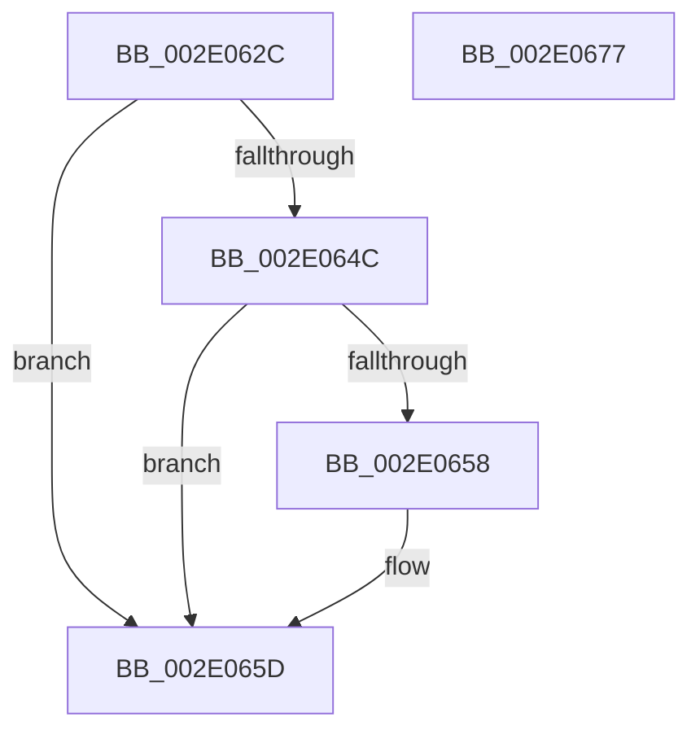

# sub_002E062C

- RVA: `0x002E062C`–`0x002E0678` (길이 `76` bytes)
- VA: `0x00000001402E062C`
- 실행 섹션: `.text`
- PDB 이름 있음: `아니요`; PDB Function 태그: `아니요`
- unwind 정보 RVA: `0x00070BBC`
- 디코드: `21`개 명령, `76/76` bytes 표시
- 미해석 바이트: `0` (있으면 어셈블리에 `.byte`로 보존)

> 이 문서는 커널 이미지의 기계어와 PDB 기호를 분석해 생성했습니다. 4번과 5번은 함수 원형과 자료형을 바이너리 사용 방식에서 추정한 C 해석이며 원본 소스 복구 결과는 아닙니다.

## 1. Dependencies

- 직접 호출 지점: **3**; 고유 호출 대상: **3**
- 직접 호출자로 확인된 함수: **0**
- RIP 상대 이미지 참조: **0**

### Outgoing calls
- `0x002E0633` → [KeAbPostRelease](KeAbPostRelease_function_002E1600.md) (function, `0x002E1600`)
- `0x002E0658` → [KiCheckForKernelApcDelivery](KiCheckForKernelApcDelivery_function_002E2C80.md) (function, `0x002E2C80`)
- `0x002E0664` → [_security_check_cookie](../6A/_security_check_cookie_function_006AC640.md) (function, `0x006AC640`)

### Direct callers
- 이 함수 시작 RVA로 연결되는 직접 call은 확인되지 않았습니다. 간접 호출은 완전히 역산할 수 없습니다.

### Static image references
- 디코드된 RIP-relative 메모리 참조가 없습니다.

## 2. Other-region calls and transfers

- 다른 실행 섹션으로 향하는 call: **0**
- 별도 외부 분기/꼬리 이동을 확인하지 못했습니다.

## 3. Assembly (complete function range)

```asm
002E062C  49 8D 8F B8 01 00 00            lea rcx, [r15 + 0x1b8]
002E0633  E8 C8 0F 00 00                  call 0x1402e1600
002E0638  65 48 8B 04 25 88 01 00 00      mov rax, qword ptr gs:[0x188]
002E0641  90                              nop
002E0642  66 83 80 E6 01 00 00 01         add word ptr [rax + 0x1e6], 1
002E064A  75 11                           jne 0x1402e065d
002E064C  48 05 98 00 00 00               add rax, 0x98
002E0652  90                              nop
002E0653  48 39 00                        cmp qword ptr [rax], rax
002E0656  74 05                           je 0x1402e065d
002E0658  E8 23 26 00 00                  call 0x1402e2c80
002E065D  48 8B 4D F0                     mov rcx, qword ptr [rbp - 0x10]
002E0661  48 33 CC                        xor rcx, rsp
002E0664  E8 D7 BF 3C 00                  call 0x1406ac640
002E0669  48 81 C4 18 01 00 00            add rsp, 0x118
002E0670  41 5F                           pop r15
002E0672  41 5D                           pop r13
002E0674  5B                              pop rbx
002E0675  5D                              pop rbp
002E0676  C3                              ret
002E0677  CC                              int3
```

## 4. C-style interpretation (structured pseudocode)

```c
__int64 __fastcall sub_002E062C(void)
{
    __int64 result;
    __int64 v_rsp;

    result = KeAbPostRelease(v_r15 + 440, a2, a3, a4);
    if (condition_is_not_equal) goto loc_002E065D;
    result = (*(unsigned __int64 *)(gs_base + (0 + 392))) + (152);
    if ((*(unsigned __int64 *)(result)) != result) {
        result = KiCheckForKernelApcDelivery(v_r15 + 440, a2, a3, a4);
    }
    a1 = (*(unsigned __int64 *)(v_rbp - 16)) ^ (v_rsp);
    result = _security_check_cookie(a1, a2, a3, a4);
    v_rsp = (v_rsp) + (280);
    return result;
}
```

## 5. (Beta) C Style

```c
void sub_002E062C(void)
{
    int64_t result;
    int64_t local_rsp;

    result = KeAbPostRelease(local_r15 + 440, a2, a3, a4);
    if (condition_is_not_equal) goto loc_002E065D;
    result = (*(uint64_t *)(gs_base + (0 + 0x188))) + (152);
    if ((*(uint64_t *)(result)) != result) {
        result = KiCheckForKernelApcDelivery(local_r15 + 440, a2, a3, a4);
    }
    a1 = (*(uint64_t *)(local_rbp - 0x10)) ^ (local_rsp);
    result = _security_check_cookie(a1, a2, a3, a4);
    local_rsp = (local_rsp) + (280);
    return result;
}
```

## 6. Execution-region graph

[열기: 2D/3D 그래프와 함수 탐색 컨트롤 패널](../../../control-panel.html?section=text&rva=0x002E062C&view=graph)

- 2D 그래프는 위에서 아래로 흐르고, 3D 그래프는 빈 공간을 드래그해 회전합니다. Shift+드래그는 이동, 휠은 확대·축소, 함수 노드 선택은 대상 보고서 이동입니다.

### Static fallback


