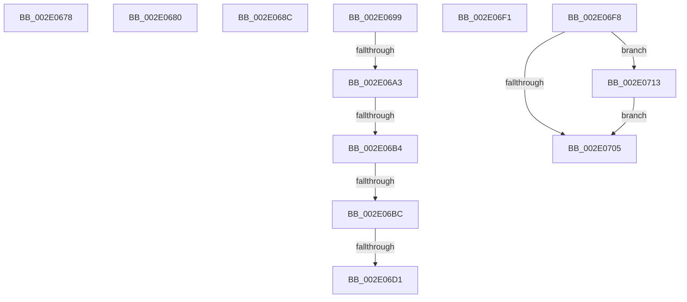

# sub_002E0678

- RVA: `0x002E0678`–`0x002E0725` (길이 `173` bytes)
- VA: `0x00000001402E0678`
- 실행 섹션: `.text`
- PDB 이름 있음: `아니요`; PDB Function 태그: `아니요`
- unwind 정보 RVA: `0x00070BD0`
- 디코드: `42`개 명령, `173/173` bytes 표시
- 미해석 바이트: `0` (있으면 어셈블리에 `.byte`로 보존)

> 이 문서는 커널 이미지의 기계어와 PDB 기호를 분석해 생성했습니다. 4번과 5번은 함수 원형과 자료형을 바이너리 사용 방식에서 추정한 C 해석이며 원본 소스 복구 결과는 아닙니다.

## 1. Dependencies

- 직접 호출 지점: **1**; 고유 호출 대상: **1**
- 직접 호출자로 확인된 함수: **0**
- RIP 상대 이미지 참조: **0**

### Outgoing calls
- `0x002E06E1` → [B_TREE<_SM_PAGE_KEY,SMKM_STORE_MGR<SM_TRAITS>::SMKM_FRONTEND_ENTRY,4096,B_TREE_DUMMY_NODE_POOL,B_TREE_KEY_COMPARATOR<_SM_PAGE_KEY> >::BTreeDeleteEx](../26/B_TREE__SM_PAGE_KEY_SMKM_STORE_MGR_SM_TRAITS_SMKM_FRONTEND_ENTRY_4096_B_TREE_DUMMY_NODE_POOL_B_TREE__function_00266C00.md) (function, `0x00266C00`)

### Direct callers
- 이 함수 시작 RVA로 연결되는 직접 call은 확인되지 않았습니다. 간접 호출은 완전히 역산할 수 없습니다.

### Static image references
- 디코드된 RIP-relative 메모리 참조가 없습니다.

## 2. Other-region calls and transfers

- 다른 실행 섹션으로 향하는 call: **0**
- call이 아닌 외부 분기/꼬리 이동: **10**
  - `0x002E067B` → [sub_002E03B8 + 0x19E](Unknown_function_002E03B8.md) (`tail-transfer`)
  - `0x002E0687` → [sub_002E03B8 + 0xF4](Unknown_function_002E03B8.md) (`tail-transfer`)
  - `0x002E0694` → [sub_002E03B8 + 0x108](Unknown_function_002E03B8.md) (`tail-transfer`)
  - `0x002E069D` → [sub_002E03B8 + 0x22E](Unknown_function_002E03B8.md) (`tail-transfer`)
  - `0x002E06AE` → [sub_002E0736 + 0x38](Unknown_function_002E0736.md) (`tail-transfer`)
  - `0x002E06B6` → [sub_002E0736 + 0x38](Unknown_function_002E0736.md) (`tail-transfer`)
  - `0x002E06CB` → [sub_002E0736 + 0x49](Unknown_function_002E0736.md) (`tail-transfer`)
  - `0x002E06EC` → [sub_002E03B8 + 0x22E](Unknown_function_002E03B8.md) (`tail-transfer`)
  - `0x002E06F3` → [sub_002E03B8 + 0xB2](Unknown_function_002E03B8.md) (`tail-transfer`)
  - `0x002E070E` → [sub_002E03B8 + 0x210](Unknown_function_002E03B8.md) (`tail-transfer`)

## 3. Assembly (complete function range)

```asm
002E0678  41 8B D0                        mov edx, r8d
002E067B  E9 D6 FE FF FF                  jmp 0x1402e0556
002E0680  33 FF                           xor edi, edi
002E0682  4C 8D 5C 24 48                  lea r11, [rsp + 0x48]
002E0687  E9 20 FE FF FF                  jmp 0x1402e04ac
002E068C  49 8D 42 08                     lea rax, [r10 + 8]
002E0690  4D 8B 52 08                     mov r10, qword ptr [r10 + 8]
002E0694  E9 27 FE FF FF                  jmp 0x1402e04c0
002E0699  83 7D 60 00                     cmp dword ptr [rbp + 0x60], 0
002E069D  0F 8D 43 FF FF FF               jge 0x1402e05e6
002E06A3  C6 42 06 00                     mov byte ptr [rdx + 6], 0
002E06A7  8B 44 24 58                     mov eax, dword ptr [rsp + 0x58]
002E06AB  83 F8 FF                        cmp eax, -1
002E06AE  0F 84 BA 00 00 00               je 0x1402e076e
002E06B4  85 C0                           test eax, eax
002E06B6  0F 84 B2 00 00 00               je 0x1402e076e
002E06BC  8D 48 FF                        lea ecx, [rax - 1]
002E06BF  48 C1 E1 04                     shl rcx, 4
002E06C3  48 03 4C 24 40                  add rcx, qword ptr [rsp + 0x40]
002E06C8  48 39 31                        cmp qword ptr [rcx], rsi
002E06CB  0F 85 AE 00 00 00               jne 0x1402e077f
002E06D1  48 89 79 08                     mov qword ptr [rcx + 8], rdi
002E06D5  49 8D 8F C0 01 00 00            lea rcx, [r15 + 0x1c0]
002E06DC  48 8D 54 24 40                  lea rdx, [rsp + 0x40]
002E06E1  E8 1A 65 F8 FF                  call 0x140266c00
002E06E6  41 BE 01 00 00 00               mov r14d, 1
002E06EC  E9 F5 FE FF FF                  jmp 0x1402e05e6
002E06F1  FF C3                           inc ebx
002E06F3  E9 72 FD FF FF                  jmp 0x1402e046a
002E06F8  48 8B 46 08                     mov rax, qword ptr [rsi + 8]
002E06FC  48 8D 48 10                     lea rcx, [rax + 0x10]
002E0700  48 85 C0                        test rax, rax
002E0703  75 0E                           jne 0x1402e0713
002E0705  33 D2                           xor edx, edx
002E0707  48 85 C0                        test rax, rax
002E070A  48 0F 45 D1                     cmovne rdx, rcx
002E070E  E9 B5 FE FF FF                  jmp 0x1402e05c8
002E0713  48 8B F0                        mov rsi, rax
002E0716  48 89 44 24 20                  mov qword ptr [rsp + 0x20], rax
002E071B  48 8B F9                        mov rdi, rcx
002E071E  48 89 4C 24 28                  mov qword ptr [rsp + 0x28], rcx
002E0723  EB E0                           jmp 0x1402e0705
```

## 4. C-style interpretation (structured pseudocode)

```c
__int64 __fastcall sub_002E0678(__int64 a1, __int64 a2, int a3)
{
    unsigned __int64 v_stack_p20;
    unsigned __int64 v_stack_p28;
    unsigned __int64 v_stack_p40;
    unsigned __int64 v_stack_p48;
    unsigned int v_stack_p58;
}
```

## 5. (Beta) C Style

```c
int64_t sub_002E0678(int64_t Arg1, int64_t Arg2, int32_t Arg3)
{
    uint64_t v_stack_p20;
    uint64_t v_stack_p28;
    uint64_t v_stack_p40;
    uint64_t v_stack_p48;
    uint32_t v_stack_p58;
}
```

## 6. Execution-region graph

[열기: 2D/3D 그래프와 함수 탐색 컨트롤 패널](../../../control-panel.html?section=text&rva=0x002E0678&view=graph)

- 2D 그래프는 위에서 아래로 흐르고, 3D 그래프는 빈 공간을 드래그해 회전합니다. Shift+드래그는 이동, 휠은 확대·축소, 함수 노드 선택은 대상 보고서 이동입니다.

### Static fallback


