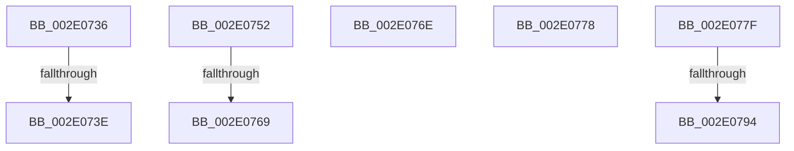

# sub_002E0736

- RVA: `0x002E0736`–`0x002E07A1` (길이 `107` bytes)
- VA: `0x00000001402E0736`
- 실행 섹션: `.text`
- PDB 이름 있음: `아니요`; PDB Function 태그: `아니요`
- unwind 정보 RVA: `0x00070C00`
- 디코드: `22`개 명령, `107/107` bytes 표시
- 미해석 바이트: `0` (있으면 어셈블리에 `.byte`로 보존)

> 이 문서는 커널 이미지의 기계어와 PDB 기호를 분석해 생성했습니다. 4번과 5번은 함수 원형과 자료형을 바이너리 사용 방식에서 추정한 C 해석이며 원본 소스 복구 결과는 아닙니다.

## 1. Dependencies

- 직접 호출 지점: **2**; 고유 호출 대상: **2**
- 직접 호출자로 확인된 함수: **0**
- RIP 상대 이미지 참조: **0**

### Outgoing calls
- `0x002E075C` → [SmArrayGrow](../3A/SmArrayGrow_function_003AC6C8.md) (function, `0x003AC6C8`)
- `0x002E0784` → [B_TREE<_SM_PAGE_KEY,SMKM_STORE_MGR<SM_TRAITS>::SMKM_FRONTEND_ENTRY,4096,B_TREE_DUMMY_NODE_POOL,B_TREE_KEY_COMPARATOR<_SM_PAGE_KEY> >::BTreeSearchResultDeref](B_TREE__SM_PAGE_KEY_SMKM_STORE_MGR_SM_TRAITS_SMKM_FRONTEND_ENTRY_4096_B_TREE_DUMMY_NODE_POOL_B_TREE__function_002E07C0.md) (function, `0x002E07C0`)

### Direct callers
- 이 함수 시작 RVA로 연결되는 직접 call은 확인되지 않았습니다. 간접 호출은 완전히 역산할 수 없습니다.

### Static image references
- 디코드된 RIP-relative 메모리 참조가 없습니다.

## 2. Other-region calls and transfers

- 다른 실행 섹션으로 향하는 call: **0**
- call이 아닌 외부 분기/꼬리 이동: **8**
  - `0x002E0738` → [sub_002E03B8 + 0x1C9](Unknown_function_002E03B8.md) (`tail-transfer`)
  - `0x002E074D` → [sub_002E03B8 + 0x1C9](Unknown_function_002E03B8.md) (`tail-transfer`)
  - `0x002E0763` → [sub_002E03B8 + 0x1C9](Unknown_function_002E03B8.md) (`tail-transfer`)
  - `0x002E0769` → [sub_002E03B8 + 0xEF](Unknown_function_002E03B8.md) (`tail-transfer`)
  - `0x002E0773` → [sub_002E0678 + 0x50](Unknown_function_002E0678.md) (`tail-transfer`)
  - `0x002E077A` → [sub_002E03B8 + 0x210](Unknown_function_002E03B8.md) (`tail-transfer`)
  - `0x002E078E` → [sub_006DDF7C](../6D/Unknown_function_006DDF7C.md) (`tail-transfer`)
  - `0x002E079C` → [sub_002E0678 + 0x5D](Unknown_function_002E0678.md) (`tail-transfer`)

## 3. Assembly (complete function range)

```asm
002E0736  85 FF                           test edi, edi
002E0738  0F 85 43 FE FF FF               jne 0x1402e0581
002E073E  49 C7 03 00 00 00 00            mov qword ptr [r11], 0
002E0745  49 C7 43 08 00 00 00 00         mov qword ptr [r11 + 8], 0
002E074D  E9 2F FE FF FF                  jmp 0x1402e0581
002E0752  4C 8D 4C 24 40                  lea r9, [rsp + 0x40]
002E0757  4C 8D 44 24 5C                  lea r8, [rsp + 0x5c]
002E075C  E8 67 BF 0C 00                  call 0x1403ac6c8
002E0761  85 C0                           test eax, eax
002E0763  0F 84 18 FE FF FF               je 0x1402e0581
002E0769  E9 39 FD FF FF                  jmp 0x1402e04a7
002E076E  48 8D 4C 24 48                  lea rcx, [rsp + 0x48]
002E0773  E9 50 FF FF FF                  jmp 0x1402e06c8
002E0778  33 D2                           xor edx, edx
002E077A  E9 49 FE FF FF                  jmp 0x1402e05c8
002E077F  48 8D 54 24 40                  lea rdx, [rsp + 0x40]
002E0784  E8 37 00 00 00                  call 0x1402e07c0
002E0789  83 7C 24 58 FF                  cmp dword ptr [rsp + 0x58], -1
002E078E  0F 85 E8 D7 3F 00               jne 0x1406ddf7c
002E0794  0F 10 44 24 20                  movups xmm0, xmmword ptr [rsp + 0x20]
002E0799  0F 11 01                        movups xmmword ptr [rcx], xmm0
002E079C  E9 34 FF FF FF                  jmp 0x1402e06d5
```

## 4. C-style interpretation (structured pseudocode)

```c
__int64 __fastcall sub_002E0736(__int64 a1, int a2)
{
    unsigned __int64 v_stack_p20;
    unsigned __int64 v_stack_p40;
    unsigned __int64 v_stack_p48;
    unsigned int v_stack_p58;
    unsigned __int64 v_stack_p5C;

    *(unsigned __int64 *)(v_r11) = 0;
    *(unsigned __int64 *)(v_r11 + 8) = 0;
}
```

## 5. (Beta) C Style

```c
int64_t sub_002E0736(int64_t Arg1, int32_t Arg2)
{
    uint64_t v_stack_p20;
    uint64_t v_stack_p40;
    uint64_t v_stack_p48;
    uint32_t v_stack_p58;
    uint64_t v_stack_p5C;

    *(uint64_t *)(local_r11) = 0;
    *(uint64_t *)(local_r11 + 0x8) = 0;
}
```

## 6. Execution-region graph

[열기: 2D/3D 그래프와 함수 탐색 컨트롤 패널](../../../control-panel.html?section=text&rva=0x002E0736&view=graph)

- 2D 그래프는 위에서 아래로 흐르고, 3D 그래프는 빈 공간을 드래그해 회전합니다. Shift+드래그는 이동, 휠은 확대·축소, 함수 노드 선택은 대상 보고서 이동입니다.

### Static fallback


