# sub_002E087E

- RVA: `0x002E087E`–`0x002E0B14` (길이 `662` bytes)
- VA: `0x00000001402E087E`
- 실행 섹션: `.text`
- PDB 이름 있음: `아니요`; PDB Function 태그: `아니요`
- unwind 정보 RVA: `0x00070C64`
- 디코드: `160`개 명령, `662/662` bytes 표시
- 미해석 바이트: `0` (있으면 어셈블리에 `.byte`로 보존)

> 이 문서는 커널 이미지의 기계어와 PDB 기호를 분석해 생성했습니다. 4번과 5번은 함수 원형과 자료형을 바이너리 사용 방식에서 추정한 C 해석이며 원본 소스 복구 결과는 아닙니다.

## 1. Dependencies

- 직접 호출 지점: **9**; 고유 호출 대상: **9**
- 직접 호출자로 확인된 함수: **0**
- RIP 상대 이미지 참조: **3**

### Outgoing calls
- `0x002E0943` → [KeAbPreAcquire](../21/KeAbPreAcquire_function_00210230.md) (function, `0x00210230`)
- `0x002E0965` → [ExfAcquirePushLockSharedEx](../21/ExfAcquirePushLockSharedEx_function_0021044C.md) (function, `0x0021044C`)
- `0x002E09B3` → [ExpAcquireSpinLockSharedAtDpcLevelInstrumented](../27/ExpAcquireSpinLockSharedAtDpcLevelInstrumented_function_0027CD20.md) (function, `0x0027CD20`)
- `0x002E0A07` → [KiLowerIrqlProcessIrqlFlags](../4F/KiLowerIrqlProcessIrqlFlags_function_004F5698.md) (function, `0x004F5698`)
- `0x002E0A56` → [MiViewMayContainPage](MiViewMayContainPage_function_002E11F0.md) (function, `0x002E11F0`)
- `0x002E0A96` → [ExfReleasePushLockShared](../26/ExfReleasePushLockShared_function_00263440.md) (function, `0x00263440`)
- `0x002E0A9F` → [KeAbPostRelease](KeAbPostRelease_function_002E1600.md) (function, `0x002E1600`)
- `0x002E0ABC` → [KiCheckForKernelApcDelivery](KiCheckForKernelApcDelivery_function_002E2C80.md) (function, `0x002E2C80`)
- `0x002E0AE7` → [MiTrimSharedPageFromViews](MiTrimSharedPageFromViews_function_002E16F8.md) (function, `0x002E16F8`)

### Direct callers
- 이 함수 시작 RVA로 연결되는 직접 call은 확인되지 않았습니다. 간접 호출은 완전히 역산할 수 없습니다.

### Static image references
- `0x002E0984` → RVA `0x00FC6D20` (`ALMOSTRO`; read)
- `0x002E0991` → RVA `0x00FC6B06` (`ALMOSTRO`; read)
- `0x002E099E` → RVA `0x00F0DE58` (`.data`; read)

## 2. Other-region calls and transfers

- 다른 실행 섹션으로 향하는 call: **0**
- call이 아닌 외부 분기/꼬리 이동: **12**
  - `0x002E0890` → [sub_002E0B15](Unknown_function_002E0B15.md) (`tail-transfer`)
  - `0x002E0899` → [sub_002E0B15 + 0x5A9](Unknown_function_002E0B15.md) (`tail-transfer`)
  - `0x002E08E0` → [sub_002E0B15 + 0x41](Unknown_function_002E0B15.md) (`tail-transfer`)
  - `0x002E08E9` → [sub_002E0B15 + 0x5B1](Unknown_function_002E0B15.md) (`tail-transfer`)
  - `0x002E098B` → [sub_002E0B15 + 0x41D](Unknown_function_002E0B15.md) (`tail-transfer`)
  - `0x002E0998` → [sub_002E0B15 + 0x7B](Unknown_function_002E0B15.md) (`tail-transfer`)
  - `0x002E09A6` → [sub_002E0B15 + 0x7B](Unknown_function_002E0B15.md) (`tail-transfer`)
  - `0x002E09C1` → [sub_002E0B15 + 0x4F9](Unknown_function_002E0B15.md) (`tail-transfer`)
  - `0x002E09D7` → [sub_002E0B15 + 0x444](Unknown_function_002E0B15.md) (`tail-transfer`)
  - `0x002E09E4` → [sub_002E0B15 + 0x586](Unknown_function_002E0B15.md) (`tail-transfer`)
  - `0x002E0A1A` → [sub_002E0B15 + 0xA9](Unknown_function_002E0B15.md) (`tail-transfer`)
  - `0x002E0AC4` → [sub_002E0B15 + 0x514](Unknown_function_002E0B15.md) (`tail-transfer`)

## 3. Assembly (complete function range)

```asm
002E087E  48 89 AC 24 B0 00 00 00         mov qword ptr [rsp + 0xb0], rbp
002E0886  4C 89 B4 24 A8 00 00 00         mov qword ptr [rsp + 0xa8], r14
002E088E  A8 20                           test al, 0x20
002E0890  0F 85 7F 02 00 00               jne 0x1402e0b15
002E0896  48 85 D2                        test rdx, rdx
002E0899  0F 84 1F 08 00 00               je 0x1402e10be
002E089F  48 8B CF                        mov rcx, rdi
002E08A2  48 2B CA                        sub rcx, rdx
002E08A5  48 C1 F9 03                     sar rcx, 3
002E08A9  48 C1 E1 0C                     shl rcx, 0xc
002E08AD  41 8B 6C 24 20                  mov ebp, dword ptr [r12 + 0x20]
002E08B2  41 8B 44 24 24                  mov eax, dword ptr [r12 + 0x24]
002E08B7  81 E5 C0 FF 00 00               and ebp, 0xffc0
002E08BD  48 C1 E5 1A                     shl rbp, 0x1a
002E08C1  48 0B E8                        or rbp, rax
002E08C4  48 C1 E5 0C                     shl rbp, 0xc
002E08C8  48 03 E9                        add rbp, rcx
002E08CB  48 8B 7E 10                     mov rdi, qword ptr [rsi + 0x10]
002E08CF  48 8B 76 20                     mov rsi, qword ptr [rsi + 0x20]
002E08D3  4C 8B 0E                        mov r9, qword ptr [rsi]
002E08D6  41 8B 41 38                     mov eax, dword ptr [r9 + 0x38]
002E08DA  48 8B 56 08                     mov rdx, qword ptr [rsi + 8]
002E08DE  A8 20                           test al, 0x20
002E08E0  0F 85 70 02 00 00               jne 0x1402e0b56
002E08E6  48 85 D2                        test rdx, rdx
002E08E9  0F 84 D7 07 00 00               je 0x1402e10c6
002E08EF  48 8B CF                        mov rcx, rdi
002E08F2  48 2B CA                        sub rcx, rdx
002E08F5  48 C1 F9 03                     sar rcx, 3
002E08F9  48 C1 E1 0C                     shl rcx, 0xc
002E08FD  8B 7E 20                        mov edi, dword ptr [rsi + 0x20]
002E0900  8B 46 24                        mov eax, dword ptr [rsi + 0x24]
002E0903  81 E7 C0 FF 00 00               and edi, 0xffc0
002E0909  48 C1 E7 1A                     shl rdi, 0x1a
002E090D  48 0B F8                        or rdi, rax
002E0910  48 C1 E7 0C                     shl rdi, 0xc
002E0914  48 03 F9                        add rdi, rcx
002E0917  48 8D 87 00 10 00 00            lea rax, [rdi + 0x1000]
002E091E  4D 8B F0                        mov r14, r8
002E0921  48 89 44 24 70                  mov qword ptr [rsp + 0x70], rax
002E0926  49 8D 4D 68                     lea rcx, [r13 + 0x68]
002E092A  65 48 8B 04 25 88 01 00 00      mov rax, qword ptr gs:[0x188]
002E0933  41 8B F0                        mov esi, r8d
002E0936  45 33 C0                        xor r8d, r8d
002E0939  33 D2                           xor edx, edx
002E093B  66 FF 88 E6 01 00 00            dec word ptr [rax + 0x1e6]
002E0942  90                              nop
002E0943  E8 E8 F8 F2 FF                  call 0x140210230
002E0948  48 8B F8                        mov rdi, rax
002E094B  49 8D 4D 68                     lea rcx, [r13 + 0x68]
002E094F  33 C0                           xor eax, eax
002E0951  BA 11 00 00 00                  mov edx, 0x11
002E0956  F0 48 0F B1 11                  lock cmpxchg qword ptr [rcx], rdx
002E095B  74 0D                           je 0x1402e096a
002E095D  4C 8B C9                        mov r9, rcx
002E0960  4C 8B C7                        mov r8, rdi
002E0963  33 D2                           xor edx, edx
002E0965  E8 E2 FA F2 FF                  call 0x14021044c
002E096A  48 85 FF                        test rdi, rdi
002E096D  74 04                           je 0x1402e0973
002E096F  C6 47 0A 01                     mov byte ptr [rdi + 0xa], 1
002E0973  4D 8D 45 48                     lea r8, [r13 + 0x48]
002E0977  44 0F 20 C7                     mov rdi, cr8
002E097B  B8 02 00 00 00                  mov eax, 2
002E0980  44 0F 22 C0                     mov cr8, rax
002E0984  83 3D 95 63 CE 00 00            cmp dword ptr [rip + 0xce6395], 0
002E098B  0F 85 A1 05 00 00               jne 0x1402e0f32
002E0991  F6 05 6E 61 CE 00 21            test byte ptr [rip + 0xce616e], 0x21
002E0998  0F 84 F2 01 00 00               je 0x1402e0b90
002E099E  8B 05 B4 D4 C2 00               mov eax, dword ptr [rip + 0xc2d4b4]
002E09A4  85 C0                           test eax, eax
002E09A6  0F 85 E4 01 00 00               jne 0x1402e0b90
002E09AC  40 0F B6 D7                     movzx edx, dil
002E09B0  49 8B C8                        mov rcx, r8
002E09B3  E8 68 C3 F9 FF                  call 0x14027cd20
002E09B8  4D 8D 45 48                     lea r8, [r13 + 0x48]
002E09BC  49 83 7D 28 00                  cmp qword ptr [r13 + 0x28], 0
002E09C1  0F 84 47 06 00 00               je 0x1402e100e
002E09C7  49 8B 45 08                     mov rax, qword ptr [r13 + 8]
002E09CB  48 89 84 24 90 00 00 00         mov qword ptr [rsp + 0x90], rax
002E09D3  40 80 FF 11                     cmp dil, 0x11
002E09D7  0F 84 7C 05 00 00               je 0x1402e0f59
002E09DD  F6 05 22 61 CE 00 01            test byte ptr [rip + 0xce6122], 1
002E09E4  0F 85 B1 06 00 00               jne 0x1402e109b
002E09EA  F0 41 81 20 FF FF FF BF         lock and dword ptr [r8], 0xbfffffff
002E09F2  F0 41 FF 08                     lock dec dword ptr [r8]
002E09F6  83 3D 23 63 CE 00 00            cmp dword ptr [rip + 0xce6323], 0
002E09FD  74 0D                           je 0x1402e0a0c
002E09FF  44 0F 20 C1                     mov rcx, cr8
002E0A03  40 0F B6 D7                     movzx edx, dil
002E0A07  E8 8C 4C 21 00                  call 0x1404f5698
002E0A0C  40 0F B6 C7                     movzx eax, dil
002E0A10  44 0F 22 C0                     mov cr8, rax
002E0A14  41 8B 45 38                     mov eax, dword ptr [r13 + 0x38]
002E0A18  A8 20                           test al, 0x20
002E0A1A  0F 84 9E 01 00 00               je 0x1402e0bbe
002E0A20  48 8B BC 24 90 00 00 00         mov rdi, qword ptr [rsp + 0x90]
002E0A28  4D 8D 65 08                     lea r12, [r13 + 8]
002E0A2C  49 3B FC                        cmp rdi, r12
002E0A2F  74 48                           je 0x1402e0a79
002E0A31  48 8D 44 24 50                  lea rax, [rsp + 0x50]
002E0A36  4C 8B CF                        mov r9, rdi
002E0A39  48 89 44 24 30                  mov qword ptr [rsp + 0x30], rax
002E0A3E  44 8B C3                        mov r8d, ebx
002E0A41  48 8B 44 24 70                  mov rax, qword ptr [rsp + 0x70]
002E0A46  49 8B D7                        mov rdx, r15
002E0A49  48 89 44 24 28                  mov qword ptr [rsp + 0x28], rax
002E0A4E  49 8B CD                        mov rcx, r13
002E0A51  48 89 6C 24 20                  mov qword ptr [rsp + 0x20], rbp
002E0A56  E8 95 07 00 00                  call 0x1402e11f0
002E0A5B  8B F0                           mov esi, eax
002E0A5D  85 C0                           test eax, eax
002E0A5F  78 18                           js 0x1402e0a79
002E0A61  48 8B 4C 24 50                  mov rcx, qword ptr [rsp + 0x50]
002E0A66  48 85 C9                        test rcx, rcx
002E0A69  74 06                           je 0x1402e0a71
002E0A6B  4C 89 31                        mov qword ptr [rcx], r14
002E0A6E  4C 8B F1                        mov r14, rcx
002E0A71  48 8B 3F                        mov rdi, qword ptr [rdi]
002E0A74  49 3B FC                        cmp rdi, r12
002E0A77  75 B8                           jne 0x1402e0a31
002E0A79  65 48 8B 3C 25 88 01 00 00      mov rdi, qword ptr gs:[0x188]
002E0A82  B8 11 00 00 00                  mov eax, 0x11
002E0A87  45 33 C9                        xor r9d, r9d
002E0A8A  F0 4D 0F B1 4D 68               lock cmpxchg qword ptr [r13 + 0x68], r9
002E0A90  74 09                           je 0x1402e0a9b
002E0A92  49 8D 4D 68                     lea rcx, [r13 + 0x68]
002E0A96  E8 A5 29 F8 FF                  call 0x140263440
002E0A9B  49 8D 4D 68                     lea rcx, [r13 + 0x68]
002E0A9F  E8 5C 0B 00 00                  call 0x1402e1600
002E0AA4  90                              nop
002E0AA5  66 83 87 E6 01 00 00 01         add word ptr [rdi + 0x1e6], 1
002E0AAD  75 12                           jne 0x1402e0ac1
002E0AAF  48 8D 87 98 00 00 00            lea rax, [rdi + 0x98]
002E0AB6  90                              nop
002E0AB7  48 39 00                        cmp qword ptr [rax], rax
002E0ABA  74 05                           je 0x1402e0ac1
002E0ABC  E8 BF 21 00 00                  call 0x1402e2c80
002E0AC1  4D 85 FF                        test r15, r15
002E0AC4  0F 85 5F 05 00 00               jne 0x1402e1029
002E0ACA  48 8B 84 24 88 00 00 00         mov rax, qword ptr [rsp + 0x88]
002E0AD2  4D 8B CD                        mov r9, r13
002E0AD5  8B 94 24 00 01 00 00            mov edx, dword ptr [rsp + 0x100]
002E0ADC  44 8B C3                        mov r8d, ebx
002E0ADF  49 8B CE                        mov rcx, r14
002E0AE2  48 89 44 24 20                  mov qword ptr [rsp + 0x20], rax
002E0AE7  E8 0C 0C 00 00                  call 0x1402e16f8
002E0AEC  85 F6                           test esi, esi
002E0AEE  0F 49 F0                        cmovns esi, eax
002E0AF1  8B C6                           mov eax, esi
002E0AF3  48 8B AC 24 B0 00 00 00         mov rbp, qword ptr [rsp + 0xb0]
002E0AFB  4C 8B B4 24 A8 00 00 00         mov r14, qword ptr [rsp + 0xa8]
002E0B03  48 81 C4 B8 00 00 00            add rsp, 0xb8
002E0B0A  41 5F                           pop r15
002E0B0C  41 5D                           pop r13
002E0B0E  41 5C                           pop r12
002E0B10  5F                              pop rdi
002E0B11  5E                              pop rsi
002E0B12  5B                              pop rbx
002E0B13  C3                              ret
```

## 4. C-style interpretation (structured pseudocode)

```c
__int64 __fastcall sub_002E087E(__int64 a1, __int64 a2, __int64 a3, __int64 a4, __int64 a5, __int64 a6, __int64 a7, __int64 a8, __int64 a9, __int64 a10, __int64 a11, __int64 a12, __int64 a13, __int64 a14, __int64 a15, __int64 a16, __int64 a17, __int64 a18, __int64 a19, __int64 a20, __int64 a21, __int64 a22, __int64 a23, __int64 a24, __int64 a25, __int64 a26, __int64 a27, __int64 a28, __int64 a29, __int64 a30, __int64 a31, unsigned int a32)
{
    __int64 result;
    __int64 v_r14;
    __int64 v_rbp;
    __int64 v_rdi;
    __int64 v_rsi;
    __int64 v_rsp;
    unsigned __int64 v_stack_p20;
    unsigned __int64 v_stack_p28;
    unsigned __int64 v_stack_p30;
    unsigned __int64 v_stack_p70;
    unsigned __int64 v_stack_p90;
    unsigned __int64 v_stack_pA8;
    unsigned __int64 v_stack_pB0;

    v_stack_pB0 = v_rbp;
    v_stack_pA8 = v_r14;
    a1 = (v_rdi) - (a2);
    a1 = (a1) >> (3);
    a1 = (a1) << (12);
    v_rbp = (unsigned int)(((unsigned int)(*(unsigned int *)(v_r12 + 32))) & (0xFFC0ULL));
    v_rbp = (v_rbp) << (26);
    v_rbp = (v_rbp) | ((unsigned int)(*(unsigned int *)(v_r12 + 36)));
    v_rbp = (v_rbp) << (12);
    v_rbp = (v_rbp) + (a1);
    a1 = (*(unsigned __int64 *)(v_rsi + 16)) - (*(unsigned __int64 *)(*(unsigned __int64 *)(v_rsi + 32) + 8));
    a1 = (a1) >> (3);
    a1 = (a1) << (12);
    v_rdi = (unsigned int)(((unsigned int)(*(unsigned int *)(*(unsigned __int64 *)(v_rsi + 32) + 32))) & (0xFFC0ULL));
    v_rdi = (v_rdi) << (26);
    v_rdi = (v_rdi) | ((unsigned int)(*(unsigned int *)(*(unsigned __int64 *)(v_rsi + 32) + 36)));
    v_rdi = (v_rdi) << (12);
    v_rdi = (v_rdi) + (a1);
    v_stack_p70 = v_rdi + 4096;
    a3 = 0;
    a2 = 0;
    result = KeAbPreAcquire(v_r13 + 104, a2, a3, *(unsigned __int64 *)(*(unsigned __int64 *)(v_rsi + 32)));
    result = 0;
    if (!(condition_is_equal)) {
        a4 = v_r13 + 104;
        a3 = 0;
        a2 = 0;
        result = ExfAcquirePushLockSharedEx(v_r13 + 104, a2, a3, a4);
    }
    if (result != 0) {
        *(unsigned __int8 *)(result + 10) = 1;
    }
    result = ExpAcquireSpinLockSharedAtDpcLevelInstrumented(v_r13 + 72, (unsigned __int8)(v_cr8), v_r13 + 72, a4);
    v_stack_p90 = *(unsigned __int64 *)(v_r13 + 8);
    result = *(unsigned __int64 *)(v_r13 + 8);
    if ((*(unsigned int *)(v_rip + 13525795)) != 0) {
        a1 = 2;
        a2 = (unsigned __int8)(v_cr8);
        result = KiLowerIrqlProcessIrqlFlags(a1, a2, v_r13 + 72, a4);
    }
    if (a18 == (v_r13 + 8)) goto loc_002E0A79;
loc_002E0A31:
    v_stack_p30 = a10;
    v_stack_p28 = a14;
    v_stack_p20 = v_rbp;
    result = MiViewMayContainPage(v_r13, v_r15, (unsigned int)((unsigned int)(v_rbx)), a18);
    if (sign_flag) goto loc_002E0A79;
    v_r14 = a3;
    if (a10 != 0) {
        *(unsigned __int64 *)(a10) = a3;
        v_r14 = a10;
    }
    if ((*(unsigned __int64 *)(a18)) != (v_r13 + 8)) goto loc_002E0A31;
loc_002E0A79:
    a4 = 0;
    result = 17;
    if (!(condition_is_equal)) {
        a1 = v_r13 + 104;
        result = ExfReleasePushLockShared(a1, v_r15, (unsigned int)((unsigned int)(v_rbx)), a4);
    }
    result = KeAbPostRelease(v_r13 + 104, v_r15, (unsigned int)((unsigned int)(v_rbx)), a4);
    if (condition_is_not_equal) goto loc_002E0AC1;
    result = *(unsigned __int64 *)(gs_base + (0 + 392)) + 152;
    if ((*(unsigned __int64 *)(*(unsigned __int64 *)(gs_base + (0 + 392)) + 152)) != (*(unsigned __int64 *)(gs_base + (0 + 392)) + 152)) {
        result = KiCheckForKernelApcDelivery(v_r13 + 104, v_r15, (unsigned int)((unsigned int)(v_rbx)), a4);
    }
    v_stack_p20 = a17;
    result = MiTrimSharedPageFromViews(v_r14, (unsigned int)(a32), (unsigned int)((unsigned int)(v_rbx)), v_r13);
    v_rsi = (unsigned int)((unsigned int)(result));
    if (!sign_flag) { v_rsi = (unsigned int)(result); }
    v_rsp = (v_rsp) + (184);
    return (unsigned int)((unsigned int)(v_rsi));
}
```

## 5. (Beta) C Style

```c
int64_t sub_002E087E(int64_t Arg1, int64_t Arg2, int64_t Arg3, int64_t Arg4, uint64_t Arg5, uint64_t Arg6, uint64_t Arg7, uint64_t Arg8, uint64_t Arg9, int64_t Arg10, uint64_t Arg11, uint64_t Arg12, uint64_t Arg13, int64_t Arg14, uint64_t Arg15, uint64_t Arg16, int64_t Arg17, int64_t Arg18, uint64_t Arg19, uint64_t Arg20, int64_t Arg21, int64_t Arg22, uint64_t Arg23, uint64_t Arg24, uint64_t Arg25, uint64_t Arg26, uint64_t Arg27, uint64_t Arg28, uint64_t Arg29, uint64_t Arg30, uint64_t Arg31, uint32_t Arg32)
{
    int64_t result;
    int64_t local_r14;
    int64_t local_rbp;
    int64_t local_rdi;
    int64_t local_rsi;
    int64_t local_rsp;
    uint64_t v_stack_p20;
    uint64_t v_stack_p28;
    uint64_t v_stack_p30;
    uint64_t v_stack_p70;
    uint64_t v_stack_p90;
    uint64_t v_stack_pA8;
    uint64_t v_stack_pB0;

    v_stack_pB0 = local_rbp;
    v_stack_pA8 = local_r14;
    Arg1 = (local_rdi) - (Arg2);
    Arg1 = (Arg1) >> (3);
    Arg1 = (Arg1) << (12);
    local_rbp = (uint32_t)(((uint32_t)(*(uint32_t *)(local_r12 + 0x20))) & (0xFFC0ULL));
    local_rbp = (local_rbp) << (26);
    local_rbp = (local_rbp) | ((uint32_t)(*(uint32_t *)(local_r12 + 0x24)));
    local_rbp = (local_rbp) << (12);
    local_rbp = (local_rbp) + (Arg1);
    Arg1 = (*(uint64_t *)(local_rsi + 0x10)) - (*(uint64_t *)(*(uint64_t *)(local_rsi + 0x20) + 0x8));
    Arg1 = (Arg1) >> (3);
    Arg1 = (Arg1) << (12);
    local_rdi = (uint32_t)(((uint32_t)(*(uint32_t *)(*(uint64_t *)(local_rsi + 0x20) + 0x20))) & (0xFFC0ULL));
    local_rdi = (local_rdi) << (26);
    local_rdi = (local_rdi) | ((uint32_t)(*(uint32_t *)(*(uint64_t *)(local_rsi + 0x20) + 0x24)));
    local_rdi = (local_rdi) << (12);
    local_rdi = (local_rdi) + (Arg1);
    v_stack_p70 = local_rdi + 4096;
    Arg3 = 0;
    Arg2 = 0;
    result = KeAbPreAcquire(local_r13 + 104, Arg2, Arg3, *(uint64_t *)(*(uint64_t *)(local_rsi + 0x20)));
    result = 0;
    if (!(condition_is_equal)) {
        Arg4 = local_r13 + 104;
        Arg3 = 0;
        Arg2 = 0;
        result = ExfAcquirePushLockSharedEx(local_r13 + 104, Arg2, Arg3, Arg4);
    }
    if (result != 0) {
        *(uint8_t *)(result + 0xA) = 1;
    }
    result = ExpAcquireSpinLockSharedAtDpcLevelInstrumented(local_r13 + 72, (uint8_t)(v_cr8), local_r13 + 72, Arg4);
    v_stack_p90 = *(uint64_t *)(local_r13 + 0x8);
    result = *(uint64_t *)(local_r13 + 0x8);
    if ((*(uint32_t *)(v_rip + 0xCE6323)) != 0) {
        Arg1 = 2;
        Arg2 = (uint8_t)(v_cr8);
        result = KiLowerIrqlProcessIrqlFlags(Arg1, Arg2, local_r13 + 72, Arg4);
    }
    if (Arg18 == (local_r13 + 8)) goto loc_002E0A79;
loc_002E0A31:
    v_stack_p30 = Arg10;
    v_stack_p28 = Arg14;
    v_stack_p20 = local_rbp;
    result = MiViewMayContainPage(local_r13, local_r15, (uint32_t)((uint32_t)(local_rbx)), Arg18);
    if (sign_flag) goto loc_002E0A79;
    local_r14 = Arg3;
    if (Arg10 != 0) {
        *(uint64_t *)(Arg10) = Arg3;
        local_r14 = Arg10;
    }
    if ((*(uint64_t *)(Arg18)) != (local_r13 + 8)) goto loc_002E0A31;
loc_002E0A79:
    Arg4 = 0;
    result = 17;
    if (!(condition_is_equal)) {
        Arg1 = local_r13 + 104;
        result = ExfReleasePushLockShared(Arg1, local_r15, (uint32_t)((uint32_t)(local_rbx)), Arg4);
    }
    result = KeAbPostRelease(local_r13 + 104, local_r15, (uint32_t)((uint32_t)(local_rbx)), Arg4);
    if (condition_is_not_equal) goto loc_002E0AC1;
    result = *(uint64_t *)(gs_base + (0 + 0x188)) + 152;
    if ((*(uint64_t *)(*(uint64_t *)(gs_base + (0 + 0x188)) + 0x98)) != (*(uint64_t *)(gs_base + (0 + 0x188)) + 152)) {
        result = KiCheckForKernelApcDelivery(local_r13 + 104, local_r15, (uint32_t)((uint32_t)(local_rbx)), Arg4);
    }
    v_stack_p20 = Arg17;
    result = MiTrimSharedPageFromViews(local_r14, (uint32_t)(Arg32), (uint32_t)((uint32_t)(local_rbx)), local_r13);
    local_rsi = (uint32_t)((uint32_t)(result));
    if (!sign_flag) { local_rsi = (uint32_t)(result); }
    local_rsp = (local_rsp) + (184);
    return (uint32_t)((uint32_t)(local_rsi));
}
```

## 6. Execution-region graph

[열기: 2D/3D 그래프와 함수 탐색 컨트롤 패널](../../../control-panel.html?section=text&rva=0x002E087E&view=graph)

- 2D 그래프는 위에서 아래로 흐르고, 3D 그래프는 빈 공간을 드래그해 회전합니다. Shift+드래그는 이동, 휠은 확대·축소, 함수 노드 선택은 대상 보고서 이동입니다.

### Static fallback

```mermaid
flowchart TD
  bb_002E087E[BB_002E087E]
  bb_002E0896[BB_002E0896]
  bb_002E089F[BB_002E089F]
  bb_002E08E6[BB_002E08E6]
  bb_002E08EF[BB_002E08EF]
  bb_002E095D[BB_002E095D]
  bb_002E096A[BB_002E096A]
  bb_002E096F[BB_002E096F]
  bb_002E0973[BB_002E0973]
  bb_002E0991[BB_002E0991]
  bb_002E099E[BB_002E099E]
  bb_002E09AC[BB_002E09AC]
  bb_002E09C7[BB_002E09C7]
  bb_002E09DD[BB_002E09DD]
  bb_002E09EA[BB_002E09EA]
  bb_002E09FF[BB_002E09FF]
  bb_002E0A0C[BB_002E0A0C]
  bb_002E0A20[BB_002E0A20]
  bb_002E0A31[BB_002E0A31]
  bb_002E0A61[BB_002E0A61]
  bb_002E0A6B[BB_002E0A6B]
  bb_002E0A71[BB_002E0A71]
  bb_002E0A79[BB_002E0A79]
  bb_002E0A92[BB_002E0A92]
  bb_002E0A9B[BB_002E0A9B]
  bb_002E0AAF[BB_002E0AAF]
  bb_002E0ABC[BB_002E0ABC]
  bb_002E0AC1[BB_002E0AC1]
  bb_002E0ACA[BB_002E0ACA]
  bb_002E087E -->|fallthrough| bb_002E0896
  bb_002E0896 -->|fallthrough| bb_002E089F
  bb_002E089F -->|fallthrough| bb_002E08E6
  bb_002E08E6 -->|fallthrough| bb_002E08EF
  bb_002E08EF -->|branch| bb_002E096A
  bb_002E08EF -->|fallthrough| bb_002E095D
  bb_002E095D -->|flow| bb_002E096A
  bb_002E096A -->|branch| bb_002E0973
  bb_002E096A -->|fallthrough| bb_002E096F
  bb_002E096F -->|flow| bb_002E0973
  bb_002E0973 -->|fallthrough| bb_002E0991
  bb_002E0991 -->|fallthrough| bb_002E099E
  bb_002E099E -->|fallthrough| bb_002E09AC
  bb_002E09AC -->|fallthrough| bb_002E09C7
  bb_002E09C7 -->|fallthrough| bb_002E09DD
  bb_002E09DD -->|fallthrough| bb_002E09EA
  bb_002E09EA -->|branch| bb_002E0A0C
  bb_002E09EA -->|fallthrough| bb_002E09FF
  bb_002E09FF -->|flow| bb_002E0A0C
  bb_002E0A0C -->|fallthrough| bb_002E0A20
  bb_002E0A20 -->|branch| bb_002E0A79
  bb_002E0A20 -->|fallthrough| bb_002E0A31
  bb_002E0A31 -->|branch| bb_002E0A79
  bb_002E0A31 -->|fallthrough| bb_002E0A61
  bb_002E0A61 -->|branch| bb_002E0A71
  bb_002E0A61 -->|fallthrough| bb_002E0A6B
  bb_002E0A6B -->|flow| bb_002E0A71
  bb_002E0A71 -->|branch| bb_002E0A31
  bb_002E0A71 -->|fallthrough| bb_002E0A79
  bb_002E0A79 -->|branch| bb_002E0A9B
  bb_002E0A79 -->|fallthrough| bb_002E0A92
  bb_002E0A92 -->|flow| bb_002E0A9B
  bb_002E0A9B -->|branch| bb_002E0AC1
  bb_002E0A9B -->|fallthrough| bb_002E0AAF
  bb_002E0AAF -->|branch| bb_002E0AC1
  bb_002E0AAF -->|fallthrough| bb_002E0ABC
  bb_002E0ABC -->|flow| bb_002E0AC1
  bb_002E0AC1 -->|fallthrough| bb_002E0ACA
```


