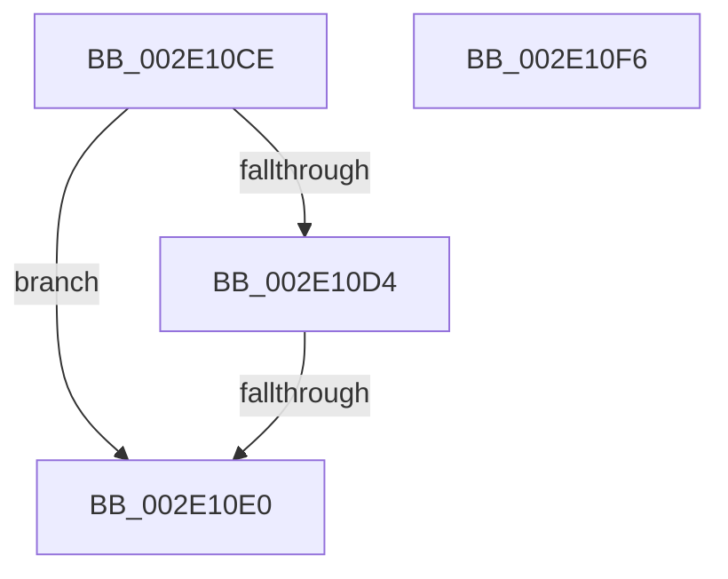

# sub_002E10CE

- RVA: `0x002E10CE`–`0x002E10F7` (길이 `41` bytes)
- VA: `0x00000001402E10CE`
- 실행 섹션: `.text`
- PDB 이름 있음: `아니요`; PDB Function 태그: `아니요`
- unwind 정보 RVA: `0x00070CA8`
- 디코드: `15`개 명령, `41/41` bytes 표시
- 미해석 바이트: `0` (있으면 어셈블리에 `.byte`로 보존)

> 이 문서는 커널 이미지의 기계어와 PDB 기호를 분석해 생성했습니다. 4번과 5번은 함수 원형과 자료형을 바이너리 사용 방식에서 추정한 C 해석이며 원본 소스 복구 결과는 아닙니다.

## 1. Dependencies

- 직접 호출 지점: **0**; 고유 호출 대상: **0**
- 직접 호출자로 확인된 함수: **0**
- RIP 상대 이미지 참조: **0**

### Outgoing calls
- 직접 디코드된 call 명령이 없습니다.

### Direct callers
- 이 함수 시작 RVA로 연결되는 직접 call은 확인되지 않았습니다. 간접 호출은 완전히 역산할 수 없습니다.

### Static image references
- 디코드된 RIP-relative 메모리 참조가 없습니다.

## 2. Other-region calls and transfers

- 다른 실행 섹션으로 향하는 call: **0**
- call이 아닌 외부 분기/꼬리 이동: **1**
  - `0x002E10DA` → [MiTrimSection + 0x65](MiTrimSection_function_002E0810.md) (`tail-transfer`)

## 3. Assembly (complete function range)

```asm
002E10CE  4D 39 45 40                     cmp qword ptr [r13 + 0x40], r8
002E10D2  74 0C                           je 0x1402e10e0
002E10D4  41 8B 45 38                     mov eax, dword ptr [r13 + 0x38]
002E10D8  A8 20                           test al, 0x20
002E10DA  0F 84 95 F7 FF FF               je 0x1402e0875
002E10E0  B8 88 00 00 C0                  mov eax, 0xc0000088
002E10E5  48 81 C4 B8 00 00 00            add rsp, 0xb8
002E10EC  41 5F                           pop r15
002E10EE  41 5D                           pop r13
002E10F0  41 5C                           pop r12
002E10F2  5F                              pop rdi
002E10F3  5E                              pop rsi
002E10F4  5B                              pop rbx
002E10F5  C3                              ret
002E10F6  CC                              int3
```

## 4. C-style interpretation (structured pseudocode)

```c
__int64 __fastcall sub_002E10CE(__int64 a1, __int64 a2, __int64 a3)
{
    __int64 v_rsp;

    if ((*(unsigned __int64 *)(v_r13 + 64)) == a3) goto loc_002E10E0;
loc_002E10E0:
    v_rsp = (v_rsp) + (184);
    return (unsigned int)(0xC0000088ULL);
}
```

## 5. (Beta) C Style

```c
int64_t sub_002E10CE(int64_t Arg1, int64_t Arg2, int64_t Arg3)
{
    int64_t local_rsp;

    if ((*(uint64_t *)(local_r13 + 0x40)) == Arg3) goto loc_002E10E0;
loc_002E10E0:
    local_rsp = (local_rsp) + (184);
    return (uint32_t)(0xC0000088ULL);
}
```

## 6. Execution-region graph

[열기: 2D/3D 그래프와 함수 탐색 컨트롤 패널](../../../control-panel.html?section=text&rva=0x002E10CE&view=graph)

- 2D 그래프는 위에서 아래로 흐르고, 3D 그래프는 빈 공간을 드래그해 회전합니다. Shift+드래그는 이동, 휠은 확대·축소, 함수 노드 선택은 대상 보고서 이동입니다.

### Static fallback


