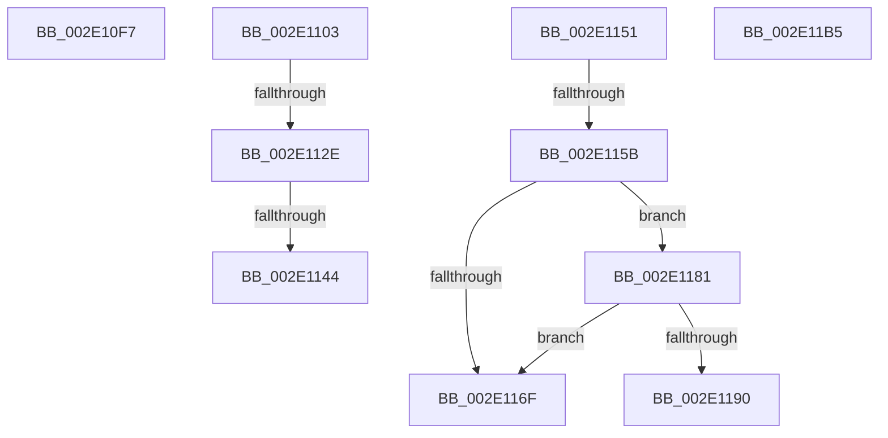

# sub_002E10F7

- RVA: `0x002E10F7`–`0x002E11E8` (길이 `241` bytes)
- VA: `0x00000001402E10F7`
- 실행 섹션: `.text`
- PDB 이름 있음: `아니요`; PDB Function 태그: `아니요`
- unwind 정보 RVA: `0x00070CBC`
- 디코드: `53`개 명령, `241/241` bytes 표시
- 미해석 바이트: `0` (있으면 어셈블리에 `.byte`로 보존)

> 이 문서는 커널 이미지의 기계어와 PDB 기호를 분석해 생성했습니다. 4번과 5번은 함수 원형과 자료형을 바이너리 사용 방식에서 추정한 C 해석이며 원본 소스 복구 결과는 아닙니다.

## 1. Dependencies

- 직접 호출 지점: **9**; 고유 호출 대상: **7**
- 직접 호출자로 확인된 함수: **0**
- RIP 상대 이미지 참조: **2**

### Outgoing calls
- `0x002E1106` → [MiGetSubsectionHoldingCrossPartitionReferences](../45/MiGetSubsectionHoldingCrossPartitionReferences_function_004589E4.md) (function, `0x004589E4`)
- `0x002E1111` → [MiGetSubsectionHoldingCrossPartitionReferences](../45/MiGetSubsectionHoldingCrossPartitionReferences_function_004589E4.md) (function, `0x004589E4`)
- `0x002E1135` → [MiUpdateSubsectionCrossPartitionRefs](../4F/MiUpdateSubsectionCrossPartitionRefs_function_004FB5DC.md) (function, `0x004FB5DC`)
- `0x002E1144` → [MiComputeCrossPartitionSectionCharges](../32/MiComputeCrossPartitionSectionCharges_function_00325BBC.md) (function, `0x00325BBC`)
- `0x002E115F` → [ExAcquireSpinLockExclusive](../24/ExAcquireSpinLockExclusive_function_00248690.md) (function, `0x00248690`)
- `0x002E1177` → [MiReleaseSpinLockExclusive](../24/MiReleaseSpinLockExclusive_function_002482C0.md) (function, `0x002482C0`)
- `0x002E1186` → [MiReferenceSubsection](../24/MiReferenceSubsection_function_00249200.md) (function, `0x00249200`)
- `0x002E11A3` → [MiReleaseSpinLockExclusive](../24/MiReleaseSpinLockExclusive_function_002482C0.md) (function, `0x002482C0`)
- `0x002E11DE` → [MiReturnCrossPartitionSectionCharges](../4B/MiReturnCrossPartitionSectionCharges_function_004BA61C.md) (function, `0x004BA61C`)

### Direct callers
- 이 함수 시작 RVA로 연결되는 직접 call은 확인되지 않았습니다. 간접 호출은 완전히 역산할 수 없습니다.

### Static image references
- `0x002E10F7` → RVA `0x00E38D00` (`.data`; read)
- `0x002E11BA` → RVA `0x00E30088` (`.data`; read)

## 2. Other-region calls and transfers

- 다른 실행 섹션으로 향하는 call: **0**
- call이 아닌 외부 분기/꼬리 이동: **8**
  - `0x002E10FE` → [sub_002E0B15 + 0x365](Unknown_function_002E0B15.md) (`tail-transfer`)
  - `0x002E1128` → [sub_002E0B15 + 0x36E](Unknown_function_002E0B15.md) (`tail-transfer`)
  - `0x002E113E` → [sub_002E0B15 + 0x36E](Unknown_function_002E0B15.md) (`tail-transfer`)
  - `0x002E114C` → [sub_002E0B15 + 0x36E](Unknown_function_002E0B15.md) (`tail-transfer`)
  - `0x002E1155` → [sub_002E0B15 + 0xD1](Unknown_function_002E0B15.md) (`tail-transfer`)
  - `0x002E117C` → [sub_002E0B15 + 0x282](Unknown_function_002E0B15.md) (`tail-transfer`)
  - `0x002E11B0` → [sub_002E0B15 + 0xD1](Unknown_function_002E0B15.md) (`tail-transfer`)
  - `0x002E11E3` → [sub_002E0B15 + 0x278](Unknown_function_002E0B15.md) (`tail-transfer`)

## 3. Assembly (complete function range)

```asm
002E10F7  48 8D 05 02 7C B5 00            lea rax, [rip + 0xb57c02]
002E10FE  E9 77 FD FF FF                  jmp 0x1402e0e7a
002E1103  48 8B CF                        mov rcx, rdi
002E1106  E8 D9 78 17 00                  call 0x1404589e4
002E110B  48 8B C8                        mov rcx, rax
002E110E  4C 8B D0                        mov r10, rax
002E1111  E8 CE 78 17 00                  call 0x1404589e4
002E1116  44 8B 48 30                     mov r9d, dword ptr [rax + 0x30]
002E111A  41 81 E1 FF FF FF 3F            and r9d, 0x3fffffff
002E1121  41 81 F9 FF FF FF 3F            cmp r9d, 0x3fffffff
002E1128  0F 84 55 FD FF FF               je 0x1402e0e83
002E112E  41 8D 51 FF                     lea edx, [r9 - 1]
002E1132  49 8B CA                        mov rcx, r10
002E1135  E8 A2 A4 21 00                  call 0x1404fb5dc
002E113A  41 83 F9 01                     cmp r9d, 1
002E113E  0F 85 3F FD FF FF               jne 0x1402e0e83
002E1144  E8 73 4A 04 00                  call 0x140325bbc
002E1149  4C 8B D8                        mov r11, rax
002E114C  E9 32 FD FF FF                  jmp 0x1402e0e83
002E1151  4C 3B 60 20                     cmp r12, qword ptr [rax + 0x20]
002E1155  0F 84 8B FA FF FF               je 0x1402e0be6
002E115B  49 8D 4D 48                     lea rcx, [r13 + 0x48]
002E115F  E8 2C 75 F6 FF                  call 0x140248690
002E1164  41 83 7C 24 68 00               cmp dword ptr [r12 + 0x68], 0
002E116A  0F B6 F8                        movzx edi, al
002E116D  75 12                           jne 0x1402e1181
002E116F  40 0F B6 D7                     movzx edx, dil
002E1173  49 8D 4D 48                     lea rcx, [r13 + 0x48]
002E1177  E8 44 71 F6 FF                  call 0x1402482c0
002E117C  E9 16 FC FF FF                  jmp 0x1402e0d97
002E1181  33 D2                           xor edx, edx
002E1183  49 8B CC                        mov rcx, r12
002E1186  E8 75 80 F6 FF                  call 0x140249200
002E118B  83 F8 01                        cmp eax, 1
002E118E  7E DF                           jle 0x1402e116f
002E1190  40 0F B6 D7                     movzx edx, dil
002E1194  C7 84 24 08 01 00 00 02 00 00 00  mov dword ptr [rsp + 0x108], 2
002E119F  49 8D 4D 48                     lea rcx, [r13 + 0x48]
002E11A3  E8 18 71 F6 FF                  call 0x1402482c0
002E11A8  48 8B 84 24 F0 00 00 00         mov rax, qword ptr [rsp + 0xf0]
002E11B0  E9 31 FA FF FF                  jmp 0x1402e0be6
002E11B5  4C 8B 44 24 78                  mov r8, qword ptr [rsp + 0x78]
002E11BA  48 8B 05 C7 EE B4 00            mov rax, qword ptr [rip + 0xb4eec7]
002E11C1  41 0F B7 48 3C                  movzx ecx, word ptr [r8 + 0x3c]
002E11C6  81 E1 FF 03 00 00               and ecx, 0x3ff
002E11CC  48 8B 0C C8                     mov rcx, qword ptr [rax + rcx*8]
002E11D0  33 C0                           xor eax, eax
002E11D2  49 39 40 40                     cmp qword ptr [r8 + 0x40], rax
002E11D6  8B D0                           mov edx, eax
002E11D8  4D 8B C5                        mov r8, r13
002E11DB  0F 95 C2                        setne dl
002E11DE  E8 39 94 1D 00                  call 0x1404ba61c
002E11E3  E9 A5 FB FF FF                  jmp 0x1402e0d8d
```

## 4. C-style interpretation (structured pseudocode)

```c
__int64 __fastcall sub_002E10F7(void)
{
    unsigned int v_stack_p108;
    unsigned __int64 v_stack_p78;
    unsigned __int64 v_stack_pF0;
}
```

## 5. (Beta) C Style

```c
void sub_002E10F7(void)
{
    uint32_t v_stack_p108;
    uint64_t v_stack_p78;
    uint64_t v_stack_pF0;
}
```

## 6. Execution-region graph

[열기: 2D/3D 그래프와 함수 탐색 컨트롤 패널](../../../control-panel.html?section=text&rva=0x002E10F7&view=graph)

- 2D 그래프는 위에서 아래로 흐르고, 3D 그래프는 빈 공간을 드래그해 회전합니다. Shift+드래그는 이동, 휠은 확대·축소, 함수 노드 선택은 대상 보고서 이동입니다.

### Static fallback


