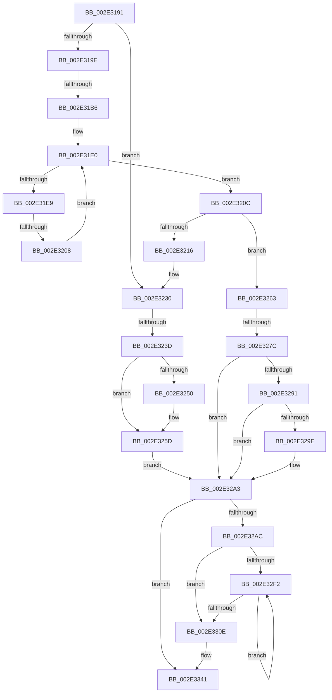

# sub_002E3191

- RVA: `0x002E3191`–`0x002E3357` (길이 `454` bytes)
- VA: `0x00000001402E3191`
- 실행 섹션: `.text`
- PDB 이름 있음: `아니요`; PDB Function 태그: `아니요`
- unwind 정보 RVA: `0x00070DCC`
- 디코드: `119`개 명령, `454/454` bytes 표시
- 미해석 바이트: `0` (있으면 어셈블리에 `.byte`로 보존)

> 이 문서는 커널 이미지의 기계어와 PDB 기호를 분석해 생성했습니다. 4번과 5번은 함수 원형과 자료형을 바이너리 사용 방식에서 추정한 C 해석이며 원본 소스 복구 결과는 아닙니다.

## 1. Dependencies

- 직접 호출 지점: **5**; 고유 호출 대상: **5**
- 직접 호출자로 확인된 함수: **0**
- RIP 상대 이미지 참조: **4**

### Outgoing calls
- `0x002E322A` → [KeBugCheckEx](../4F/KeBugCheckEx_function_004FD660.md) (function, `0x004FD660`)
- `0x002E3258` → [KiLowerIrqlProcessIrqlFlags](../4F/KiLowerIrqlProcessIrqlFlags_function_004F5698.md) (function, `0x004F5698`)
- `0x002E329E` → [KiCheckForKernelApcDelivery](KiCheckForKernelApcDelivery_function_002E2C80.md) (function, `0x002E2C80`)
- `0x002E32D1` → [RtlCSparseBitmapBitsClear](RtlCSparseBitmapBitsClear_function_002E34C4.md) (function, `0x002E34C4`)
- `0x002E3317` → [RtlpHpSegMgrRelease](RtlpHpSegMgrRelease_function_002E37FC.md) (function, `0x002E37FC`)

### Direct callers
- 이 함수 시작 RVA로 연결되는 직접 call은 확인되지 않았습니다. 간접 호출은 완전히 역산할 수 없습니다.

### Static image references
- `0x002E3230` → RVA `0x00FC6B06` (`ALMOSTRO`; read)
- `0x002E3241` → RVA `0x00FC6D20` (`ALMOSTRO`; read)
- `0x002E32AF` → RVA `0x00E68610` (`.data`; read)
- `0x002E32BC` → RVA `0x00E68608` (`.data`; read)

## 2. Other-region calls and transfers

- 다른 실행 섹션으로 향하는 call: **0**
- call이 아닌 외부 분기/꼬리 이동: **4**
  - `0x002E31B0` → [sub_002E3422](Unknown_function_002E3422.md) (`tail-transfer`)
  - `0x002E3202` → [sub_002E33E2](Unknown_function_002E33E2.md) (`tail-transfer`)
  - `0x002E3237` → [sub_002E3438](Unknown_function_002E3438.md) (`tail-transfer`)
  - `0x002E3276` → [sub_002E3461](Unknown_function_002E3461.md) (`tail-transfer`)

## 3. Assembly (complete function range)

```asm
002E3191  4C 89 7C 24 60                  mov qword ptr [rsp + 0x60], r15
002E3196  A8 01                           test al, 1
002E3198  0F 85 92 00 00 00               jne 0x1402e3230
002E319E  48 C7 C0 FF FF FF FF            mov rax, 0xffffffffffffffff
002E31A5  F0 48 0F C1 47 40               lock xadd qword ptr [rdi + 0x40], rax
002E31AB  24 06                           and al, 6
002E31AD  40 3A C5                        cmp al, bpl
002E31B0  0F 84 6C 02 00 00               je 0x1402e3422
002E31B6  65 4C 8B 1C 25 88 01 00 00      mov r11, qword ptr gs:[0x188]
002E31BF  FA                              cli
002E31C0  4D 8B 83 70 04 00 00            mov r8, qword ptr [r11 + 0x470]
002E31C7  4C 8D 57 40                     lea r10, [rdi + 0x40]
002E31CB  49 BF FC FF FF FF FF FF FF 7F   movabs r15, 0x7ffffffffffffffc
002E31D5  41 8B D4                        mov edx, r12d
002E31D8  4D 23 D7                        and r10, r15
002E31DB  0F 1F 44 00 00                  nop dword ptr [rax + rax]
002E31E0  41 0F B6 40 0C                  movzx eax, byte ptr [r8 + 0xc]
002E31E5  3B D0                           cmp edx, eax
002E31E7  73 23                           jae 0x1402e320c
002E31E9  8B C2                           mov eax, edx
002E31EB  48 6B C8 58                     imul rcx, rax, 0x58
002E31EF  48 83 C1 10                     add rcx, 0x10
002E31F3  49 03 C8                        add rcx, r8
002E31F6  4C 8B 09                        mov r9, qword ptr [rcx]
002E31F9  49 8B C1                        mov rax, r9
002E31FC  49 23 C7                        and rax, r15
002E31FF  49 3B C2                        cmp rax, r10
002E3202  0F 84 DA 01 00 00               je 0x1402e33e2
002E3208  FF C2                           inc edx
002E320A  EB D4                           jmp 0x1402e31e0
002E320C  41 8B 43 78                     mov eax, dword ptr [r11 + 0x78]
002E3210  0F BA E0 10                     bt eax, 0x10
002E3214  72 4D                           jb 0x1402e3263
002E3216  45 33 C9                        xor r9d, r9d
002E3219  4C 89 64 24 20                  mov qword ptr [rsp + 0x20], r12
002E321E  4C 8D 47 40                     lea r8, [rdi + 0x40]
002E3222  49 8B D3                        mov rdx, r11
002E3225  B9 62 01 00 00                  mov ecx, 0x162
002E322A  E8 31 A4 21 00                  call 0x1404fd660
002E322F  CC                              int3
002E3230  F6 05 CF 38 CE 00 01            test byte ptr [rip + 0xce38cf], 1
002E3237  0F 85 FB 01 00 00               jne 0x1402e3438
002E323D  44 89 67 40                     mov dword ptr [rdi + 0x40], r12d
002E3241  44 39 25 D8 3A CE 00            cmp dword ptr [rip + 0xce3ad8], r12d
002E3248  44 0F B6 74 24 70               movzx r14d, byte ptr [rsp + 0x70]
002E324E  74 0D                           je 0x1402e325d
002E3250  44 0F 20 C1                     mov rcx, cr8
002E3254  41 0F B6 D6                     movzx edx, r14b
002E3258  E8 3B 24 21 00                  call 0x1404f5698
002E325D  45 0F 22 C6                     mov cr8, r14
002E3261  EB 40                           jmp 0x1402e32a3
002E3263  65 48 8B 0C 25 20 00 00 00      mov rcx, qword ptr gs:[0x20]
002E326C  4C 8B 81 B8 8E 00 00            mov r8, qword ptr [rcx + 0x8eb8]
002E3273  4D 85 C0                        test r8, r8
002E3276  0F 85 E5 01 00 00               jne 0x1402e3461
002E327C  FB                              sti
002E327D  65 48 8B 0C 25 88 01 00 00      mov rcx, qword ptr gs:[0x188]
002E3286  90                              nop
002E3287  66 83 81 E6 01 00 00 01         add word ptr [rcx + 0x1e6], 1
002E328F  75 12                           jne 0x1402e32a3
002E3291  48 8D 81 98 00 00 00            lea rax, [rcx + 0x98]
002E3298  90                              nop
002E3299  48 39 00                        cmp qword ptr [rax], rax
002E329C  74 05                           je 0x1402e32a3
002E329E  E8 DD F9 FF FF                  call 0x1402e2c80
002E32A3  48 85 DB                        test rbx, rbx
002E32A6  0F 84 95 00 00 00               je 0x1402e3341
002E32AC  44 8B 07                        mov r8d, dword ptr [rdi]
002E32AF  48 8D 0D 5A 53 B8 00            lea rcx, [rip + 0xb8535a]
002E32B6  41 F7 D8                        neg r8d
002E32B9  48 8B D3                        mov rdx, rbx
002E32BC  48 2B 15 45 53 B8 00            sub rdx, qword ptr [rip + 0xb85345]
002E32C3  48 C1 EA 14                     shr rdx, 0x14
002E32C7  49 C1 E8 14                     shr r8, 0x14
002E32CB  48 03 D2                        add rdx, rdx
002E32CE  4D 03 C0                        add r8, r8
002E32D1  E8 EE 01 00 00                  call 0x1402e34c4
002E32D6  0F B6 47 0A                     movzx eax, byte ptr [rdi + 0xa]
002E32DA  48 2B F0                        sub rsi, rax
002E32DD  8B D0                           mov edx, eax
002E32DF  48 C1 E2 05                     shl rdx, 5
002E32E3  48 03 D3                        add rdx, rbx
002E32E6  48 C1 E6 05                     shl rsi, 5
002E32EA  48 03 F2                        add rsi, rdx
002E32ED  48 3B D6                        cmp rdx, rsi
002E32F0  73 1C                           jae 0x1402e330e
002E32F2  8B 4A 1C                        mov ecx, dword ptr [rdx + 0x1c]
002E32F5  8B C1                           mov eax, ecx
002E32F7  48 C1 E9 18                     shr rcx, 0x18
002E32FB  48 C1 E1 05                     shl rcx, 5
002E32FF  F7 D0                           not eax
002E3301  0F B7 C0                        movzx eax, ax
002E3304  48 03 D1                        add rdx, rcx
002E3307  03 E8                           add ebp, eax
002E3309  48 3B D6                        cmp rdx, rsi
002E330C  72 E4                           jb 0x1402e32f2
002E330E  44 8B C5                        mov r8d, ebp
002E3311  48 8B D3                        mov rdx, rbx
002E3314  48 8B CF                        mov rcx, rdi
002E3317  E8 E0 04 00 00                  call 0x1402e37fc
002E331C  48 0F BF 47 16                  movsx rax, word ptr [rdi + 0x16]
002E3321  8B CD                           mov ecx, ebp
002E3323  48 F7 D9                        neg rcx
002E3326  F0 48 01 4C 38 08               lock add qword ptr [rax + rdi + 8], rcx
002E332C  8B 0F                           mov ecx, dword ptr [rdi]
002E332E  48 0F BF 47 16                  movsx rax, word ptr [rdi + 0x16]
002E3333  F7 D9                           neg ecx
002E3335  48 C1 E9 0C                     shr rcx, 0xc
002E3339  48 F7 D9                        neg rcx
002E333C  F0 48 01 0C 38                  lock add qword ptr [rax + rdi], rcx
002E3341  4C 8B 7C 24 60                  mov r15, qword ptr [rsp + 0x60]
002E3346  48 8B 5C 24 68                  mov rbx, qword ptr [rsp + 0x68]
002E334B  48 83 C4 30                     add rsp, 0x30
002E334F  41 5E                           pop r14
002E3351  41 5C                           pop r12
002E3353  5F                              pop rdi
002E3354  5E                              pop rsi
002E3355  5D                              pop rbp
002E3356  C3                              ret
```

## 4. C-style interpretation (structured pseudocode)

```c
__int64 __fastcall sub_002E3191(__int64 a1, __int64 a2, __int64 a3, __int64 a4, __int64 a5, __int64 a6, __int64 a7, __int64 a8, __int64 a9, __int64 a10, __int64 a11, __int64 a12, __int64 a13, unsigned __int8 a14)
{
    __int64 result;
    __int64 v_r10;
    __int64 v_rbp;
    __int64 v_rsi;
    __int64 v_rsp;
    unsigned __int64 v_stack_p20;
    unsigned __int64 v_stack_p60;

    v_stack_p60 = v_r15;
    if ((((unsigned __int8)(result)) & (1)) != 0) goto loc_002E3230;
    result = (unsigned __int8)((-1) & (6));
    v_r10 = (v_rdi + 64) & (v_r15);
loc_002E31E0:
    if (((unsigned int)((unsigned int)((unsigned int)(v_r12)))) >= ((unsigned int)(*(unsigned __int8 *)(*(unsigned __int64 *)(*(unsigned __int64 *)(gs_base + (0 + 392)) + 1136) + 12)))) goto loc_002E320C;
    a1 = (a1) * ((unsigned int)((unsigned int)((unsigned int)((unsigned int)(v_r12)))));
    a1 = (a1) + (16);
    a1 = (a1) + (*(unsigned __int64 *)(*(unsigned __int64 *)(gs_base + (0 + 392)) + 1136));
    result = (*(unsigned __int64 *)(a1)) & (v_r15);
    a2 = (unsigned int)(((unsigned int)((unsigned int)(v_r12))) + 1);
    goto loc_002E31E0;
loc_002E320C:
    if (result < v_r10) goto loc_002E3263;
    a4 = 0;
    v_stack_p20 = v_r12;
    result = KeBugCheckEx(354, *(unsigned __int64 *)(gs_base + (0 + 392)), v_rdi + 64, a4);
loc_002E3230:
    *(unsigned int *)(v_rdi + 64) = (unsigned int)(v_r12);
    if ((*(unsigned int *)(v_rip + 13515480)) != ((unsigned int)(v_r12))) {
        a1 = v_cr8;
        a2 = a14;
        result = KiLowerIrqlProcessIrqlFlags(a1, a2, v_rdi + 64, a4);
    }
    goto loc_002E32A3;
loc_002E3263:
    if (*(unsigned __int64 *)(*(unsigned __int64 *)(gs_base + (0 + 32)) + 36536) != 0) goto loc_002E32A3;
    result = *(unsigned __int64 *)(gs_base + (0 + 392)) + 152;
    if ((*(unsigned __int64 *)(*(unsigned __int64 *)(gs_base + (0 + 392)) + 152)) != (*(unsigned __int64 *)(gs_base + (0 + 392)) + 152)) {
        result = KiCheckForKernelApcDelivery(*(unsigned __int64 *)(gs_base + (0 + 392)), a2, *(unsigned __int64 *)(*(unsigned __int64 *)(gs_base + (0 + 32)) + 36536), a4);
    }
    if (v_rbx == 0) goto loc_002E3341;
    a3 = (unsigned int)(-((unsigned int)(*(unsigned int *)(v_rdi))));
    a2 = (v_rbx) - (*(unsigned __int64 *)(v_rip + 12079941));
    a2 = (a2) >> (20);
    a3 = (a3) >> (20);
    a2 = (a2) + (a2);
    a3 = (a3) + (a3);
    result = RtlCSparseBitmapBitsClear(v_rip + 12079962, a2, a3, a4);
    v_rsi = (v_rsi) - (*(unsigned __int8 *)(v_rdi + 10));
    a2 = ((unsigned int)((unsigned int)(*(unsigned __int8 *)(v_rdi + 10)))) << (5);
    a2 = (a2) + (v_rbx);
    v_rsi = (v_rsi) << (5);
    v_rsi = (v_rsi) + (a2);
    if (a2 >= v_rsi) goto loc_002E330E;
loc_002E32F2:
    a1 = ((unsigned int)(*(unsigned int *)(a2 + 28))) >> (24);
    a1 = (a1) << (5);
    result = (unsigned int)(~((unsigned int)((unsigned int)((unsigned int)(*(unsigned int *)(a2 + 28))))));
    a2 = (a2) + (a1);
    v_rbp = (unsigned int)((v_rbp) + ((unsigned int)((unsigned __int16)(result))));
    if (a2 < v_rsi) goto loc_002E32F2;
loc_002E330E:
    result = RtlpHpSegMgrRelease(v_rdi, v_rbx, (unsigned int)((unsigned int)(v_rbp)), a4);
    a1 = -((unsigned int)((unsigned int)(v_rbp)));
    a1 = (unsigned int)(-((unsigned int)(*(unsigned int *)(v_rdi))));
    a1 = (a1) >> (12);
    a1 = -(a1);
loc_002E3341:
    v_rsp = (v_rsp) + (48);
    return (__int16)(*(unsigned __int16 *)(v_rdi + 22));
}
```

## 5. (Beta) C Style

```c
int64_t sub_002E3191(void *Arg1, int64_t Arg2, int64_t Arg3, int64_t Arg4, uint64_t Arg5, uint64_t Arg6, uint64_t Arg7, uint64_t Arg8, uint64_t Arg9, uint64_t Arg10, uint64_t Arg11, int64_t Arg12, int64_t Arg13, uint8_t Arg14)
{
    uint8_t *arg1 = (uint8_t *)Arg1;

    int64_t result;
    int64_t local_r10;
    int64_t local_rbp;
    int64_t local_rsi;
    int64_t local_rsp;
    uint64_t v_stack_p20;
    uint64_t v_stack_p60;

    v_stack_p60 = local_r15;
    if ((((uint8_t)(result)) & (1)) != 0) goto loc_002E3230;
    result = (uint8_t)((-1) & (6));
    local_r10 = (local_rdi + 64) & (local_r15);
loc_002E31E0:
    if (((uint32_t)((uint32_t)((uint32_t)(local_r12)))) >= ((uint32_t)(*(uint8_t *)(*(uint64_t *)(*(uint64_t *)(gs_base + (0 + 0x188)) + 0x470) + 0xC)))) goto loc_002E320C;
    Arg1 = (Arg1) * ((uint32_t)((uint32_t)((uint32_t)((uint32_t)(local_r12)))));
    Arg1 = (Arg1) + (16);
    Arg1 = (Arg1) + (*(uint64_t *)(*(uint64_t *)(gs_base + (0 + 0x188)) + 0x470));
    result = (*(uint64_t *)(arg1)) & (local_r15);
    Arg2 = (uint32_t)(((uint32_t)((uint32_t)(local_r12))) + 1);
    goto loc_002E31E0;
loc_002E320C:
    if (result < local_r10) goto loc_002E3263;
    Arg4 = 0;
    v_stack_p20 = local_r12;
    result = KeBugCheckEx(354, *(uint64_t *)(gs_base + (0 + 0x188)), local_rdi + 64, Arg4);
loc_002E3230:
    *(uint32_t *)(local_rdi + 0x40) = (uint32_t)(local_r12);
    if ((*(uint32_t *)(v_rip + 0xCE3AD8)) != ((uint32_t)(local_r12))) {
        Arg1 = v_cr8;
        Arg2 = Arg14;
        result = KiLowerIrqlProcessIrqlFlags(Arg1, Arg2, local_rdi + 64, Arg4);
    }
    goto loc_002E32A3;
loc_002E3263:
    if (*(uint64_t *)(*(uint64_t *)(gs_base + (0 + 0x20)) + 0x8EB8) != 0) goto loc_002E32A3;
    result = *(uint64_t *)(gs_base + (0 + 0x188)) + 152;
    if ((*(uint64_t *)(*(uint64_t *)(gs_base + (0 + 0x188)) + 0x98)) != (*(uint64_t *)(gs_base + (0 + 0x188)) + 152)) {
        result = KiCheckForKernelApcDelivery(*(uint64_t *)(gs_base + (0 + 0x188)), Arg2, *(uint64_t *)(*(uint64_t *)(gs_base + (0 + 0x20)) + 0x8EB8), Arg4);
    }
    if (local_rbx == 0) goto loc_002E3341;
    Arg3 = (uint32_t)(-((uint32_t)(*(uint32_t *)(local_rdi))));
    Arg2 = (local_rbx) - (*(uint64_t *)(v_rip + 0xB85345));
    Arg2 = (Arg2) >> (20);
    Arg3 = (Arg3) >> (20);
    Arg2 = (Arg2) + (Arg2);
    Arg3 = (Arg3) + (Arg3);
    result = RtlCSparseBitmapBitsClear(v_rip + 12079962, Arg2, Arg3, Arg4);
    local_rsi = (local_rsi) - (*(uint8_t *)(local_rdi + 0xA));
    Arg2 = ((uint32_t)((uint32_t)(*(uint8_t *)(local_rdi + 0xA)))) << (5);
    Arg2 = (Arg2) + (local_rbx);
    local_rsi = (local_rsi) << (5);
    local_rsi = (local_rsi) + (Arg2);
    if (Arg2 >= local_rsi) goto loc_002E330E;
loc_002E32F2:
    Arg1 = ((uint32_t)(*(uint32_t *)(Arg2 + 0x1C))) >> (24);
    Arg1 = (Arg1) << (5);
    result = (uint32_t)(~((uint32_t)((uint32_t)((uint32_t)(*(uint32_t *)(Arg2 + 0x1C))))));
    Arg2 = (Arg2) + (Arg1);
    local_rbp = (uint32_t)((local_rbp) + ((uint32_t)((uint16_t)(result))));
    if (Arg2 < local_rsi) goto loc_002E32F2;
loc_002E330E:
    result = RtlpHpSegMgrRelease(local_rdi, local_rbx, (uint32_t)((uint32_t)(local_rbp)), Arg4);
    Arg1 = -((uint32_t)((uint32_t)(local_rbp)));
    Arg1 = (uint32_t)(-((uint32_t)(*(uint32_t *)(local_rdi))));
    Arg1 = (Arg1) >> (12);
    Arg1 = -(Arg1);
loc_002E3341:
    local_rsp = (local_rsp) + (48);
    return (int16_t)(*(uint16_t *)(local_rdi + 0x16));
}
```

### 관측된 메모리 오프셋

구조체 형식이 확인되지 않은 접근은 인자 기준의 오프셋으로만 기록했습니다.

| 기준 인자 | 오프셋 표현 | 폭 (bit) | 접근 |
|---|---:|---:|---|
| `Arg1` | `+ 0x0` | `64` | `R` |

## 6. Execution-region graph

[열기: 2D/3D 그래프와 함수 탐색 컨트롤 패널](../../../control-panel.html?section=text&rva=0x002E3191&view=graph)

- 2D 그래프는 위에서 아래로 흐르고, 3D 그래프는 빈 공간을 드래그해 회전합니다. Shift+드래그는 이동, 휠은 확대·축소, 함수 노드 선택은 대상 보고서 이동입니다.

### Static fallback


