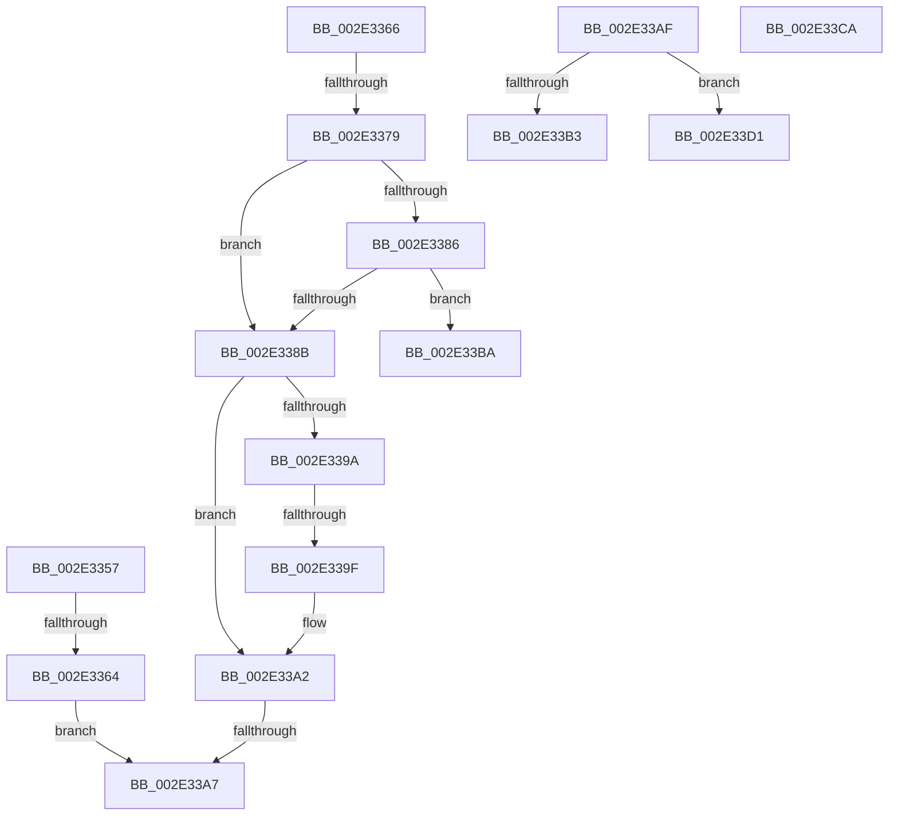

# sub_002E3357

- RVA: `0x002E3357`–`0x002E33E2` (길이 `139` bytes)
- VA: `0x00000001402E3357`
- 실행 섹션: `.text`
- PDB 이름 있음: `아니요`; PDB Function 태그: `아니요`
- unwind 정보 RVA: `0x00070DE4`
- 디코드: `42`개 명령, `139/139` bytes 표시
- 미해석 바이트: `0` (있으면 어셈블리에 `.byte`로 보존)

> 이 문서는 커널 이미지의 기계어와 PDB 기호를 분석해 생성했습니다. 4번과 5번은 함수 원형과 자료형을 바이너리 사용 방식에서 추정한 C 해석이며 원본 소스 복구 결과는 아닙니다.

## 1. Dependencies

- 직접 호출 지점: **0**; 고유 호출 대상: **0**
- 직접 호출자로 확인된 함수: **0**
- RIP 상대 이미지 참조: **0**

### Outgoing calls
- 직접 디코드된 call 명령이 없습니다.

### Direct callers
- 이 함수 시작 RVA로 연결되는 직접 call은 확인되지 않았습니다. 간접 호출은 완전히 역산할 수 없습니다.

### Static image references
- 디코드된 RIP-relative 메모리 참조가 없습니다.

## 2. Other-region calls and transfers

- 다른 실행 섹션으로 향하는 call: **0**
- call이 아닌 외부 분기/꼬리 이동: **9**
  - `0x002E335E` → [RtlpHpSegPageRangeShrink + 0x1C6](RtlpHpSegPageRangeShrink_function_002E2FA0.md) (`tail-transfer`)
  - `0x002E3373` → [RtlpHpSegPageRangeShrink + 0x1EE](RtlpHpSegPageRangeShrink_function_002E2FA0.md) (`tail-transfer`)
  - `0x002E339D` → [sub_002E3416 + 0x5](Unknown_function_002E3416.md) (`tail-transfer`)
  - `0x002E33A5` → [sub_002E3416 + 0x5](Unknown_function_002E3416.md) (`tail-transfer`)
  - `0x002E33AA` → [RtlpHpSegPageRangeShrink + 0x1A7](RtlpHpSegPageRangeShrink_function_002E2FA0.md) (`tail-transfer`)
  - `0x002E33B5` → [RtlpHpSegPageRangeShrink + 0x178](RtlpHpSegPageRangeShrink_function_002E2FA0.md) (`tail-transfer`)
  - `0x002E33C5` → [RtlpHpSegPageRangeShrink + 0x1EE](RtlpHpSegPageRangeShrink_function_002E2FA0.md) (`tail-transfer`)
  - `0x002E33CC` → [RtlpHpSegPageRangeShrink + 0x178](RtlpHpSegPageRangeShrink_function_002E2FA0.md) (`tail-transfer`)
  - `0x002E33DD` → [RtlpHpSegPageRangeShrink + 0x178](RtlpHpSegPageRangeShrink_function_002E2FA0.md) (`tail-transfer`)

## 3. Assembly (complete function range)

```asm
002E3357  CC                              int3
002E3358  48 33 CA                        xor rcx, rdx
002E335B  48 85 C9                        test rcx, rcx
002E335E  0F 84 02 FE FF FF               je 0x1402e3166
002E3364  EB 41                           jmp 0x1402e33a7
002E3366  48 8B 1F                        mov rbx, qword ptr [rdi]
002E3369  49 23 DE                        and rbx, r14
002E336C  41 C7 06 FF CC DD CC            mov dword ptr [r14], 0xccddccff
002E3373  0F 84 15 FE FF FF               je 0x1402e318e
002E3379  48 8B 0B                        mov rcx, qword ptr [rbx]
002E337C  48 8B 43 08                     mov rax, qword ptr [rbx + 8]
002E3380  48 39 59 08                     cmp qword ptr [rcx + 8], rbx
002E3384  75 05                           jne 0x1402e338b
002E3386  48 39 18                        cmp qword ptr [rax], rbx
002E3389  74 2F                           je 0x1402e33ba
002E338B  B9 03 00 00 00                  mov ecx, 3
002E3390  CD 29                           int 0x29
002E3392  48 8B 0A                        mov rcx, qword ptr [rdx]
002E3395  45 85 C0                        test r8d, r8d
002E3398  74 08                           je 0x1402e33a2
002E339A  48 85 C9                        test rcx, rcx
002E339D  74 7C                           je 0x1402e341b
002E339F  48 33 CA                        xor rcx, rdx
002E33A2  48 85 C9                        test rcx, rcx
002E33A5  74 74                           je 0x1402e341b
002E33A7  48 8B D1                        mov rdx, rcx
002E33AA  E9 98 FD FF FF                  jmp 0x1402e3147
002E33AF  85 C0                           test eax, eax
002E33B1  74 1E                           je 0x1402e33d1
002E33B3  8B D5                           mov edx, ebp
002E33B5  E9 5E FD FF FF                  jmp 0x1402e3118
002E33BA  48 89 08                        mov qword ptr [rax], rcx
002E33BD  48 89 41 08                     mov qword ptr [rcx + 8], rax
002E33C1  48 FF 4F 58                     dec qword ptr [rdi + 0x58]
002E33C5  E9 C4 FD FF FF                  jmp 0x1402e318e
002E33CA  B2 04                           mov dl, 4
002E33CC  E9 47 FD FF FF                  jmp 0x1402e3118
002E33D1  45 85 D2                        test r10d, r10d
002E33D4  41 8B D4                        mov edx, r12d
002E33D7  0F 94 C2                        sete dl
002E33DA  83 C2 03                        add edx, 3
002E33DD  E9 36 FD FF FF                  jmp 0x1402e3118
```

## 4. C-style interpretation (structured pseudocode)

```c
__int64 __fastcall sub_002E3357(__int64 a1, __int64 a2, int a3)
{
    a1 = (a1) ^ (a2);
    goto loc_002E33A7;
loc_002E33A7:
}
```

## 5. (Beta) C Style

```c
int64_t sub_002E3357(int64_t Arg1, int64_t Arg2, int32_t Arg3)
{
    Arg1 = (Arg1) ^ (Arg2);
    goto loc_002E33A7;
loc_002E33A7:
}
```

## 6. Execution-region graph

[열기: 2D/3D 그래프와 함수 탐색 컨트롤 패널](../../../control-panel.html?section=text&rva=0x002E3357&view=graph)

- 2D 그래프는 위에서 아래로 흐르고, 3D 그래프는 빈 공간을 드래그해 회전합니다. Shift+드래그는 이동, 휠은 확대·축소, 함수 노드 선택은 대상 보고서 이동입니다.

### Static fallback


