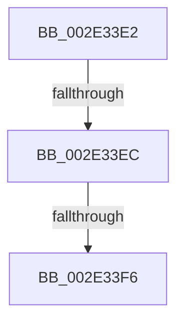

# sub_002E33E2

- RVA: `0x002E33E2`–`0x002E3416` (길이 `52` bytes)
- VA: `0x00000001402E33E2`
- 실행 섹션: `.text`
- PDB 이름 있음: `아니요`; PDB Function 태그: `아니요`
- unwind 정보 RVA: `0x00070DF4`
- 디코드: `11`개 명령, `52/52` bytes 표시
- 미해석 바이트: `0` (있으면 어셈블리에 `.byte`로 보존)

> 이 문서는 커널 이미지의 기계어와 PDB 기호를 분석해 생성했습니다. 4번과 5번은 함수 원형과 자료형을 바이너리 사용 방식에서 추정한 C 해석이며 원본 소스 복구 결과는 아닙니다.

## 1. Dependencies

- 직접 호출 지점: **1**; 고유 호출 대상: **1**
- 직접 호출자로 확인된 함수: **0**
- RIP 상대 이미지 참조: **0**

### Outgoing calls
- `0x002E340C` → [KiAbEntryFreeAndEnableInterrupts](../26/KiAbEntryFreeAndEnableInterrupts_function_002622D0.md) (function, `0x002622D0`)

### Direct callers
- 이 함수 시작 RVA로 연결되는 직접 call은 확인되지 않았습니다. 간접 호출은 완전히 역산할 수 없습니다.

### Static image references
- 디코드된 RIP-relative 메모리 참조가 없습니다.

## 2. Other-region calls and transfers

- 다른 실행 섹션으로 향하는 call: **0**
- call이 아닌 외부 분기/꼬리 이동: **3**
  - `0x002E33E6` → [sub_002E3191 + 0x77](Unknown_function_002E3191.md) (`tail-transfer`)
  - `0x002E33F0` → [sub_002E3191 + 0x77](Unknown_function_002E3191.md) (`tail-transfer`)
  - `0x002E3411` → [sub_002E3191 + 0xEC](Unknown_function_002E3191.md) (`tail-transfer`)

## 3. Assembly (complete function range)

```asm
002E33E2  44 38 61 0A                     cmp byte ptr [rcx + 0xa], r12b
002E33E6  0F 84 1C FE FF FF               je 0x1402e3208
002E33EC  41 F6 C1 01                     test r9b, 1
002E33F0  0F 85 12 FE FF FF               jne 0x1402e3208
002E33F6  41 B9 01 00 00 00               mov r9d, 1
002E33FC  44 88 61 0A                     mov byte ptr [rcx + 0xa], r12b
002E3400  4C 8D 47 40                     lea r8, [rdi + 0x40]
002E3404  4C 89 64 24 20                  mov qword ptr [rsp + 0x20], r12
002E3409  49 8B D3                        mov rdx, r11
002E340C  E8 BF EE F7 FF                  call 0x1402622d0
002E3411  E9 67 FE FF FF                  jmp 0x1402e327d
```

## 4. C-style interpretation (structured pseudocode)

```c
__int64 __fastcall sub_002E33E2(__int64 a1, __int64 a2, __int64 a3, unsigned __int8 a4)
{
    __int64 result;
    unsigned __int64 v_stack_p20;

    *(unsigned __int8 *)(a1 + 10) = (unsigned __int8)(v_r12);
    v_stack_p20 = v_r12;
    result = KiAbEntryFreeAndEnableInterrupts(a1, v_r11, v_rdi + 64, 1);
}
```

## 5. (Beta) C Style

```c
int64_t sub_002E33E2(void *Arg1, int64_t Arg2, int64_t Arg3, uint8_t Arg4)
{
    uint8_t *arg1 = (uint8_t *)Arg1;

    int64_t result;
    uint64_t v_stack_p20;

    *(uint8_t *)(arg1 + 0xA) = (uint8_t)(local_r12);
    v_stack_p20 = local_r12;
    result = KiAbEntryFreeAndEnableInterrupts(Arg1, local_r11, local_rdi + 64, 1);
}
```

### 관측된 메모리 오프셋

구조체 형식이 확인되지 않은 접근은 인자 기준의 오프셋으로만 기록했습니다.

| 기준 인자 | 오프셋 표현 | 폭 (bit) | 접근 |
|---|---:|---:|---|
| `Arg1` | `+ 0xA` | `8` | `R` |
| `Arg1` | `+ 0xA` | `8` | `W` |

## 6. Execution-region graph

[열기: 2D/3D 그래프와 함수 탐색 컨트롤 패널](../../../control-panel.html?section=text&rva=0x002E33E2&view=graph)

- 2D 그래프는 위에서 아래로 흐르고, 3D 그래프는 빈 공간을 드래그해 회전합니다. Shift+드래그는 이동, 휠은 확대·축소, 함수 노드 선택은 대상 보고서 이동입니다.

### Static fallback


