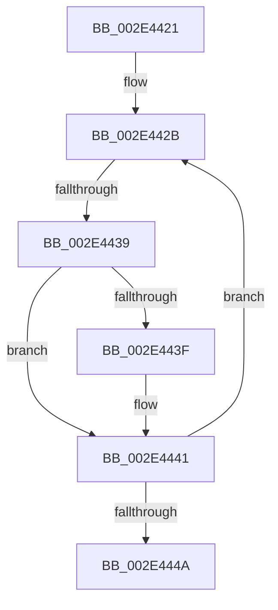

# sub_002E4421

- RVA: `0x002E4421`–`0x002E444F` (길이 `46` bytes)
- VA: `0x00000001402E4421`
- 실행 섹션: `.text`
- PDB 이름 있음: `아니요`; PDB Function 태그: `아니요`
- unwind 정보 RVA: `0x00070F08`
- 디코드: `12`개 명령, `46/46` bytes 표시
- 미해석 바이트: `0` (있으면 어셈블리에 `.byte`로 보존)

> 이 문서는 커널 이미지의 기계어와 PDB 기호를 분석해 생성했습니다. 4번과 5번은 함수 원형과 자료형을 바이너리 사용 방식에서 추정한 C 해석이며 원본 소스 복구 결과는 아닙니다.

## 1. Dependencies

- 직접 호출 지점: **0**; 고유 호출 대상: **0**
- 직접 호출자로 확인된 함수: **0**
- RIP 상대 이미지 참조: **0**

### Outgoing calls
- 직접 디코드된 call 명령이 없습니다.

### Direct callers
- 이 함수 시작 RVA로 연결되는 직접 call은 확인되지 않았습니다. 간접 호출은 완전히 역산할 수 없습니다.

### Static image references
- 디코드된 RIP-relative 메모리 참조가 없습니다.

## 2. Other-region calls and transfers

- 다른 실행 섹션으로 향하는 call: **0**
- call이 아닌 외부 분기/꼬리 이동: **1**
  - `0x002E4433` → [sub_002E4553](Unknown_function_002E4553.md) (`tail-transfer`)

## 3. Assembly (complete function range)

```asm
002E4421  48 89 74 24 30                  mov qword ptr [rsp + 0x30], rsi
002E4426  BE FF 07 00 00                  mov esi, 0x7ff
002E442B  44 0F B7 01                     movzx r8d, word ptr [rcx]
002E442F  66 44 85 C6                     test si, r8w
002E4433  0F 84 1A 01 00 00               je 0x1402e4553
002E4439  66 45 85 C0                     test r8w, r8w
002E443D  79 02                           jns 0x1402e4441
002E443F  FF C0                           inc eax
002E4441  48 83 C1 02                     add rcx, 2
002E4445  49 3B C9                        cmp rcx, r9
002E4448  76 E1                           jbe 0x1402e442b
002E444A  48 8B 74 24 30                  mov rsi, qword ptr [rsp + 0x30]
```

## 4. C-style interpretation (structured pseudocode)

```c
__int64 __fastcall sub_002E4421(__int64 a1, __int64 a2, __int64 a3, __int64 a4, __int64 a5, __int64 a6)
{
    __int64 result;
    unsigned __int64 v_stack_p30;

    v_stack_p30 = v_rsi;
loc_002E442B:
    if (sign_flag) {
        result = (unsigned int)((result) + 1);
    }
    a1 = (a1) + (2);
    if (a1 <= a4) goto loc_002E442B;
    return result;
}
```

## 5. (Beta) C Style

```c
int64_t sub_002E4421(int64_t Arg1, int64_t Arg2, int64_t Arg3, int64_t Arg4, uint64_t Arg5, int64_t Arg6)
{
    int64_t result;
    uint64_t v_stack_p30;

    v_stack_p30 = local_rsi;
loc_002E442B:
    if (sign_flag) {
        result = (uint32_t)((result) + 1);
    }
    Arg1 = (Arg1) + (2);
    if (Arg1 <= Arg4) goto loc_002E442B;
    return result;
}
```

## 6. Execution-region graph

[열기: 2D/3D 그래프와 함수 탐색 컨트롤 패널](../../../control-panel.html?section=text&rva=0x002E4421&view=graph)

- 2D 그래프는 위에서 아래로 흐르고, 3D 그래프는 빈 공간을 드래그해 회전합니다. Shift+드래그는 이동, 휠은 확대·축소, 함수 노드 선택은 대상 보고서 이동입니다.

### Static fallback


